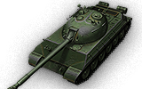
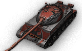
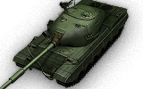
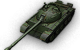
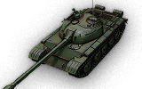
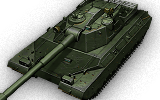
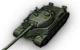
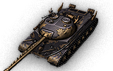
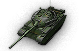

# China · Tier X

[All nations and tiers](../buffs_nerfs.md) · EU v20410 → RU v14600ru · 3 November 2026

<label><strong>Find a tank</strong><input type="search" placeholder="Try is7, obj140 or xm57" aria-label="Find a tank" style="display:block;width:100%;padding:.7rem;border:1px solid #888;border-radius:4px;margin:.5rem 0;color:inherit;background:transparent"></label>

113 · Tier X

113

<a href="https://tanks.gg/v20410/tank/113">EU stats</a> · <a href="https://tanks.gg/v14600ru/tank/113">RU stats</a>
<figure style="display:inline-block"><figcaption>113</figcaption></figure>
<em>Gun handling</em> 
<strong>Aim time (s)</strong> <small>EU</small> 2.68  <small>RU</small> <strong>2.30</strong> 
<strong>Dispersion · moving</strong> <small>EU</small> 0.18  <small>RU</small> <strong>0.15</strong> 
<strong>Dispersion · tank traverse</strong> <small>EU</small> 0.18  <small>RU</small> <strong>0.15</strong> 

<em>Armor &amp; health</em> 
<strong>Hull armor · front (mm)</strong> <small>EU</small> 120  <small>RU</small> <strong>140</strong> 

113 Beijing Opera · Tier X

113beijingopera

<a href="https://tanks.gg/v20410/tank/113-bo">EU stats</a> · <a href="https://tanks.gg/v14600ru/tank/113-bo">RU stats</a>
<figure style="display:inline-block"><figcaption>113 Beijing Opera</figcaption></figure>
<em>Gun handling</em> 
<strong>Aim time (s)</strong> <small>EU</small> 2.68  <small>RU</small> <strong>2.30</strong> 
<strong>Dispersion · moving</strong> <small>EU</small> 0.18  <small>RU</small> <strong>0.15</strong> 
<strong>Dispersion · tank traverse</strong> <small>EU</small> 0.18  <small>RU</small> <strong>0.15</strong> 

<em>Armor &amp; health</em> 
<strong>Hull armor · front (mm)</strong> <small>EU</small> 120  <small>RU</small> <strong>140</strong> 

116-F3 · Tier X

116f3

<a href="https://tanks.gg/v20410/tank/116-f3">EU stats</a> · <a href="https://tanks.gg/v14600ru/tank/116-f3">RU stats</a>
<figure style="display:inline-block"><figcaption>116-F3</figcaption></figure>
<em>Firepower</em> 
<strong>DPM (HP/min)</strong> <small>EU</small> 1 973.08  <small>RU</small> <strong>2 551.34</strong> 
<strong>Rate of fire (rounds/min)</strong> <small>EU</small> 3.72  <small>RU</small> <strong>4.81</strong> 
<strong>Reload time (s)</strong> <small>EU</small> 38.35  <small>RU</small> <strong>12.46</strong> 
<strong>Clip size</strong> <small>EU</small> 3 → <small>RU</small> <strong>—</strong> 
<strong>Clip damage · damage</strong> <small>EU</small> 1 590 → <small>RU</small> <strong>—</strong> 
<strong>Clip damage · time (s)</strong> <small>EU</small> 10 → <small>RU</small> <strong>—</strong> 
<strong>Intra-clip reload</strong> <small>EU</small> 5 → <small>RU</small> <strong>—</strong> 

<em>Gun handling</em> 
<strong>Aim time (s)</strong> <small>EU</small> 2.78  <small>RU</small> <strong>2.88</strong> 
<strong>Dispersion (m/100 m)</strong> <small>EU</small> 0.40  <small>RU</small> <strong>0.34</strong> 
<strong>Dispersion · damaged</strong> <small>EU</small> 0.81  <small>RU</small> <strong>0.67</strong> 
<strong>Dispersion · moving</strong> <small>EU</small> 0.25  <small>RU</small> <strong>0.24</strong> 
<strong>Dispersion · tank traverse</strong> <small>EU</small> 0.25  <small>RU</small> <strong>0.24</strong> 

<em>Mobility</em> 
<strong>Reverse speed (km/h)</strong> <small>EU</small> 20  <small>RU</small> <strong>16</strong> 

<em>Armor &amp; health</em> 
<strong>Health</strong> <small>EU</small> 2 100  <small>RU</small> <strong>2 500</strong> 

121 · Tier X

121

<a href="https://tanks.gg/v20410/tank/121">EU stats</a> · <a href="https://tanks.gg/v14600ru/tank/121">RU stats</a>
<figure style="display:inline-block"><figcaption>EU · 121</figcaption></figure><figure style="display:inline-block"><figcaption>RU · 121</figcaption></figure>
<em>Firepower</em> 
<strong>DPM (HP/min)</strong> <small>EU</small> 2 929.28  <small>RU</small> <strong>2 868.25</strong> 
<strong>Rate of fire (rounds/min)</strong> <small>EU</small> 6.66  <small>RU</small> <strong>6.52</strong> 
<strong>Reload time (s)</strong> <small>EU</small> 9.01  <small>RU</small> <strong>9.20</strong> 

<em>Gun handling</em> 
<strong>Aim time (s)</strong> <small>EU</small> 2.21  <small>RU</small> <strong>2.40</strong> 

BZT-70 · EU X → RU XI

bzt70

<a href="https://tanks.gg/v20410/tank/bzt-70">EU stats</a> · <a href="https://tanks.gg/v14600ru/tank/bzt-70">RU stats</a>
<figure style="display:inline-block"><figcaption>BZT-70</figcaption></figure>
<strong>Penetration (mm)</strong> <b>EU</b>  AP <strong>256</strong> /  HEAT <strong>330</strong> /  HE <strong>90</strong> → <b>RU</b>  AP <strong>269</strong> /  HEAT <strong>330</strong> /  HE <strong>90</strong>

<strong>Damage (HP)</strong> <b>EU</b>  AP <strong>850</strong> /  HEAT <strong>850</strong> /  HE <strong>1200</strong> → <b>RU</b>  AP <strong>1050</strong> /  HEAT <strong>1050</strong> /  HE <strong>1400</strong>

<em>General</em> 
<strong>Tier</strong> <small>EU</small> 10 → <small>RU</small> <strong>11</strong> 

<em>Firepower</em> 
<strong>DPM (HP/min)</strong> <small>EU</small> 2 533  <small>RU</small> <strong>2 527.27</strong> 
<strong>Module damage</strong> <small>EU</small> 243  <small>RU</small> <strong>240</strong> 
<strong>Rate of fire (rounds/min)</strong> <small>EU</small> 2.98  <small>RU</small> <strong>2.41</strong> 
<strong>Reload time (s)</strong> <small>EU</small> 20.13  <small>RU</small> <strong>24.93</strong> 
<strong>Shell velocity (m/s)</strong> <small>EU</small> 800  <small>RU</small> <strong>960</strong> 
<strong>Ammo capacity</strong> <small>EU</small> 25  <small>RU</small> <strong>22</strong> 
<strong>Potential damage</strong> <small>EU</small> 21 250  <small>RU</small> <strong>23 100</strong> 

<em>Gun handling</em> 
<strong>Dispersion (m/100 m)</strong> <small>EU</small> 0.43  <small>RU</small> <strong>0.38</strong> 
<strong>Dispersion · damaged</strong> <small>EU</small> 0.86  <small>RU</small> <strong>0.77</strong> 
<strong>Dispersion · moving</strong> <small>EU</small> 0.23  <small>RU</small> <strong>0.25</strong> 
<strong>Dispersion · tank traverse</strong> <small>EU</small> 0.23  <small>RU</small> <strong>0.25</strong> 
<strong>Dispersion · turret traverse</strong> <small>EU</small> 0.15  <small>RU</small> <strong>0.18</strong> 
<strong>Dispersion · firing</strong> <small>EU</small> 6  <small>RU</small> <strong>4</strong> 

<em>Mobility</em> 
<strong>Forward speed (km/h)</strong> <small>EU</small> 28  <small>RU</small> <strong>33</strong> 
<strong>Forward speed on hard terrain (km/h)</strong> <small>EU</small> 28  <small>RU</small> <strong>33</strong> 
<strong>Forward speed on medium terrain (km/h)</strong> <small>EU</small> 28  <small>RU</small> <strong>27.64</strong> 
<strong>Forward speed on soft terrain (km/h)</strong> <small>EU</small> 21.75  <small>RU</small> <strong>17.40</strong> 
<strong>Reverse speed (km/h)</strong> <small>EU</small> 10  <small>RU</small> <strong>12</strong> 
<strong>Engine power (hp)</strong> <small>EU</small> 1 200  <small>RU</small> <strong>1 000</strong> 
<strong>Weight (kg)</strong> <small>EU</small> 105 000 → <small>RU</small> <strong>81 000</strong> 
<strong>Power/weight (hp/t)</strong> <small>EU</small> 11.43  <small>RU</small> <strong>12.35</strong> 
<strong>Terrain resist (hard)</strong> <small>EU</small> 0.96  <small>RU</small> <strong>1.25</strong> 
<strong>Terrain resist (med)</strong> <small>EU</small> 1.15  <small>RU</small> <strong>1.63</strong> 
<strong>Terrain resist (soft)</strong> <small>EU</small> 1.92  <small>RU</small> <strong>2.59</strong> 
<strong>Turret traverse (°/s)</strong> <small>EU</small> 15.65  <small>RU</small> <strong>29.20</strong> 
<strong>Tank traverse (°/s)</strong> <small>EU</small> 20.86  <small>RU</small> <strong>29.20</strong> 
<strong>Tank traverse on hard terrain (°/s)</strong> <small>EU</small> 20.86  <small>RU</small> <strong>29.20</strong> 
<strong>Tank traverse on medium terrain (°/s)</strong> <small>EU</small> 17.38  <small>RU</small> <strong>22.33</strong> 
<strong>Tank traverse on soft terrain (°/s)</strong> <small>EU</small> 10.43  <small>RU</small> <strong>14.06</strong> 

<em>Armor &amp; health</em> 
<strong>Hull armor · front (mm)</strong> <small>EU</small> 320  <small>RU</small> <strong>310</strong> 
<strong>Hull armor · side (mm)</strong> <small>EU</small> 120  <small>RU</small> <strong>100</strong> 
<strong>Hull armor · rear (mm)</strong> <small>EU</small> 60  <small>RU</small> <strong>100</strong> 
<strong>Turret armor · front (mm)</strong> <small>EU</small> 300  <small>RU</small> <strong>250</strong> 
<strong>Turret armor · side (mm)</strong> <small>EU</small> 170  <small>RU</small> <strong>100</strong> 
<strong>Turret armor · rear (mm)</strong> <small>EU</small> 90  <small>RU</small> <strong>100</strong> 
<strong>Track armor</strong> <small>EU</small> 40  <small>RU</small> <strong>20</strong> 
<strong>Health</strong> <small>EU</small> 2 300  <small>RU</small> <strong>2 800</strong> 
<strong>Health · engine</strong> <small>EU</small> 345  <small>RU</small> <strong>400</strong> 
<strong>Health · track</strong> <small>EU</small> 250  <small>RU</small> <strong>350</strong> 
<strong>Health · ammo rack</strong> <small>EU</small> 250  <small>RU</small> <strong>300</strong> 
<strong>Track repair time (s)</strong> <small>EU</small> 11.79  <small>RU</small> <strong>12.03</strong> 

<em>Miscellaneous</em> 
<strong>View range (m)</strong> <small>EU</small> 380  <small>RU</small> <strong>410</strong> 
<strong>Fire chance (%)</strong> <small>EU</small> 15  <small>RU</small> <strong>12</strong> 
<strong>Shell cost</strong> <small>EU</small> 2 176  <small>RU</small> <strong>2 200</strong> 

WZ-111 model 5A · Tier X

wz111model5a

<a href="https://tanks.gg/v20410/tank/wz-111-5a">EU stats</a> · <a href="https://tanks.gg/v14600ru/tank/wz-111-5a">RU stats</a>
<figure style="display:inline-block"><figcaption>WZ-111 model 5A</figcaption></figure>
<em>Firepower</em> 
<strong>Shell velocity (m/s)</strong> <small>EU</small> 930  <small>RU</small> <strong>1 020</strong> 

<em>Gun handling</em> 
<strong>Aim time (s)</strong> <small>EU</small> 2.40  <small>RU</small> <strong>2.21</strong> 
<strong>Dispersion · moving</strong> <small>EU</small> 0.18  <small>RU</small> <strong>0.16</strong> 
<strong>Dispersion · tank traverse</strong> <small>EU</small> 0.18  <small>RU</small> <strong>0.16</strong> 

<em>Mobility</em> 
<strong>Forward speed on soft terrain (km/h)</strong> <small>EU</small> 25.88  <small>RU</small> <strong>26.18</strong> 
<strong>Engine power (hp)</strong> <small>EU</small> 850  <small>RU</small> <strong>860</strong> 
<strong>Power/weight (hp/t)</strong> <small>EU</small> 17  <small>RU</small> <strong>17.20</strong> 

<em>Armor &amp; health</em> 
<strong>Hull armor · front (mm)</strong> <small>EU</small> 140  <small>RU</small> <strong>160</strong> 

WZ-111 Qilin · Tier X

wz111qilin

<a href="https://tanks.gg/v20410/tank/wz-111-ql">EU stats</a> · <a href="https://tanks.gg/v14600ru/tank/wz-111-ql">RU stats</a>
<figure style="display:inline-block"><figcaption>WZ-111 Qilin</figcaption></figure>
<em>Firepower</em> 
<strong>Shell velocity (m/s)</strong> <small>EU</small> 930  <small>RU</small> <strong>1 020</strong> 

<em>Gun handling</em> 
<strong>Aim time (s)</strong> <small>EU</small> 2.40  <small>RU</small> <strong>2.21</strong> 
<strong>Dispersion · moving</strong> <small>EU</small> 0.18  <small>RU</small> <strong>0.16</strong> 
<strong>Dispersion · tank traverse</strong> <small>EU</small> 0.18  <small>RU</small> <strong>0.16</strong> 

<em>Mobility</em> 
<strong>Forward speed on soft terrain (km/h)</strong> <small>EU</small> 25.88  <small>RU</small> <strong>26.18</strong> 
<strong>Engine power (hp)</strong> <small>EU</small> 850  <small>RU</small> <strong>860</strong> 
<strong>Power/weight (hp/t)</strong> <small>EU</small> 17  <small>RU</small> <strong>17.20</strong> 

<em>Armor &amp; health</em> 
<strong>Hull armor · front (mm)</strong> <small>EU</small> 140  <small>RU</small> <strong>160</strong> 

WZ-111 T · Tier X

wz111t

<a href="https://tanks.gg/v20410/tank/wz-111-t">EU stats</a> · <a href="https://tanks.gg/v14600ru/tank/wz-111-t">RU stats</a>
<figure style="display:inline-block"><figcaption>WZ-111 T</figcaption></figure>
<em>Mobility</em> 
<strong>Forward speed on soft terrain (km/h)</strong> <small>EU</small> 25.88  <small>RU</small> <strong>24.14</strong> 
<strong>Engine power (hp)</strong> <small>EU</small> 850  <small>RU</small> <strong>792.96</strong> 
<strong>Power/weight (hp/t)</strong> <small>EU</small> 17  <small>RU</small> <strong>15.86</strong> 

WZ-132-1 · Tier X

wz1321

<a href="https://tanks.gg/v20410/tank/wz-132-1">EU stats</a> · <a href="https://tanks.gg/v14600ru/tank/wz-132-1">RU stats</a>
<figure style="display:inline-block"><figcaption>WZ-132-1</figcaption></figure>
<em>Firepower</em> 
<strong>DPM (HP/min)</strong> <small>EU</small> 2 596.40  <small>RU</small> <strong>2 280.95</strong> 
<strong>Rate of fire (rounds/min)</strong> <small>EU</small> 6.66  <small>RU</small> <strong>5.85</strong> 
<strong>Reload time (s)</strong> <small>EU</small> 9.01  <small>RU</small> <strong>10.26</strong> 

<em>Gun handling</em> 
<strong>Aim time (s)</strong> <small>EU</small> 1.73  <small>RU</small> <strong>1.92</strong> 
<strong>Dispersion (m/100 m)</strong> <small>EU</small> 0.36  <small>RU</small> <strong>0.40</strong> 
<strong>Dispersion · damaged</strong> <small>EU</small> 0.73  <small>RU</small> <strong>0.81</strong> 
<strong>Dispersion · moving</strong> <small>EU</small> 0.12  <small>RU</small> <strong>0.14</strong> 
<strong>Dispersion · tank traverse</strong> <small>EU</small> 0.12  <small>RU</small> <strong>0.14</strong> 
<strong>Depression (°)</strong> <small>EU</small> 6  <small>RU</small> <strong>5</strong> 

<em>Mobility</em> 
<strong>Forward speed (km/h)</strong> <small>EU</small> 70  <small>RU</small> <strong>65</strong> 
<strong>Forward speed on hard terrain (km/h)</strong> <small>EU</small> 70  <small>RU</small> <strong>65</strong> 
<strong>Forward speed on medium terrain (km/h)</strong> <small>EU</small> 70  <small>RU</small> <strong>65</strong> 
<strong>Forward speed on soft terrain (km/h)</strong> <small>EU</small> 70  <small>RU</small> <strong>65</strong> 
<strong>Reverse speed (km/h)</strong> <small>EU</small> 25  <small>RU</small> <strong>23</strong> 
<strong>Engine power (hp)</strong> <small>EU</small> 1 170  <small>RU</small> <strong>1 080</strong> 
<strong>Power/weight (hp/t)</strong> <small>EU</small> 39  <small>RU</small> <strong>36</strong> 
<strong>Terrain resist (hard)</strong> <small>EU</small> 0.67  <small>RU</small> <strong>0.84</strong> 
<strong>Terrain resist (med)</strong> <small>EU</small> 0.77  <small>RU</small> <strong>0.96</strong> 
<strong>Terrain resist (soft)</strong> <small>EU</small> 1.53  <small>RU</small> <strong>1.92</strong> 
<strong>Tank traverse (°/s)</strong> <small>EU</small> 46.93  <small>RU</small> <strong>52.15</strong> 
<strong>Tank traverse on hard terrain (°/s)</strong> <small>EU</small> 46.93  <small>RU</small> <strong>52.15</strong> 
<strong>Tank traverse on medium terrain (°/s)</strong> <small>EU</small> 41.07  <small>RU</small> <strong>45.63</strong> 
<strong>Tank traverse on soft terrain (°/s)</strong> <small>EU</small> 20.53  <small>RU</small> <strong>22.82</strong> 

<em>Armor &amp; health</em> 
<strong>Hull armor · side (mm)</strong> <small>EU</small> 30  <small>RU</small> <strong>25</strong> 
<strong>Track armor</strong> <small>EU</small> 15  <small>RU</small> <strong>20</strong> 
<strong>Health</strong> <small>EU</small> 1 750  <small>RU</small> <strong>1 500</strong> 

<em>Miscellaneous</em> 
<strong>View range (m)</strong> <small>EU</small> 410  <small>RU</small> <strong>400</strong> 

