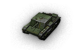
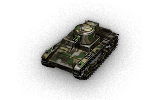
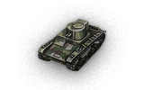
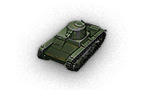

# China · Tier II

[All nations and tiers](../buffs_nerfs.md) · EU v20410 → RU v14600ru · 3 November 2026

<label><strong>Find a tank</strong><input type="search" placeholder="Try is7, obj140 or xm57" aria-label="Find a tank" style="display:block;width:100%;padding:.7rem;border:1px solid #888;border-radius:4px;margin:.5rem 0;color:inherit;background:transparent"></label>

T-26G FT · Tier II

t26gft

<a href="https://tanks.gg/v20410/tank/t-26g-ft">EU stats</a> · <a href="https://tanks.gg/v14600ru/tank/t-26g-ft">RU stats</a>
<figure style="display:inline-block"><figcaption>T-26G FT</figcaption></figure>
<em>Armor &amp; health</em> 
<strong>Health</strong> <small>EU</small> 250  <small>RU</small> <strong>390</strong> 
<strong>Track repair time (s)</strong> <small>EU</small> 12.03  <small>RU</small> <strong>3</strong> 

<em>Miscellaneous</em> 
<strong>View range (m)</strong> <small>EU</small> 270  <small>RU</small> <strong>300</strong> 

Vickers 6 ton · Tier II

vickers6ton

<a href="https://tanks.gg/v20410/tank/vickers-6-t">EU stats</a> · <a href="https://tanks.gg/v14600ru/tank/vickers-6-t">RU stats</a>
<figure style="display:inline-block"><figcaption>EU · Vickers 6 ton</figcaption></figure><figure style="display:inline-block"><figcaption>RU · Vickers 6 ton</figcaption></figure>
<strong>Penetration (mm)</strong> <b>EU</b>  AP <strong>55</strong> /  APCR <strong>82</strong> /  HE <strong>23</strong> → <b>RU</b>  AP <strong>68</strong> /  APCR <strong>92</strong> /  HE <strong>23</strong>

<strong>Damage (HP)</strong> <b>EU</b>  AP <strong>50</strong> /  APCR <strong>50</strong> /  HE <strong>65</strong> → <b>RU</b>  AP <strong>60</strong> /  APCR <strong>60</strong> /  HE <strong>90</strong>

<em>Firepower</em> 
<strong>DPM (HP/min)</strong> <small>EU</small> 1 078.97  <small>RU</small> <strong>1 211.23</strong> 
<strong>Rate of fire (rounds/min)</strong> <small>EU</small> 21.58  <small>RU</small> <strong>20.19</strong> 
<strong>Reload time (s)</strong> <small>EU</small> 2.78  <small>RU</small> <strong>2.97</strong> 
<strong>Ammo capacity</strong> <small>EU</small> 190  <small>RU</small> <strong>60</strong> 
<strong>Potential damage</strong> <small>EU</small> 9 500  <small>RU</small> <strong>3 600</strong> 

<em>Gun handling</em> 
<strong>Aim time (s)</strong> <small>EU</small> 1.92  <small>RU</small> <strong>1.53</strong> 
<strong>Dispersion (m/100 m)</strong> <small>EU</small> 0.43  <small>RU</small> <strong>0.42</strong> 
<strong>Dispersion · damaged</strong> <small>EU</small> 0.86  <small>RU</small> <strong>0.84</strong> 

<em>Mobility</em> 
<strong>Forward speed on soft terrain (km/h)</strong> <small>EU</small> 22.86  <small>RU</small> <strong>24.15</strong> 
<strong>Engine power (hp)</strong> <small>EU</small> 92  <small>RU</small> <strong>97.27</strong> 
<strong>Weight (kg)</strong> <small>EU</small> 7 295 → <small>RU</small> <strong>7 300</strong> 
<strong>Power/weight (hp/t)</strong> <small>EU</small> 12.61  <small>RU</small> <strong>13.32</strong> 

<em>Armor &amp; health</em> 
<strong>Hull armor · front (mm)</strong> <small>EU</small> 12.70  <small>RU</small> <strong>14</strong> 
<strong>Hull armor · side (mm)</strong> <small>EU</small> 12.70  <small>RU</small> <strong>14</strong> 
<strong>Hull armor · rear (mm)</strong> <small>EU</small> 12.70  <small>RU</small> <strong>14</strong> 
<strong>Turret armor · front (mm)</strong> <small>EU</small> 12.70  <small>RU</small> <strong>14</strong> 
<strong>Turret armor · side (mm)</strong> <small>EU</small> 12.70  <small>RU</small> <strong>14</strong> 
<strong>Turret armor · rear (mm)</strong> <small>EU</small> 12.70  <small>RU</small> <strong>14</strong> 
<strong>Health · track</strong> <small>EU</small> 60  <small>RU</small> <strong>50</strong> 
<strong>Health · ammo rack</strong> <small>EU</small> 70  <small>RU</small> <strong>80</strong> 
<strong>Track repair time (s)</strong> <small>EU</small> 12.03  <small>RU</small> <strong>3</strong> 

<em>Miscellaneous</em> 
<strong>View range (m)</strong> <small>EU</small> 310  <small>RU</small> <strong>320</strong> 

Vickers Mk. E Type B · Tier II

vickersmketypeb

<a href="https://tanks.gg/v20410/tank/vae-type-b">EU stats</a> · <a href="https://tanks.gg/v14600ru/tank/vae-type-b">RU stats</a>
<figure style="display:inline-block"><figcaption>Vickers Mk. E Type B</figcaption></figure>
<em>Gun handling</em> 
<strong>Aim time (s)</strong> <small>EU</small> 1.82  <small>RU</small> <strong>1.53</strong> 
<strong>Dispersion · moving</strong> <small>EU</small> 0.26  <small>RU</small> <strong>0.23</strong> 
<strong>Dispersion · tank traverse</strong> <small>EU</small> 0.26  <small>RU</small> <strong>0.23</strong> 
<strong>Dispersion · turret traverse</strong> <small>EU</small> 0.12  <small>RU</small> <strong>0.10</strong> 

<em>Mobility</em> 
<strong>Forward speed on soft terrain (km/h)</strong> <small>EU</small> 28.39  <small>RU</small> <strong>26.10</strong> 
<strong>Engine power (hp)</strong> <small>EU</small> 115  <small>RU</small> <strong>105.73</strong> 
<strong>Power/weight (hp/t)</strong> <small>EU</small> 15.66  <small>RU</small> <strong>14.40</strong> 
<strong>Turret traverse (°/s)</strong> <small>EU</small> 25.03  <small>RU</small> <strong>39.63</strong> 
<strong>Tank traverse (°/s)</strong> <small>EU</small> 56.32  <small>RU</small> <strong>50.06</strong> 
<strong>Tank traverse on hard terrain (°/s)</strong> <small>EU</small> 60.17  <small>RU</small> <strong>46.93</strong> 
<strong>Tank traverse on medium terrain (°/s)</strong> <small>EU</small> 55.15  <small>RU</small> <strong>43.02</strong> 
<strong>Tank traverse on soft terrain (°/s)</strong> <small>EU</small> 31.52  <small>RU</small> <strong>24.58</strong> 

<em>Armor &amp; health</em> 
<strong>Health</strong> <small>EU</small> 340  <small>RU</small> <strong>350</strong> 
<strong>Health · engine</strong> <small>EU</small> 65  <small>RU</small> <strong>25</strong> 
<strong>Track repair time (s)</strong> <small>EU</small> 12.03  <small>RU</small> <strong>3</strong> 

