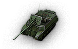
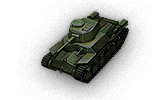
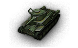

# China · Tier III

[All nations and tiers](../buffs_nerfs.md) · EU v20410 → RU v14600ru · 3 November 2026

<label><strong>Find a tank</strong><input type="search" placeholder="Try is7, obj140 or xm57" aria-label="Find a tank" style="display:block;width:100%;padding:.7rem;border:1px solid #888;border-radius:4px;margin:.5rem 0;color:inherit;background:transparent"></label>

M3G FT · Tier III

m3gft

<a href="https://tanks.gg/v20410/tank/m3g-ft">EU stats</a> · <a href="https://tanks.gg/v14600ru/tank/m3g-ft">RU stats</a>
<figure style="display:inline-block"><figcaption>M3G FT</figcaption></figure>
<em>Gun handling</em> 
<strong>Aim time (s)</strong> <small>EU</small> 1.82  <small>RU</small> <strong>1.53</strong> 
<strong>Dispersion · turret traverse</strong> <small>EU</small> 0.12  <small>RU</small> <strong>0.10</strong> 
<strong>Dispersion · firing</strong> <small>EU</small> 4  <small>RU</small> <strong>2</strong> 

<em>Mobility</em> 
<strong>Reverse speed (km/h)</strong> <small>EU</small> 12  <small>RU</small> <strong>16</strong> 

<em>Armor &amp; health</em> 
<strong>Health</strong> <small>EU</small> 285  <small>RU</small> <strong>510</strong> 
<strong>Track repair time (s)</strong> <small>EU</small> 10.03  <small>RU</small> <strong>4</strong> 

Type 2597 Chi-Ha · Tier III

type2597chiha

<a href="https://tanks.gg/v20410/tank/type-2597-chi-ha">EU stats</a> · <a href="https://tanks.gg/v14600ru/tank/type-2597-chi-ha">RU stats</a>
<figure style="display:inline-block"><figcaption>EU · Type 2597 Chi-Ha</figcaption></figure><figure style="display:inline-block"><figcaption>RU · Type 2597 Chi-Ha</figcaption></figure>
<em>Gun handling</em> 
<strong>Aim time (s)</strong> <small>EU</small> 2.21  <small>RU</small> <strong>1.73</strong> 
<strong>Dispersion (m/100 m)</strong> <small>EU</small> 0.40  <small>RU</small> <strong>0.38</strong> 
<strong>Dispersion · damaged</strong> <small>EU</small> 0.81  <small>RU</small> <strong>0.77</strong> 
<strong>Dispersion · moving</strong> <small>EU</small> 0.20  <small>RU</small> <strong>0.24</strong> 
<strong>Dispersion · turret traverse</strong> <small>EU</small> 0.14  <small>RU</small> <strong>0.08</strong> 
<strong>Dispersion · firing</strong> <small>EU</small> 4  <small>RU</small> <strong>3.50</strong> 

<em>Mobility</em> 
<strong>Forward speed on soft terrain (km/h)</strong> <small>EU</small> 35.54  <small>RU</small> <strong>31.83</strong> 
<strong>Engine power (hp)</strong> <small>EU</small> 280  <small>RU</small> <strong>253.75</strong> 
<strong>Weight (kg)</strong> <small>EU</small> 15 780 → <small>RU</small> <strong>15 970</strong> 
<strong>Power/weight (hp/t)</strong> <small>EU</small> 17.74  <small>RU</small> <strong>15.89</strong> 
<strong>Tank traverse on hard terrain (°/s)</strong> <small>EU</small> 34.49  <small>RU</small> <strong>38.45</strong> 
<strong>Tank traverse on medium terrain (°/s)</strong> <small>EU</small> 31.36  <small>RU</small> <strong>34.96</strong> 
<strong>Tank traverse on soft terrain (°/s)</strong> <small>EU</small> 18.15  <small>RU</small> <strong>20.24</strong> 

<em>Armor &amp; health</em> 
<strong>Health</strong> <small>EU</small> 430  <small>RU</small> <strong>460</strong> 
<strong>Track repair time (s)</strong> <small>EU</small> 10.03  <small>RU</small> <strong>4</strong> 

<em>Miscellaneous</em> 
<strong>Radio range (m)</strong> <small>EU</small> 443.28  <small>RU</small> <strong>573.65</strong> 

