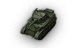
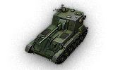

# China · Tier IV

[All nations and tiers](../buffs_nerfs.md) · EU v20410 → RU v14600ru · 3 November 2026

<label><strong>Find a tank</strong><input type="search" placeholder="Try is7, obj140 or xm57" aria-label="Find a tank" style="display:block;width:100%;padding:.7rem;border:1px solid #888;border-radius:4px;margin:.5rem 0;color:inherit;background:transparent"></label>

M5A1 Stuart · Tier IV

m5a1stuart

<a href="https://tanks.gg/v20410/tank/m5a1-stuart">EU stats</a> · <a href="https://tanks.gg/v14600ru/tank/m5a1-stuart">RU stats</a>
<figure style="display:inline-block"><figcaption>M5A1 Stuart</figcaption></figure>
<em>Firepower</em> 
<strong>DPM (HP/min)</strong> <small>EU</small> 1 564.50  <small>RU</small> <strong>1 716.12</strong> 
<strong>Rate of fire (rounds/min)</strong> <small>EU</small> 22.35  <small>RU</small> <strong>24.52</strong> 
<strong>Reload time (s)</strong> <small>EU</small> 2.68  <small>RU</small> <strong>2.45</strong> 

<em>Mobility</em> 
<strong>Forward speed on soft terrain (km/h)</strong> <small>EU</small> 57.93  <small>RU</small> <strong>55.68</strong> 
<strong>Engine power (hp)</strong> <small>EU</small> 440  <small>RU</small> <strong>422.91</strong> 
<strong>Power/weight (hp/t)</strong> <small>EU</small> 27.40  <small>RU</small> <strong>26.33</strong> 
<strong>Tank traverse (°/s)</strong> <small>EU</small> 57.36  <small>RU</small> <strong>39.63</strong> 
<strong>Tank traverse on hard terrain (°/s)</strong> <small>EU</small> 59.67  <small>RU</small> <strong>51.92</strong> 
<strong>Tank traverse on medium terrain (°/s)</strong> <small>EU</small> 53.04  <small>RU</small> <strong>46.15</strong> 
<strong>Tank traverse on soft terrain (°/s)</strong> <small>EU</small> 26.52  <small>RU</small> <strong>23.07</strong> 

<em>Armor &amp; health</em> 
<strong>Track repair time (s)</strong> <small>EU</small> 8.02  <small>RU</small> <strong>5</strong> 

SU-76G FT · Tier IV

su76gft

<a href="https://tanks.gg/v20410/tank/su-76g-ft">EU stats</a> · <a href="https://tanks.gg/v14600ru/tank/su-76g-ft">RU stats</a>
<figure style="display:inline-block"><figcaption>SU-76G FT</figcaption></figure>
<em>Gun handling</em> 
<strong>Aim time (s)</strong> <small>EU</small> 2.21  <small>RU</small> <strong>1.92</strong> 
<strong>Dispersion (m/100 m)</strong> <small>EU</small> 0.40  <small>RU</small> <strong>0.35</strong> 
<strong>Dispersion · damaged</strong> <small>EU</small> 0.81  <small>RU</small> <strong>0.69</strong> 
<strong>Dispersion · firing</strong> <small>EU</small> 4  <small>RU</small> <strong>1.90</strong> 

<em>Armor &amp; health</em> 
<strong>Health</strong> <small>EU</small> 380  <small>RU</small> <strong>560</strong> 
<strong>Track repair time (s)</strong> <small>EU</small> 10.03  <small>RU</small> <strong>5</strong> 

<em>Miscellaneous</em> 
<strong>View range (m)</strong> <small>EU</small> 310  <small>RU</small> <strong>300</strong> 

