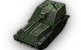
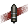
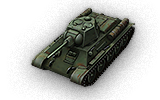

# China · Tier V

[All nations and tiers](../buffs_nerfs.md) · EU v20410 → RU v14600ru · 3 November 2026

<label><strong>Find a tank</strong><input type="search" placeholder="Try is7, obj140 or xm57" aria-label="Find a tank" style="display:block;width:100%;padding:.7rem;border:1px solid #888;border-radius:4px;margin:.5rem 0;color:inherit;background:transparent"></label>

60G FT · Tier V

60gft

<a href="https://tanks.gg/v20410/tank/60g-ft">EU stats</a> · <a href="https://tanks.gg/v14600ru/tank/60g-ft">RU stats</a>
<figure style="display:inline-block"><figcaption>60G FT</figcaption></figure>
<strong>Damage (HP)</strong> <b>EU</b>  AP <strong>200</strong> /  HEAT <strong>200</strong> /  HE <strong>320</strong> → <b>RU</b>  AP <strong>180</strong> /  HEAT <strong>180</strong> /  HE <strong>300</strong>

<em>Firepower</em> 
<strong>DPM (HP/min)</strong> <small>EU</small> 2 195.79  <small>RU</small> <strong>2 346.75</strong> 
<strong>Rate of fire (rounds/min)</strong> <small>EU</small> 10.98  <small>RU</small> <strong>13.04</strong> 
<strong>Reload time (s)</strong> <small>EU</small> 5.47  <small>RU</small> <strong>4.60</strong> 
<strong>Potential damage</strong> <small>EU</small> 12 000  <small>RU</small> <strong>10 800</strong> 

<em>Mobility</em> 
<strong>Tank traverse (°/s)</strong> <small>EU</small> 43.81  <small>RU</small> <strong>36.50</strong> 
<strong>Tank traverse on hard terrain (°/s)</strong> <small>EU</small> 45.24  <small>RU</small> <strong>45.34</strong> 
<strong>Tank traverse on medium terrain (°/s)</strong> <small>EU</small> 35.55  <small>RU</small> <strong>35.63</strong> 
<strong>Tank traverse on soft terrain (°/s)</strong> <small>EU</small> 23.70  <small>RU</small> <strong>23.75</strong> 

Type T-34 · Tier V

typet34

<a href="https://tanks.gg/v20410/tank/type-t-34">EU stats</a> · <a href="https://tanks.gg/v14600ru/tank/type-t-34">RU stats</a>
<figure style="display:inline-block"><figcaption>Type T-34</figcaption></figure>
<em>Mobility</em> 
<strong>Forward speed on medium terrain (km/h)</strong> <small>EU</small> 54.80  <small>RU</small> <strong>53.65</strong> 
<strong>Forward speed on soft terrain (km/h)</strong> <small>EU</small> 33.92  <small>RU</small> <strong>33.21</strong> 
<strong>Engine power (hp)</strong> <small>EU</small> 540  <small>RU</small> <strong>528.64</strong> 
<strong>Power/weight (hp/t)</strong> <small>EU</small> 18.72  <small>RU</small> <strong>18.33</strong> 
<strong>Tank traverse (°/s)</strong> <small>EU</small> 49.02  <small>RU</small> <strong>43.81</strong> 
<strong>Tank traverse on hard terrain (°/s)</strong> <small>EU</small> 50.71  <small>RU</small> <strong>45.43</strong> 
<strong>Tank traverse on medium terrain (°/s)</strong> <small>EU</small> 42.91  <small>RU</small> <strong>38.44</strong> 
<strong>Tank traverse on soft terrain (°/s)</strong> <small>EU</small> 26.56  <small>RU</small> <strong>23.79</strong> 

<em>Armor &amp; health</em> 
<strong>Health</strong> <small>EU</small> 650  <small>RU</small> <strong>590</strong> 

