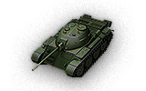
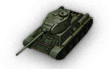
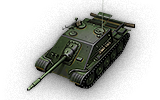

# China · Tier VI

[All nations and tiers](../buffs_nerfs.md) · EU v20410 → RU v14600ru · 3 November 2026

<label><strong>Find a tank</strong><input type="search" placeholder="Try is7, obj140 or xm57" aria-label="Find a tank" style="display:block;width:100%;padding:.7rem;border:1px solid #888;border-radius:4px;margin:.5rem 0;color:inherit;background:transparent"></label>

59-16 · Tier VI

5916

<a href="https://tanks.gg/v20410/tank/59-16">EU stats</a> · <a href="https://tanks.gg/v14600ru/tank/59-16">RU stats</a>
<figure style="display:inline-block"><figcaption>59-16</figcaption></figure>
<em>Mobility</em> 
<strong>Tank traverse (°/s)</strong> <small>EU</small> 62.58  <small>RU</small> <strong>56.32</strong> 
<strong>Tank traverse on hard terrain (°/s)</strong> <small>EU</small> 69.52  <small>RU</small> <strong>62.81</strong> 
<strong>Tank traverse on medium terrain (°/s)</strong> <small>EU</small> 61.80  <small>RU</small> <strong>55.83</strong> 
<strong>Tank traverse on soft terrain (°/s)</strong> <small>EU</small> 34.76  <small>RU</small> <strong>31.40</strong> 

<em>Armor &amp; health</em> 
<strong>Health</strong> <small>EU</small> 800  <small>RU</small> <strong>670</strong> 

Type 58 · Tier VI

type58

<a href="https://tanks.gg/v20410/tank/type-58">EU stats</a> · <a href="https://tanks.gg/v14600ru/tank/type-58">RU stats</a>
<figure style="display:inline-block"><figcaption>Type 58</figcaption></figure>
<em>Mobility</em> 
<strong>Forward speed on soft terrain (km/h)</strong> <small>EU</small> 35.75  <small>RU</small> <strong>33.89</strong> 
<strong>Engine power (hp)</strong> <small>EU</small> 580  <small>RU</small> <strong>549.79</strong> 
<strong>Power/weight (hp/t)</strong> <small>EU</small> 17.85  <small>RU</small> <strong>16.92</strong> 
<strong>Tank traverse (°/s)</strong> <small>EU</small> 47.98  <small>RU</small> <strong>43.81</strong> 
<strong>Tank traverse on hard terrain (°/s)</strong> <small>EU</small> 50.13  <small>RU</small> <strong>45.11</strong> 
<strong>Tank traverse on medium terrain (°/s)</strong> <small>EU</small> 45.57  <small>RU</small> <strong>41.01</strong> 
<strong>Tank traverse on soft terrain (°/s)</strong> <small>EU</small> 26.38  <small>RU</small> <strong>23.74</strong> 

<em>Armor &amp; health</em> 
<strong>Health</strong> <small>EU</small> 950  <small>RU</small> <strong>900</strong> 

WZ-131G FT · Tier VI

wz131gft

<a href="https://tanks.gg/v20410/tank/wz-131g-ft">EU stats</a> · <a href="https://tanks.gg/v14600ru/tank/wz-131g-ft">RU stats</a>
<figure style="display:inline-block"><figcaption>WZ-131G FT</figcaption></figure>
<em>Mobility</em> 
<strong>Tank traverse on hard terrain (°/s)</strong> <small>EU</small> 47.15  <small>RU</small> <strong>63.06</strong> 
<strong>Tank traverse on medium terrain (°/s)</strong> <small>EU</small> 37.05  <small>RU</small> <strong>49.54</strong> 
<strong>Tank traverse on soft terrain (°/s)</strong> <small>EU</small> 24.70  <small>RU</small> <strong>33.03</strong> 

