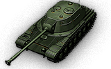
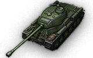
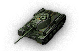
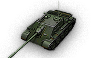
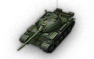

# China · Tier VII

[All nations and tiers](../buffs_nerfs.md) · EU v20410 → RU v14600ru · 3 November 2026

<label><strong>Find a tank</strong><input type="search" placeholder="Try is7, obj140 or xm57" aria-label="Find a tank" style="display:block;width:100%;padding:.7rem;border:1px solid #888;border-radius:4px;margin:.5rem 0;color:inherit;background:transparent"></label>

BZ-58 · Tier VII

bz58

<a href="https://tanks.gg/v20410/tank/bz-58">EU stats</a> · <a href="https://tanks.gg/v14600ru/tank/bz-58">RU stats</a>
<figure style="display:inline-block"><figcaption>BZ-58</figcaption></figure>
<em>Mobility</em> 
<strong>Tank traverse on hard terrain (°/s)</strong> <small>EU</small> 28.21  <small>RU</small> <strong>31.06</strong> 
<strong>Tank traverse on medium terrain (°/s)</strong> <small>EU</small> 22.16  <small>RU</small> <strong>24.41</strong> 
<strong>Tank traverse on soft terrain (°/s)</strong> <small>EU</small> 13.49  <small>RU</small> <strong>14.86</strong> 

<em>Armor &amp; health</em> 
<strong>Health</strong> <small>EU</small> 1 300  <small>RU</small> <strong>1 250</strong> 

<em>Miscellaneous</em> 
<strong>Moving camo</strong> <small>EU</small> 4.10  <small>RU</small> <strong>4.05</strong> 
<strong>Moving camo · after firing</strong> <small>EU</small> 0.90  <small>RU</small> <strong>0.89</strong> 

IS-2 · Tier VII

is2

<a href="https://tanks.gg/v20410/tank/is-2">EU stats</a> · <a href="https://tanks.gg/v14600ru/tank/is-2">RU stats</a>
<figure style="display:inline-block"><figcaption>IS-2</figcaption></figure>
<em>Mobility</em> 
<strong>Forward speed on soft terrain (km/h)</strong> <small>EU</small> 24.05  <small>RU</small> <strong>26.80</strong> 
<strong>Engine power (hp)</strong> <small>EU</small> 640  <small>RU</small> <strong>713.22</strong> 
<strong>Power/weight (hp/t)</strong> <small>EU</small> 13.90  <small>RU</small> <strong>15.49</strong> 
<strong>Tank traverse (°/s)</strong> <small>EU</small> 45.89  <small>RU</small> <strong>39.63</strong> 
<strong>Tank traverse on hard terrain (°/s)</strong> <small>EU</small> 48.60  <small>RU</small> <strong>51.09</strong> 
<strong>Tank traverse on medium terrain (°/s)</strong> <small>EU</small> 44.18  <small>RU</small> <strong>46.44</strong> 
<strong>Tank traverse on soft terrain (°/s)</strong> <small>EU</small> 22.09  <small>RU</small> <strong>23.22</strong> 

<em>Armor &amp; health</em> 
<strong>Health</strong> <small>EU</small> 1 350  <small>RU</small> <strong>1 280</strong> 

T-34-1 · Tier VII

t341

<a href="https://tanks.gg/v20410/tank/t-34-1">EU stats</a> · <a href="https://tanks.gg/v14600ru/tank/t-34-1">RU stats</a>
<figure style="display:inline-block"><figcaption>EU · T-34-1</figcaption></figure><figure style="display:inline-block"><figcaption>RU · T-34-1</figcaption></figure>
<em>Mobility</em> 
<strong>Forward speed on soft terrain (km/h)</strong> <small>EU</small> 35.12  <small>RU</small> <strong>33.88</strong> 
<strong>Engine power (hp)</strong> <small>EU</small> 570  <small>RU</small> <strong>549.79</strong> 
<strong>Power/weight (hp/t)</strong> <small>EU</small> 17.53  <small>RU</small> <strong>16.91</strong> 
<strong>Tank traverse (°/s)</strong> <small>EU</small> 52.15  <small>RU</small> <strong>43.81</strong> 
<strong>Tank traverse on hard terrain (°/s)</strong> <small>EU</small> 51.24  <small>RU</small> <strong>43.07</strong> 
<strong>Tank traverse on medium terrain (°/s)</strong> <small>EU</small> 46.58  <small>RU</small> <strong>39.15</strong> 
<strong>Tank traverse on soft terrain (°/s)</strong> <small>EU</small> 26.97  <small>RU</small> <strong>22.67</strong> 

<em>Armor &amp; health</em> 
<strong>Health</strong> <small>EU</small> 1 250  <small>RU</small> <strong>1 150</strong> 

T-34-2G FT · Tier VII

t342gft

<a href="https://tanks.gg/v20410/tank/t-34-2g-ft">EU stats</a> · <a href="https://tanks.gg/v14600ru/tank/t-34-2g-ft">RU stats</a>
<figure style="display:inline-block"><figcaption>T-34-2G FT</figcaption></figure>
<em>Mobility</em> 
<strong>Tank traverse on hard terrain (°/s)</strong> <small>EU</small> 45.12  <small>RU</small> <strong>45.20</strong> 
<strong>Tank traverse on medium terrain (°/s)</strong> <small>EU</small> 33.84  <small>RU</small> <strong>33.90</strong> 
<strong>Tank traverse on soft terrain (°/s)</strong> <small>EU</small> 23.54  <small>RU</small> <strong>23.58</strong> 

<em>Armor &amp; health</em> 
<strong>Health</strong> <small>EU</small> 900  <small>RU</small> <strong>800</strong> 

WZ-131 · Tier VII

wz131

<a href="https://tanks.gg/v20410/tank/wz-131">EU stats</a> · <a href="https://tanks.gg/v14600ru/tank/wz-131">RU stats</a>
<figure style="display:inline-block"><figcaption>WZ-131</figcaption></figure>
<em>Gun handling</em> 
<strong>Aim time (s)</strong> <small>EU</small> 1.92  <small>RU</small> <strong>2.40</strong> 

<em>Mobility</em> 
<strong>Tank traverse (°/s)</strong> <small>EU</small> 70.92  <small>RU</small> <strong>56.32</strong> 
<strong>Tank traverse on hard terrain (°/s)</strong> <small>EU</small> 73.77  <small>RU</small> <strong>67.70</strong> 
<strong>Tank traverse on medium terrain (°/s)</strong> <small>EU</small> 63.23  <small>RU</small> <strong>58.03</strong> 
<strong>Tank traverse on soft terrain (°/s)</strong> <small>EU</small> 34.05  <small>RU</small> <strong>31.24</strong> 

<em>Armor &amp; health</em> 
<strong>Track armor</strong> <small>EU</small> 10  <small>RU</small> <strong>15</strong> 
<strong>Health</strong> <small>EU</small> 1 000  <small>RU</small> <strong>900</strong> 

