# China · Tier VIII

[All nations and tiers](../buffs_nerfs.md) · EU v20410 → RU v14600ru · 3 November 2026

<label><strong>Find a tank</strong><input type="search" placeholder="Try is7, obj140 or xm57" aria-label="Find a tank" style="display:block;width:100%;padding:.7rem;border:1px solid #888;border-radius:4px;margin:.5rem 0;color:inherit;background:transparent"></label>

110 · Tier VIII

110

<a href="https://tanks.gg/v20410/tank/110">EU stats</a> · <a href="https://tanks.gg/v14600ru/tank/110">RU stats</a>
<figure style="display:inline-block">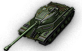<figcaption>110</figcaption></figure>
<strong>Penetration (mm)</strong> <b>EU</b>  AP <strong>227</strong> /  APCR <strong>265</strong> /  HE <strong>50</strong> → <b>RU</b>  AP <strong>230</strong> /  APCR <strong>265</strong> /  HE <strong>50</strong>

<em>Firepower</em> 
<strong>DPM (HP/min)</strong> <small>EU</small> 2 355.95  <small>RU</small> <strong>2 225.07</strong> 
<strong>Rate of fire (rounds/min)</strong> <small>EU</small> 7.36  <small>RU</small> <strong>6.95</strong> 
<strong>Reload time (s)</strong> <small>EU</small> 8.15  <small>RU</small> <strong>8.63</strong> 

<em>Gun handling</em> 
<strong>Aim time (s)</strong> <small>EU</small> 2.01  <small>RU</small> <strong>2.40</strong> 
<strong>Dispersion (m/100 m)</strong> <small>EU</small> 0.34  <small>RU</small> <strong>0.35</strong> 
<strong>Dispersion · damaged</strong> <small>EU</small> 0.67  <small>RU</small> <strong>0.71</strong> 
<strong>Dispersion · moving</strong> <small>EU</small> 0.18  <small>RU</small> <strong>0.16</strong> 
<strong>Dispersion · tank traverse</strong> <small>EU</small> 0.18  <small>RU</small> <strong>0.16</strong> 

<em>Mobility</em> 
<strong>Forward speed (km/h)</strong> <small>EU</small> 47  <small>RU</small> <strong>42</strong> 
<strong>Forward speed on hard terrain (km/h)</strong> <small>EU</small> 47  <small>RU</small> <strong>42</strong> 
<strong>Forward speed on medium terrain (km/h)</strong> <small>EU</small> 47  <small>RU</small> <strong>42</strong> 
<strong>Forward speed on soft terrain (km/h)</strong> <small>EU</small> 24  <small>RU</small> <strong>24.51</strong> 
<strong>Reverse speed (km/h)</strong> <small>EU</small> 15  <small>RU</small> <strong>16</strong> 
<strong>Engine power (hp)</strong> <small>EU</small> 700  <small>RU</small> <strong>715</strong> 
<strong>Power/weight (hp/t)</strong> <small>EU</small> 13.87  <small>RU</small> <strong>14.17</strong> 
<strong>Turret traverse (°/s)</strong> <small>EU</small> 31.29  <small>RU</small> <strong>27.12</strong> 
<strong>Tank traverse (°/s)</strong> <small>EU</small> 35.46  <small>RU</small> <strong>31.29</strong> 
<strong>Tank traverse on hard terrain (°/s)</strong> <small>EU</small> 34.14  <small>RU</small> <strong>37.37</strong> 
<strong>Tank traverse on medium terrain (°/s)</strong> <small>EU</small> 31.03  <small>RU</small> <strong>33.98</strong> 
<strong>Tank traverse on soft terrain (°/s)</strong> <small>EU</small> 15.52  <small>RU</small> <strong>16.99</strong> 

<em>Armor &amp; health</em> 
<strong>Hull armor · front (mm)</strong> <small>EU</small> 120  <small>RU</small> <strong>140</strong> 
<strong>Health</strong> <small>EU</small> 1 700  <small>RU</small> <strong>1 550</strong> 

59-Patton · Tier VIII

59patton

<a href="https://tanks.gg/v20410/tank/59-patton">EU stats</a> · <a href="https://tanks.gg/v14600ru/tank/59-patton">RU stats</a>
<figure style="display:inline-block">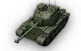<figcaption>59-Patton</figcaption></figure>
<strong>Damage (HP)</strong> <b>EU</b>  AP <strong>280</strong> /  HEAT <strong>280</strong> /  HE <strong>370</strong> → <b>RU</b>  AP <strong>240</strong> /  HEAT <strong>240</strong> /  HE <strong>320</strong>

<em>Firepower</em> 
<strong>DPM (HP/min)</strong> <small>EU</small> 2 336.32  <small>RU</small> <strong>2 241.67</strong> 
<strong>Rate of fire (rounds/min)</strong> <small>EU</small> 8.34  <small>RU</small> <strong>9.34</strong> 
<strong>Reload time (s)</strong> <small>EU</small> 7.19  <small>RU</small> <strong>6.42</strong> 
<strong>Potential damage</strong> <small>EU</small> 15 120  <small>RU</small> <strong>12 960</strong> 

<em>Gun handling</em> 
<strong>Aim time (s)</strong> <small>EU</small> 1.63  <small>RU</small> <strong>1.82</strong> 
<strong>Dispersion (m/100 m)</strong> <small>EU</small> 0.35  <small>RU</small> <strong>0.32</strong> 
<strong>Dispersion · damaged</strong> <small>EU</small> 0.69  <small>RU</small> <strong>0.63</strong> 
<strong>Dispersion · turret traverse</strong> <small>EU</small> 0.06  <small>RU</small> <strong>0.10</strong> 

BZ-166 · Tier VIII

bz166

<a href="https://tanks.gg/v20410/tank/bz-166">EU stats</a> · <a href="https://tanks.gg/v14600ru/tank/bz-166">RU stats</a>
<figure style="display:inline-block">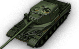<figcaption>BZ-166</figcaption></figure>
<em>Firepower</em> 
<strong>DPM (HP/min)</strong> <small>EU</small> 1 877.40  <small>RU</small> <strong>2 021.82</strong> 
<strong>Rate of fire (rounds/min)</strong> <small>EU</small> 4.47  <small>RU</small> <strong>4.81</strong> 
<strong>Reload time (s)</strong> <small>EU</small> 13.42  <small>RU</small> <strong>12.46</strong> 

<em>Gun handling</em> 
<strong>Dispersion (m/100 m)</strong> <small>EU</small> 0.40  <small>RU</small> <strong>0.42</strong> 
<strong>Dispersion · damaged</strong> <small>EU</small> 0.81  <small>RU</small> <strong>0.84</strong> 
<strong>Dispersion · turret traverse</strong> <small>EU</small> 0.14  <small>RU</small> <strong>0.16</strong> 

<em>Mobility</em> 
<strong>Forward speed on soft terrain (km/h)</strong> <small>EU</small> 26.34  <small>RU</small> <strong>23.94</strong> 
<strong>Engine power (hp)</strong> <small>EU</small> 770  <small>RU</small> <strong>700</strong> 
<strong>Power/weight (hp/t)</strong> <small>EU</small> 14.53  <small>RU</small> <strong>13.21</strong> 
<strong>Tank traverse on hard terrain (°/s)</strong> <small>EU</small> 30.89  <small>RU</small> <strong>36.76</strong> 
<strong>Tank traverse on medium terrain (°/s)</strong> <small>EU</small> 22.06  <small>RU</small> <strong>26.26</strong> 
<strong>Tank traverse on soft terrain (°/s)</strong> <small>EU</small> 14.71  <small>RU</small> <strong>17.51</strong> 

<em>Armor &amp; health</em> 
<strong>Health</strong> <small>EU</small> 1 650  <small>RU</small> <strong>1 600</strong> 

<em>Miscellaneous</em> 
<strong>View range (m)</strong> <small>EU</small> 360  <small>RU</small> <strong>370</strong> 

BZ-74-1 · EU VIII → RU X

bz741

<a href="https://tanks.gg/v20410/tank/bz-74-1">EU stats</a> · <a href="https://tanks.gg/v14600ru/tank/bz-74-1">RU stats</a>
<figure style="display:inline-block">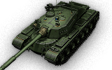<figcaption>BZ-74-1</figcaption></figure>
<strong>Penetration (mm)</strong> <b>EU</b>  AP <strong>223</strong> /  HEAT <strong>270</strong> /  HE <strong>61</strong> → <b>RU</b>  AP <strong>258</strong> /  HEAT <strong>330</strong> /  HE <strong>65</strong>

<strong>Damage (HP)</strong> <b>EU</b>  AP <strong>420</strong> /  HEAT <strong>420</strong> /  HE <strong>550</strong> → <b>RU</b>  AP <strong>560</strong> /  HEAT <strong>560</strong> /  HE <strong>700</strong>

<em>General</em> 
<strong>Tier</strong> <small>EU</small> 8 → <small>RU</small> <strong>10</strong> 

<em>Firepower</em> 
<strong>DPM (HP/min)</strong> <small>EU</small> 1 877.40  <small>RU</small> <strong>2 539.48</strong> 
<strong>Module damage</strong> <small>EU</small> 165  <small>RU</small> <strong>173</strong> 
<strong>Rate of fire (rounds/min)</strong> <small>EU</small> 4.47  <small>RU</small> <strong>4.53</strong> 
<strong>Reload time (s)</strong> <small>EU</small> 13.42  <small>RU</small> <strong>13.23</strong> 
<strong>Caliber</strong> <small>EU</small> 122  <small>RU</small> <strong>130</strong> 
<strong>Shell velocity (m/s)</strong> <small>EU</small> 930  <small>RU</small> <strong>1 020</strong> 
<strong>Ammo capacity</strong> <small>EU</small> 40  <small>RU</small> <strong>38</strong> 
<strong>Potential damage</strong> <small>EU</small> 16 800  <small>RU</small> <strong>21 280</strong> 

<em>Gun handling</em> 
<strong>Aim time (s)</strong> <small>EU</small> 2.59  <small>RU</small> <strong>2.68</strong> 
<strong>Dispersion (m/100 m)</strong> <small>EU</small> 0.37  <small>RU</small> <strong>0.38</strong> 
<strong>Dispersion · damaged</strong> <small>EU</small> 0.75  <small>RU</small> <strong>0.77</strong> 
<strong>Dispersion · moving</strong> <small>EU</small> 0.15  <small>RU</small> <strong>0.11</strong> 
<strong>Dispersion · tank traverse</strong> <small>EU</small> 0.15  <small>RU</small> <strong>0.11</strong> 
<strong>Dispersion · turret traverse</strong> <small>EU</small> 0.08  <small>RU</small> <strong>0.11</strong> 

<em>Mobility</em> 
<strong>Forward speed (km/h)</strong> <small>EU</small> 50  <small>RU</small> <strong>48</strong> 
<strong>Forward speed on hard terrain (km/h)</strong> <small>EU</small> 50  <small>RU</small> <strong>48</strong> 
<strong>Forward speed on medium terrain (km/h)</strong> <small>EU</small> 49.21  <small>RU</small> <strong>48</strong> 
<strong>Reverse speed (km/h)</strong> <small>EU</small> 15  <small>RU</small> <strong>16</strong> 
<strong>Weight (kg)</strong> <small>EU</small> 58 000 → <small>RU</small> <strong>57 995</strong> 
<strong>Turret traverse (°/s)</strong> <small>EU</small> 26.08  <small>RU</small> <strong>34.42</strong> 
<strong>Tank traverse (°/s)</strong> <small>EU</small> 35.46  <small>RU</small> <strong>34.42</strong> 
<strong>Tank traverse on hard terrain (°/s)</strong> <small>EU</small> 33.69  <small>RU</small> <strong>32.70</strong> 
<strong>Tank traverse on medium terrain (°/s)</strong> <small>EU</small> 30.88  <small>RU</small> <strong>29.97</strong> 
<strong>Tank traverse on soft terrain (°/s)</strong> <small>EU</small> 14.82  <small>RU</small> <strong>14.39</strong> 

<em>Armor &amp; health</em> 
<strong>Hull armor · front (mm)</strong> <small>EU</small> 180  <small>RU</small> <strong>230</strong> 
<strong>Hull armor · side (mm)</strong> <small>EU</small> 60  <small>RU</small> <strong>70</strong> 
<strong>Turret armor · front (mm)</strong> <small>EU</small> 220  <small>RU</small> <strong>285</strong> 
<strong>Turret armor · side (mm)</strong> <small>EU</small> 100  <small>RU</small> <strong>110</strong> 
<strong>Health</strong> <small>EU</small> 1 500  <small>RU</small> <strong>2 300</strong> 
<strong>Health · engine</strong> <small>EU</small> 275  <small>RU</small> <strong>360</strong> 
<strong>Health · track</strong> <small>EU</small> 220  <small>RU</small> <strong>250</strong> 
<strong>Health · fuel tank</strong> <small>EU</small> 175  <small>RU</small> <strong>200</strong> 
<strong>Track repair time (s)</strong> <small>EU</small> 11.70  <small>RU</small> <strong>12.03</strong> 

<em>Miscellaneous</em> 
<strong>Stationary camo</strong> <small>EU</small> 5.76  <small>RU</small> <strong>6.27</strong> 
<strong>Stationary camo · after firing</strong> <small>EU</small> 0.88  <small>RU</small> <strong>0.96</strong> 
<strong>View range (m)</strong> <small>EU</small> 370  <small>RU</small> <strong>400</strong> 
<strong>Radio range (m)</strong> <small>EU</small> 570  <small>RU</small> <strong>700</strong> 
<strong>Fire chance (%)</strong> <small>EU</small> 15  <small>RU</small> <strong>12</strong> 
<strong>Shell cost</strong> <small>EU</small> 794  <small>RU</small> <strong>1 260</strong> 

M41D · Tier VIII

m41d

<a href="https://tanks.gg/v20410/tank/m41d">EU stats</a> · <a href="https://tanks.gg/v14600ru/tank/m41d">RU stats</a>
<figure style="display:inline-block">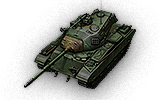<figcaption>M41D</figcaption></figure>
<em>Gun handling</em> 
<strong>Dispersion · moving</strong> <small>EU</small> 0.10  <small>RU</small> <strong>0.14</strong> 
<strong>Dispersion · tank traverse</strong> <small>EU</small> 0.10  <small>RU</small> <strong>0.14</strong> 
<strong>Dispersion · turret traverse</strong> <small>EU</small> 0.04  <small>RU</small> <strong>0.06</strong> 

T-34-2 · Tier VIII

t342

<a href="https://tanks.gg/v20410/tank/t-34-2">EU stats</a> · <a href="https://tanks.gg/v14600ru/tank/t-34-2">RU stats</a>
<figure style="display:inline-block">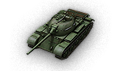<figcaption>T-34-2</figcaption></figure>
<strong>Penetration (mm)</strong> <b>EU</b>  AP <strong>212</strong> /  HEAT <strong>280</strong> /  HE <strong>61</strong> → <b>RU</b>  AP <strong>212</strong> /  APCR <strong>258</strong> /  HE <strong>50</strong>

<strong>Damage (HP)</strong> <b>EU</b>  AP <strong>390</strong> /  HEAT <strong>390</strong> /  HE <strong>530</strong> → <b>RU</b>  AP <strong>250</strong> /  APCR <strong>250</strong> /  HE <strong>330</strong>

<em>Firepower</em> 
<strong>DPM (HP/min)</strong> <small>EU</small> 2 068.32  <small>RU</small> <strong>2 086</strong> 
<strong>Module damage</strong> <small>EU</small> 165  <small>RU</small> <strong>135</strong> 
<strong>Rate of fire (rounds/min)</strong> <small>EU</small> 5.30  <small>RU</small> <strong>8.34</strong> 
<strong>Reload time (s)</strong> <small>EU</small> 11.31  <small>RU</small> <strong>7.19</strong> 
<strong>Caliber</strong> <small>EU</small> 122  <small>RU</small> <strong>100</strong> 
<strong>Ammo capacity</strong> <small>EU</small> 40  <small>RU</small> <strong>45</strong> 
<strong>Potential damage</strong> <small>EU</small> 15 600  <small>RU</small> <strong>11 250</strong> 

<em>Gun handling</em> 
<strong>Aim time (s)</strong> <small>EU</small> 2.30  <small>RU</small> <strong>2.40</strong> 
<strong>Dispersion (m/100 m)</strong> <small>EU</small> 0.36  <small>RU</small> <strong>0.35</strong> 
<strong>Dispersion · damaged</strong> <small>EU</small> 0.73  <small>RU</small> <strong>0.69</strong> 
<strong>Dispersion · moving</strong> <small>EU</small> 0.16  <small>RU</small> <strong>0.18</strong> 
<strong>Dispersion · tank traverse</strong> <small>EU</small> 0.16  <small>RU</small> <strong>0.18</strong> 
<strong>Elevation (°)</strong> <small>EU</small> 15  <small>RU</small> <strong>18</strong> 

<em>Mobility</em> 
<strong>Forward speed on soft terrain (km/h)</strong> <small>EU</small> 38.97  <small>RU</small> <strong>44.35</strong> 
<strong>Engine power (hp)</strong> <small>EU</small> 630  <small>RU</small> <strong>713.22</strong> 
<strong>Weight (kg)</strong> <small>EU</small> 34 183 → <small>RU</small> <strong>34 000</strong> 
<strong>Power/weight (hp/t)</strong> <small>EU</small> 18.43  <small>RU</small> <strong>20.98</strong> 
<strong>Tank traverse (°/s)</strong> <small>EU</small> 58.41  <small>RU</small> <strong>47.98</strong> 
<strong>Tank traverse on hard terrain (°/s)</strong> <small>EU</small> 60.33  <small>RU</small> <strong>60.54</strong> 
<strong>Tank traverse on medium terrain (°/s)</strong> <small>EU</small> 53.63  <small>RU</small> <strong>53.81</strong> 
<strong>Tank traverse on soft terrain (°/s)</strong> <small>EU</small> 26.81  <small>RU</small> <strong>26.91</strong> 

<em>Armor &amp; health</em> 
<strong>Turret armor · front (mm)</strong> <small>EU</small> 180  <small>RU</small> <strong>190</strong> 
<strong>Health</strong> <small>EU</small> 1 550  <small>RU</small> <strong>1 400</strong> 

<em>Miscellaneous</em> 
<strong>Stationary camo · after firing</strong> <small>EU</small> 3.41  <small>RU</small> <strong>3.75</strong> 
<strong>Moving camo · after firing</strong> <small>EU</small> 2.55  <small>RU</small> <strong>2.81</strong> 
<strong>Shell cost</strong> <small>EU</small> 1 025  <small>RU</small> <strong>252</strong> 

WZ-111 · Tier VIII

wz111

<a href="https://tanks.gg/v20410/tank/wz-111">EU stats</a> · <a href="https://tanks.gg/v14600ru/tank/wz-111">RU stats</a>
<figure style="display:inline-block">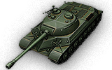<figcaption>WZ-111</figcaption></figure>
<em>Firepower</em> 
<strong>DPM (HP/min)</strong> <small>EU</small> 2 033.85  <small>RU</small> <strong>1 952.50</strong> 
<strong>Rate of fire (rounds/min)</strong> <small>EU</small> 5.21  <small>RU</small> <strong>5.01</strong> 
<strong>Reload time (s)</strong> <small>EU</small> 11.51  <small>RU</small> <strong>11.98</strong> 

<em>Gun handling</em> 
<strong>Aim time (s)</strong> <small>EU</small> 2.49  <small>RU</small> <strong>2.68</strong> 
<strong>Dispersion (m/100 m)</strong> <small>EU</small> 0.37  <small>RU</small> <strong>0.40</strong> 
<strong>Dispersion · damaged</strong> <small>EU</small> 0.75  <small>RU</small> <strong>0.81</strong> 
<strong>Dispersion · turret traverse</strong> <small>EU</small> 0.10  <small>RU</small> <strong>0.12</strong> 

<em>Mobility</em> 
<strong>Forward speed on medium terrain (km/h)</strong> <small>EU</small> 50  <small>RU</small> <strong>46.65</strong> 
<strong>Forward speed on soft terrain (km/h)</strong> <small>EU</small> 26.05  <small>RU</small> <strong>23.33</strong> 
<strong>Engine power (hp)</strong> <small>EU</small> 670  <small>RU</small> <strong>600</strong> 
<strong>Power/weight (hp/t)</strong> <small>EU</small> 15.06  <small>RU</small> <strong>13.48</strong> 

WZ-111 Alpine Tiger · Tier VIII

wz111alpinetiger

<a href="https://tanks.gg/v20410/tank/alpine-tiger">EU stats</a> · <a href="https://tanks.gg/v14600ru/tank/alpine-tiger">RU stats</a>
<figure style="display:inline-block">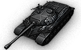<figcaption>WZ-111 Alpine Tiger</figcaption></figure>
<em>Firepower</em> 
<strong>DPM (HP/min)</strong> <small>EU</small> 2 033.85  <small>RU</small> <strong>1 952.50</strong> 
<strong>Rate of fire (rounds/min)</strong> <small>EU</small> 5.21  <small>RU</small> <strong>5.01</strong> 
<strong>Reload time (s)</strong> <small>EU</small> 11.51  <small>RU</small> <strong>11.98</strong> 

<em>Gun handling</em> 
<strong>Aim time (s)</strong> <small>EU</small> 2.49  <small>RU</small> <strong>2.68</strong> 
<strong>Dispersion (m/100 m)</strong> <small>EU</small> 0.37  <small>RU</small> <strong>0.40</strong> 
<strong>Dispersion · damaged</strong> <small>EU</small> 0.75  <small>RU</small> <strong>0.81</strong> 
<strong>Dispersion · turret traverse</strong> <small>EU</small> 0.10  <small>RU</small> <strong>0.12</strong> 

<em>Mobility</em> 
<strong>Forward speed on medium terrain (km/h)</strong> <small>EU</small> 50  <small>RU</small> <strong>46.65</strong> 
<strong>Forward speed on soft terrain (km/h)</strong> <small>EU</small> 26.05  <small>RU</small> <strong>23.33</strong> 
<strong>Engine power (hp)</strong> <small>EU</small> 670  <small>RU</small> <strong>600</strong> 
<strong>Power/weight (hp/t)</strong> <small>EU</small> 15.06  <small>RU</small> <strong>13.48</strong> 

WZ-111 model 6 · Tier VIII

wz111model6

<a href="https://tanks.gg/v20410/tank/wz-111-6">EU stats</a> · <a href="https://tanks.gg/v14600ru/tank/wz-111-6">RU stats</a>
<figure style="display:inline-block">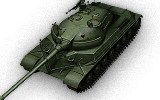<figcaption>WZ-111 model 6</figcaption></figure>
<strong>Penetration (mm)</strong> <b>EU</b>  APCR <strong>227</strong> /  HEAT <strong>290</strong> /  HE <strong>60</strong> → <b>RU</b>  APCR <strong>218</strong> /  HEAT <strong>290</strong> /  HE <strong>60</strong>

<em>Gun handling</em> 
<strong>Aim time (s)</strong> <small>EU</small> 2.49  <small>RU</small> <strong>2.68</strong> 
<strong>Dispersion · moving</strong> <small>EU</small> 0.20  <small>RU</small> <strong>0.23</strong> 
<strong>Dispersion · tank traverse</strong> <small>EU</small> 0.20  <small>RU</small> <strong>0.23</strong> 

<em>Mobility</em> 
<strong>Turret traverse (°/s)</strong> <small>EU</small> 29.20  <small>RU</small> <strong>25.03</strong> 
<strong>Tank traverse (°/s)</strong> <small>EU</small> 31.29  <small>RU</small> <strong>27.12</strong> 
<strong>Tank traverse on hard terrain (°/s)</strong> <small>EU</small> 29.73  <small>RU</small> <strong>25.76</strong> 
<strong>Tank traverse on medium terrain (°/s)</strong> <small>EU</small> 27.25  <small>RU</small> <strong>23.62</strong> 
<strong>Tank traverse on soft terrain (°/s)</strong> <small>EU</small> 13.08  <small>RU</small> <strong>11.34</strong> 

WZ-111-1G FT · Tier VIII

wz1111gft

<a href="https://tanks.gg/v20410/tank/wz-111-1-ft">EU stats</a> · <a href="https://tanks.gg/v14600ru/tank/wz-111-1g-ft">RU stats</a>
<figure style="display:inline-block">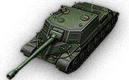<figcaption>WZ-111-1G FT</figcaption></figure>
<em>Gun handling</em> 
<strong>Dispersion · moving</strong> <small>EU</small> 0.24  <small>RU</small> <strong>0.23</strong> 
<strong>Dispersion · tank traverse</strong> <small>EU</small> 0.24  <small>RU</small> <strong>0.23</strong> 

<em>Mobility</em> 
<strong>Tank traverse (°/s)</strong> <small>EU</small> 31.29  <small>RU</small> <strong>26.08</strong> 
<strong>Tank traverse on hard terrain (°/s)</strong> <small>EU</small> 31.81  <small>RU</small> <strong>31.18</strong> 
<strong>Tank traverse on medium terrain (°/s)</strong> <small>EU</small> 24.99  <small>RU</small> <strong>24.50</strong> 
<strong>Tank traverse on soft terrain (°/s)</strong> <small>EU</small> 15.21  <small>RU</small> <strong>14.91</strong> 

<em>Armor &amp; health</em> 
<strong>Health</strong> <small>EU</small> 1 300  <small>RU</small> <strong>1 250</strong> 

WZ-113-II · Tier VIII

wz113ii

<a href="https://tanks.gg/v20410/tank/wz-113-ii">EU stats</a> · <a href="https://tanks.gg/v14600ru/tank/wz-113-ii">RU stats</a>
<figure style="display:inline-block">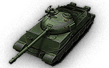<figcaption>WZ-113-II</figcaption></figure>
<em>Gun handling</em> 
<strong>Aim time (s)</strong> <small>EU</small> 2.30  <small>RU</small> <strong>2.49</strong> 
<strong>Dispersion · moving</strong> <small>EU</small> 0.18  <small>RU</small> <strong>0.20</strong> 
<strong>Dispersion · tank traverse</strong> <small>EU</small> 0.18  <small>RU</small> <strong>0.20</strong> 

<em>Mobility</em> 
<strong>Forward speed (km/h)</strong> <small>EU</small> 50  <small>RU</small> <strong>48</strong> 
<strong>Forward speed on hard terrain (km/h)</strong> <small>EU</small> 50  <small>RU</small> <strong>48</strong> 
<strong>Forward speed on medium terrain (km/h)</strong> <small>EU</small> 50  <small>RU</small> <strong>48</strong> 
<strong>Forward speed on soft terrain (km/h)</strong> <small>EU</small> 24.90  <small>RU</small> <strong>23.77</strong> 
<strong>Reverse speed (km/h)</strong> <small>EU</small> 15  <small>RU</small> <strong>14</strong> 
<strong>Engine power (hp)</strong> <small>EU</small> 660  <small>RU</small> <strong>630</strong> 
<strong>Power/weight (hp/t)</strong> <small>EU</small> 16.35  <small>RU</small> <strong>15.61</strong> 

WZ-132 · Tier VIII

wz132

<a href="https://tanks.gg/v20410/tank/wz-132">EU stats</a> · <a href="https://tanks.gg/v14600ru/tank/wz-132">RU stats</a>
<figure style="display:inline-block">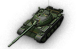<figcaption>WZ-132</figcaption></figure>
<strong>Penetration (mm)</strong> <b>EU</b>  AP <strong>189</strong> /  APCR <strong>233</strong> /  HE <strong>50</strong> → <b>RU</b>  AP <strong>189</strong> /  APCR <strong>225</strong> /  HE <strong>50</strong>

<strong>Damage (HP)</strong> <b>EU</b>  AP <strong>280</strong> /  APCR <strong>280</strong> /  HE <strong>350</strong> → <b>RU</b>  AP <strong>250</strong> /  APCR <strong>250</strong> /  HE <strong>330</strong>

<em>Firepower</em> 
<strong>DPM (HP/min)</strong> <small>EU</small> 2 086  <small>RU</small> <strong>2 005.77</strong> 
<strong>Rate of fire (rounds/min)</strong> <small>EU</small> 7.45  <small>RU</small> <strong>8.02</strong> 
<strong>Reload time (s)</strong> <small>EU</small> 8.05  <small>RU</small> <strong>7.48</strong> 
<strong>Potential damage</strong> <small>EU</small> 12 040  <small>RU</small> <strong>10 750</strong> 

<em>Gun handling</em> 
<strong>Aim time (s)</strong> <small>EU</small> 1.92  <small>RU</small> <strong>2.21</strong> 
<strong>Dispersion (m/100 m)</strong> <small>EU</small> 0.36  <small>RU</small> <strong>0.38</strong> 
<strong>Dispersion · damaged</strong> <small>EU</small> 0.73  <small>RU</small> <strong>0.77</strong> 
<strong>Dispersion · turret traverse</strong> <small>EU</small> 0.10  <small>RU</small> <strong>0.08</strong> 
<strong>Depression (°)</strong> <small>EU</small> 6  <small>RU</small> <strong>5</strong> 

<em>Mobility</em> 
<strong>Forward speed (km/h)</strong> <small>EU</small> 68  <small>RU</small> <strong>64</strong> 
<strong>Forward speed on hard terrain (km/h)</strong> <small>EU</small> 68  <small>RU</small> <strong>64</strong> 
<strong>Forward speed on medium terrain (km/h)</strong> <small>EU</small> 68  <small>RU</small> <strong>64</strong> 
<strong>Forward speed on soft terrain (km/h)</strong> <small>EU</small> 68  <small>RU</small> <strong>64</strong> 
<strong>Engine power (hp)</strong> <small>EU</small> 750  <small>RU</small> <strong>700</strong> 
<strong>Power/weight (hp/t)</strong> <small>EU</small> 30.85  <small>RU</small> <strong>28.79</strong> 
<strong>Turret traverse (°/s)</strong> <small>EU</small> 44.85  <small>RU</small> <strong>50.06</strong> 
<strong>Tank traverse (°/s)</strong> <small>EU</small> 46.93  <small>RU</small> <strong>58.41</strong> 
<strong>Tank traverse on hard terrain (°/s)</strong> <small>EU</small> 48.64  <small>RU</small> <strong>71.90</strong> 
<strong>Tank traverse on medium terrain (°/s)</strong> <small>EU</small> 40.53  <small>RU</small> <strong>59.92</strong> 
<strong>Tank traverse on soft terrain (°/s)</strong> <small>EU</small> 18.71  <small>RU</small> <strong>27.65</strong> 

<em>Armor &amp; health</em> 
<strong>Track armor</strong> <small>EU</small> 10  <small>RU</small> <strong>15</strong> 
<strong>Health</strong> <small>EU</small> 1 300  <small>RU</small> <strong>1 100</strong> 

<em>Miscellaneous</em> 
<strong>Stationary camo</strong> <small>EU</small> 16.07  <small>RU</small> <strong>16.70</strong> 
<strong>Stationary camo · after firing</strong> <small>EU</small> 3.36  <small>RU</small> <strong>3.49</strong> 
<strong>Moving camo</strong> <small>EU</small> 16.07  <small>RU</small> <strong>16.70</strong> 
<strong>Moving camo · after firing</strong> <small>EU</small> 3.36  <small>RU</small> <strong>3.49</strong> 
<strong>View range (m)</strong> <small>EU</small> 390  <small>RU</small> <strong>380</strong> 

WZ-132 FL · Tier VIII

wz132fl

<a href="https://tanks.gg/v20410/tank/wz-132-fl">EU stats</a> · <a href="https://tanks.gg/v14600ru/tank/wz-132-fl">RU stats</a>
<figure style="display:inline-block"><figcaption>WZ-132 FL</figcaption></figure>
<strong>Penetration (mm)</strong> <b>EU</b>  AP <strong>189</strong> /  APCR <strong>233</strong> /  HE <strong>50</strong> → <b>RU</b>  AP <strong>189</strong> /  APCR <strong>225</strong> /  HE <strong>50</strong>

<strong>Damage (HP)</strong> <b>EU</b>  AP <strong>280</strong> /  APCR <strong>280</strong> /  HE <strong>350</strong> → <b>RU</b>  AP <strong>250</strong> /  APCR <strong>250</strong> /  HE <strong>330</strong>

<em>Firepower</em> 
<strong>DPM (HP/min)</strong> <small>EU</small> 2 086  <small>RU</small> <strong>2 005.77</strong> 
<strong>Rate of fire (rounds/min)</strong> <small>EU</small> 7.45  <small>RU</small> <strong>8.02</strong> 
<strong>Reload time (s)</strong> <small>EU</small> 8.05  <small>RU</small> <strong>7.48</strong> 
<strong>Potential damage</strong> <small>EU</small> 12 040  <small>RU</small> <strong>10 750</strong> 

<em>Gun handling</em> 
<strong>Aim time (s)</strong> <small>EU</small> 1.92  <small>RU</small> <strong>2.21</strong> 
<strong>Dispersion (m/100 m)</strong> <small>EU</small> 0.36  <small>RU</small> <strong>0.38</strong> 
<strong>Dispersion · damaged</strong> <small>EU</small> 0.73  <small>RU</small> <strong>0.77</strong> 
<strong>Dispersion · turret traverse</strong> <small>EU</small> 0.10  <small>RU</small> <strong>0.08</strong> 
<strong>Depression (°)</strong> <small>EU</small> 6  <small>RU</small> <strong>5</strong> 

<em>Mobility</em> 
<strong>Forward speed (km/h)</strong> <small>EU</small> 68  <small>RU</small> <strong>64</strong> 
<strong>Forward speed on hard terrain (km/h)</strong> <small>EU</small> 68  <small>RU</small> <strong>64</strong> 
<strong>Forward speed on medium terrain (km/h)</strong> <small>EU</small> 68  <small>RU</small> <strong>64</strong> 
<strong>Forward speed on soft terrain (km/h)</strong> <small>EU</small> 68  <small>RU</small> <strong>64</strong> 
<strong>Engine power (hp)</strong> <small>EU</small> 750  <small>RU</small> <strong>700</strong> 
<strong>Power/weight (hp/t)</strong> <small>EU</small> 30.85  <small>RU</small> <strong>28.79</strong> 
<strong>Turret traverse (°/s)</strong> <small>EU</small> 44.85  <small>RU</small> <strong>50.06</strong> 
<strong>Tank traverse (°/s)</strong> <small>EU</small> 46.93  <small>RU</small> <strong>58.41</strong> 
<strong>Tank traverse on hard terrain (°/s)</strong> <small>EU</small> 46.93  <small>RU</small> <strong>58.41</strong> 
<strong>Tank traverse on medium terrain (°/s)</strong> <small>EU</small> 39.11  <small>RU</small> <strong>48.67</strong> 
<strong>Tank traverse on soft terrain (°/s)</strong> <small>EU</small> 18.05  <small>RU</small> <strong>22.46</strong> 

<em>Armor &amp; health</em> 
<strong>Track armor</strong> <small>EU</small> 10  <small>RU</small> <strong>15</strong> 
<strong>Health</strong> <small>EU</small> 1 300  <small>RU</small> <strong>1 100</strong> 

<em>Miscellaneous</em> 
<strong>Stationary camo</strong> <small>EU</small> 16.07  <small>RU</small> <strong>16.70</strong> 
<strong>Stationary camo · after firing</strong> <small>EU</small> 3.36  <small>RU</small> <strong>3.49</strong> 
<strong>Moving camo</strong> <small>EU</small> 16.07  <small>RU</small> <strong>16.70</strong> 
<strong>Moving camo · after firing</strong> <small>EU</small> 3.36  <small>RU</small> <strong>3.49</strong> 
<strong>View range (m)</strong> <small>EU</small> 390  <small>RU</small> <strong>380</strong> 

