# China · Tier IX

[All nations and tiers](../buffs_nerfs.md) · EU v20410 → RU v14600ru · 3 November 2026

<label><strong>Find a tank</strong><input type="search" placeholder="Try is7, obj140 or xm57" aria-label="Find a tank" style="display:block;width:100%;padding:.7rem;border:1px solid #888;border-radius:4px;margin:.5rem 0;color:inherit;background:transparent"></label>

BZ-58-2 · Tier IX

bz582

<a href="https://tanks.gg/v20410/tank/bz-58-2">EU stats</a> · <a href="https://tanks.gg/v14600ru/tank/bz-58-2">RU stats</a>
<figure style="display:inline-block">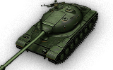<figcaption>BZ-58-2</figcaption></figure>
<em>Armor &amp; health</em> 
<strong>Hull armor · front (mm)</strong> <small>EU</small> 70  <small>RU</small> <strong>110</strong> 
<strong>Hull armor · side (mm)</strong> <small>EU</small> 70  <small>RU</small> <strong>80</strong> 

BZ-68 · Tier IX

bz68

<a href="https://tanks.gg/v20410/tank/bz-68">EU stats</a> · <a href="https://tanks.gg/v14600ru/tank/bz-68">RU stats</a>
<figure style="display:inline-block">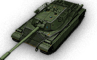<figcaption>BZ-68</figcaption></figure>
<em>Gun handling</em> 
<strong>Dispersion · turret traverse</strong> <small>EU</small> 0.12  <small>RU</small> <strong>0.16</strong> 
<strong>Dispersion · firing</strong> <small>EU</small> 4  <small>RU</small> <strong>3.50</strong> 

<em>Mobility</em> 
<strong>Tank traverse on hard terrain (°/s)</strong> <small>EU</small> 29.51  <small>RU</small> <strong>35.41</strong> 
<strong>Tank traverse on medium terrain (°/s)</strong> <small>EU</small> 26.83  <small>RU</small> <strong>32.19</strong> 
<strong>Tank traverse on soft terrain (°/s)</strong> <small>EU</small> 15.53  <small>RU</small> <strong>18.64</strong> 

<em>Armor &amp; health</em> 
<strong>Health</strong> <small>EU</small> 2 000  <small>RU</small> <strong>1 900</strong> 

DZT-159 · EU IX → RU X

dzt159

<a href="https://tanks.gg/v20410/tank/dzt-159">EU stats</a> · <a href="https://tanks.gg/v14600ru/tank/dzt-159">RU stats</a>
<figure style="display:inline-block">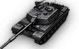<figcaption>EU · DZT-159</figcaption></figure><figure style="display:inline-block">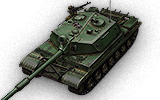<figcaption>RU · DZT-159</figcaption></figure>
<strong>Penetration (mm)</strong> <b>EU</b>  AP <strong>260</strong> /  HEAT <strong>310</strong> /  HE <strong>68</strong> → <b>RU</b>  AP <strong>258</strong> /  HEAT <strong>340</strong> /  HE <strong>68</strong>

<em>General</em> 
<strong>Tier</strong> <small>EU</small> 9 → <small>RU</small> <strong>10</strong> 

<em>Firepower</em> 
<strong>DPM (HP/min)</strong> <small>EU</small> 2 353.44  <small>RU</small> <strong>2 753.52</strong> 
<strong>Rate of fire (rounds/min)</strong> <small>EU</small> 5.35  <small>RU</small> <strong>6.26</strong> 
<strong>Reload time (s)</strong> <small>EU</small> 11.22  <small>RU</small> <strong>9.59</strong> 
<strong>Shell velocity (m/s)</strong> <small>EU</small> 1 150  <small>RU</small> <strong>950</strong> 
<strong>Ammo capacity</strong> <small>EU</small> 40  <small>RU</small> <strong>48</strong> 
<strong>Potential damage</strong> <small>EU</small> 17 600  <small>RU</small> <strong>21 120</strong> 

<em>Gun handling</em> 
<strong>Aim time (s)</strong> <small>EU</small> 2.59  <small>RU</small> <strong>2.49</strong> 
<strong>Dispersion (m/100 m)</strong> <small>EU</small> 0.38  <small>RU</small> <strong>0.36</strong> 
<strong>Dispersion · damaged</strong> <small>EU</small> 0.77  <small>RU</small> <strong>0.73</strong> 
<strong>Dispersion · moving</strong> <small>EU</small> 0.20  <small>RU</small> <strong>0.14</strong> 
<strong>Dispersion · tank traverse</strong> <small>EU</small> 0.20  <small>RU</small> <strong>0.14</strong> 
<strong>Dispersion · turret traverse</strong> <small>EU</small> 0.08  <small>RU</small> <strong>0.10</strong> 

<em>Mobility</em> 
<strong>Forward speed (km/h)</strong> <small>EU</small> 40  <small>RU</small> <strong>50</strong> 
<strong>Forward speed on hard terrain (km/h)</strong> <small>EU</small> 40  <small>RU</small> <strong>50</strong> 
<strong>Forward speed on medium terrain (km/h)</strong> <small>EU</small> 40  <small>RU</small> <strong>50</strong> 
<strong>Forward speed on soft terrain (km/h)</strong> <small>EU</small> 23.76  <small>RU</small> <strong>35.80</strong> 
<strong>Reverse speed (km/h)</strong> <small>EU</small> 15  <small>RU</small> <strong>16</strong> 
<strong>Engine power (hp)</strong> <small>EU</small> 640  <small>RU</small> <strong>540</strong> 
<strong>Power/weight (hp/t)</strong> <small>EU</small> 15.61  <small>RU</small> <strong>13.17</strong> 
<strong>Terrain resist (hard)</strong> <small>EU</small> 1.05  <small>RU</small> <strong>0.67</strong> 
<strong>Terrain resist (med)</strong> <small>EU</small> 1.15  <small>RU</small> <strong>0.77</strong> 
<strong>Terrain resist (soft)</strong> <small>EU</small> 2.40  <small>RU</small> <strong>1.34</strong> 
<strong>Turret traverse (°/s)</strong> <small>EU</small> 26.08  <small>RU</small> <strong>35.46</strong> 
<strong>Tank traverse (°/s)</strong> <small>EU</small> 41.72  <small>RU</small> <strong>35.46</strong> 
<strong>Tank traverse on hard terrain (°/s)</strong> <small>EU</small> 39.63  <small>RU</small> <strong>33.69</strong> 
<strong>Tank traverse on medium terrain (°/s)</strong> <small>EU</small> 36.33  <small>RU</small> <strong>29.48</strong> 
<strong>Tank traverse on soft terrain (°/s)</strong> <small>EU</small> 17.44  <small>RU</small> <strong>16.84</strong> 

<em>Armor &amp; health</em> 
<strong>Hull armor · front (mm)</strong> <small>EU</small> 120  <small>RU</small> <strong>130</strong> 
<strong>Hull armor · side (mm)</strong> <small>EU</small> 80  <small>RU</small> <strong>100</strong> 
<strong>Turret armor · front (mm)</strong> <small>EU</small> 270  <small>RU</small> <strong>265</strong> 
<strong>Turret armor · side (mm)</strong> <small>EU</small> 150  <small>RU</small> <strong>110</strong> 
<strong>Health</strong> <small>EU</small> 1 600  <small>RU</small> <strong>2 000</strong> 
<strong>Health · engine</strong> <small>EU</small> 260  <small>RU</small> <strong>360</strong> 
<strong>Health · track</strong> <small>EU</small> 240  <small>RU</small> <strong>250</strong> 
<strong>Health · ammo rack</strong> <small>EU</small> 210  <small>RU</small> <strong>240</strong> 

<em>Miscellaneous</em> 
<strong>Stationary camo</strong> <small>EU</small> 14.76  <small>RU</small> <strong>15.68</strong> 
<strong>Stationary camo · after firing</strong> <small>EU</small> 2.80  <small>RU</small> <strong>2.82</strong> 
<strong>Moving camo</strong> <small>EU</small> 11.06  <small>RU</small> <strong>11.74</strong> 
<strong>Moving camo · after firing</strong> <small>EU</small> 2.10  <small>RU</small> <strong>2.11</strong> 
<strong>View range (m)</strong> <small>EU</small> 390  <small>RU</small> <strong>400</strong> 
<strong>Radio range (m)</strong> <small>EU</small> 750.96  <small>RU</small> <strong>750</strong> 
<strong>Shell cost</strong> <small>EU</small> 1 215  <small>RU</small> <strong>1 065</strong> 

WZ-111 model 1-4 · Tier IX

wz111model14

<a href="https://tanks.gg/v20410/tank/wz-111-1-4">EU stats</a> · <a href="https://tanks.gg/v14600ru/tank/wz-111-1-4">RU stats</a>
<figure style="display:inline-block">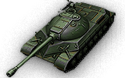<figcaption>WZ-111 model 1-4</figcaption></figure>
<em>Firepower</em> 
<strong>DPM (HP/min)</strong> <small>EU</small> 2 190.30  <small>RU</small> <strong>2 358.78</strong> 
<strong>Rate of fire (rounds/min)</strong> <small>EU</small> 4.47  <small>RU</small> <strong>4.81</strong> 
<strong>Reload time (s)</strong> <small>EU</small> 13.42  <small>RU</small> <strong>12.46</strong> 

<em>Gun handling</em> 
<strong>Aim time (s)</strong> <small>EU</small> 2.78  <small>RU</small> <strong>2.49</strong> 
<strong>Dispersion · moving</strong> <small>EU</small> 0.18  <small>RU</small> <strong>0.16</strong> 
<strong>Dispersion · tank traverse</strong> <small>EU</small> 0.18  <small>RU</small> <strong>0.16</strong> 
<strong>Dispersion · turret traverse</strong> <small>EU</small> 0.10  <small>RU</small> <strong>0.08</strong> 
<strong>Depression (°)</strong> <small>EU</small> 6  <small>RU</small> <strong>5</strong> 

<em>Mobility</em> 
<strong>Forward speed on soft terrain (km/h)</strong> <small>EU</small> 27.49  <small>RU</small> <strong>31.08</strong> 
<strong>Engine power (hp)</strong> <small>EU</small> 650  <small>RU</small> <strong>735</strong> 
<strong>Power/weight (hp/t)</strong> <small>EU</small> 14.44  <small>RU</small> <strong>16.33</strong> 
<strong>Tank traverse (°/s)</strong> <small>EU</small> 36.50  <small>RU</small> <strong>29.20</strong> 
<strong>Tank traverse on hard terrain (°/s)</strong> <small>EU</small> 38.67  <small>RU</small> <strong>38.17</strong> 
<strong>Tank traverse on medium terrain (°/s)</strong> <small>EU</small> 34.80  <small>RU</small> <strong>34.36</strong> 
<strong>Tank traverse on soft terrain (°/s)</strong> <small>EU</small> 17.40  <small>RU</small> <strong>17.18</strong> 

<em>Armor &amp; health</em> 
<strong>Hull armor · front (mm)</strong> <small>EU</small> 120  <small>RU</small> <strong>150</strong> 
<strong>Health</strong> <small>EU</small> 1 900  <small>RU</small> <strong>1 850</strong> 

WZ-111 model 1-4 FL · Tier IX

wz111model14fl

<a href="https://tanks.gg/v20410/tank/wz-111-1-4-fl">EU stats</a> · <a href="https://tanks.gg/v14600ru/tank/wz-111-1-4-fl">RU stats</a>
<figure style="display:inline-block">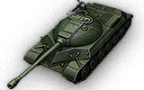<figcaption>WZ-111 model 1-4 FL</figcaption></figure>
<em>Firepower</em> 
<strong>DPM (HP/min)</strong> <small>EU</small> 2 190.30  <small>RU</small> <strong>2 358.78</strong> 
<strong>Rate of fire (rounds/min)</strong> <small>EU</small> 4.47  <small>RU</small> <strong>4.81</strong> 
<strong>Reload time (s)</strong> <small>EU</small> 13.42  <small>RU</small> <strong>12.46</strong> 

<em>Gun handling</em> 
<strong>Aim time (s)</strong> <small>EU</small> 2.78  <small>RU</small> <strong>2.49</strong> 
<strong>Dispersion · moving</strong> <small>EU</small> 0.18  <small>RU</small> <strong>0.16</strong> 
<strong>Dispersion · tank traverse</strong> <small>EU</small> 0.18  <small>RU</small> <strong>0.16</strong> 
<strong>Dispersion · turret traverse</strong> <small>EU</small> 0.10  <small>RU</small> <strong>0.08</strong> 
<strong>Depression (°)</strong> <small>EU</small> 6  <small>RU</small> <strong>5</strong> 

<em>Mobility</em> 
<strong>Forward speed on soft terrain (km/h)</strong> <small>EU</small> 27.49  <small>RU</small> <strong>31.08</strong> 
<strong>Engine power (hp)</strong> <small>EU</small> 650  <small>RU</small> <strong>735</strong> 
<strong>Power/weight (hp/t)</strong> <small>EU</small> 14.44  <small>RU</small> <strong>16.33</strong> 
<strong>Tank traverse (°/s)</strong> <small>EU</small> 36.50  <small>RU</small> <strong>29.20</strong> 
<strong>Tank traverse on hard terrain (°/s)</strong> <small>EU</small> 36.50  <small>RU</small> <strong>29.20</strong> 
<strong>Tank traverse on medium terrain (°/s)</strong> <small>EU</small> 32.85  <small>RU</small> <strong>26.28</strong> 
<strong>Tank traverse on soft terrain (°/s)</strong> <small>EU</small> 16.43  <small>RU</small> <strong>13.14</strong> 

<em>Armor &amp; health</em> 
<strong>Hull armor · front (mm)</strong> <small>EU</small> 120  <small>RU</small> <strong>150</strong> 
<strong>Health</strong> <small>EU</small> 1 900  <small>RU</small> <strong>1 850</strong> 

WZ-111G FT · Tier IX

wz111gft

<a href="https://tanks.gg/v20410/tank/wz-111g-ft">EU stats</a> · <a href="https://tanks.gg/v14600ru/tank/wz-111g-ft">RU stats</a>
<figure style="display:inline-block">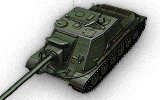<figcaption>EU · WZ-111G FT</figcaption></figure><figure style="display:inline-block">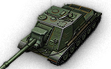<figcaption>RU · WZ-111G FT</figcaption></figure>
<strong>Penetration (mm)</strong> <b>EU</b>  AP <strong>290</strong> /  HEAT <strong>350</strong> /  HE <strong>90</strong> → <b>RU</b>  AP <strong>290</strong> /  HEAT <strong>395</strong> /  HE <strong>90</strong>

<em>Firepower</em> 
<strong>DPM (HP/min)</strong> <small>EU</small> 2 470.26  <small>RU</small> <strong>2 682</strong> 
<strong>Rate of fire (rounds/min)</strong> <small>EU</small> 3.29  <small>RU</small> <strong>3.58</strong> 
<strong>Reload time (s)</strong> <small>EU</small> 18.22  <small>RU</small> <strong>16.78</strong> 

<em>Gun handling</em> 
<strong>Dispersion · turret traverse</strong> <small>EU</small> 0.10  <small>RU</small> <strong>0.06</strong> 

<em>Mobility</em> 
<strong>Tank traverse on hard terrain (°/s)</strong> <small>EU</small> 26.46  <small>RU</small> <strong>31.27</strong> 
<strong>Tank traverse on medium terrain (°/s)</strong> <small>EU</small> 19.11  <small>RU</small> <strong>22.58</strong> 
<strong>Tank traverse on soft terrain (°/s)</strong> <small>EU</small> 11.86  <small>RU</small> <strong>14.02</strong> 

WZ-114 · Tier IX

wz114

<a href="https://tanks.gg/v20410/tank/wz-114">EU stats</a> · <a href="https://tanks.gg/v14600ru/tank/wz-114">RU stats</a>
<figure style="display:inline-block">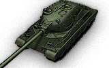<figcaption>WZ-114</figcaption></figure>
<em>Firepower</em> 
<strong>DPM (HP/min)</strong> <small>EU</small> 1 658.37  <small>RU</small> <strong>1 842.63</strong> 
<strong>Rate of fire (rounds/min)</strong> <small>EU</small> 3.13  <small>RU</small> <strong>3.48</strong> 
<strong>Reload time (s)</strong> <small>EU</small> 19.18  <small>RU</small> <strong>17.26</strong> 

<em>Gun handling</em> 
<strong>Aim time (s)</strong> <small>EU</small> 2.88  <small>RU</small> <strong>2.68</strong> 
<strong>Dispersion · moving</strong> <small>EU</small> 0.27  <small>RU</small> <strong>0.24</strong> 
<strong>Dispersion · tank traverse</strong> <small>EU</small> 0.27  <small>RU</small> <strong>0.24</strong> 
<strong>Dispersion · turret traverse</strong> <small>EU</small> 0.16  <small>RU</small> <strong>0.20</strong> 
<strong>Dispersion · firing</strong> <small>EU</small> 4  <small>RU</small> <strong>7</strong> 

<em>Mobility</em> 
<strong>Reverse speed (km/h)</strong> <small>EU</small> 10  <small>RU</small> <strong>14</strong> 

WZ-120 · Tier IX

wz120

<a href="https://tanks.gg/v20410/tank/wz-120">EU stats</a> · <a href="https://tanks.gg/v14600ru/tank/wz-120">RU stats</a>
<figure style="display:inline-block">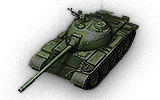<figcaption>WZ-120</figcaption></figure>
<em>Gun handling</em> 
<strong>Aim time (s)</strong> <small>EU</small> 2.30  <small>RU</small> <strong>2.59</strong> 
<strong>Depression (°)</strong> <small>EU</small> 5.50  <small>RU</small> <strong>3</strong> 

<em>Mobility</em> 
<strong>Forward speed on soft terrain (km/h)</strong> <small>EU</small> 36.95  <small>RU</small> <strong>41.74</strong> 
<strong>Engine power (hp)</strong> <small>EU</small> 650  <small>RU</small> <strong>734.37</strong> 
<strong>Power/weight (hp/t)</strong> <small>EU</small> 17.47  <small>RU</small> <strong>19.74</strong> 
<strong>Tank traverse (°/s)</strong> <small>EU</small> 57.36  <small>RU</small> <strong>47.98</strong> 
<strong>Tank traverse on hard terrain (°/s)</strong> <small>EU</small> 62.21  <small>RU</small> <strong>62.02</strong> 
<strong>Tank traverse on medium terrain (°/s)</strong> <small>EU</small> 55.30  <small>RU</small> <strong>55.13</strong> 
<strong>Tank traverse on soft terrain (°/s)</strong> <small>EU</small> 27.65  <small>RU</small> <strong>27.56</strong> 

<em>Armor &amp; health</em> 
<strong>Health</strong> <small>EU</small> 1 800  <small>RU</small> <strong>1 750</strong> 

WZ-120G FT · Tier IX

wz120gft

<a href="https://tanks.gg/v20410/tank/wz-120g-ft">EU stats</a> · <a href="https://tanks.gg/v14600ru/tank/wz-120g-ft">RU stats</a>
<figure style="display:inline-block">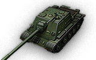<figcaption>WZ-120G FT</figcaption></figure>
<em>Firepower</em> 
<strong>DPM (HP/min)</strong> <small>EU</small> 3 129  <small>RU</small> <strong>2 944.94</strong> 
<strong>Rate of fire (rounds/min)</strong> <small>EU</small> 5.59  <small>RU</small> <strong>5.26</strong> 
<strong>Reload time (s)</strong> <small>EU</small> 10.74  <small>RU</small> <strong>11.41</strong> 

<em>Gun handling</em> 
<strong>Aim time (s)</strong> <small>EU</small> 2.11  <small>RU</small> <strong>2.21</strong> 
<strong>Dispersion · moving</strong> <small>EU</small> 0.20  <small>RU</small> <strong>0.18</strong> 
<strong>Dispersion · tank traverse</strong> <small>EU</small> 0.20  <small>RU</small> <strong>0.18</strong> 
<strong>Dispersion · turret traverse</strong> <small>EU</small> 0.06  <small>RU</small> <strong>0.10</strong> 
<strong>Depression (°)</strong> <small>EU</small> 7  <small>RU</small> <strong>6</strong> 

<em>Mobility</em> 
<strong>Forward speed on soft terrain (km/h)</strong> <small>EU</small> 28.60  <small>RU</small> <strong>24.79</strong> 
<strong>Engine power (hp)</strong> <small>EU</small> 600  <small>RU</small> <strong>520</strong> 
<strong>Power/weight (hp/t)</strong> <small>EU</small> 16.53  <small>RU</small> <strong>14.33</strong> 
<strong>Tank traverse (°/s)</strong> <small>EU</small> 43.81  <small>RU</small> <strong>39.63</strong> 
<strong>Tank traverse on hard terrain (°/s)</strong> <small>EU</small> 41.62  <small>RU</small> <strong>37.65</strong> 
<strong>Tank traverse on medium terrain (°/s)</strong> <small>EU</small> 37.83  <small>RU</small> <strong>34.23</strong> 
<strong>Tank traverse on soft terrain (°/s)</strong> <small>EU</small> 18.92  <small>RU</small> <strong>17.11</strong> 

<em>Armor &amp; health</em> 
<strong>Hull armor · front (mm)</strong> <small>EU</small> 200  <small>RU</small> <strong>150</strong> 
<strong>Health</strong> <small>EU</small> 1 800  <small>RU</small> <strong>1 700</strong> 

WZ-132A · Tier IX

wz132a

<a href="https://tanks.gg/v20410/tank/wz-132a">EU stats</a> · <a href="https://tanks.gg/v14600ru/tank/wz-132a">RU stats</a>
<figure style="display:inline-block">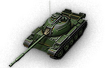<figcaption>WZ-132A</figcaption></figure>
<em>Firepower</em> 
<strong>DPM (HP/min)</strong> <small>EU</small> 2 250.07  <small>RU</small> <strong>2 176.70</strong> 
<strong>Rate of fire (rounds/min)</strong> <small>EU</small> 7.03  <small>RU</small> <strong>6.80</strong> 
<strong>Reload time (s)</strong> <small>EU</small> 8.53  <small>RU</small> <strong>8.82</strong> 

<em>Gun handling</em> 
<strong>Aim time (s)</strong> <small>EU</small> 1.92  <small>RU</small> <strong>2.21</strong> 
<strong>Dispersion (m/100 m)</strong> <small>EU</small> 0.36  <small>RU</small> <strong>0.40</strong> 
<strong>Dispersion · damaged</strong> <small>EU</small> 0.73  <small>RU</small> <strong>0.81</strong> 
<strong>Dispersion · moving</strong> <small>EU</small> 0.12  <small>RU</small> <strong>0.13</strong> 
<strong>Dispersion · tank traverse</strong> <small>EU</small> 0.12  <small>RU</small> <strong>0.13</strong> 
<strong>Dispersion · turret traverse</strong> <small>EU</small> 0.09  <small>RU</small> <strong>0.10</strong> 
<strong>Depression (°)</strong> <small>EU</small> 6  <small>RU</small> <strong>5</strong> 

<em>Mobility</em> 
<strong>Forward speed (km/h)</strong> <small>EU</small> 68  <small>RU</small> <strong>64</strong> 
<strong>Forward speed on hard terrain (km/h)</strong> <small>EU</small> 68  <small>RU</small> <strong>64</strong> 
<strong>Forward speed on medium terrain (km/h)</strong> <small>EU</small> 68  <small>RU</small> <strong>64</strong> 
<strong>Forward speed on soft terrain (km/h)</strong> <small>EU</small> 67.84  <small>RU</small> <strong>54.27</strong> 
<strong>Terrain resist (hard)</strong> <small>EU</small> 0.77  <small>RU</small> <strong>0.96</strong> 
<strong>Terrain resist (med)</strong> <small>EU</small> 0.86  <small>RU</small> <strong>1.08</strong> 
<strong>Terrain resist (soft)</strong> <small>EU</small> 1.73  <small>RU</small> <strong>2.16</strong> 
<strong>Turret traverse (°/s)</strong> <small>EU</small> 44.85  <small>RU</small> <strong>41.72</strong> 
<strong>Tank traverse (°/s)</strong> <small>EU</small> 46.93  <small>RU</small> <strong>47.98</strong> 
<strong>Tank traverse on hard terrain (°/s)</strong> <small>EU</small> 50.96  <small>RU</small> <strong>52.09</strong> 
<strong>Tank traverse on medium terrain (°/s)</strong> <small>EU</small> 45.30  <small>RU</small> <strong>46.31</strong> 
<strong>Tank traverse on soft terrain (°/s)</strong> <small>EU</small> 22.65  <small>RU</small> <strong>23.15</strong> 

<em>Armor &amp; health</em> 
<strong>Track armor</strong> <small>EU</small> 10  <small>RU</small> <strong>15</strong> 
<strong>Health</strong> <small>EU</small> 1 550  <small>RU</small> <strong>1 250</strong> 

