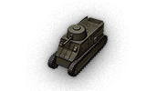

# Czechoslovakia · Tier I

[All nations and tiers](../buffs_nerfs.md) · EU v20410 → RU v14600ru · 3 November 2026

<label><strong>Find a tank</strong><input type="search" placeholder="Try is7, obj140 or xm57" aria-label="Find a tank" style="display:block;width:100%;padding:.7rem;border:1px solid #888;border-radius:4px;margin:.5rem 0;color:inherit;background:transparent"></label>

Kolohousenka · Tier I

kolohousenka

<a href="https://tanks.gg/v20410/tank/k-housenka">EU stats</a> · <a href="https://tanks.gg/v14600ru/tank/k-housenka">RU stats</a>
<figure style="display:inline-block"><figcaption>Kolohousenka</figcaption></figure>
<em>Gun handling</em> 
<strong>Dispersion (m/100 m)</strong> <small>EU</small> 0.42  <small>RU</small> <strong>0.40</strong> 
<strong>Dispersion · damaged</strong> <small>EU</small> 0.84  <small>RU</small> <strong>0.80</strong> 
<strong>Dispersion · moving</strong> <small>EU</small> 0.36  <small>RU</small> <strong>0.10</strong> 
<strong>Dispersion · tank traverse</strong> <small>EU</small> 0.36  <small>RU</small> <strong>0.10</strong> 
<strong>Dispersion · turret traverse</strong> <small>EU</small> 0.14  <small>RU</small> <strong>0.10</strong> 
<strong>Dispersion · firing</strong> <small>EU</small> 4  <small>RU</small> <strong>3</strong> 

<em>Mobility</em> 
<strong>Forward speed (km/h)</strong> <small>EU</small> 25  <small>RU</small> <strong>30</strong> 
<strong>Forward speed on hard terrain (km/h)</strong> <small>EU</small> 25  <small>RU</small> <strong>30</strong> 
<strong>Forward speed on medium terrain (km/h)</strong> <small>EU</small> 25  <small>RU</small> <strong>25.39</strong> 
<strong>Forward speed on soft terrain (km/h)</strong> <small>EU</small> 19.21  <small>RU</small> <strong>16.92</strong> 
<strong>Engine power (hp)</strong> <small>EU</small> 60  <small>RU</small> <strong>52.86</strong> 
<strong>Power/weight (hp/t)</strong> <small>EU</small> 7.57  <small>RU</small> <strong>6.67</strong> 

<em>Armor &amp; health</em> 
<strong>Health</strong> <small>EU</small> 235  <small>RU</small> <strong>280</strong> 
<strong>Track repair time (s)</strong> <small>EU</small> 6  <small>RU</small> <strong>3</strong> 

<em>Miscellaneous</em> 
<strong>View range (m)</strong> <small>EU</small> 280  <small>RU</small> <strong>300</strong> 

