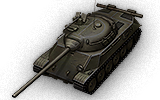
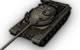
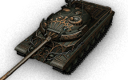
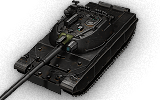
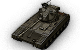
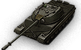

# Czechoslovakia · Tier X

[All nations and tiers](../buffs_nerfs.md) · EU v20410 → RU v14600ru · 3 November 2026

<label><strong>Find a tank</strong><input type="search" placeholder="Try is7, obj140 or xm57" aria-label="Find a tank" style="display:block;width:100%;padding:.7rem;border:1px solid #888;border-radius:4px;margin:.5rem 0;color:inherit;background:transparent"></label>

TVP T 50/51 · Tier X

tvpt5051

<a href="https://tanks.gg/v20410/tank/tvp-t-5051">EU stats</a> · <a href="https://tanks.gg/v14600ru/tank/tvp-t-5051">RU stats</a>
<figure style="display:inline-block"><figcaption>TVP T 50/51</figcaption></figure>
<em>Mobility</em> 
<strong>Forward speed on soft terrain (km/h)</strong> <small>EU</small> 59.20  <small>RU</small> <strong>55.89</strong> 
<strong>Engine power (hp)</strong> <small>EU</small> 1 120  <small>RU</small> <strong>1 057.28</strong> 
<strong>Power/weight (hp/t)</strong> <small>EU</small> 28  <small>RU</small> <strong>26.43</strong> 

<em>Armor &amp; health</em> 
<strong>Health</strong> <small>EU</small> 1 850  <small>RU</small> <strong>1 800</strong> 
<strong>Health · engine</strong> <small>EU</small> 340  <small>RU</small> <strong>360</strong> 

Vz. 55 · Tier X

vz55

<a href="https://tanks.gg/v20410/tank/vz-55">EU stats</a> · <a href="https://tanks.gg/v14600ru/tank/vz-55">RU stats</a>
<figure style="display:inline-block"><figcaption>Vz. 55</figcaption></figure>
<strong>Penetration (mm)</strong> <b>EU</b>  AP <strong>260</strong> /  APCR <strong>315</strong> /  HE <strong>68</strong> → <b>RU</b>  AP <strong>260</strong> /  APCR <strong>306</strong> /  HE <strong>68</strong>

<strong>Damage (HP)</strong> <b>EU</b>  AP <strong>530</strong> /  APCR <strong>530</strong> /  HE <strong>640</strong> → <b>RU</b>  AP <strong>490</strong> /  APCR <strong>490</strong> /  HE <strong>640</strong>

<em>Firepower</em> 
<strong>DPM (HP/min)</strong> <small>EU</small> 2 763.95  <small>RU</small> <strong>2 221.44</strong> 
<strong>Rate of fire (rounds/min)</strong> <small>EU</small> 5.21  <small>RU</small> <strong>4.53</strong> 
<strong>Reload time (s)</strong> <small>EU</small> 11.51  <small>RU</small> <strong>23.97</strong> 
<strong>Potential damage</strong> <small>EU</small> 21 200  <small>RU</small> <strong>19 600</strong> 
<strong>Clip size</strong> <small>EU</small> — → <small>RU</small> <strong>2</strong> 
<strong>Clip damage · damage</strong> <small>EU</small> — → <small>RU</small> <strong>980</strong> 
<strong>Clip damage · time (s)</strong> <small>EU</small> — → <small>RU</small> <strong>2.50</strong> 
<strong>Intra-clip reload</strong> <small>EU</small> — → <small>RU</small> <strong>2.50</strong> 

<em>Gun handling</em> 
<strong>Aim time (s)</strong> <small>EU</small> 1.92  <small>RU</small> <strong>2.88</strong> 
<strong>Dispersion (m/100 m)</strong> <small>EU</small> 0.34  <small>RU</small> <strong>0.36</strong> 
<strong>Dispersion · damaged</strong> <small>EU</small> 0.67  <small>RU</small> <strong>0.73</strong> 

<em>Mobility</em> 
<strong>Forward speed on medium terrain (km/h)</strong> <small>EU</small> 49.10  <small>RU</small> <strong>49.02</strong> 
<strong>Forward speed on soft terrain (km/h)</strong> <small>EU</small> 23.57  <small>RU</small> <strong>23.53</strong> 
<strong>Weight (kg)</strong> <small>EU</small> 54 900 → <small>RU</small> <strong>55 000</strong> 
<strong>Power/weight (hp/t)</strong> <small>EU</small> 15.48  <small>RU</small> <strong>15.45</strong> 
<strong>Tank traverse on hard terrain (°/s)</strong> <small>EU</small> 29.78  <small>RU</small> <strong>29.67</strong> 
<strong>Tank traverse on medium terrain (°/s)</strong> <small>EU</small> 27.28  <small>RU</small> <strong>27.18</strong> 
<strong>Tank traverse on soft terrain (°/s)</strong> <small>EU</small> 13.10  <small>RU</small> <strong>13.05</strong> 

<em>Armor &amp; health</em> 
<strong>Health · engine</strong> <small>EU</small> 340  <small>RU</small> <strong>360</strong> 

Vz. 55 Gothic Warrior · Tier X

vz55gothicwarrior

<a href="https://tanks.gg/v20410/tank/vz-55-gw">EU stats</a> · <a href="https://tanks.gg/v14600ru/tank/warrior">RU stats</a>
<figure style="display:inline-block"><figcaption>Vz. 55 Gothic Warrior</figcaption></figure>
<em>Firepower</em> 
<strong>DPM (HP/min)</strong> <small>EU</small> 2 546.23  <small>RU</small> <strong>2 576.82</strong> 
<strong>Rate of fire (rounds/min)</strong> <small>EU</small> 5.20  <small>RU</small> <strong>5.26</strong> 
<strong>Reload time (s)</strong> <small>EU</small> 21.09  <small>RU</small> <strong>11.41</strong> 
<strong>Clip damage · time (s)</strong> <small>EU</small> 2  <small>RU</small> <strong>2.50</strong> 
<strong>Intra-clip reload</strong> <small>EU</small> 2  <small>RU</small> <strong>2.50</strong> 

<em>Gun handling</em> 
<strong>Aim time (s)</strong> <small>EU</small> 2.59  <small>RU</small> <strong>2.30</strong> 
<strong>Dispersion (m/100 m)</strong> <small>EU</small> 0.36  <small>RU</small> <strong>0.35</strong> 
<strong>Dispersion · damaged</strong> <small>EU</small> 0.73  <small>RU</small> <strong>0.69</strong> 
<strong>Dispersion · firing</strong> <small>EU</small> 4  <small>RU</small> <strong>3</strong> 

Vz. 60S Dravec · EU X → RU VIII

vz60sdravec

<a href="https://tanks.gg/v20410/tank/dravec">EU stats</a> · <a href="https://tanks.gg/v14600ru/tank/dravec">RU stats</a>
<figure style="display:inline-block"><figcaption>EU · Vz. 60S Dravec</figcaption></figure><figure style="display:inline-block"><figcaption>RU · Vz. 59 Dravec</figcaption></figure>
<strong>Penetration (mm)</strong> <b>EU</b>  AP <strong>264</strong> /  APCR <strong>315</strong> /  HE <strong>61</strong> → <b>RU</b>  APCR <strong>216</strong> /  HEAT <strong>250</strong> /  HE <strong>50</strong>

<strong>Damage (HP)</strong> <b>EU</b>  AP <strong>450</strong> /  APCR <strong>450</strong> /  HE <strong>540</strong> → <b>RU</b>  APCR <strong>320</strong> /  HEAT <strong>320</strong> /  HE <strong>420</strong>

EU lists the Vz. 60S Dravec as a tier X heavy. Its model resembles the RU TST. The RU vehicle named Vz. 59 Dravec is a tier VIII medium with a different hull and turret. Select a vehicle image to inspect its 3D model.
<figure style="display:inline-block;margin:0 1rem 0 0"><figcaption>EU · Vz. 60S Dravec</figcaption></figure><figure style="display:inline-block;margin:0 1rem 0 0"><figcaption>RU · Vz. 59 Dravec</figcaption></figure><figure style="display:inline-block;margin:0 1rem 0 0"><figcaption>RU · TST</figcaption></figure>
<em>General</em> 
<strong>Tier</strong> <small>EU</small> 10 → <small>RU</small> <strong>8</strong> 

<em>Firepower</em> 
<strong>DPM (HP/min)</strong> <small>EU</small> 2 560.09  <small>RU</small> <strong>1 706</strong> 
<strong>Module damage</strong> <small>EU</small> 165  <small>RU</small> <strong>135</strong> 
<strong>Rate of fire (rounds/min)</strong> <small>EU</small> 5.69  <small>RU</small> <strong>5.33</strong> 
<strong>Reload time (s)</strong> <small>EU</small> 10.55  <small>RU</small> <strong>28.76</strong> 
<strong>Caliber</strong> <small>EU</small> 122  <small>RU</small> <strong>100</strong> 
<strong>Shell velocity (m/s)</strong> <small>EU</small> 970  <small>RU</small> <strong>1 415</strong> 
<strong>Normalization</strong> <small>EU</small> 5  <small>RU</small> <strong>2</strong> 
<strong>Ammo capacity</strong> <small>EU</small> 40  <small>RU</small> <strong>66</strong> 
<strong>Potential damage</strong> <small>EU</small> 18 000  <small>RU</small> <strong>21 120</strong> 
<strong>Clip size</strong> <small>EU</small> — → <small>RU</small> <strong>3</strong> 
<strong>Clip damage · damage</strong> <small>EU</small> — → <small>RU</small> <strong>960</strong> 
<strong>Clip damage · time (s)</strong> <small>EU</small> — → <small>RU</small> <strong>5</strong> 
<strong>Intra-clip reload</strong> <small>EU</small> — → <small>RU</small> <strong>2.50</strong> 

<em>Gun handling</em> 
<strong>Aim time (s)</strong> <small>EU</small> 1.92  <small>RU</small> <strong>2.88</strong> 
<strong>Dispersion (m/100 m)</strong> <small>EU</small> 0.32  <small>RU</small> <strong>0.36</strong> 
<strong>Dispersion · damaged</strong> <small>EU</small> 0.63  <small>RU</small> <strong>0.73</strong> 
<strong>Dispersion · turret traverse</strong> <small>EU</small> 0.12  <small>RU</small> <strong>0.08</strong> 
<strong>Dispersion · firing</strong> <small>EU</small> 4  <small>RU</small> <strong>3.50</strong> 
<strong>Elevation (°)</strong> <small>EU</small> 20  <small>RU</small> <strong>18</strong> 

<em>Mobility</em> 
<strong>Forward speed (km/h)</strong> <small>EU</small> 45  <small>RU</small> <strong>60</strong> 
<strong>Forward speed on hard terrain (km/h)</strong> <small>EU</small> 45  <small>RU</small> <strong>60</strong> 
<strong>Forward speed on medium terrain (km/h)</strong> <small>EU</small> 45  <small>RU</small> <strong>60</strong> 
<strong>Forward speed on soft terrain (km/h)</strong> <small>EU</small> 32.81  <small>RU</small> <strong>46.74</strong> 
<strong>Reverse speed (km/h)</strong> <small>EU</small> 15  <small>RU</small> <strong>20</strong> 
<strong>Engine power (hp)</strong> <small>EU</small> 1 000  <small>RU</small> <strong>1 050</strong> 
<strong>Weight (kg)</strong> <small>EU</small> 58 000 → <small>RU</small> <strong>44 997</strong> 
<strong>Power/weight (hp/t)</strong> <small>EU</small> 17.24  <small>RU</small> <strong>23.33</strong> 
<strong>Terrain resist (med)</strong> <small>EU</small> 1.15  <small>RU</small> <strong>1.25</strong> 
<strong>Terrain resist (soft)</strong> <small>EU</small> 1.92  <small>RU</small> <strong>1.82</strong> 
<strong>Turret traverse (°/s)</strong> <small>EU</small> 26.08  <small>RU</small> <strong>41.72</strong> 
<strong>Tank traverse (°/s)</strong> <small>EU</small> 36.50  <small>RU</small> <strong>41.72</strong> 
<strong>Tank traverse on hard terrain (°/s)</strong> <small>EU</small> 34.68  <small>RU</small> <strong>39.63</strong> 
<strong>Tank traverse on medium terrain (°/s)</strong> <small>EU</small> 28.90  <small>RU</small> <strong>30.49</strong> 
<strong>Tank traverse on soft terrain (°/s)</strong> <small>EU</small> 17.34  <small>RU</small> <strong>20.86</strong> 

<em>Armor &amp; health</em> 
<strong>Hull armor · front (mm)</strong> <small>EU</small> 100  <small>RU</small> <strong>70</strong> 
<strong>Hull armor · side (mm)</strong> <small>EU</small> 80  <small>RU</small> <strong>60</strong> 
<strong>Hull armor · rear (mm)</strong> <small>EU</small> 50  <small>RU</small> <strong>40</strong> 
<strong>Turret armor · front (mm)</strong> <small>EU</small> 330  <small>RU</small> <strong>160</strong> 
<strong>Turret armor · side (mm)</strong> <small>EU</small> 100  <small>RU</small> <strong>120</strong> 
<strong>Turret armor · rear (mm)</strong> <small>EU</small> 50  <small>RU</small> <strong>80</strong> 
<strong>Track armor</strong> <small>EU</small> 25  <small>RU</small> <strong>20</strong> 
<strong>Health</strong> <small>EU</small> 2 200  <small>RU</small> <strong>1 350</strong> 
<strong>Health · engine</strong> <small>EU</small> 345  <small>RU</small> <strong>255</strong> 
<strong>Health · track</strong> <small>EU</small> 250  <small>RU</small> <strong>200</strong> 
<strong>Health · ammo rack</strong> <small>EU</small> 250  <small>RU</small> <strong>220</strong> 
<strong>Health · fuel tank</strong> <small>EU</small> 200  <small>RU</small> <strong>175</strong> 
<strong>Track repair time (s)</strong> <small>EU</small> 11.79  <small>RU</small> <strong>10.03</strong> 

<em>Miscellaneous</em> 
<strong>Stationary camo</strong> <small>EU</small> 6.73  <small>RU</small> <strong>13.85</strong> 
<strong>Stationary camo · after firing</strong> <small>EU</small> 1.21  <small>RU</small> <strong>2.74</strong> 
<strong>Moving camo</strong> <small>EU</small> 3.36  <small>RU</small> <strong>10.37</strong> 
<strong>Moving camo · after firing</strong> <small>EU</small> 0.61  <small>RU</small> <strong>2.05</strong> 
<strong>Radio range (m)</strong> <small>EU</small> 750  <small>RU</small> <strong>680</strong> 
<strong>Shell cost</strong> <small>EU</small> 1 161  <small>RU</small> <strong>890</strong> 

