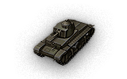

# Czechoslovakia · Tier II

[All nations and tiers](../buffs_nerfs.md) · EU v20410 → RU v14600ru · 3 November 2026

<label><strong>Find a tank</strong><input type="search" placeholder="Try is7, obj140 or xm57" aria-label="Find a tank" style="display:block;width:100%;padding:.7rem;border:1px solid #888;border-radius:4px;margin:.5rem 0;color:inherit;background:transparent"></label>

LT vz. 35 · Tier II

ltvz35

<a href="https://tanks.gg/v20410/tank/lt-vz-35">EU stats</a> · <a href="https://tanks.gg/v14600ru/tank/lt-vz-35">RU stats</a>
<figure style="display:inline-block"><figcaption>LT vz. 35</figcaption></figure>
<em>Firepower</em> 
<strong>Shell velocity (m/s)</strong> <small>EU</small> 720  <small>RU</small> <strong>675</strong> 

<em>Gun handling</em> 
<strong>Aim time (s)</strong> <small>EU</small> 1.70  <small>RU</small> <strong>1.50</strong> 
<strong>Dispersion · moving</strong> <small>EU</small> 0.28  <small>RU</small> <strong>0.24</strong> 
<strong>Dispersion · tank traverse</strong> <small>EU</small> 0.28  <small>RU</small> <strong>0.24</strong> 
<strong>Dispersion · turret traverse</strong> <small>EU</small> 0.11  <small>RU</small> <strong>0.10</strong> 
<strong>Dispersion · firing</strong> <small>EU</small> 4  <small>RU</small> <strong>1</strong> 

<em>Mobility</em> 
<strong>Forward speed (km/h)</strong> <small>EU</small> 40  <small>RU</small> <strong>34</strong> 
<strong>Forward speed on hard terrain (km/h)</strong> <small>EU</small> 40  <small>RU</small> <strong>34</strong> 
<strong>Forward speed on medium terrain (km/h)</strong> <small>EU</small> 40  <small>RU</small> <strong>34</strong> 
<strong>Forward speed on soft terrain (km/h)</strong> <small>EU</small> 36.25  <small>RU</small> <strong>25.87</strong> 
<strong>Engine power (hp)</strong> <small>EU</small> 200  <small>RU</small> <strong>142.73</strong> 
<strong>Power/weight (hp/t)</strong> <small>EU</small> 19.05  <small>RU</small> <strong>13.59</strong> 
<strong>Turret traverse (°/s)</strong> <small>EU</small> 30  <small>RU</small> <strong>45</strong> 
<strong>Tank traverse (°/s)</strong> <small>EU</small> 54.24  <small>RU</small> <strong>46.93</strong> 
<strong>Tank traverse on hard terrain (°/s)</strong> <small>EU</small> 60.26  <small>RU</small> <strong>46.93</strong> 
<strong>Tank traverse on medium terrain (°/s)</strong> <small>EU</small> 50.22  <small>RU</small> <strong>39.11</strong> 
<strong>Tank traverse on soft terrain (°/s)</strong> <small>EU</small> 30.13  <small>RU</small> <strong>23.47</strong> 

<em>Armor &amp; health</em> 
<strong>Health · engine</strong> <small>EU</small> 50  <small>RU</small> <strong>55</strong> 
<strong>Track repair time (s)</strong> <small>EU</small> 12.03  <small>RU</small> <strong>3</strong> 

