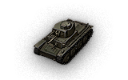
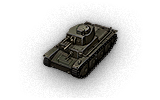
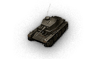
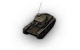

# Czechoslovakia · Tier III

[All nations and tiers](../buffs_nerfs.md) · EU v20410 → RU v14600ru · 3 November 2026

<label><strong>Find a tank</strong><input type="search" placeholder="Try is7, obj140 or xm57" aria-label="Find a tank" style="display:block;width:100%;padding:.7rem;border:1px solid #888;border-radius:4px;margin:.5rem 0;color:inherit;background:transparent"></label>

LT vz. 38 · Tier III

ltvz38

<a href="https://tanks.gg/v20410/tank/lt-vz-38">EU stats</a> · <a href="https://tanks.gg/v14600ru/tank/lt-vz-38">RU stats</a>
<figure style="display:inline-block"><figcaption>EU · LT vz. 38</figcaption></figure><figure style="display:inline-block"><figcaption>RU · LT vz. 38</figcaption></figure>
<strong>Damage (HP)</strong> <b>EU</b>  AP <strong>45</strong> /  APCR <strong>45</strong> /  HE <strong>50</strong> → <b>RU</b>  AP <strong>40</strong> /  APCR <strong>40</strong> /  HE <strong>45</strong>

<em>Firepower</em> 
<strong>DPM (HP/min)</strong> <small>EU</small> 1 192.25  <small>RU</small> <strong>1 330.78</strong> 
<strong>Rate of fire (rounds/min)</strong> <small>EU</small> 26.49  <small>RU</small> <strong>33.27</strong> 
<strong>Reload time (s)</strong> <small>EU</small> 4.79  <small>RU</small> <strong>4.41</strong> 
<strong>Clip damage · damage</strong> <small>EU</small> 135  <small>RU</small> <strong>120</strong> 
<strong>Clip damage · time (s)</strong> <small>EU</small> 2  <small>RU</small> <strong>1</strong> 
<strong>Intra-clip reload</strong> <small>EU</small> 1  <small>RU</small> <strong>0.50</strong> 
<strong>Potential damage</strong> <small>EU</small> 7 155  <small>RU</small> <strong>6 360</strong> 

<em>Gun handling</em> 
<strong>Aim time (s)</strong> <small>EU</small> 1.50  <small>RU</small> <strong>1.70</strong> 
<strong>Dispersion · moving</strong> <small>EU</small> 0.27  <small>RU</small> <strong>0.22</strong> 
<strong>Dispersion · tank traverse</strong> <small>EU</small> 0.27  <small>RU</small> <strong>0.22</strong> 
<strong>Dispersion · firing</strong> <small>EU</small> 3  <small>RU</small> <strong>1.50</strong> 

<em>Mobility</em> 
<strong>Forward speed (km/h)</strong> <small>EU</small> 45  <small>RU</small> <strong>42</strong> 
<strong>Forward speed on hard terrain (km/h)</strong> <small>EU</small> 45  <small>RU</small> <strong>42</strong> 
<strong>Forward speed on medium terrain (km/h)</strong> <small>EU</small> 45  <small>RU</small> <strong>42</strong> 
<strong>Forward speed on soft terrain (km/h)</strong> <small>EU</small> 43.90  <small>RU</small> <strong>29.54</strong> 
<strong>Engine power (hp)</strong> <small>EU</small> 220  <small>RU</small> <strong>148.02</strong> 
<strong>Power/weight (hp/t)</strong> <small>EU</small> 20.76  <small>RU</small> <strong>13.97</strong> 
<strong>Tank traverse (°/s)</strong> <small>EU</small> 47.98  <small>RU</small> <strong>39.63</strong> 
<strong>Tank traverse on hard terrain (°/s)</strong> <small>EU</small> 49.16  <small>RU</small> <strong>41.18</strong> 
<strong>Tank traverse on medium terrain (°/s)</strong> <small>EU</small> 40.97  <small>RU</small> <strong>34.32</strong> 
<strong>Tank traverse on soft terrain (°/s)</strong> <small>EU</small> 27.31  <small>RU</small> <strong>22.88</strong> 

<em>Armor &amp; health</em> 
<strong>Health</strong> <small>EU</small> 420  <small>RU</small> <strong>450</strong> 
<strong>Health · engine</strong> <small>EU</small> 75  <small>RU</small> <strong>55</strong> 
<strong>Track repair time (s)</strong> <small>EU</small> 12.03  <small>RU</small> <strong>4</strong> 

Panzerwagen 39 · Tier III

panzerwagen39

<a href="https://tanks.gg/v20410/tank/pzw-39">EU stats</a> · <a href="https://tanks.gg/v14600ru/tank/pzw39">RU stats</a>
<figure style="display:inline-block"><figcaption>EU · Panzerwagen 39</figcaption></figure><figure style="display:inline-block"><figcaption>RU · Pzw.39</figcaption></figure>
<strong>Penetration (mm)</strong> <b>EU</b>  AP <strong>45</strong> /  AP <strong>60</strong> /  HE <strong>30</strong> → <b>RU</b>  AP <strong>56</strong> /  APCR <strong>82</strong> /  HE <strong>20</strong>

<strong>Damage (HP)</strong> <b>EU</b>  AP <strong>30</strong> /  AP <strong>30</strong> /  HE <strong>40</strong> → <b>RU</b>  AP <strong>20</strong> /  APCR <strong>20</strong> /  HE <strong>30</strong>

<em>Firepower</em> 
<strong>DPM (HP/min)</strong> <small>EU</small> 1 125  <small>RU</small> <strong>958.05</strong> 
<strong>Rate of fire (rounds/min)</strong> <small>EU</small> 37.50  <small>RU</small> <strong>47.90</strong> 
<strong>Reload time (s)</strong> <small>EU</small> 1.60  <small>RU</small> <strong>6.27</strong> 
<strong>Ammo capacity</strong> <small>EU</small> 360  <small>RU</small> <strong>220</strong> 
<strong>Potential damage</strong> <small>EU</small> 10 800  <small>RU</small> <strong>4 400</strong> 
<strong>Clip size</strong> <small>EU</small> — → <small>RU</small> <strong>6</strong> 
<strong>Clip damage · damage</strong> <small>EU</small> — → <small>RU</small> <strong>120</strong> 
<strong>Clip damage · time (s)</strong> <small>EU</small> — → <small>RU</small> <strong>1.25</strong> 
<strong>Intra-clip reload</strong> <small>EU</small> — → <small>RU</small> <strong>0.25</strong> 

<em>Gun handling</em> 
<strong>Aim time (s)</strong> <small>EU</small> 1.20  <small>RU</small> <strong>1.15</strong> 
<strong>Dispersion (m/100 m)</strong> <small>EU</small> 0.40  <small>RU</small> <strong>0.38</strong> 
<strong>Dispersion · damaged</strong> <small>EU</small> 0.80  <small>RU</small> <strong>0.77</strong> 
<strong>Dispersion · moving</strong> <small>EU</small> 0.18  <small>RU</small> <strong>0.21</strong> 
<strong>Dispersion · tank traverse</strong> <small>EU</small> 0.18  <small>RU</small> <strong>0.21</strong> 
<strong>Dispersion · firing</strong> <small>EU</small> 3  <small>RU</small> <strong>1.50</strong> 

<em>Mobility</em> 
<strong>Turret traverse (°/s)</strong> <small>EU</small> 40  <small>RU</small> <strong>41.72</strong> 

<em>Armor &amp; health</em> 
<strong>Health</strong> <small>EU</small> 445  <small>RU</small> <strong>460</strong> 
<strong>Track repair time (s)</strong> <small>EU</small> 10.03  <small>RU</small> <strong>4</strong> 

<em>Miscellaneous</em> 
<strong>Radio range (m)</strong> <small>EU</small> 432.85  <small>RU</small> <strong>415</strong> 

