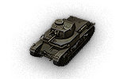

# Czechoslovakia · Tier IV

[All nations and tiers](../buffs_nerfs.md) · EU v20410 → RU v14600ru · 3 November 2026

<label><strong>Find a tank</strong><input type="search" placeholder="Try is7, obj140 or xm57" aria-label="Find a tank" style="display:block;width:100%;padding:.7rem;border:1px solid #888;border-radius:4px;margin:.5rem 0;color:inherit;background:transparent"></label>

ST vz. 39 · Tier IV

stvz39

<a href="https://tanks.gg/v20410/tank/st-vz-39">EU stats</a> · <a href="https://tanks.gg/v14600ru/tank/st-vz-39">RU stats</a>
<figure style="display:inline-block"><figcaption>ST vz. 39</figcaption></figure>
<strong>Penetration (mm)</strong> <b>EU</b>  AP <strong>97</strong> /  APCR <strong>132</strong> /  HE <strong>24</strong> → <b>RU</b>  AP <strong>86</strong> /  APCR <strong>132</strong> /  HE <strong>24</strong>

<strong>Damage (HP)</strong> <b>EU</b>  AP <strong>75</strong> /  APCR <strong>75</strong> /  HE <strong>100</strong> → <b>RU</b>  AP <strong>60</strong> /  APCR <strong>60</strong> /  HE <strong>75</strong>

<em>Firepower</em> 
<strong>DPM (HP/min)</strong> <small>EU</small> 1 738.33  <small>RU</small> <strong>1 501.92</strong> 
<strong>Rate of fire (rounds/min)</strong> <small>EU</small> 23.18  <small>RU</small> <strong>25.03</strong> 
<strong>Reload time (s)</strong> <small>EU</small> 2.59  <small>RU</small> <strong>2.40</strong> 
<strong>Potential damage</strong> <small>EU</small> 6 750  <small>RU</small> <strong>5 400</strong> 

<em>Gun handling</em> 
<strong>Aim time (s)</strong> <small>EU</small> 1.92  <small>RU</small> <strong>1.73</strong> 
<strong>Dispersion · moving</strong> <small>EU</small> 0.22  <small>RU</small> <strong>0.20</strong> 
<strong>Dispersion · tank traverse</strong> <small>EU</small> 0.22  <small>RU</small> <strong>0.20</strong> 
<strong>Dispersion · firing</strong> <small>EU</small> 4  <small>RU</small> <strong>2</strong> 

<em>Mobility</em> 
<strong>Forward speed on soft terrain (km/h)</strong> <small>EU</small> 32.66  <small>RU</small> <strong>30.96</strong> 
<strong>Engine power (hp)</strong> <small>EU</small> 290  <small>RU</small> <strong>274.89</strong> 
<strong>Power/weight (hp/t)</strong> <small>EU</small> 17.16  <small>RU</small> <strong>16.27</strong> 
<strong>Tank traverse (°/s)</strong> <small>EU</small> 41.72  <small>RU</small> <strong>34.42</strong> 
<strong>Tank traverse on hard terrain (°/s)</strong> <small>EU</small> 44.61  <small>RU</small> <strong>35.74</strong> 
<strong>Tank traverse on medium terrain (°/s)</strong> <small>EU</small> 37.74  <small>RU</small> <strong>30.24</strong> 
<strong>Tank traverse on soft terrain (°/s)</strong> <small>EU</small> 24.53  <small>RU</small> <strong>19.66</strong> 

<em>Armor &amp; health</em> 
<strong>Health</strong> <small>EU</small> 570  <small>RU</small> <strong>640</strong> 
<strong>Health · engine</strong> <small>EU</small> 100  <small>RU</small> <strong>82</strong> 
<strong>Track repair time (s)</strong> <small>EU</small> 10.03  <small>RU</small> <strong>5</strong> 

