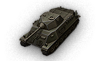

# Czechoslovakia · Tier V

[All nations and tiers](../buffs_nerfs.md) · EU v20410 → RU v14600ru · 3 November 2026

<label><strong>Find a tank</strong><input type="search" placeholder="Try is7, obj140 or xm57" aria-label="Find a tank" style="display:block;width:100%;padding:.7rem;border:1px solid #888;border-radius:4px;margin:.5rem 0;color:inherit;background:transparent"></label>

Škoda T 24 · Tier V

škodat24

<a href="https://tanks.gg/v20410/tank/skoda-t-24">EU stats</a> · <a href="https://tanks.gg/v14600ru/tank/skoda-t-24">RU stats</a>
<figure style="display:inline-block"><figcaption>Škoda T 24</figcaption></figure>
<em>Firepower</em> 
<strong>DPM (HP/min)</strong> <small>EU</small> 1 564.50  <small>RU</small> <strong>1 298.83</strong> 
<strong>Rate of fire (rounds/min)</strong> <small>EU</small> 14.22  <small>RU</small> <strong>11.81</strong> 
<strong>Reload time (s)</strong> <small>EU</small> 4.22  <small>RU</small> <strong>5.08</strong> 

<em>Gun handling</em> 
<strong>Dispersion (m/100 m)</strong> <small>EU</small> 0.35  <small>RU</small> <strong>0.36</strong> 
<strong>Dispersion · damaged</strong> <small>EU</small> 0.71  <small>RU</small> <strong>0.73</strong> 
<strong>Dispersion · turret traverse</strong> <small>EU</small> 0.12  <small>RU</small> <strong>0.14</strong> 

<em>Mobility</em> 
<strong>Forward speed on soft terrain (km/h)</strong> <small>EU</small> 46.01  <small>RU</small> <strong>44.68</strong> 
<strong>Engine power (hp)</strong> <small>EU</small> 490  <small>RU</small> <strong>475.78</strong> 
<strong>Power/weight (hp/t)</strong> <small>EU</small> 25.39  <small>RU</small> <strong>24.65</strong> 
<strong>Tank traverse (°/s)</strong> <small>EU</small> 50.06  <small>RU</small> <strong>41.72</strong> 
<strong>Tank traverse on hard terrain (°/s)</strong> <small>EU</small> 51.59  <small>RU</small> <strong>45.72</strong> 
<strong>Tank traverse on medium terrain (°/s)</strong> <small>EU</small> 44.71  <small>RU</small> <strong>39.62</strong> 
<strong>Tank traverse on soft terrain (°/s)</strong> <small>EU</small> 31.94  <small>RU</small> <strong>28.30</strong> 

<em>Armor &amp; health</em> 
<strong>Health</strong> <small>EU</small> 700  <small>RU</small> <strong>590</strong> 
<strong>Health · engine</strong> <small>EU</small> 140  <small>RU</small> <strong>100</strong> 

