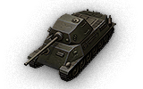

# Czechoslovakia · Tier VI

[All nations and tiers](../buffs_nerfs.md) · EU v20410 → RU v14600ru · 3 November 2026

<label><strong>Find a tank</strong><input type="search" placeholder="Try is7, obj140 or xm57" aria-label="Find a tank" style="display:block;width:100%;padding:.7rem;border:1px solid #888;border-radius:4px;margin:.5rem 0;color:inherit;background:transparent"></label>

Škoda T 25 · Tier VI

škodat25

<a href="https://tanks.gg/v20410/tank/skoda-t-25">EU stats</a> · <a href="https://tanks.gg/v14600ru/tank/skoda-t-25">RU stats</a>
<figure style="display:inline-block"><figcaption>Škoda T 25</figcaption></figure>
<em>Mobility</em> 
<strong>Forward speed on soft terrain (km/h)</strong> <small>EU</small> 47.28  <small>RU</small> <strong>45.45</strong> 
<strong>Engine power (hp)</strong> <small>EU</small> 550  <small>RU</small> <strong>528.64</strong> 
<strong>Power/weight (hp/t)</strong> <small>EU</small> 23.61  <small>RU</small> <strong>22.69</strong> 
<strong>Tank traverse (°/s)</strong> <small>EU</small> 36.50  <small>RU</small> <strong>31.29</strong> 
<strong>Tank traverse on hard terrain (°/s)</strong> <small>EU</small> 37.35  <small>RU</small> <strong>32.33</strong> 
<strong>Tank traverse on medium terrain (°/s)</strong> <small>EU</small> 33.95  <small>RU</small> <strong>29.39</strong> 
<strong>Tank traverse on soft terrain (°/s)</strong> <small>EU</small> 19.66  <small>RU</small> <strong>17.02</strong> 

<em>Armor &amp; health</em> 
<strong>Health</strong> <small>EU</small> 900  <small>RU</small> <strong>820</strong> 
<strong>Health · engine</strong> <small>EU</small> 180  <small>RU</small> <strong>145</strong> 

