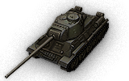
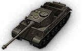

# Czechoslovakia · Tier VII

[All nations and tiers](../buffs_nerfs.md) · EU v20410 → RU v14600ru · 3 November 2026

<label><strong>Find a tank</strong><input type="search" placeholder="Try is7, obj140 or xm57" aria-label="Find a tank" style="display:block;width:100%;padding:.7rem;border:1px solid #888;border-radius:4px;margin:.5rem 0;color:inherit;background:transparent"></label>

Konštrukta T-34/100 · Tier VII

konštruktat34100

<a href="https://tanks.gg/v20410/tank/t-34100">EU stats</a> · <a href="https://tanks.gg/v14600ru/tank/t-34100">RU stats</a>
<figure style="display:inline-block"><figcaption>Konštrukta T-34/100</figcaption></figure>
<em>Firepower</em> 
<strong>Shell velocity (m/s)</strong> <small>EU</small> 950  <small>RU</small> <strong>925</strong> 
<strong>Ammo capacity</strong> <small>EU</small> 40  <small>RU</small> <strong>30</strong> 
<strong>Potential damage</strong> <small>EU</small> 10 000  <small>RU</small> <strong>7 500</strong> 

<em>Gun handling</em> 
<strong>Aim time (s)</strong> <small>EU</small> 2.21  <small>RU</small> <strong>2.30</strong> 
<strong>Dispersion (m/100 m)</strong> <small>EU</small> 0.36  <small>RU</small> <strong>0.35</strong> 
<strong>Dispersion · damaged</strong> <small>EU</small> 0.73  <small>RU</small> <strong>0.69</strong> 
<strong>Dispersion · moving</strong> <small>EU</small> 0.22  <small>RU</small> <strong>0.18</strong> 
<strong>Dispersion · tank traverse</strong> <small>EU</small> 0.22  <small>RU</small> <strong>0.18</strong> 

<em>Mobility</em> 
<strong>Forward speed on soft terrain (km/h)</strong> <small>EU</small> 39.51  <small>RU</small> <strong>36.20</strong> 
<strong>Engine power (hp)</strong> <small>EU</small> 600  <small>RU</small> <strong>549.79</strong> 
<strong>Power/weight (hp/t)</strong> <small>EU</small> 17.65  <small>RU</small> <strong>16.17</strong> 
<strong>Tank traverse (°/s)</strong> <small>EU</small> 43.81  <small>RU</small> <strong>39.63</strong> 
<strong>Tank traverse on hard terrain (°/s)</strong> <small>EU</small> 45.95  <small>RU</small> <strong>39.66</strong> 
<strong>Tank traverse on medium terrain (°/s)</strong> <small>EU</small> 36.76  <small>RU</small> <strong>31.73</strong> 
<strong>Tank traverse on soft terrain (°/s)</strong> <small>EU</small> 21.62  <small>RU</small> <strong>18.66</strong> 

<em>Armor &amp; health</em> 
<strong>Health</strong> <small>EU</small> 1 200  <small>RU</small> <strong>1 100</strong> 
<strong>Health · engine</strong> <small>EU</small> 220  <small>RU</small> <strong>190</strong> 

Vz. 44-1 · Tier VII

vz441

<a href="https://tanks.gg/v20410/tank/vz-44-1">EU stats</a> · <a href="https://tanks.gg/v14600ru/tank/vz-44-1">RU stats</a>
<figure style="display:inline-block"><figcaption>Vz. 44-1</figcaption></figure>
<em>Gun handling</em> 
<strong>Dispersion · moving</strong> <small>EU</small> 0.22  <small>RU</small> <strong>0.23</strong> 
<strong>Dispersion · tank traverse</strong> <small>EU</small> 0.22  <small>RU</small> <strong>0.23</strong> 

<em>Mobility</em> 
<strong>Tank traverse on hard terrain (°/s)</strong> <small>EU</small> 26.31  <small>RU</small> <strong>31.02</strong> 
<strong>Tank traverse on medium terrain (°/s)</strong> <small>EU</small> 20.67  <small>RU</small> <strong>24.37</strong> 
<strong>Tank traverse on soft terrain (°/s)</strong> <small>EU</small> 12.58  <small>RU</small> <strong>14.83</strong> 

<em>Armor &amp; health</em> 
<strong>Health</strong> <small>EU</small> 1 500  <small>RU</small> <strong>1 400</strong> 
<strong>Health · engine</strong> <small>EU</small> 220  <small>RU</small> <strong>190</strong> 

