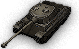
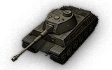
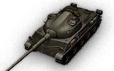

# Czechoslovakia · Tier VIII

[All nations and tiers](../buffs_nerfs.md) · EU v20410 → RU v14600ru · 3 November 2026

<label><strong>Find a tank</strong><input type="search" placeholder="Try is7, obj140 or xm57" aria-label="Find a tank" style="display:block;width:100%;padding:.7rem;border:1px solid #888;border-radius:4px;margin:.5rem 0;color:inherit;background:transparent"></label>

TNH 105/1000 · Tier VIII

tnh1051000

<a href="https://tanks.gg/v20410/tank/tnh-1051000">EU stats</a> · <a href="https://tanks.gg/v14600ru/tank/tnh-1051000">RU stats</a>
<figure style="display:inline-block"><figcaption>TNH 105/1000</figcaption></figure>
<strong>Damage (HP)</strong> <b>EU</b>  AP <strong>360</strong> /  APCR <strong>360</strong> /  HE <strong>440</strong> → <b>RU</b>  AP <strong>320</strong> /  APCR <strong>320</strong> /  HE <strong>420</strong>

<em>Firepower</em> 
<strong>DPM (HP/min)</strong> <small>EU</small> 2 187.26  <small>RU</small> <strong>2 225.07</strong> 
<strong>Rate of fire (rounds/min)</strong> <small>EU</small> 6.08  <small>RU</small> <strong>6.95</strong> 
<strong>Reload time (s)</strong> <small>EU</small> 9.88  <small>RU</small> <strong>8.63</strong> 
<strong>Potential damage</strong> <small>EU</small> 15 840  <small>RU</small> <strong>14 080</strong> 

<em>Gun handling</em> 
<strong>Dispersion · moving</strong> <small>EU</small> 0.20  <small>RU</small> <strong>0.19</strong> 
<strong>Dispersion · tank traverse</strong> <small>EU</small> 0.20  <small>RU</small> <strong>0.19</strong> 
<strong>Dispersion · turret traverse</strong> <small>EU</small> 0.10  <small>RU</small> <strong>0.12</strong> 
<strong>Dispersion · firing</strong> <small>EU</small> 4  <small>RU</small> <strong>5</strong> 

<em>Mobility</em> 
<strong>Tank traverse on hard terrain (°/s)</strong> <small>EU</small> 32.32  <small>RU</small> <strong>32.35</strong> 
<strong>Tank traverse on medium terrain (°/s)</strong> <small>EU</small> 25.86  <small>RU</small> <strong>25.88</strong> 
<strong>Tank traverse on soft terrain (°/s)</strong> <small>EU</small> 16.86  <small>RU</small> <strong>16.88</strong> 

<em>Armor &amp; health</em> 
<strong>Hull armor · front (mm)</strong> <small>EU</small> 125  <small>RU</small> <strong>130</strong> 
<strong>Health</strong> <small>EU</small> 1 650  <small>RU</small> <strong>1 550</strong> 
<strong>Health · engine</strong> <small>EU</small> 260  <small>RU</small> <strong>370</strong> 

<em>Miscellaneous</em> 
<strong>Moving camo</strong> <small>EU</small> 3.19  <small>RU</small> <strong>3.13</strong> 
<strong>Moving camo · after firing</strong> <small>EU</small> 0.63  <small>RU</small> <strong>0.62</strong> 

TVP VTU Koncept · Tier VIII

tvpvtukoncept

<a href="https://tanks.gg/v20410/tank/tvp-vtu">EU stats</a> · <a href="https://tanks.gg/v14600ru/tank/tvp-vtu">RU stats</a>
<figure style="display:inline-block"><figcaption>TVP VTU Koncept</figcaption></figure>
<strong>Penetration (mm)</strong> <b>EU</b>  AP <strong>210</strong> /  APCR <strong>252</strong> /  HE <strong>44</strong> → <b>RU</b>  AP <strong>226</strong> /  APCR <strong>264</strong> /  HE <strong>53</strong>

<strong>Damage (HP)</strong> <b>EU</b>  AP <strong>240</strong> /  APCR <strong>240</strong> /  HE <strong>295</strong> → <b>RU</b>  AP <strong>320</strong> /  APCR <strong>320</strong> /  HE <strong>420</strong>

<em>Firepower</em> 
<strong>DPM (HP/min)</strong> <small>EU</small> 1 567.37  <small>RU</small> <strong>2 275.64</strong> 
<strong>Module damage</strong> <small>EU</small> 119  <small>RU</small> <strong>150</strong> 
<strong>Rate of fire (rounds/min)</strong> <small>EU</small> 6.53  <small>RU</small> <strong>7.11</strong> 
<strong>Reload time (s)</strong> <small>EU</small> 23.97  <small>RU</small> <strong>8.44</strong> 
<strong>Clip size</strong> <small>EU</small> 3 → <small>RU</small> <strong>—</strong> 
<strong>Clip damage · damage</strong> <small>EU</small> 720 → <small>RU</small> <strong>—</strong> 
<strong>Clip damage · time (s)</strong> <small>EU</small> 3.59 → <small>RU</small> <strong>—</strong> 
<strong>Intra-clip reload</strong> <small>EU</small> 1.80 → <small>RU</small> <strong>—</strong> 
<strong>Caliber</strong> <small>EU</small> 88  <small>RU</small> <strong>105</strong> 
<strong>Shell velocity (m/s)</strong> <small>EU</small> 1 020  <small>RU</small> <strong>1 050</strong> 
<strong>Ammo capacity</strong> <small>EU</small> 60  <small>RU</small> <strong>74</strong> 
<strong>Potential damage</strong> <small>EU</small> 14 400  <small>RU</small> <strong>23 680</strong> 

<em>Gun handling</em> 
<strong>Aim time (s)</strong> <small>EU</small> 2.11  <small>RU</small> <strong>1.92</strong> 
<strong>Dispersion · moving</strong> <small>EU</small> 0.20  <small>RU</small> <strong>0.16</strong> 
<strong>Dispersion · tank traverse</strong> <small>EU</small> 0.20  <small>RU</small> <strong>0.16</strong> 
<strong>Dispersion · firing</strong> <small>EU</small> 3  <small>RU</small> <strong>4</strong> 
<strong>Depression (°)</strong> <small>EU</small> 8  <small>RU</small> <strong>9</strong> 

<em>Mobility</em> 
<strong>Forward speed on soft terrain (km/h)</strong> <small>EU</small> 43.40  <small>RU</small> <strong>40.68</strong> 
<strong>Engine power (hp)</strong> <small>EU</small> 770  <small>RU</small> <strong>740.10</strong> 
<strong>Weight (kg)</strong> <small>EU</small> 35 542 → <small>RU</small> <strong>36 442</strong> 
<strong>Power/weight (hp/t)</strong> <small>EU</small> 21.66  <small>RU</small> <strong>20.31</strong> 
<strong>Tank traverse (°/s)</strong> <small>EU</small> 55.28  <small>RU</small> <strong>45.89</strong> 
<strong>Tank traverse on hard terrain (°/s)</strong> <small>EU</small> 53.62  <small>RU</small> <strong>46.06</strong> 
<strong>Tank traverse on medium terrain (°/s)</strong> <small>EU</small> 41.25  <small>RU</small> <strong>35.43</strong> 
<strong>Tank traverse on soft terrain (°/s)</strong> <small>EU</small> 28.22  <small>RU</small> <strong>24.24</strong> 

<em>Armor &amp; health</em> 
<strong>Health</strong> <small>EU</small> 1 550  <small>RU</small> <strong>1 450</strong> 
<strong>Health · engine</strong> <small>EU</small> 260  <small>RU</small> <strong>255</strong> 

<em>Miscellaneous</em> 
<strong>Stationary camo · after firing</strong> <small>EU</small> 2.96  <small>RU</small> <strong>2.46</strong> 
<strong>Moving camo · after firing</strong> <small>EU</small> 2.22  <small>RU</small> <strong>1.85</strong> 
<strong>View range (m)</strong> <small>EU</small> 380  <small>RU</small> <strong>390</strong> 
<strong>Shell cost</strong> <small>EU</small> 340  <small>RU</small> <strong>560</strong> 

Škoda T 27 · Tier VIII

škodat27

<a href="https://tanks.gg/v20410/tank/skoda-t-27">EU stats</a> · <a href="https://tanks.gg/v14600ru/tank/skoda-t-27">RU stats</a>
<figure style="display:inline-block"><figcaption>Škoda T 27</figcaption></figure>
<em>Firepower</em> 
<strong>DPM (HP/min)</strong> <small>EU</small> 1 623.85  <small>RU</small> <strong>1 749.99</strong> 
<strong>Rate of fire (rounds/min)</strong> <small>EU</small> 6.77  <small>RU</small> <strong>7.29</strong> 
<strong>Reload time (s)</strong> <small>EU</small> 23.01  <small>RU</small> <strong>21.09</strong> 

<em>Gun handling</em> 
<strong>Dispersion (m/100 m)</strong> <small>EU</small> 0.36  <small>RU</small> <strong>0.35</strong> 
<strong>Dispersion · damaged</strong> <small>EU</small> 0.73  <small>RU</small> <strong>0.69</strong> 

<em>Mobility</em> 
<strong>Forward speed (km/h)</strong> <small>EU</small> 50  <small>RU</small> <strong>55</strong> 
<strong>Forward speed on hard terrain (km/h)</strong> <small>EU</small> 50  <small>RU</small> <strong>55</strong> 
<strong>Forward speed on medium terrain (km/h)</strong> <small>EU</small> 50  <small>RU</small> <strong>55</strong> 
<strong>Terrain resist (hard)</strong> <small>EU</small> 0.96  <small>RU</small> <strong>0.81</strong> 
<strong>Terrain resist (med)</strong> <small>EU</small> 1.25  <small>RU</small> <strong>1.06</strong> 
<strong>Tank traverse (°/s)</strong> <small>EU</small> 45.89  <small>RU</small> <strong>52.15</strong> 
<strong>Tank traverse on hard terrain (°/s)</strong> <small>EU</small> 43.60  <small>RU</small> <strong>49.54</strong> 
<strong>Tank traverse on medium terrain (°/s)</strong> <small>EU</small> 33.54  <small>RU</small> <strong>38.10</strong> 
<strong>Tank traverse on soft terrain (°/s)</strong> <small>EU</small> 22.95  <small>RU</small> <strong>22.16</strong> 

