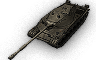
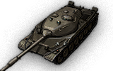
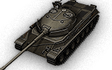
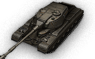
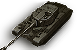
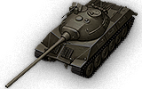

# Czechoslovakia · Tier IX

[All nations and tiers](../buffs_nerfs.md) · EU v20410 → RU v14600ru · 3 November 2026

<label><strong>Find a tank</strong><input type="search" placeholder="Try is7, obj140 or xm57" aria-label="Find a tank" style="display:block;width:100%;padding:.7rem;border:1px solid #888;border-radius:4px;margin:.5rem 0;color:inherit;background:transparent"></label>

TBT · Tier IX

tbt

<a href="https://tanks.gg/v20410/tank/tbt">EU stats</a> · <a href="https://tanks.gg/v14600ru/tank/tbt">RU stats</a>
<figure style="display:inline-block"><figcaption>EU · TBT</figcaption></figure><figure style="display:inline-block"><figcaption>RU · TBT</figcaption></figure>
<strong>Penetration (mm)</strong> <b>EU</b>  AP <strong>247</strong> /  APCR <strong>290</strong> /  HE <strong>65</strong> → <b>RU</b>  AP <strong>240</strong> /  AP <strong>284</strong> /  HE <strong>68</strong>

<strong>Damage (HP)</strong> <b>EU</b>  AP <strong>490</strong> /  APCR <strong>490</strong> /  HE <strong>640</strong> → <b>RU</b>  AP <strong>490</strong> /  AP <strong>490</strong> /  HE <strong>640</strong>

<em>Firepower</em> 
<strong>DPM (HP/min)</strong> <small>EU</small> 1 651.77  <small>RU</small> <strong>2 071.91</strong> 
<strong>Rate of fire (rounds/min)</strong> <small>EU</small> 3.37  <small>RU</small> <strong>4.23</strong> 
<strong>Reload time (s)</strong> <small>EU</small> 32.60  <small>RU</small> <strong>14.19</strong> 
<strong>Clip size</strong> <small>EU</small> 2 → <small>RU</small> <strong>—</strong> 
<strong>Clip damage · damage</strong> <small>EU</small> 980 → <small>RU</small> <strong>—</strong> 
<strong>Clip damage · time (s)</strong> <small>EU</small> 3 → <small>RU</small> <strong>—</strong> 
<strong>Intra-clip reload</strong> <small>EU</small> 3 → <small>RU</small> <strong>—</strong> 
<strong>Shell velocity (m/s)</strong> <small>EU</small> 980  <small>RU</small> <strong>860</strong> 

<em>Gun handling</em> 
<strong>Aim time (s)</strong> <small>EU</small> 2.68  <small>RU</small> <strong>3.07</strong> 
<strong>Dispersion (m/100 m)</strong> <small>EU</small> 0.39  <small>RU</small> <strong>0.38</strong> 
<strong>Dispersion · damaged</strong> <small>EU</small> 0.79  <small>RU</small> <strong>0.77</strong> 
<strong>Dispersion · moving</strong> <small>EU</small> 0.20  <small>RU</small> <strong>0.17</strong> 
<strong>Dispersion · tank traverse</strong> <small>EU</small> 0.20  <small>RU</small> <strong>0.17</strong> 
<strong>Dispersion · turret traverse</strong> <small>EU</small> 0.12  <small>RU</small> <strong>0.10</strong> 

<em>Mobility</em> 
<strong>Forward speed (km/h)</strong> <small>EU</small> 36  <small>RU</small> <strong>54</strong> 
<strong>Forward speed on hard terrain (km/h)</strong> <small>EU</small> 36  <small>RU</small> <strong>47.75</strong> 
<strong>Forward speed on medium terrain (km/h)</strong> <small>EU</small> 36  <small>RU</small> <strong>43.77</strong> 
<strong>Forward speed on soft terrain (km/h)</strong> <small>EU</small> 26.64  <small>RU</small> <strong>22.84</strong> 
<strong>Reverse speed (km/h)</strong> <small>EU</small> 15  <small>RU</small> <strong>16</strong> 
<strong>Engine power (hp)</strong> <small>EU</small> 700  <small>RU</small> <strong>690</strong> 
<strong>Weight (kg)</strong> <small>EU</small> 50 000 → <small>RU</small> <strong>49 997</strong> 
<strong>Power/weight (hp/t)</strong> <small>EU</small> 14  <small>RU</small> <strong>13.80</strong> 
<strong>Terrain resist (hard)</strong> <small>EU</small> 0.96  <small>RU</small> <strong>1.05</strong> 
<strong>Terrain resist (soft)</strong> <small>EU</small> 1.92  <small>RU</small> <strong>2.21</strong> 
<strong>Turret traverse (°/s)</strong> <small>EU</small> 26.08  <small>RU</small> <strong>27.12</strong> 
<strong>Tank traverse (°/s)</strong> <small>EU</small> 29.20  <small>RU</small> <strong>27.12</strong> 
<strong>Tank traverse on hard terrain (°/s)</strong> <small>EU</small> 29.20  <small>RU</small> <strong>27.12</strong> 
<strong>Tank traverse on medium terrain (°/s)</strong> <small>EU</small> 24.34  <small>RU</small> <strong>24.86</strong> 
<strong>Tank traverse on soft terrain (°/s)</strong> <small>EU</small> 14.60  <small>RU</small> <strong>12.97</strong> 

<em>Armor &amp; health</em> 
<strong>Hull armor · front (mm)</strong> <small>EU</small> 120  <small>RU</small> <strong>130</strong> 
<strong>Hull armor · rear (mm)</strong> <small>EU</small> 70  <small>RU</small> <strong>80</strong> 
<strong>Turret armor · front (mm)</strong> <small>EU</small> 240  <small>RU</small> <strong>210</strong> 
<strong>Turret armor · side (mm)</strong> <small>EU</small> 100  <small>RU</small> <strong>180</strong> 
<strong>Turret armor · rear (mm)</strong> <small>EU</small> 70  <small>RU</small> <strong>80</strong> 
<strong>Health</strong> <small>EU</small> 1 850  <small>RU</small> <strong>1 700</strong> 
<strong>Health · engine</strong> <small>EU</small> 310  <small>RU</small> <strong>255</strong> 
<strong>Health · ammo rack</strong> <small>EU</small> 230  <small>RU</small> <strong>260</strong> 
<strong>Health · fuel tank</strong> <small>EU</small> 200  <small>RU</small> <strong>175</strong> 
<strong>Track repair time (s)</strong> <small>EU</small> 11.70  <small>RU</small> <strong>12.03</strong> 

<em>Miscellaneous</em> 
<strong>Stationary camo</strong> <small>EU</small> 6.78  <small>RU</small> <strong>6.73</strong> 
<strong>Stationary camo · after firing</strong> <small>EU</small> 1.04  <small>RU</small> <strong>1.03</strong> 
<strong>Moving camo</strong> <small>EU</small> 3.42  <small>RU</small> <strong>3.36</strong> 
<strong>Moving camo · after firing</strong> <small>EU</small> 0.52  <small>RU</small> <strong>0.51</strong> 
<strong>View range (m)</strong> <small>EU</small> 380  <small>RU</small> <strong>370</strong> 
<strong>Radio range (m)</strong> <small>EU</small> 670  <small>RU</small> <strong>850</strong> 
<strong>Shell cost</strong> <small>EU</small> 1 116  <small>RU</small> <strong>1 180</strong> 

TNH T Vz. 51 · Tier IX

tnhtvz51

<a href="https://tanks.gg/v20410/tank/tnh-t-vz-51">EU stats</a> · <a href="https://tanks.gg/v14600ru/tank/tnh-t-vz-51">RU stats</a>
<figure style="display:inline-block"><figcaption>TNH T Vz. 51</figcaption></figure>
<em>Firepower</em> 
<strong>DPM (HP/min)</strong> <small>EU</small> 2 294.60  <small>RU</small> <strong>1 676.70</strong> 
<strong>Module damage</strong> <small>EU</small> 165  <small>RU</small> <strong>180</strong> 
<strong>Rate of fire (rounds/min)</strong> <small>EU</small> 5.21  <small>RU</small> <strong>3.81</strong> 
<strong>Reload time (s)</strong> <small>EU</small> 11.51  <small>RU</small> <strong>28.76</strong> 
<strong>Clip size</strong> <small>EU</small> — → <small>RU</small> <strong>2</strong> 
<strong>Clip damage · damage</strong> <small>EU</small> — → <small>RU</small> <strong>880</strong> 
<strong>Clip damage · time (s)</strong> <small>EU</small> — → <small>RU</small> <strong>2.73</strong> 
<strong>Intra-clip reload</strong> <small>EU</small> — → <small>RU</small> <strong>2.73</strong> 

<em>Gun handling</em> 
<strong>Aim time (s)</strong> <small>EU</small> 2.21  <small>RU</small> <strong>2.59</strong> 
<strong>Dispersion (m/100 m)</strong> <small>EU</small> 0.34  <small>RU</small> <strong>0.38</strong> 
<strong>Dispersion · damaged</strong> <small>EU</small> 0.67  <small>RU</small> <strong>0.77</strong> 
<strong>Dispersion · moving</strong> <small>EU</small> 0.18  <small>RU</small> <strong>0.16</strong> 
<strong>Dispersion · tank traverse</strong> <small>EU</small> 0.18  <small>RU</small> <strong>0.16</strong> 
<strong>Dispersion · turret traverse</strong> <small>EU</small> 0.10  <small>RU</small> <strong>0.12</strong> 

<em>Mobility</em> 
<strong>Forward speed on hard terrain (km/h)</strong> <small>EU</small> 49.83  <small>RU</small> <strong>49.73</strong> 
<strong>Forward speed on medium terrain (km/h)</strong> <small>EU</small> 45.65  <small>RU</small> <strong>45.56</strong> 
<strong>Forward speed on soft terrain (km/h)</strong> <small>EU</small> 21.91  <small>RU</small> <strong>21.87</strong> 
<strong>Weight (kg)</strong> <small>EU</small> 52 110 → <small>RU</small> <strong>52 210</strong> 
<strong>Power/weight (hp/t)</strong> <small>EU</small> 14.39  <small>RU</small> <strong>14.37</strong> 
<strong>Tank traverse (°/s)</strong> <small>EU</small> 33.38  <small>RU</small> <strong>31.29</strong> 
<strong>Tank traverse on hard terrain (°/s)</strong> <small>EU</small> 34.96  <small>RU</small> <strong>32.74</strong> 
<strong>Tank traverse on medium terrain (°/s)</strong> <small>EU</small> 32.03  <small>RU</small> <strong>29.99</strong> 
<strong>Tank traverse on soft terrain (°/s)</strong> <small>EU</small> 15.37  <small>RU</small> <strong>14.40</strong> 

<em>Armor &amp; health</em> 
<strong>Health · engine</strong> <small>EU</small> 300  <small>RU</small> <strong>370</strong> 

Vz. 58 Medvěd · Tier IX

vz58medvěd

<a href="https://tanks.gg/v20410/tank/medved">EU stats</a> · <a href="https://tanks.gg/v14600ru/tank/vz-58-k">RU stats</a>
<figure style="display:inline-block"><figcaption>EU · Vz. 58 Medvěd</figcaption></figure><figure style="display:inline-block"><figcaption>RU · Vz. 58 Koncept</figcaption></figure>
<strong>Penetration (mm)</strong> <b>EU</b>  AP <strong>257</strong> /  APCR <strong>325</strong> /  HE <strong>68</strong> → <b>RU</b>  AP <strong>246</strong> /  APCR <strong>306</strong> /  HE <strong>61</strong>

<strong>Damage (HP)</strong> <b>EU</b>  AP <strong>440</strong> /  APCR <strong>440</strong> /  HE <strong>530</strong> → <b>RU</b>  AP <strong>390</strong> /  APCR <strong>390</strong> /  HE <strong>530</strong>

<em>Firepower</em> 
<strong>DPM (HP/min)</strong> <small>EU</small> 2 170.96  <small>RU</small> <strong>2 596.40</strong> 
<strong>Rate of fire (rounds/min)</strong> <small>EU</small> 4.93  <small>RU</small> <strong>6.66</strong> 
<strong>Reload time (s)</strong> <small>EU</small> 37.39  <small>RU</small> <strong>9.01</strong> 
<strong>Clip size</strong> <small>EU</small> 4 → <small>RU</small> <strong>—</strong> 
<strong>Clip damage · damage</strong> <small>EU</small> 1 760 → <small>RU</small> <strong>—</strong> 
<strong>Clip damage · time (s)</strong> <small>EU</small> 11.25 → <small>RU</small> <strong>—</strong> 
<strong>Intra-clip reload</strong> <small>EU</small> 3.75 → <small>RU</small> <strong>—</strong> 
<strong>Shell velocity (m/s)</strong> <small>EU</small> 1 040  <small>RU</small> <strong>850</strong> 
<strong>Potential damage</strong> <small>EU</small> 17 600  <small>RU</small> <strong>15 600</strong> 

<em>Gun handling</em> 
<strong>Aim time (s)</strong> <small>EU</small> 2.88  <small>RU</small> <strong>2.59</strong> 
<strong>Dispersion (m/100 m)</strong> <small>EU</small> 0.43  <small>RU</small> <strong>0.44</strong> 
<strong>Dispersion · damaged</strong> <small>EU</small> 0.86  <small>RU</small> <strong>0.88</strong> 
<strong>Dispersion · moving</strong> <small>EU</small> 0.24  <small>RU</small> <strong>0.20</strong> 
<strong>Dispersion · tank traverse</strong> <small>EU</small> 0.24  <small>RU</small> <strong>0.20</strong> 
<strong>Dispersion · turret traverse</strong> <small>EU</small> 0.15  <small>RU</small> <strong>0.10</strong> 

<em>Mobility</em> 
<strong>Forward speed (km/h)</strong> <small>EU</small> 36  <small>RU</small> <strong>42</strong> 
<strong>Forward speed on hard terrain (km/h)</strong> <small>EU</small> 36  <small>RU</small> <strong>42</strong> 
<strong>Forward speed on medium terrain (km/h)</strong> <small>EU</small> 36  <small>RU</small> <strong>42</strong> 
<strong>Forward speed on soft terrain (km/h)</strong> <small>EU</small> 29.03  <small>RU</small> <strong>25.68</strong> 
<strong>Reverse speed (km/h)</strong> <small>EU</small> 16  <small>RU</small> <strong>15</strong> 
<strong>Engine power (hp)</strong> <small>EU</small> 1 000  <small>RU</small> <strong>900</strong> 
<strong>Weight (kg)</strong> <small>EU</small> 57 000 → <small>RU</small> <strong>57 995</strong> 
<strong>Power/weight (hp/t)</strong> <small>EU</small> 17.54  <small>RU</small> <strong>15.52</strong> 
<strong>Terrain resist (hard)</strong> <small>EU</small> 1.25  <small>RU</small> <strong>1.05</strong> 
<strong>Terrain resist (med)</strong> <small>EU</small> 1.34  <small>RU</small> <strong>1.15</strong> 
<strong>Turret traverse (°/s)</strong> <small>EU</small> 27.12  <small>RU</small> <strong>33.38</strong> 
<strong>Tank traverse (°/s)</strong> <small>EU</small> 27.12  <small>RU</small> <strong>33.38</strong> 
<strong>Tank traverse on hard terrain (°/s)</strong> <small>EU</small> 27.12  <small>RU</small> <strong>31.71</strong> 
<strong>Tank traverse on medium terrain (°/s)</strong> <small>EU</small> 25.18  <small>RU</small> <strong>29.06</strong> 
<strong>Tank traverse on soft terrain (°/s)</strong> <small>EU</small> 15.33  <small>RU</small> <strong>15.16</strong> 

<em>Armor &amp; health</em> 
<strong>Hull armor · front (mm)</strong> <small>EU</small> 105  <small>RU</small> <strong>300</strong> 
<strong>Hull armor · side (mm)</strong> <small>EU</small> 70  <small>RU</small> <strong>120</strong> 
<strong>Hull armor · rear (mm)</strong> <small>EU</small> 40  <small>RU</small> <strong>60</strong> 
<strong>Turret armor · front (mm)</strong> <small>EU</small> 270  <small>RU</small> <strong>340</strong> 
<strong>Turret armor · side (mm)</strong> <small>EU</small> 80  <small>RU</small> <strong>130</strong> 
<strong>Turret armor · rear (mm)</strong> <small>EU</small> 50  <small>RU</small> <strong>90</strong> 
<strong>Track armor</strong> <small>EU</small> 30  <small>RU</small> <strong>20</strong> 
<strong>Health</strong> <small>EU</small> 1 750  <small>RU</small> <strong>1 800</strong> 
<strong>Health · engine</strong> <small>EU</small> 370  <small>RU</small> <strong>255</strong> 
<strong>Health · track</strong> <small>EU</small> 250  <small>RU</small> <strong>240</strong> 
<strong>Health · ammo rack</strong> <small>EU</small> 240  <small>RU</small> <strong>260</strong> 
<strong>Health · fuel tank</strong> <small>EU</small> 200  <small>RU</small> <strong>175</strong> 

<em>Miscellaneous</em> 
<strong>Stationary camo</strong> <small>EU</small> 7.35  <small>RU</small> <strong>7.12</strong> 
<strong>Stationary camo · after firing</strong> <small>EU</small> 1.32  <small>RU</small> <strong>1.28</strong> 
<strong>Moving camo</strong> <small>EU</small> 3.71  <small>RU</small> <strong>3.53</strong> 
<strong>Moving camo · after firing</strong> <small>EU</small> 0.67  <small>RU</small> <strong>0.64</strong> 
<strong>View range (m)</strong> <small>EU</small> 390  <small>RU</small> <strong>380</strong> 
<strong>Shell cost</strong> <small>EU</small> 1 020  <small>RU</small> <strong>980</strong> 

Škoda T 50 · Tier IX

škodat50

<a href="https://tanks.gg/v20410/tank/skoda-t-50">EU stats</a> · <a href="https://tanks.gg/v14600ru/tank/skoda-t-50">RU stats</a>
<figure style="display:inline-block"><figcaption>Škoda T 50</figcaption></figure>
<em>Mobility</em> 
<strong>Engine power (hp)</strong> <small>EU</small> 1 070  <small>RU</small> <strong>1 057.28</strong> 
<strong>Power/weight (hp/t)</strong> <small>EU</small> 27.86  <small>RU</small> <strong>27.53</strong> 
<strong>Tank traverse (°/s)</strong> <small>EU</small> 60.49  <small>RU</small> <strong>43.81</strong> 
<strong>Tank traverse on hard terrain (°/s)</strong> <small>EU</small> 62.26  <small>RU</small> <strong>55.08</strong> 
<strong>Tank traverse on medium terrain (°/s)</strong> <small>EU</small> 46.12  <small>RU</small> <strong>40.80</strong> 
<strong>Tank traverse on soft terrain (°/s)</strong> <small>EU</small> 31.93  <small>RU</small> <strong>28.25</strong> 

<em>Armor &amp; health</em> 
<strong>Health</strong> <small>EU</small> 1 700  <small>RU</small> <strong>1 650</strong> 
<strong>Health · engine</strong> <small>EU</small> 300  <small>RU</small> <strong>360</strong> 

