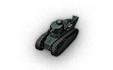

# France · Tier I

[All nations and tiers](../buffs_nerfs.md) · EU v20410 → RU v14600ru · 3 November 2026

<label><strong>Find a tank</strong><input type="search" placeholder="Try is7, obj140 or xm57" aria-label="Find a tank" style="display:block;width:100%;padding:.7rem;border:1px solid #888;border-radius:4px;margin:.5rem 0;color:inherit;background:transparent"></label>

Renault FT · Tier I

renaultft

<a href="https://tanks.gg/v20410/tank/ft">EU stats</a> · <a href="https://tanks.gg/v14600ru/tank/ft">RU stats</a>
<figure style="display:inline-block"><figcaption>Renault FT</figcaption></figure>
<strong>Penetration (mm)</strong> <b>EU</b>  AP <strong>23</strong> /  APCR <strong>36</strong> → <b>RU</b>  AP <strong>30</strong> /  APCR <strong>45</strong>

<em>Firepower</em> 
<strong>DPM (HP/min)</strong> <small>EU</small> 939.13  <small>RU</small> <strong>1 006.99</strong> 
<strong>Rate of fire (rounds/min)</strong> <small>EU</small> 117.39  <small>RU</small> <strong>125.87</strong> 
<strong>Reload time (s)</strong> <small>EU</small> 5.80  <small>RU</small> <strong>7</strong> 
<strong>Clip size</strong> <small>EU</small> 15  <small>RU</small> <strong>20</strong> 
<strong>Clip damage · damage</strong> <small>EU</small> 120  <small>RU</small> <strong>160</strong> 
<strong>Clip damage · time (s)</strong> <small>EU</small> 1.87  <small>RU</small> <strong>2.53</strong> 
<strong>Ammo capacity</strong> <small>EU</small> 1 665  <small>RU</small> <strong>1 700</strong> 
<strong>Potential damage</strong> <small>EU</small> 13 320  <small>RU</small> <strong>13 600</strong> 

<em>Gun handling</em> 
<strong>Aim time (s)</strong> <small>EU</small> 1.60  <small>RU</small> <strong>2</strong> 
<strong>Dispersion (m/100 m)</strong> <small>EU</small> 0.52  <small>RU</small> <strong>0.42</strong> 
<strong>Dispersion · damaged</strong> <small>EU</small> 1.04  <small>RU</small> <strong>0.84</strong> 
<strong>Dispersion · moving</strong> <small>EU</small> 0.33  <small>RU</small> <strong>0.10</strong> 
<strong>Dispersion · tank traverse</strong> <small>EU</small> 0.33  <small>RU</small> <strong>0.10</strong> 

<em>Mobility</em> 
<strong>Forward speed (km/h)</strong> <small>EU</small> 21  <small>RU</small> <strong>30</strong> 
<strong>Forward speed on hard terrain (km/h)</strong> <small>EU</small> 21  <small>RU</small> <strong>30</strong> 
<strong>Forward speed on medium terrain (km/h)</strong> <small>EU</small> 21  <small>RU</small> <strong>30</strong> 
<strong>Forward speed on soft terrain (km/h)</strong> <small>EU</small> 21  <small>RU</small> <strong>22.09</strong> 

<em>Armor &amp; health</em> 
<strong>Health</strong> <small>EU</small> 250  <small>RU</small> <strong>280</strong> 
<strong>Track repair time (s)</strong> <small>EU</small> 6  <small>RU</small> <strong>3</strong> 

