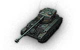
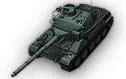
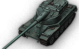
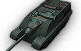
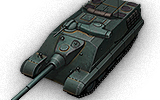
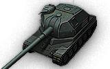
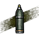
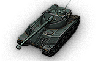
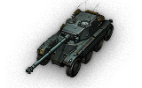

# France · Tier X

[All nations and tiers](../buffs_nerfs.md) · EU v20410 → RU v14600ru · 3 November 2026

<label><strong>Find a tank</strong><input type="search" placeholder="Try is7, obj140 or xm57" aria-label="Find a tank" style="display:block;width:100%;padding:.7rem;border:1px solid #888;border-radius:4px;margin:.5rem 0;color:inherit;background:transparent"></label>

AMX 13 105 · Tier X

amx13105

<a href="https://tanks.gg/v20410/tank/amx-13-105">EU stats</a> · <a href="https://tanks.gg/v14600ru/tank/amx-13-105">RU stats</a>
<figure style="display:inline-block"><figcaption>AMX 13 105</figcaption></figure>
<em>Firepower</em> 
<strong>DPM (HP/min)</strong> <small>EU</small> 2 239.85  <small>RU</small> <strong>2 201.57</strong> 
<strong>Rate of fire (rounds/min)</strong> <small>EU</small> 5.74  <small>RU</small> <strong>5.65</strong> 
<strong>Reload time (s)</strong> <small>EU</small> 25.89  <small>RU</small> <strong>26.43</strong> 
<strong>Shell velocity (m/s)</strong> <small>EU</small> 1 100  <small>RU</small> <strong>1 000</strong> 

<em>Gun handling</em> 
<strong>Dispersion (m/100 m)</strong> <small>EU</small> 0.38  <small>RU</small> <strong>0.40</strong> 
<strong>Dispersion · damaged</strong> <small>EU</small> 0.77  <small>RU</small> <strong>0.81</strong> 
<strong>Dispersion · moving</strong> <small>EU</small> 0.13  <small>RU</small> <strong>0.15</strong> 
<strong>Dispersion · tank traverse</strong> <small>EU</small> 0.13  <small>RU</small> <strong>0.15</strong> 
<strong>Dispersion · turret traverse</strong> <small>EU</small> 0.10  <small>RU</small> <strong>0.12</strong> 

<em>Mobility</em> 
<strong>Forward speed (km/h)</strong> <small>EU</small> 70  <small>RU</small> <strong>68</strong> 
<strong>Forward speed on hard terrain (km/h)</strong> <small>EU</small> 70  <small>RU</small> <strong>68</strong> 
<strong>Forward speed on medium terrain (km/h)</strong> <small>EU</small> 70  <small>RU</small> <strong>68</strong> 
<strong>Forward speed on soft terrain (km/h)</strong> <small>EU</small> 70  <small>RU</small> <strong>68</strong> 
<strong>Reverse speed (km/h)</strong> <small>EU</small> 25  <small>RU</small> <strong>22</strong> 
<strong>Terrain resist (hard)</strong> <small>EU</small> 0.86  <small>RU</small> <strong>1.08</strong> 
<strong>Terrain resist (med)</strong> <small>EU</small> 0.96  <small>RU</small> <strong>1.20</strong> 
<strong>Terrain resist (soft)</strong> <small>EU</small> 1.53  <small>RU</small> <strong>1.92</strong> 
<strong>Turret traverse (°/s)</strong> <small>EU</small> 43.81  <small>RU</small> <strong>39.63</strong> 
<strong>Tank traverse (°/s)</strong> <small>EU</small> 46.93  <small>RU</small> <strong>41.72</strong> 
<strong>Tank traverse on hard terrain (°/s)</strong> <small>EU</small> 46.93  <small>RU</small> <strong>41.72</strong> 
<strong>Tank traverse on medium terrain (°/s)</strong> <small>EU</small> 42.24  <small>RU</small> <strong>37.55</strong> 
<strong>Tank traverse on soft terrain (°/s)</strong> <small>EU</small> 26.40  <small>RU</small> <strong>23.47</strong> 

<em>Armor &amp; health</em> 
<strong>Track armor</strong> <small>EU</small> 10  <small>RU</small> <strong>15</strong> 
<strong>Health</strong> <small>EU</small> 1 700  <small>RU</small> <strong>1 400</strong> 

AMX 30 B · Tier X

amx30b

<a href="https://tanks.gg/v20410/tank/amx-30-b">EU stats</a> · <a href="https://tanks.gg/v14600ru/tank/amx-30-b">RU stats</a>
<figure style="display:inline-block"><figcaption>AMX 30 B</figcaption></figure>
<strong>Damage (HP)</strong> <b>EU</b>  APCR <strong>390</strong> /  HEAT <strong>390</strong> /  HE <strong>480</strong> → <b>RU</b>  APCR <strong>420</strong> /  HEAT <strong>420</strong> /  HE <strong>510</strong>

<em>Firepower</em> 
<strong>DPM (HP/min)</strong> <small>EU</small> 3 129  <small>RU</small> <strong>3 348.23</strong> 
<strong>Rate of fire (rounds/min)</strong> <small>EU</small> 8.02  <small>RU</small> <strong>7.97</strong> 
<strong>Reload time (s)</strong> <small>EU</small> 7.48  <small>RU</small> <strong>7.53</strong> 
<strong>Shell velocity (m/s)</strong> <small>EU</small> 1 100  <small>RU</small> <strong>1 300</strong> 
<strong>Potential damage</strong> <small>EU</small> 19 500  <small>RU</small> <strong>21 000</strong> 

<em>Miscellaneous</em> 
<strong>Shell cost</strong> <small>EU</small> 1 210  <small>RU</small> <strong>1 310</strong> 

AMX 50 B · Tier X

amx50b

<a href="https://tanks.gg/v20410/tank/amx-50-b">EU stats</a> · <a href="https://tanks.gg/v14600ru/tank/amx-50-b">RU stats</a>
<figure style="display:inline-block"><figcaption>AMX 50 B</figcaption></figure>
<strong>Penetration (mm)</strong> <b>EU</b>  AP <strong>267</strong> /  APCR <strong>327</strong> /  HE <strong>65</strong> → <b>RU</b>  AP <strong>257</strong> /  APCR <strong>325</strong> /  HE <strong>65</strong>

<strong>Damage (HP)</strong> <b>EU</b>  AP <strong>420</strong> /  APCR <strong>420</strong> /  HE <strong>520</strong> → <b>RU</b>  AP <strong>400</strong> /  APCR <strong>400</strong> /  HE <strong>515</strong>

<em>Firepower</em> 
<strong>DPM (HP/min)</strong> <small>EU</small> 2 779.68  <small>RU</small> <strong>2 618.37</strong> 
<strong>Rate of fire (rounds/min)</strong> <small>EU</small> 6.62  <small>RU</small> <strong>6.55</strong> 
<strong>Reload time (s)</strong> <small>EU</small> 28.76  <small>RU</small> <strong>29.16</strong> 
<strong>Clip damage · damage</strong> <small>EU</small> 1 680  <small>RU</small> <strong>1 600</strong> 
<strong>Potential damage</strong> <small>EU</small> 23 520  <small>RU</small> <strong>22 400</strong> 

<em>Gun handling</em> 
<strong>Dispersion · moving</strong> <small>EU</small> 0.17  <small>RU</small> <strong>0.18</strong> 
<strong>Dispersion · tank traverse</strong> <small>EU</small> 0.17  <small>RU</small> <strong>0.18</strong> 
<strong>Dispersion · firing</strong> <small>EU</small> 3.50  <small>RU</small> <strong>4</strong> 

<em>Mobility</em> 
<strong>Forward speed on hard terrain (km/h)</strong> <small>EU</small> 61.18  <small>RU</small> <strong>59.71</strong> 
<strong>Forward speed on medium terrain (km/h)</strong> <small>EU</small> 56.81  <small>RU</small> <strong>55.44</strong> 
<strong>Forward speed on soft terrain (km/h)</strong> <small>EU</small> 34.58  <small>RU</small> <strong>33.75</strong> 
<strong>Engine power (hp)</strong> <small>EU</small> 1 300  <small>RU</small> <strong>1 268.74</strong> 
<strong>Power/weight (hp/t)</strong> <small>EU</small> 20.90  <small>RU</small> <strong>20.39</strong> 
<strong>Tank traverse (°/s)</strong> <small>EU</small> 43.81  <small>RU</small> <strong>37.55</strong> 
<strong>Tank traverse on hard terrain (°/s)</strong> <small>EU</small> 43.81  <small>RU</small> <strong>37.55</strong> 
<strong>Tank traverse on medium terrain (°/s)</strong> <small>EU</small> 40.68  <small>RU</small> <strong>34.87</strong> 
<strong>Tank traverse on soft terrain (°/s)</strong> <small>EU</small> 24.76  <small>RU</small> <strong>21.22</strong> 

<em>Armor &amp; health</em> 
<strong>Health</strong> <small>EU</small> 2 200  <small>RU</small> <strong>2 300</strong> 

AMX 50 Foch (155) · Tier X

amx50foch155

<a href="https://tanks.gg/v20410/tank/foch-155">EU stats</a> · <a href="https://tanks.gg/v14600ru/tank/foch-155">RU stats</a>
<figure style="display:inline-block"><figcaption>AMX 50 Foch (155)</figcaption></figure>
<em>Firepower</em> 
<strong>DPM (HP/min)</strong> <small>EU</small> 2 330.05  <small>RU</small> <strong>2 586.90</strong> 
<strong>Rate of fire (rounds/min)</strong> <small>EU</small> 3.11  <small>RU</small> <strong>3.45</strong> 
<strong>Reload time (s)</strong> <small>EU</small> 47.94  <small>RU</small> <strong>42.19</strong> 

<em>Gun handling</em> 
<strong>Dispersion · moving</strong> <small>EU</small> 0.20  <small>RU</small> <strong>0.16</strong> 
<strong>Dispersion · tank traverse</strong> <small>EU</small> 0.20  <small>RU</small> <strong>0.16</strong> 

<em>Mobility</em> 
<strong>Reverse speed (km/h)</strong> <small>EU</small> 13  <small>RU</small> <strong>18</strong> 

AMX 50 Foch B · Tier X

amx50fochb

<a href="https://tanks.gg/v20410/tank/foch-b">EU stats</a> · <a href="https://tanks.gg/v14600ru/tank/foch-b">RU stats</a>
<figure style="display:inline-block"><figcaption>AMX 50 Foch B</figcaption></figure>
<em>Gun handling</em> 
<strong>Dispersion · moving</strong> <small>EU</small> 0.13  <small>RU</small> <strong>0.16</strong> 
<strong>Dispersion · tank traverse</strong> <small>EU</small> 0.13  <small>RU</small> <strong>0.16</strong> 
<strong>Dispersion · turret traverse</strong> <small>EU</small> 0.10  <small>RU</small> <strong>0.14</strong> 

<em>Mobility</em> 
<strong>Forward speed on medium terrain (km/h)</strong> <small>EU</small> 48.69  <small>RU</small> <strong>47.42</strong> 
<strong>Forward speed on soft terrain (km/h)</strong> <small>EU</small> 32.46  <small>RU</small> <strong>31.61</strong> 
<strong>Reverse speed (km/h)</strong> <small>EU</small> 15  <small>RU</small> <strong>18</strong> 
<strong>Engine power (hp)</strong> <small>EU</small> 1 150  <small>RU</small> <strong>1 120</strong> 
<strong>Power/weight (hp/t)</strong> <small>EU</small> 20.47  <small>RU</small> <strong>19.94</strong> 

Bat.-Châtillon 155 58 · Tier X

batchâtillon15558

<a href="https://tanks.gg/v20410/tank/b-c-155-58">EU stats</a> · <a href="https://tanks.gg/v14600ru/tank/b-c-155-58">RU stats</a>
<figure style="display:inline-block"><figcaption>Bat.-Châtillon 155 58</figcaption></figure>
<strong>Penetration (mm)</strong> <b>EU</b>  HE <strong>48</strong> /  HE <strong>60</strong> /  AP <strong>310</strong> → <b>RU</b>  HE <strong>39</strong> /  AP <strong>310</strong>

<strong>Damage (HP)</strong> <b>EU</b>  HE <strong>680</strong> /  HE <strong>830</strong> /  AP <strong>460</strong> → <b>RU</b>  HE <strong>900</strong> /  AP <strong>500</strong>

<em>Firepower</em> 
<strong>DPM (HP/min)</strong> <small>EU</small> 1 752.17  <small>RU</small> <strong>2 319.05</strong> 
<strong>Clip damage · damage</strong> <small>EU</small> 2 040  <small>RU</small> <strong>2 700</strong> 
<strong>Explosion radius</strong> <small>EU</small> 7.60  <small>RU</small> <strong>6.80</strong> 
<strong>Stun duration · maximum (s)</strong> <small>EU</small> 27 → <small>RU</small> <strong>—</strong> 
<strong>Stun duration · minimum (s)</strong> <small>EU</small> 12.15 → <small>RU</small> <strong>—</strong> 
<strong>Potential damage</strong> <small>EU</small> 24 480  <small>RU</small> <strong>32 400</strong> 

<em>Gun handling</em> 
<strong>Dispersion (m/100 m)</strong> <small>EU</small> 0.58  <small>RU</small> <strong>0.56</strong> 
<strong>Dispersion · damaged</strong> <small>EU</small> 1.17  <small>RU</small> <strong>1.11</strong> 
<strong>Dispersion · moving</strong> <small>EU</small> 0.50  <small>RU</small> <strong>0.45</strong> 
<strong>Dispersion · tank traverse</strong> <small>EU</small> 0.50  <small>RU</small> <strong>0.45</strong> 
<strong>Dispersion · turret traverse</strong> <small>EU</small> 0.45  <small>RU</small> <strong>0.40</strong> 

<em>Armor &amp; health</em> 
<strong>Health · ammo rack</strong> <small>EU</small> 250  <small>RU</small> <strong>150</strong> 

<em>Miscellaneous</em> 
<strong>Shell cost</strong> <small>EU</small> 1 120  <small>RU</small> <strong>1 330</strong> 

Bat.-Châtillon 25 t · Tier X

batchâtillon25t

<a href="https://tanks.gg/v20410/tank/b-c-25-t">EU stats</a> · <a href="https://tanks.gg/v14600ru/tank/b-c-25-t">RU stats</a>
<figure style="display:inline-block"><figcaption>Bat.-Châtillon 25 t</figcaption></figure>
<em>Firepower</em> 
<strong>DPM (HP/min)</strong> <small>EU</small> 2 375.15  <small>RU</small> <strong>2 609.14</strong> 
<strong>Rate of fire (rounds/min)</strong> <small>EU</small> 6.09  <small>RU</small> <strong>6.69</strong> 
<strong>Reload time (s)</strong> <small>EU</small> 38.35  <small>RU</small> <strong>35.24</strong> 
<strong>Clip damage · time (s)</strong> <small>EU</small> 10.91  <small>RU</small> <strong>9.60</strong> 
<strong>Intra-clip reload</strong> <small>EU</small> 2.73  <small>RU</small> <strong>2.40</strong> 
<strong>Ammo capacity</strong> <small>EU</small> 50  <small>RU</small> <strong>40</strong> 
<strong>Potential damage</strong> <small>EU</small> 19 500  <small>RU</small> <strong>15 600</strong> 

<em>Gun handling</em> 
<strong>Aim time (s)</strong> <small>EU</small> 2.30  <small>RU</small> <strong>2.21</strong> 
<strong>Dispersion (m/100 m)</strong> <small>EU</small> 0.34  <small>RU</small> <strong>0.35</strong> 
<strong>Dispersion · damaged</strong> <small>EU</small> 0.67  <small>RU</small> <strong>0.69</strong> 
<strong>Dispersion · moving</strong> <small>EU</small> 0.14  <small>RU</small> <strong>0.17</strong> 
<strong>Dispersion · tank traverse</strong> <small>EU</small> 0.14  <small>RU</small> <strong>0.17</strong> 
<strong>Dispersion · turret traverse</strong> <small>EU</small> 0.10  <small>RU</small> <strong>0.16</strong> 
<strong>Dispersion · firing</strong> <small>EU</small> 3  <small>RU</small> <strong>3.50</strong> 

<em>Mobility</em> 
<strong>Tank traverse on hard terrain (°/s)</strong> <small>EU</small> 41.62  <small>RU</small> <strong>40.30</strong> 
<strong>Tank traverse on medium terrain (°/s)</strong> <small>EU</small> 37.45  <small>RU</small> <strong>36.27</strong> 
<strong>Tank traverse on soft terrain (°/s)</strong> <small>EU</small> 23.41  <small>RU</small> <strong>22.67</strong> 

<em>Armor &amp; health</em> 
<strong>Health</strong> <small>EU</small> 1 800  <small>RU</small> <strong>1 900</strong> 

Panhard EBR 105 · Tier X

panhardebr105

<a href="https://tanks.gg/v20410/tank/ebr-105">EU stats</a> · <a href="https://tanks.gg/v14600ru/tank/ebr-105">RU stats</a>
<figure style="display:inline-block"><figcaption>Panhard EBR 105</figcaption></figure>
<em>Armor &amp; health</em> 
<strong>Health</strong> <small>EU</small> 1 500  <small>RU</small> <strong>1 300</strong> 

<em>Miscellaneous</em> 
<strong>View range (m)</strong> <small>EU</small> 350  <small>RU</small> <strong>340</strong> 

Alternate mode

<a href="https://tanks.gg/v20410/tank/ebr-105-siege">EU stats</a> · <a href="https://tanks.gg/v14600ru/tank/ebr-105-siege">RU stats</a>
<em>Armor &amp; health</em> 
<strong>Health</strong> <small>EU</small> 1 500  <small>RU</small> <strong>1 300</strong> 

<em>Miscellaneous</em> 
<strong>View range (m)</strong> <small>EU</small> 350  <small>RU</small> <strong>340</strong> 

