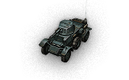
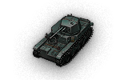
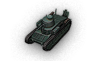
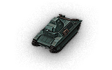
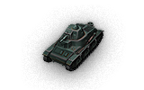
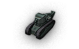
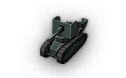
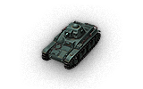

# France · Tier II

[All nations and tiers](../buffs_nerfs.md) · EU v20410 → RU v14600ru · 3 November 2026

<label><strong>Find a tank</strong><input type="search" placeholder="Try is7, obj140 or xm57" aria-label="Find a tank" style="display:block;width:100%;padding:.7rem;border:1px solid #888;border-radius:4px;margin:.5rem 0;color:inherit;background:transparent"></label>

AM 39 Gendron-Somua · Tier II

am39gendronsomua

<a href="https://tanks.gg/v20410/tank/am-gendron">EU stats</a> · <a href="https://tanks.gg/v14600ru/tank/am-gendron">RU stats</a>
<figure style="display:inline-block"><figcaption>AM 39 Gendron-Somua</figcaption></figure>
<strong>Damage (HP)</strong> <b>EU</b>  AP <strong>27</strong> /  APCR <strong>27</strong> → <b>RU</b>  AP <strong>30</strong> /  APCR <strong>30</strong>

<em>Firepower</em> 
<strong>DPM (HP/min)</strong> <small>EU</small> 771.43  <small>RU</small> <strong>947.37</strong> 
<strong>Rate of fire (rounds/min)</strong> <small>EU</small> 28.57  <small>RU</small> <strong>31.58</strong> 
<strong>Reload time (s)</strong> <small>EU</small> 2.10  <small>RU</small> <strong>1.90</strong> 
<strong>Potential damage</strong> <small>EU</small> 8 100  <small>RU</small> <strong>9 000</strong> 

<em>Gun handling</em> 
<strong>Aim time (s)</strong> <small>EU</small> 1.80  <small>RU</small> <strong>1.50</strong> 
<strong>Dispersion (m/100 m)</strong> <small>EU</small> 0.42  <small>RU</small> <strong>0.38</strong> 
<strong>Dispersion · damaged</strong> <small>EU</small> 0.84  <small>RU</small> <strong>0.76</strong> 
<strong>Dispersion · moving</strong> <small>EU</small> 0.10  <small>RU</small> <strong>0.05</strong> 
<strong>Dispersion · tank traverse</strong> <small>EU</small> 0.15  <small>RU</small> <strong>0.05</strong> 

<em>Mobility</em> 
<strong>Turret traverse (°/s)</strong> <small>EU</small> 42  <small>RU</small> <strong>60</strong> 

<em>Armor &amp; health</em> 
<strong>Health</strong> <small>EU</small> 280  <small>RU</small> <strong>360</strong> 
<strong>Track repair time (s)</strong> <small>EU</small> 24.06  <small>RU</small> <strong>12</strong> 

<em>Miscellaneous</em> 
<strong>View range (m)</strong> <small>EU</small> 280  <small>RU</small> <strong>300</strong> 

AMR 35 · Tier II

amr35

<a href="https://tanks.gg/v20410/tank/amr-35">EU stats</a> · <a href="https://tanks.gg/v14600ru/tank/amr-35">RU stats</a>
<figure style="display:inline-block"><figcaption>AMR 35</figcaption></figure>
<strong>Damage (HP)</strong> <b>EU</b>  AP <strong>27</strong> /  APCR <strong>27</strong> → <b>RU</b>  AP <strong>30</strong> /  APCR <strong>30</strong>

<em>Firepower</em> 
<strong>DPM (HP/min)</strong> <small>EU</small> 952.94  <small>RU</small> <strong>1 058.82</strong> 
<strong>Potential damage</strong> <small>EU</small> 4 185  <small>RU</small> <strong>4 650</strong> 

<em>Gun handling</em> 
<strong>Dispersion (m/100 m)</strong> <small>EU</small> 0.38  <small>RU</small> <strong>0.36</strong> 
<strong>Dispersion · damaged</strong> <small>EU</small> 0.76  <small>RU</small> <strong>0.72</strong> 
<strong>Dispersion · moving</strong> <small>EU</small> 0.20  <small>RU</small> <strong>0.14</strong> 
<strong>Dispersion · tank traverse</strong> <small>EU</small> 0.20  <small>RU</small> <strong>0.14</strong> 

<em>Mobility</em> 
<strong>Forward speed on hard terrain (km/h)</strong> <small>EU</small> 34.83  <small>RU</small> <strong>49.42</strong> 
<strong>Forward speed on medium terrain (km/h)</strong> <small>EU</small> 30.48  <small>RU</small> <strong>43.24</strong> 
<strong>Forward speed on soft terrain (km/h)</strong> <small>EU</small> 18.06  <small>RU</small> <strong>25.63</strong> 
<strong>Engine power (hp)</strong> <small>EU</small> 84.58  <small>RU</small> <strong>120</strong> 
<strong>Power/weight (hp/t)</strong> <small>EU</small> 12.81  <small>RU</small> <strong>18.18</strong> 
<strong>Turret traverse (°/s)</strong> <small>EU</small> 30  <small>RU</small> <strong>40</strong> 

<em>Armor &amp; health</em> 
<strong>Track repair time (s)</strong> <small>EU</small> 12.03  <small>RU</small> <strong>3</strong> 

D1 · Tier II

d1

<a href="https://tanks.gg/v20410/tank/d1">EU stats</a> · <a href="https://tanks.gg/v14600ru/tank/d1">RU stats</a>
<figure style="display:inline-block"><figcaption>D1</figcaption></figure>
<em>Gun handling</em> 
<strong>Aim time (s)</strong> <small>EU</small> 1.70  <small>RU</small> <strong>1.50</strong> 
<strong>Dispersion (m/100 m)</strong> <small>EU</small> 0.53  <small>RU</small> <strong>0.42</strong> 
<strong>Dispersion · damaged</strong> <small>EU</small> 1.06  <small>RU</small> <strong>0.84</strong> 
<strong>Dispersion · moving</strong> <small>EU</small> 0.29  <small>RU</small> <strong>0.23</strong> 
<strong>Dispersion · tank traverse</strong> <small>EU</small> 0.29  <small>RU</small> <strong>0.23</strong> 
<strong>Dispersion · turret traverse</strong> <small>EU</small> 0.14  <small>RU</small> <strong>0.08</strong> 
<strong>Dispersion · firing</strong> <small>EU</small> 4  <small>RU</small> <strong>1</strong> 

<em>Mobility</em> 
<strong>Turret traverse (°/s)</strong> <small>EU</small> 24  <small>RU</small> <strong>34</strong> 

<em>Armor &amp; health</em> 
<strong>Health</strong> <small>EU</small> 340  <small>RU</small> <strong>380</strong> 
<strong>Track repair time (s)</strong> <small>EU</small> 12.03  <small>RU</small> <strong>3</strong> 

<em>Miscellaneous</em> 
<strong>View range (m)</strong> <small>EU</small> 300  <small>RU</small> <strong>310</strong> 

FCM 36 · Tier II

fcm36

<a href="https://tanks.gg/v20410/tank/fcm-36">EU stats</a> · <a href="https://tanks.gg/v14600ru/tank/fcm-36">RU stats</a>
<figure style="display:inline-block"><figcaption>FCM 36</figcaption></figure>
<strong>Penetration (mm)</strong> <b>EU</b>  AP <strong>46</strong> /  APCR <strong>68</strong> /  HE <strong>13</strong> → <b>RU</b>  AP <strong>46</strong> /  APCR <strong>68</strong>

<strong>Damage (HP)</strong> <b>EU</b>  AP <strong>27</strong> /  APCR <strong>27</strong> /  HE <strong>33</strong> → <b>RU</b>  AP <strong>30</strong> /  APCR <strong>30</strong>

<em>Firepower</em> 
<strong>DPM (HP/min)</strong> <small>EU</small> 704.35  <small>RU</small> <strong>1 000</strong> 
<strong>Rate of fire (rounds/min)</strong> <small>EU</small> 26.09  <small>RU</small> <strong>33.33</strong> 
<strong>Reload time (s)</strong> <small>EU</small> 2.30  <small>RU</small> <strong>1.80</strong> 
<strong>Potential damage</strong> <small>EU</small> 8 100  <small>RU</small> <strong>9 000</strong> 

<em>Gun handling</em> 
<strong>Aim time (s)</strong> <small>EU</small> 1.80  <small>RU</small> <strong>1.50</strong> 
<strong>Dispersion (m/100 m)</strong> <small>EU</small> 0.41  <small>RU</small> <strong>0.40</strong> 
<strong>Dispersion · damaged</strong> <small>EU</small> 0.82  <small>RU</small> <strong>0.80</strong> 
<strong>Dispersion · moving</strong> <small>EU</small> 0.24  <small>RU</small> <strong>0.20</strong> 
<strong>Dispersion · tank traverse</strong> <small>EU</small> 0.24  <small>RU</small> <strong>0.20</strong> 
<strong>Dispersion · turret traverse</strong> <small>EU</small> 0.14  <small>RU</small> <strong>0.10</strong> 
<strong>Dispersion · firing</strong> <small>EU</small> 3  <small>RU</small> <strong>1</strong> 

<em>Mobility</em> 
<strong>Forward speed (km/h)</strong> <small>EU</small> 24  <small>RU</small> <strong>28</strong> 
<strong>Forward speed on hard terrain (km/h)</strong> <small>EU</small> 24  <small>RU</small> <strong>28</strong> 
<strong>Forward speed on medium terrain (km/h)</strong> <small>EU</small> 24  <small>RU</small> <strong>28</strong> 
<strong>Forward speed on soft terrain (km/h)</strong> <small>EU</small> 15.43  <small>RU</small> <strong>22.39</strong> 
<strong>Engine power (hp)</strong> <small>EU</small> 120  <small>RU</small> <strong>111.01</strong> 
<strong>Power/weight (hp/t)</strong> <small>EU</small> 9.73  <small>RU</small> <strong>9</strong> 
<strong>Terrain resist (hard)</strong> <small>EU</small> 1.05  <small>RU</small> <strong>0.58</strong> 
<strong>Terrain resist (med)</strong> <small>EU</small> 1.25  <small>RU</small> <strong>0.77</strong> 
<strong>Terrain resist (soft)</strong> <small>EU</small> 2.30  <small>RU</small> <strong>1.47</strong> 
<strong>Turret traverse (°/s)</strong> <small>EU</small> 24  <small>RU</small> <strong>34</strong> 
<strong>Tank traverse (°/s)</strong> <small>EU</small> 43.81  <small>RU</small> <strong>35.46</strong> 
<strong>Tank traverse on hard terrain (°/s)</strong> <small>EU</small> 47.78  <small>RU</small> <strong>35.46</strong> 
<strong>Tank traverse on medium terrain (°/s)</strong> <small>EU</small> 40.43  <small>RU</small> <strong>26.63</strong> 
<strong>Tank traverse on soft terrain (°/s)</strong> <small>EU</small> 21.90  <small>RU</small> <strong>13.97</strong> 

<em>Armor &amp; health</em> 
<strong>Health</strong> <small>EU</small> 280  <small>RU</small> <strong>380</strong> 
<strong>Track repair time (s)</strong> <small>EU</small> 12.03  <small>RU</small> <strong>3</strong> 

<em>Miscellaneous</em> 
<strong>View range (m)</strong> <small>EU</small> 300  <small>RU</small> <strong>280</strong> 

Hotchkiss H35 · Tier II

hotchkissh35

<a href="https://tanks.gg/v20410/tank/h35">EU stats</a> · <a href="https://tanks.gg/v14600ru/tank/h35">RU stats</a>
<figure style="display:inline-block"><figcaption>Hotchkiss H35</figcaption></figure>
<em>Gun handling</em> 
<strong>Aim time (s)</strong> <small>EU</small> 2  <small>RU</small> <strong>1.50</strong> 
<strong>Dispersion · moving</strong> <small>EU</small> 0.30  <small>RU</small> <strong>0.24</strong> 
<strong>Dispersion · tank traverse</strong> <small>EU</small> 0.30  <small>RU</small> <strong>0.24</strong> 

<em>Mobility</em> 
<strong>Turret traverse (°/s)</strong> <small>EU</small> 24  <small>RU</small> <strong>34</strong> 

<em>Armor &amp; health</em> 
<strong>Health</strong> <small>EU</small> 320  <small>RU</small> <strong>340</strong> 
<strong>Track repair time (s)</strong> <small>EU</small> 12.03  <small>RU</small> <strong>3</strong> 

Renault FT 75 BS · Tier II

renaultft75bs

<a href="https://tanks.gg/v20410/tank/ft-bs">EU stats</a> · <a href="https://tanks.gg/v14600ru/tank/ft-bs">RU stats</a>
<figure style="display:inline-block"><figcaption>Renault FT 75 BS</figcaption></figure>
<em>Gun handling</em> 
<strong>Dispersion · moving</strong> <small>EU</small> 0.30  <small>RU</small> <strong>0.26</strong> 
<strong>Dispersion · tank traverse</strong> <small>EU</small> 0.30  <small>RU</small> <strong>0.26</strong> 
<strong>Dispersion · turret traverse</strong> <small>EU</small> 0.34  <small>RU</small> <strong>0.30</strong> 

<em>Armor &amp; health</em> 
<strong>Health</strong> <small>EU</small> 160  <small>RU</small> <strong>200</strong> 
<strong>Track repair time (s)</strong> <small>EU</small> 13.16  <small>RU</small> <strong>3</strong> 

Renault FT AC · Tier II

renaultftac

<a href="https://tanks.gg/v20410/tank/ft-ac">EU stats</a> · <a href="https://tanks.gg/v14600ru/tank/ft-ac">RU stats</a>
<figure style="display:inline-block"><figcaption>Renault FT AC</figcaption></figure>
<em>Gun handling</em> 
<strong>Dispersion · moving</strong> <small>EU</small> 0.28  <small>RU</small> <strong>0.18</strong> 
<strong>Dispersion · tank traverse</strong> <small>EU</small> 0.28  <small>RU</small> <strong>0.18</strong> 

<em>Mobility</em> 
<strong>Forward speed (km/h)</strong> <small>EU</small> 21  <small>RU</small> <strong>26</strong> 
<strong>Forward speed on hard terrain (km/h)</strong> <small>EU</small> 21  <small>RU</small> <strong>26</strong> 
<strong>Forward speed on medium terrain (km/h)</strong> <small>EU</small> 21  <small>RU</small> <strong>26</strong> 
<strong>Forward speed on soft terrain (km/h)</strong> <small>EU</small> 16.80  <small>RU</small> <strong>19.42</strong> 
<strong>Reverse speed (km/h)</strong> <small>EU</small> 8  <small>RU</small> <strong>12</strong> 
<strong>Engine power (hp)</strong> <small>EU</small> 47.58  <small>RU</small> <strong>55</strong> 
<strong>Power/weight (hp/t)</strong> <small>EU</small> 10.15  <small>RU</small> <strong>11.74</strong> 
<strong>Tank traverse on hard terrain (°/s)</strong> <small>EU</small> 34.08  <small>RU</small> <strong>32.49</strong> 
<strong>Tank traverse on medium terrain (°/s)</strong> <small>EU</small> 28.84  <small>RU</small> <strong>27.49</strong> 
<strong>Tank traverse on soft terrain (°/s)</strong> <small>EU</small> 16.30  <small>RU</small> <strong>15.54</strong> 

<em>Armor &amp; health</em> 
<strong>Health</strong> <small>EU</small> 240  <small>RU</small> <strong>390</strong> 
<strong>Track repair time (s)</strong> <small>EU</small> 12.03  <small>RU</small> <strong>3</strong> 

<em>Miscellaneous</em> 
<strong>Fire chance (%)</strong> <small>EU</small> 20  <small>RU</small> <strong>15</strong> 

Renault R35 · Tier II

renaultr35

<a href="https://tanks.gg/v20410/tank/r35">EU stats</a> · <a href="https://tanks.gg/v14600ru/tank/r35">RU stats</a>
<figure style="display:inline-block"><figcaption>Renault R35</figcaption></figure>
<em>Firepower</em> 
<strong>DPM (HP/min)</strong> <small>EU</small> 923.08  <small>RU</small> <strong>1 000</strong> 
<strong>Rate of fire (rounds/min)</strong> <small>EU</small> 23.08  <small>RU</small> <strong>25</strong> 
<strong>Reload time (s)</strong> <small>EU</small> 2.60  <small>RU</small> <strong>2.40</strong> 

<em>Gun handling</em> 
<strong>Aim time (s)</strong> <small>EU</small> 2  <small>RU</small> <strong>1.60</strong> 
<strong>Dispersion · moving</strong> <small>EU</small> 0.30  <small>RU</small> <strong>0.24</strong> 
<strong>Dispersion · tank traverse</strong> <small>EU</small> 0.30  <small>RU</small> <strong>0.24</strong> 

<em>Mobility</em> 
<strong>Forward speed (km/h)</strong> <small>EU</small> 23  <small>RU</small> <strong>28</strong> 
<strong>Forward speed on hard terrain (km/h)</strong> <small>EU</small> 23  <small>RU</small> <strong>25.99</strong> 
<strong>Forward speed on medium terrain (km/h)</strong> <small>EU</small> 23  <small>RU</small> <strong>23.99</strong> 
<strong>Turret traverse (°/s)</strong> <small>EU</small> 24  <small>RU</small> <strong>34</strong> 

<em>Armor &amp; health</em> 
<strong>Health</strong> <small>EU</small> 310  <small>RU</small> <strong>340</strong> 
<strong>Track repair time (s)</strong> <small>EU</small> 12.03  <small>RU</small> <strong>3</strong> 

<em>Miscellaneous</em> 
<strong>View range (m)</strong> <small>EU</small> 300  <small>RU</small> <strong>310</strong> 

