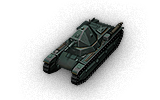
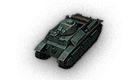
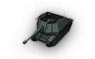
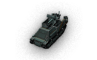
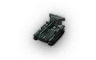
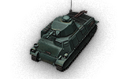

# France · Tier III

[All nations and tiers](../buffs_nerfs.md) · EU v20410 → RU v14600ru · 3 November 2026

<label><strong>Find a tank</strong><input type="search" placeholder="Try is7, obj140 or xm57" aria-label="Find a tank" style="display:block;width:100%;padding:.7rem;border:1px solid #888;border-radius:4px;margin:.5rem 0;color:inherit;background:transparent"></label>

AMX 38 · Tier III

amx38

<a href="https://tanks.gg/v20410/tank/amx-38">EU stats</a> · <a href="https://tanks.gg/v14600ru/tank/amx-38">RU stats</a>
<figure style="display:inline-block"><figcaption>AMX 38</figcaption></figure>
<strong>Penetration (mm)</strong> <b>EU</b>  AP <strong>73</strong> /  APCR <strong>120</strong> /  HE <strong>24</strong> → <b>RU</b>  AP <strong>45</strong> /  APCR <strong>79</strong> /  HE <strong>24</strong>

<strong>Damage (HP)</strong> <b>EU</b>  AP <strong>60</strong> /  APCR <strong>60</strong> /  HE <strong>75</strong> → <b>RU</b>  AP <strong>55</strong> /  APCR <strong>55</strong> /  HE <strong>70</strong>

<em>Firepower</em> 
<strong>DPM (HP/min)</strong> <small>EU</small> 1 161.29  <small>RU</small> <strong>1 100</strong> 
<strong>Rate of fire (rounds/min)</strong> <small>EU</small> 19.35  <small>RU</small> <strong>20</strong> 
<strong>Reload time (s)</strong> <small>EU</small> 3.10  <small>RU</small> <strong>3</strong> 
<strong>Potential damage</strong> <small>EU</small> 12 600  <small>RU</small> <strong>11 550</strong> 

<em>Gun handling</em> 
<strong>Aim time (s)</strong> <small>EU</small> 2.20  <small>RU</small> <strong>1.60</strong> 
<strong>Dispersion (m/100 m)</strong> <small>EU</small> 0.42  <small>RU</small> <strong>0.40</strong> 
<strong>Dispersion · damaged</strong> <small>EU</small> 0.84  <small>RU</small> <strong>0.80</strong> 
<strong>Dispersion · turret traverse</strong> <small>EU</small> 0.20  <small>RU</small> <strong>0.10</strong> 
<strong>Dispersion · firing</strong> <small>EU</small> 4  <small>RU</small> <strong>2</strong> 
<strong>Elevation (°)</strong> <small>EU</small> 18  <small>RU</small> <strong>20</strong> 
<strong>Depression (°)</strong> <small>EU</small> 14  <small>RU</small> <strong>6</strong> 

<em>Mobility</em> 
<strong>Forward speed (km/h)</strong> <small>EU</small> 28  <small>RU</small> <strong>25</strong> 
<strong>Forward speed on hard terrain (km/h)</strong> <small>EU</small> 28  <small>RU</small> <strong>25</strong> 
<strong>Forward speed on medium terrain (km/h)</strong> <small>EU</small> 28  <small>RU</small> <strong>25</strong> 
<strong>Forward speed on soft terrain (km/h)</strong> <small>EU</small> 18.50  <small>RU</small> <strong>16.05</strong> 
<strong>Reverse speed (km/h)</strong> <small>EU</small> 10  <small>RU</small> <strong>15</strong> 
<strong>Engine power (hp)</strong> <small>EU</small> 195  <small>RU</small> <strong>169.17</strong> 
<strong>Power/weight (hp/t)</strong> <small>EU</small> 12.15  <small>RU</small> <strong>10.54</strong> 
<strong>Turret traverse (°/s)</strong> <small>EU</small> 28  <small>RU</small> <strong>32</strong> 
<strong>Tank traverse (°/s)</strong> <small>EU</small> 37.55  <small>RU</small> <strong>33.38</strong> 
<strong>Tank traverse on hard terrain (°/s)</strong> <small>EU</small> 41.60  <small>RU</small> <strong>35.40</strong> 
<strong>Tank traverse on medium terrain (°/s)</strong> <small>EU</small> 38.63  <small>RU</small> <strong>32.87</strong> 
<strong>Tank traverse on soft terrain (°/s)</strong> <small>EU</small> 21.63  <small>RU</small> <strong>18.41</strong> 

<em>Armor &amp; health</em> 
<strong>Health</strong> <small>EU</small> 390  <small>RU</small> <strong>480</strong> 
<strong>Health · engine</strong> <small>EU</small> 100  <small>RU</small> <strong>50</strong> 
<strong>Track repair time (s)</strong> <small>EU</small> 12.03  <small>RU</small> <strong>4</strong> 

<em>Miscellaneous</em> 
<strong>View range (m)</strong> <small>EU</small> 320  <small>RU</small> <strong>310</strong> 

D2 · Tier III

d2

<a href="https://tanks.gg/v20410/tank/d2">EU stats</a> · <a href="https://tanks.gg/v14600ru/tank/d2">RU stats</a>
<figure style="display:inline-block"><figcaption>D2</figcaption></figure>
<em>Gun handling</em> 
<strong>Aim time (s)</strong> <small>EU</small> 2.30  <small>RU</small> <strong>1.60</strong> 
<strong>Dispersion · moving</strong> <small>EU</small> 0.28  <small>RU</small> <strong>0.20</strong> 
<strong>Dispersion · tank traverse</strong> <small>EU</small> 0.28  <small>RU</small> <strong>0.20</strong> 
<strong>Dispersion · turret traverse</strong> <small>EU</small> 0.16  <small>RU</small> <strong>0.10</strong> 
<strong>Dispersion · firing</strong> <small>EU</small> 4  <small>RU</small> <strong>2</strong> 

<em>Mobility</em> 
<strong>Forward speed (km/h)</strong> <small>EU</small> 23  <small>RU</small> <strong>25</strong> 
<strong>Forward speed on hard terrain (km/h)</strong> <small>EU</small> 23  <small>RU</small> <strong>25</strong> 
<strong>Forward speed on medium terrain (km/h)</strong> <small>EU</small> 23  <small>RU</small> <strong>25</strong> 
<strong>Reverse speed (km/h)</strong> <small>EU</small> 12  <small>RU</small> <strong>15</strong> 

<em>Armor &amp; health</em> 
<strong>Health</strong> <small>EU</small> 410  <small>RU</small> <strong>550</strong> 
<strong>Track repair time (s)</strong> <small>EU</small> 12.03  <small>RU</small> <strong>4</strong> 

FCM 36 Pak 40 · Tier III

fcm36pak40

<a href="https://tanks.gg/v20410/tank/fcm36pak40">EU stats</a> · <a href="https://tanks.gg/v14600ru/tank/fcm36pak40">RU stats</a>
<figure style="display:inline-block"><figcaption>FCM 36 Pak 40</figcaption></figure>
<em>Armor &amp; health</em> 
<strong>Health</strong> <small>EU</small> 320  <small>RU</small> <strong>490</strong> 
<strong>Track repair time (s)</strong> <small>EU</small> 10.03  <small>RU</small> <strong>4</strong> 

Lorraine 39L AM · Tier III

lorraine39lam

<a href="https://tanks.gg/v20410/tank/lorr-39l-am">EU stats</a> · <a href="https://tanks.gg/v14600ru/tank/lorr-39l-am">RU stats</a>
<figure style="display:inline-block"><figcaption>EU · Lorraine 39L AM</figcaption></figure><figure style="display:inline-block"><figcaption>RU · Lorraine 39L AM</figcaption></figure>
<em>Firepower</em> 
<strong>Max range (m)</strong> <small>EU</small> 982.19  <small>RU</small> <strong>1 414.01</strong> 

<em>Armor &amp; health</em> 
<strong>Health</strong> <small>EU</small> 215  <small>RU</small> <strong>250</strong> 
<strong>Track repair time (s)</strong> <small>EU</small> 12.63  <small>RU</small> <strong>4</strong> 

<em>Miscellaneous</em> 
<strong>View range (m)</strong> <small>EU</small> 260  <small>RU</small> <strong>300</strong> 

Renault UE 57 · Tier III

renaultue57

<a href="https://tanks.gg/v20410/tank/ue-57">EU stats</a> · <a href="https://tanks.gg/v14600ru/tank/ue-57">RU stats</a>
<figure style="display:inline-block"><figcaption>Renault UE 57</figcaption></figure>
<em>Gun handling</em> 
<strong>Aim time (s)</strong> <small>EU</small> 1.92  <small>RU</small> <strong>1.53</strong> 
<strong>Dispersion (m/100 m)</strong> <small>EU</small> 0.37  <small>RU</small> <strong>0.35</strong> 
<strong>Dispersion · damaged</strong> <small>EU</small> 0.75  <small>RU</small> <strong>0.69</strong> 
<strong>Dispersion · moving</strong> <small>EU</small> 0.26  <small>RU</small> <strong>0.20</strong> 
<strong>Dispersion · tank traverse</strong> <small>EU</small> 0.26  <small>RU</small> <strong>0.20</strong> 
<strong>Dispersion · turret traverse</strong> <small>EU</small> 0.16  <small>RU</small> <strong>0.08</strong> 
<strong>Dispersion · firing</strong> <small>EU</small> 4  <small>RU</small> <strong>3</strong> 

<em>Mobility</em> 
<strong>Reverse speed (km/h)</strong> <small>EU</small> 12  <small>RU</small> <strong>16</strong> 

<em>Armor &amp; health</em> 
<strong>Health</strong> <small>EU</small> 265  <small>RU</small> <strong>500</strong> 
<strong>Track repair time (s)</strong> <small>EU</small> 10.03  <small>RU</small> <strong>4</strong> 

Somua S35 · Tier III

somuas35

<a href="https://tanks.gg/v20410/tank/somua-s35">EU stats</a> · <a href="https://tanks.gg/v14600ru/tank/somua-s35">RU stats</a>
<figure style="display:inline-block"><figcaption>Somua S35</figcaption></figure>
<em>Firepower</em> 
<strong>DPM (HP/min)</strong> <small>EU</small> 1 186.86  <small>RU</small> <strong>1 348.38</strong> 
<strong>Rate of fire (rounds/min)</strong> <small>EU</small> 21.58  <small>RU</small> <strong>24.52</strong> 
<strong>Reload time (s)</strong> <small>EU</small> 2.78  <small>RU</small> <strong>2.45</strong> 

<em>Mobility</em> 
<strong>Forward speed on hard terrain (km/h)</strong> <small>EU</small> 40.64  <small>RU</small> <strong>38.01</strong> 
<strong>Forward speed on medium terrain (km/h)</strong> <small>EU</small> 34.84  <small>RU</small> <strong>32.58</strong> 
<strong>Forward speed on soft terrain (km/h)</strong> <small>EU</small> 20.32  <small>RU</small> <strong>19.01</strong> 
<strong>Engine power (hp)</strong> <small>EU</small> 260  <small>RU</small> <strong>243.17</strong> 
<strong>Power/weight (hp/t)</strong> <small>EU</small> 12.81  <small>RU</small> <strong>11.98</strong> 
<strong>Tank traverse (°/s)</strong> <small>EU</small> 52.15  <small>RU</small> <strong>39.63</strong> 
<strong>Tank traverse on hard terrain (°/s)</strong> <small>EU</small> 55.55  <small>RU</small> <strong>40.64</strong> 
<strong>Tank traverse on medium terrain (°/s)</strong> <small>EU</small> 47.61  <small>RU</small> <strong>34.83</strong> 
<strong>Tank traverse on soft terrain (°/s)</strong> <small>EU</small> 27.77  <small>RU</small> <strong>20.32</strong> 

<em>Armor &amp; health</em> 
<strong>Health</strong> <small>EU</small> 450  <small>RU</small> <strong>550</strong> 
<strong>Track repair time (s)</strong> <small>EU</small> 10.03  <small>RU</small> <strong>4</strong> 

