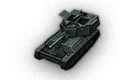
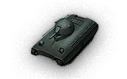
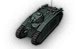
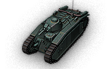
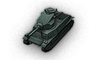
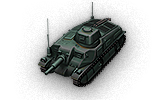

# France · Tier IV

[All nations and tiers](../buffs_nerfs.md) · EU v20410 → RU v14600ru · 3 November 2026

<label><strong>Find a tank</strong><input type="search" placeholder="Try is7, obj140 or xm57" aria-label="Find a tank" style="display:block;width:100%;padding:.7rem;border:1px solid #888;border-radius:4px;margin:.5rem 0;color:inherit;background:transparent"></label>

AMX 105 AM mle. 47 · Tier IV

amx105ammle47

<a href="https://tanks.gg/v20410/tank/amx-105-am">EU stats</a> · <a href="https://tanks.gg/v14600ru/tank/amx-105-am">RU stats</a>
<figure style="display:inline-block"><figcaption>AMX 105 AM mle. 47</figcaption></figure>
<strong>Penetration (mm)</strong> <b>EU</b>  HE <strong>30</strong> → <b>RU</b>  HE <strong>27</strong>

<em>Firepower</em> 
<strong>Max range (m)</strong> <small>EU</small> 1 287.24  <small>RU</small> <strong>1 412.13</strong> 

<em>Armor &amp; health</em> 
<strong>Health</strong> <small>EU</small> 260  <small>RU</small> <strong>300</strong> 
<strong>Track repair time (s)</strong> <small>EU</small> 13.40  <small>RU</small> <strong>5</strong> 

<em>Miscellaneous</em> 
<strong>View range (m)</strong> <small>EU</small> 260  <small>RU</small> <strong>300</strong> 

AMX 40 · Tier IV

amx40

<a href="https://tanks.gg/v20410/tank/amx-40">EU stats</a> · <a href="https://tanks.gg/v14600ru/tank/amx-40">RU stats</a>
<figure style="display:inline-block"><figcaption>AMX 40</figcaption></figure>
<strong>Penetration (mm)</strong> <b>EU</b>  AP <strong>85</strong> /  HEAT <strong>131</strong> /  HE <strong>38</strong> → <b>RU</b>  AP <strong>74</strong> /  HEAT <strong>92</strong> /  HE <strong>38</strong>

<em>Firepower</em> 
<strong>DPM (HP/min)</strong> <small>EU</small> 1 110.29  <small>RU</small> <strong>1 274.78</strong> 
<strong>Rate of fire (rounds/min)</strong> <small>EU</small> 10.09  <small>RU</small> <strong>11.59</strong> 
<strong>Reload time (s)</strong> <small>EU</small> 5.94  <small>RU</small> <strong>5.18</strong> 

<em>Gun handling</em> 
<strong>Aim time (s)</strong> <small>EU</small> 2.21  <small>RU</small> <strong>1.92</strong> 
<strong>Dispersion (m/100 m)</strong> <small>EU</small> 0.44  <small>RU</small> <strong>0.36</strong> 
<strong>Dispersion · damaged</strong> <small>EU</small> 0.88  <small>RU</small> <strong>0.73</strong> 
<strong>Dispersion · turret traverse</strong> <small>EU</small> 0.14  <small>RU</small> <strong>0.12</strong> 

<em>Mobility</em> 
<strong>Forward speed (km/h)</strong> <small>EU</small> 35  <small>RU</small> <strong>50</strong> 
<strong>Forward speed on hard terrain (km/h)</strong> <small>EU</small> 34.82  <small>RU</small> <strong>24.98</strong> 
<strong>Forward speed on medium terrain (km/h)</strong> <small>EU</small> 32.50  <small>RU</small> <strong>23.32</strong> 
<strong>Forward speed on soft terrain (km/h)</strong> <small>EU</small> 19.50  <small>RU</small> <strong>13.99</strong> 
<strong>Engine power (hp)</strong> <small>EU</small> 280  <small>RU</small> <strong>200.88</strong> 
<strong>Power/weight (hp/t)</strong> <small>EU</small> 12.81  <small>RU</small> <strong>9.19</strong> 
<strong>Tank traverse (°/s)</strong> <small>EU</small> 41.72  <small>RU</small> <strong>31.29</strong> 
<strong>Tank traverse on hard terrain (°/s)</strong> <small>EU</small> 43.16  <small>RU</small> <strong>36.61</strong> 
<strong>Tank traverse on medium terrain (°/s)</strong> <small>EU</small> 40.28  <small>RU</small> <strong>34.17</strong> 
<strong>Tank traverse on soft terrain (°/s)</strong> <small>EU</small> 24.17  <small>RU</small> <strong>20.50</strong> 

<em>Armor &amp; health</em> 
<strong>Health</strong> <small>EU</small> 400  <small>RU</small> <strong>520</strong> 
<strong>Health · engine</strong> <small>EU</small> 135  <small>RU</small> <strong>50</strong> 
<strong>Track repair time (s)</strong> <small>EU</small> 12.03  <small>RU</small> <strong>5</strong> 

<em>Miscellaneous</em> 
<strong>Moving camo</strong> <small>EU</small> 13.19  <small>RU</small> <strong>9.89</strong> 
<strong>Moving camo · after firing</strong> <small>EU</small> 3.43  <small>RU</small> <strong>2.57</strong> 

B1 · Tier IV

b1

<a href="https://tanks.gg/v20410/tank/b1">EU stats</a> · <a href="https://tanks.gg/v14600ru/tank/b1">RU stats</a>
<figure style="display:inline-block"><figcaption>EU · B1</figcaption></figure><figure style="display:inline-block"><figcaption>RU · B1</figcaption></figure>
<strong>Penetration (mm)</strong> <b>EU</b>  AP <strong>80</strong> /  APCR <strong>120</strong> /  HE <strong>24</strong> → <b>RU</b>  AP <strong>66</strong> /  APCR <strong>98</strong> /  HE <strong>24</strong>

<strong>Damage (HP)</strong> <b>EU</b>  AP <strong>60</strong> /  APCR <strong>60</strong> /  HE <strong>80</strong> → <b>RU</b>  AP <strong>55</strong> /  APCR <strong>55</strong> /  HE <strong>70</strong>

<em>Firepower</em> 
<strong>DPM (HP/min)</strong> <small>EU</small> 1 706.73  <small>RU</small> <strong>1 605.21</strong> 
<strong>Rate of fire (rounds/min)</strong> <small>EU</small> 28.45  <small>RU</small> <strong>29.19</strong> 
<strong>Reload time (s)</strong> <small>EU</small> 2.11  <small>RU</small> <strong>2.06</strong> 
<strong>Potential damage</strong> <small>EU</small> 11 700  <small>RU</small> <strong>10 725</strong> 

<em>Gun handling</em> 
<strong>Aim time (s)</strong> <small>EU</small> 1.05  <small>RU</small> <strong>1.47</strong> 
<strong>Dispersion (m/100 m)</strong> <small>EU</small> 0.37  <small>RU</small> <strong>0.35</strong> 
<strong>Dispersion · damaged</strong> <small>EU</small> 0.75  <small>RU</small> <strong>0.70</strong> 
<strong>Dispersion · firing</strong> <small>EU</small> 3  <small>RU</small> <strong>2</strong> 

<em>Mobility</em> 
<strong>Forward speed on soft terrain (km/h)</strong> <small>EU</small> 23.39  <small>RU</small> <strong>21.63</strong> 
<strong>Reverse speed (km/h)</strong> <small>EU</small> 10  <small>RU</small> <strong>14</strong> 
<strong>Engine power (hp)</strong> <small>EU</small> 400  <small>RU</small> <strong>370.05</strong> 
<strong>Power/weight (hp/t)</strong> <small>EU</small> 13.52  <small>RU</small> <strong>12.51</strong> 
<strong>Turret traverse (°/s)</strong> <small>EU</small> 31.29  <small>RU</small> <strong>30.65</strong> 
<strong>Tank traverse on hard terrain (°/s)</strong> <small>EU</small> 30.43  <small>RU</small> <strong>32.96</strong> 
<strong>Tank traverse on medium terrain (°/s)</strong> <small>EU</small> 25.75  <small>RU</small> <strong>27.89</strong> 
<strong>Tank traverse on soft terrain (°/s)</strong> <small>EU</small> 15.21  <small>RU</small> <strong>16.48</strong> 

<em>Armor &amp; health</em> 
<strong>Health</strong> <small>EU</small> 700  <small>RU</small> <strong>720</strong> 
<strong>Track repair time (s)</strong> <small>EU</small> 12.03  <small>RU</small> <strong>5</strong> 

<em>Miscellaneous</em> 
<strong>Moving camo</strong> <small>EU</small> 3.76  <small>RU</small> <strong>3.71</strong> 
<strong>Moving camo · after firing</strong> <small>EU</small> 1.09  <small>RU</small> <strong>1.07</strong> 

SARL 42 · Tier IV

sarl42

<a href="https://tanks.gg/v20410/tank/sarl-42">EU stats</a> · <a href="https://tanks.gg/v14600ru/tank/sarl-42">RU stats</a>
<figure style="display:inline-block"><figcaption>SARL 42</figcaption></figure>
<em>Firepower</em> 
<strong>DPM (HP/min)</strong> <small>EU</small> 1 274.78  <small>RU</small> <strong>1 376.76</strong> 
<strong>Rate of fire (rounds/min)</strong> <small>EU</small> 11.59  <small>RU</small> <strong>12.52</strong> 
<strong>Reload time (s)</strong> <small>EU</small> 5.18  <small>RU</small> <strong>4.79</strong> 

<em>Gun handling</em> 
<strong>Aim time (s)</strong> <small>EU</small> 2.21  <small>RU</small> <strong>1.92</strong> 
<strong>Dispersion (m/100 m)</strong> <small>EU</small> 0.41  <small>RU</small> <strong>0.36</strong> 
<strong>Dispersion · damaged</strong> <small>EU</small> 0.82  <small>RU</small> <strong>0.73</strong> 
<strong>Dispersion · firing</strong> <small>EU</small> 4  <small>RU</small> <strong>2</strong> 

<em>Armor &amp; health</em> 
<strong>Health</strong> <small>EU</small> 540  <small>RU</small> <strong>630</strong> 
<strong>Track repair time (s)</strong> <small>EU</small> 10.03  <small>RU</small> <strong>5</strong> 

Somua SAu 40 · Tier IV

somuasau40

<a href="https://tanks.gg/v20410/tank/sau-40">EU stats</a> · <a href="https://tanks.gg/v14600ru/tank/sau-40">RU stats</a>
<figure style="display:inline-block"><figcaption>Somua SAu 40</figcaption></figure>
<strong>Penetration (mm)</strong> <b>EU</b>  HE <strong>53</strong> /  HEAT <strong>104</strong> → <b>RU</b>  AP <strong>100</strong> /  APCR <strong>129</strong> /  HE <strong>38</strong>

<strong>Damage (HP)</strong> <b>EU</b>  HE <strong>410</strong> /  HEAT <strong>350</strong> → <b>RU</b>  AP <strong>110</strong> /  APCR <strong>110</strong> /  HE <strong>175</strong>

<em>Firepower</em> 
<strong>DPM (HP/min)</strong> <small>EU</small> 3 018.56  <small>RU</small> <strong>1 811.53</strong> 
<strong>Module damage</strong> <small>EU</small> 150  <small>RU</small> <strong>100</strong> 
<strong>Rate of fire (rounds/min)</strong> <small>EU</small> 7.36  <small>RU</small> <strong>16.47</strong> 
<strong>Reload time (s)</strong> <small>EU</small> 8.15  <small>RU</small> <strong>3.64</strong> 
<strong>Explosion radius</strong> <small>EU</small> 1.91 → <small>RU</small> <strong>—</strong> 
<strong>Caliber</strong> <small>EU</small> 105  <small>RU</small> <strong>75</strong> 
<strong>Shell velocity (m/s)</strong> <small>EU</small> 670  <small>RU</small> <strong>735</strong> 
<strong>Normalization</strong> <small>EU</small> 0  <small>RU</small> <strong>5</strong> 
<strong>Ricochet angle</strong> <small>EU</small> 90  <small>RU</small> <strong>70</strong> 
<strong>Ammo capacity</strong> <small>EU</small> 45  <small>RU</small> <strong>60</strong> 
<strong>Potential damage</strong> <small>EU</small> 18 450  <small>RU</small> <strong>6 600</strong> 

<em>Gun handling</em> 
<strong>Aim time (s)</strong> <small>EU</small> 2.21  <small>RU</small> <strong>1.63</strong> 
<strong>Dispersion (m/100 m)</strong> <small>EU</small> 0.51  <small>RU</small> <strong>0.35</strong> 
<strong>Dispersion · damaged</strong> <small>EU</small> 1.02  <small>RU</small> <strong>0.69</strong> 
<strong>Dispersion · moving</strong> <small>EU</small> 0.24  <small>RU</small> <strong>0.20</strong> 
<strong>Dispersion · tank traverse</strong> <small>EU</small> 0.24  <small>RU</small> <strong>0.20</strong> 
<strong>Dispersion · firing</strong> <small>EU</small> 4  <small>RU</small> <strong>2</strong> 

<em>Mobility</em> 
<strong>Forward speed on hard terrain (km/h)</strong> <small>EU</small> 37  <small>RU</small> <strong>32.82</strong> 
<strong>Forward speed on medium terrain (km/h)</strong> <small>EU</small> 35.78  <small>RU</small> <strong>28.45</strong> 
<strong>Forward speed on soft terrain (km/h)</strong> <small>EU</small> 21.47  <small>RU</small> <strong>17.07</strong> 
<strong>Reverse speed (km/h)</strong> <small>EU</small> 12  <small>RU</small> <strong>15</strong> 
<strong>Engine power (hp)</strong> <small>EU</small> 350  <small>RU</small> <strong>274.89</strong> 
<strong>Weight (kg)</strong> <small>EU</small> 24 820 → <small>RU</small> <strong>24 520</strong> 
<strong>Power/weight (hp/t)</strong> <small>EU</small> 14.10  <small>RU</small> <strong>11.21</strong> 
<strong>Tank traverse (°/s)</strong> <small>EU</small> 39.63  <small>RU</small> <strong>31.29</strong> 
<strong>Tank traverse on hard terrain (°/s)</strong> <small>EU</small> 38.84  <small>RU</small> <strong>34.59</strong> 
<strong>Tank traverse on medium terrain (°/s)</strong> <small>EU</small> 33.66  <small>RU</small> <strong>29.97</strong> 
<strong>Tank traverse on soft terrain (°/s)</strong> <small>EU</small> 20.20  <small>RU</small> <strong>17.98</strong> 

<em>Armor &amp; health</em> 
<strong>Health</strong> <small>EU</small> 430  <small>RU</small> <strong>560</strong> 
<strong>Health · engine</strong> <small>EU</small> 135  <small>RU</small> <strong>80</strong> 
<strong>Track repair time (s)</strong> <small>EU</small> 10.03  <small>RU</small> <strong>5</strong> 

<em>Miscellaneous</em> 
<strong>Stationary camo · after firing</strong> <small>EU</small> 3.54  <small>RU</small> <strong>4.18</strong> 
<strong>Moving camo · after firing</strong> <small>EU</small> 2.12  <small>RU</small> <strong>2.50</strong> 
<strong>Shell cost</strong> <small>EU</small> 128  <small>RU</small> <strong>70</strong> 

