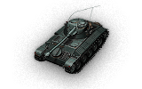
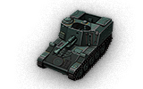
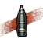
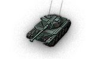
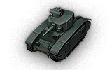
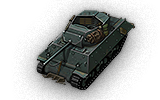
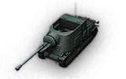

# France · Tier V

[All nations and tiers](../buffs_nerfs.md) · EU v20410 → RU v14600ru · 3 November 2026

<label><strong>Find a tank</strong><input type="search" placeholder="Try is7, obj140 or xm57" aria-label="Find a tank" style="display:block;width:100%;padding:.7rem;border:1px solid #888;border-radius:4px;margin:.5rem 0;color:inherit;background:transparent"></label>

AMX 13 (FL 11) · Tier V

amx13fl11

<a href="https://tanks.gg/v20410/tank/amx-13-fl-11">EU stats</a> · <a href="https://tanks.gg/v14600ru/tank/amx-13-fl-11">RU stats</a>
<figure style="display:inline-block"><figcaption>AMX 13 (FL 11)</figcaption></figure>
<em>Firepower</em> 
<strong>DPM (HP/min)</strong> <small>EU</small> 1 147.30  <small>RU</small> <strong>1 123.65</strong> 
<strong>Rate of fire (rounds/min)</strong> <small>EU</small> 10.43  <small>RU</small> <strong>10.22</strong> 
<strong>Reload time (s)</strong> <small>EU</small> 5.75  <small>RU</small> <strong>5.87</strong> 

AMX 13 105 AM mle. 50 · Tier V

amx13105ammle50

<a href="https://tanks.gg/v20410/tank/amx-13-am">EU stats</a> · <a href="https://tanks.gg/v14600ru/tank/amx-13-am">RU stats</a>
<figure style="display:inline-block"><figcaption>AMX 13 105 AM mle. 50</figcaption></figure>
<strong>Penetration (mm)</strong> <b>EU</b>  HE <strong>30</strong> → <b>RU</b>  HE <strong>27</strong>

<em>Firepower</em> 
<strong>Max range (m)</strong> <small>EU</small> 1 287.24  <small>RU</small> <strong>1 412.13</strong> 

<em>Gun handling</em> 
<strong>Dispersion · moving</strong> <small>EU</small> 0.34  <small>RU</small> <strong>0.30</strong> 
<strong>Dispersion · tank traverse</strong> <small>EU</small> 0.34  <small>RU</small> <strong>0.30</strong> 

<em>Mobility</em> 
<strong>Tank traverse on hard terrain (°/s)</strong> <small>EU</small> 33.09  <small>RU</small> <strong>33.13</strong> 
<strong>Tank traverse on medium terrain (°/s)</strong> <small>EU</small> 28  <small>RU</small> <strong>28.03</strong> 
<strong>Tank traverse on soft terrain (°/s)</strong> <small>EU</small> 17.33  <small>RU</small> <strong>17.35</strong> 

<em>Armor &amp; health</em> 
<strong>Health · ammo rack</strong> <small>EU</small> 150  <small>RU</small> <strong>80</strong> 

AMX ELC bis · Tier V

amxelcbis

<a href="https://tanks.gg/v20410/tank/amx-elc-bis">EU stats</a> · <a href="https://tanks.gg/v14600ru/tank/amx-elc-bis">RU stats</a>
<figure style="display:inline-block"><figcaption>AMX ELC bis</figcaption></figure>
<em>Mobility</em> 
<strong>Tank traverse on hard terrain (°/s)</strong> <small>EU</small> 43.14  <small>RU</small> <strong>46.86</strong> 
<strong>Tank traverse on medium terrain (°/s)</strong> <small>EU</small> 36.97  <small>RU</small> <strong>40.16</strong> 
<strong>Tank traverse on soft terrain (°/s)</strong> <small>EU</small> 21.57  <small>RU</small> <strong>23.43</strong> 

<em>Armor &amp; health</em> 
<strong>Health</strong> <small>EU</small> 500  <small>RU</small> <strong>490</strong> 
<strong>Health · engine</strong> <small>EU</small> 170  <small>RU</small> <strong>105</strong> 

BDR G1 B · Tier V

bdrg1b

<a href="https://tanks.gg/v20410/tank/bdr-g1-b">EU stats</a> · <a href="https://tanks.gg/v14600ru/tank/bdr-g1-b">RU stats</a>
<figure style="display:inline-block"><figcaption>BDR G1 B</figcaption></figure>
<em>Firepower</em> 
<strong>DPM (HP/min)</strong> <small>EU</small> 1 444.15  <small>RU</small> <strong>1 501.92</strong> 
<strong>Rate of fire (rounds/min)</strong> <small>EU</small> 6.02  <small>RU</small> <strong>6.26</strong> 
<strong>Reload time (s)</strong> <small>EU</small> 9.97  <small>RU</small> <strong>9.59</strong> 

<em>Mobility</em> 
<strong>Forward speed on soft terrain (km/h)</strong> <small>EU</small> 21.95  <small>RU</small> <strong>20.88</strong> 
<strong>Engine power (hp)</strong> <small>EU</small> 500  <small>RU</small> <strong>475.78</strong> 
<strong>Power/weight (hp/t)</strong> <small>EU</small> 13.26  <small>RU</small> <strong>12.62</strong> 
<strong>Tank traverse (°/s)</strong> <small>EU</small> 35.46  <small>RU</small> <strong>25.03</strong> 
<strong>Tank traverse on hard terrain (°/s)</strong> <small>EU</small> 36.17  <small>RU</small> <strong>28.95</strong> 
<strong>Tank traverse on medium terrain (°/s)</strong> <small>EU</small> 33.59  <small>RU</small> <strong>26.88</strong> 
<strong>Tank traverse on soft terrain (°/s)</strong> <small>EU</small> 20.44  <small>RU</small> <strong>16.36</strong> 

<em>Armor &amp; health</em> 
<strong>Health · engine</strong> <small>EU</small> 170  <small>RU</small> <strong>105</strong> 

<em>Miscellaneous</em> 
<strong>View range (m)</strong> <small>EU</small> 330  <small>RU</small> <strong>320</strong> 

M10 RBFM · Tier V

m10rbfm

<a href="https://tanks.gg/v20410/tank/m10-rbfm">EU stats</a> · <a href="https://tanks.gg/v14600ru/tank/m10-rbfm">RU stats</a>
<figure style="display:inline-block"><figcaption>M10 RBFM</figcaption></figure>
<em>Mobility</em> 
<strong>Forward speed (km/h)</strong> <small>EU</small> 50  <small>RU</small> <strong>48</strong> 

S35 CA · Tier V

s35ca

<a href="https://tanks.gg/v20410/tank/s35-ca">EU stats</a> · <a href="https://tanks.gg/v14600ru/tank/s35-ca">RU stats</a>
<figure style="display:inline-block"><figcaption>S35 CA</figcaption></figure>
<em>Mobility</em> 
<strong>Forward speed on medium terrain (km/h)</strong> <small>EU</small> 34.37  <small>RU</small> <strong>32.58</strong> 
<strong>Forward speed on soft terrain (km/h)</strong> <small>EU</small> 20.37  <small>RU</small> <strong>19.31</strong> 
<strong>Engine power (hp)</strong> <small>EU</small> 290  <small>RU</small> <strong>274.89</strong> 
<strong>Power/weight (hp/t)</strong> <small>EU</small> 14.45  <small>RU</small> <strong>13.70</strong> 
<strong>Tank traverse (°/s)</strong> <small>EU</small> 36.50  <small>RU</small> <strong>29.20</strong> 
<strong>Tank traverse on hard terrain (°/s)</strong> <small>EU</small> 39.41  <small>RU</small> <strong>32.04</strong> 
<strong>Tank traverse on medium terrain (°/s)</strong> <small>EU</small> 34.48  <small>RU</small> <strong>28.03</strong> 
<strong>Tank traverse on soft terrain (°/s)</strong> <small>EU</small> 20.43  <small>RU</small> <strong>16.61</strong> 

<em>Armor &amp; health</em> 
<strong>Health</strong> <small>EU</small> 500  <small>RU</small> <strong>430</strong> 
<strong>Health · engine</strong> <small>EU</small> 170  <small>RU</small> <strong>80</strong> 

