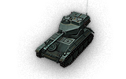
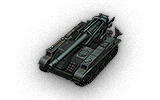
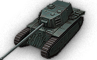
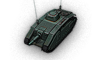
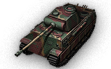
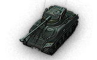
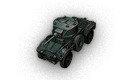

# France · Tier VI

[All nations and tiers](../buffs_nerfs.md) · EU v20410 → RU v14600ru · 3 November 2026

<label><strong>Find a tank</strong><input type="search" placeholder="Try is7, obj140 or xm57" aria-label="Find a tank" style="display:block;width:100%;padding:.7rem;border:1px solid #888;border-radius:4px;margin:.5rem 0;color:inherit;background:transparent"></label>

AMX 12 t · Tier VI

amx12t

<a href="https://tanks.gg/v20410/tank/amx-12-t">EU stats</a> · <a href="https://tanks.gg/v14600ru/tank/amx-12-t">RU stats</a>
<figure style="display:inline-block"><figcaption>AMX 12 t</figcaption></figure>
<em>Firepower</em> 
<strong>DPM (HP/min)</strong> <small>EU</small> 1 214.60  <small>RU</small> <strong>1 196.50</strong> 
<strong>Rate of fire (rounds/min)</strong> <small>EU</small> 9  <small>RU</small> <strong>8.86</strong> 
<strong>Reload time (s)</strong> <small>EU</small> 19.18  <small>RU</small> <strong>19.58</strong> 
<strong>Ammo capacity</strong> <small>EU</small> 44  <small>RU</small> <strong>36</strong> 
<strong>Potential damage</strong> <small>EU</small> 5 940  <small>RU</small> <strong>4 860</strong> 

<em>Mobility</em> 
<strong>Tank traverse on hard terrain (°/s)</strong> <small>EU</small> 42.81  <small>RU</small> <strong>51.45</strong> 
<strong>Tank traverse on medium terrain (°/s)</strong> <small>EU</small> 38.52  <small>RU</small> <strong>46.31</strong> 
<strong>Tank traverse on soft terrain (°/s)</strong> <small>EU</small> 21.40  <small>RU</small> <strong>25.73</strong> 

<em>Armor &amp; health</em> 
<strong>Health</strong> <small>EU</small> 750  <small>RU</small> <strong>650</strong> 

AMX 13 F3 AM · Tier VI

amx13f3am

<a href="https://tanks.gg/v20410/tank/amx-13-f3">EU stats</a> · <a href="https://tanks.gg/v14600ru/tank/amx-13-f3">RU stats</a>
<figure style="display:inline-block"><figcaption>AMX 13 F3 AM</figcaption></figure>
<strong>Penetration (mm)</strong> <b>EU</b>  HE <strong>39</strong> /  HE <strong>49</strong> /  HEAT <strong>194</strong> → <b>RU</b>  HE <strong>39</strong> /  HEAT <strong>194</strong>

<strong>Damage (HP)</strong> <b>EU</b>  HE <strong>630</strong> /  HE <strong>770</strong> /  HEAT <strong>420</strong> → <b>RU</b>  HE <strong>800</strong> /  HEAT <strong>500</strong>

<em>Firepower</em> 
<strong>DPM (HP/min)</strong> <small>EU</small> 1 194.71  <small>RU</small> <strong>1 569.40</strong> 
<strong>Rate of fire (rounds/min)</strong> <small>EU</small> 1.90  <small>RU</small> <strong>1.96</strong> 
<strong>Reload time (s)</strong> <small>EU</small> 31.64  <small>RU</small> <strong>30.58</strong> 
<strong>Explosion radius</strong> <small>EU</small> 7.60  <small>RU</small> <strong>5.80</strong> 
<strong>Stun duration · maximum (s)</strong> <small>EU</small> 22 → <small>RU</small> <strong>—</strong> 
<strong>Stun duration · minimum (s)</strong> <small>EU</small> 11 → <small>RU</small> <strong>—</strong> 
<strong>Shell velocity (m/s)</strong> <small>EU</small> 470  <small>RU</small> <strong>482</strong> 
<strong>Max range (m)</strong> <small>EU</small> 1 380.63  <small>RU</small> <strong>1 416.61</strong> 
<strong>Potential damage</strong> <small>EU</small> 15 750  <small>RU</small> <strong>20 000</strong> 

<em>Gun handling</em> 
<strong>Dispersion (m/100 m)</strong> <small>EU</small> 0.69  <small>RU</small> <strong>0.70</strong> 
<strong>Dispersion · damaged</strong> <small>EU</small> 1.38  <small>RU</small> <strong>1.40</strong> 
<strong>Dispersion · turret traverse</strong> <small>EU</small> 0.40  <small>RU</small> <strong>0.44</strong> 

<em>Mobility</em> 
<strong>Tank traverse on hard terrain (°/s)</strong> <small>EU</small> 30.35  <small>RU</small> <strong>30.39</strong> 
<strong>Tank traverse on medium terrain (°/s)</strong> <small>EU</small> 25.68  <small>RU</small> <strong>25.72</strong> 
<strong>Tank traverse on soft terrain (°/s)</strong> <small>EU</small> 15.90  <small>RU</small> <strong>15.92</strong> 

<em>Armor &amp; health</em> 
<strong>Health · track</strong> <small>EU</small> 145  <small>RU</small> <strong>90</strong> 
<strong>Health · ammo rack</strong> <small>EU</small> 170  <small>RU</small> <strong>90</strong> 
<strong>Track repair time (s)</strong> <small>EU</small> 11.62  <small>RU</small> <strong>12.63</strong> 

<em>Miscellaneous</em> 
<strong>Shell cost</strong> <small>EU</small> 1 000  <small>RU</small> <strong>1 140</strong> 

ARL 44 · Tier VI

arl44

<a href="https://tanks.gg/v20410/tank/arl-44">EU stats</a> · <a href="https://tanks.gg/v14600ru/tank/arl-44">RU stats</a>
<figure style="display:inline-block"><figcaption>ARL 44</figcaption></figure>
<em>Gun handling</em> 
<strong>Dispersion · firing</strong> <small>EU</small> 4  <small>RU</small> <strong>4.50</strong> 

<em>Mobility</em> 
<strong>Forward speed on soft terrain (km/h)</strong> <small>EU</small> 24.80  <small>RU</small> <strong>23.69</strong> 
<strong>Engine power (hp)</strong> <small>EU</small> 830  <small>RU</small> <strong>792.96</strong> 
<strong>Power/weight (hp/t)</strong> <small>EU</small> 17.59  <small>RU</small> <strong>16.81</strong> 
<strong>Tank traverse (°/s)</strong> <small>EU</small> 30.25  <small>RU</small> <strong>20.86</strong> 
<strong>Tank traverse on hard terrain (°/s)</strong> <small>EU</small> 32.02  <small>RU</small> <strong>26.80</strong> 
<strong>Tank traverse on medium terrain (°/s)</strong> <small>EU</small> 28.01  <small>RU</small> <strong>23.45</strong> 
<strong>Tank traverse on soft terrain (°/s)</strong> <small>EU</small> 16.60  <small>RU</small> <strong>13.90</strong> 

<em>Armor &amp; health</em> 
<strong>Health</strong> <small>EU</small> 1 000  <small>RU</small> <strong>920</strong> 

<em>Miscellaneous</em> 
<strong>Stationary camo</strong> <small>EU</small> 4.99  <small>RU</small> <strong>5.24</strong> 
<strong>Stationary camo · after firing</strong> <small>EU</small> 1.12  <small>RU</small> <strong>1.18</strong> 
<strong>Moving camo</strong> <small>EU</small> 2.49  <small>RU</small> <strong>2.62</strong> 
<strong>Moving camo · after firing</strong> <small>EU</small> 0.56  <small>RU</small> <strong>0.59</strong> 

ARL V39 · Tier VI

arlv39

<a href="https://tanks.gg/v20410/tank/arl-v39">EU stats</a> · <a href="https://tanks.gg/v14600ru/tank/arl-v39">RU stats</a>
<figure style="display:inline-block"><figcaption>ARL V39</figcaption></figure>
<em>Firepower</em> 
<strong>DPM (HP/min)</strong> <small>EU</small> 2 145.60  <small>RU</small> <strong>2 002.56</strong> 
<strong>Rate of fire (rounds/min)</strong> <small>EU</small> 8.94  <small>RU</small> <strong>8.34</strong> 
<strong>Reload time (s)</strong> <small>EU</small> 6.71  <small>RU</small> <strong>7.19</strong> 

<em>Gun handling</em> 
<strong>Aim time (s)</strong> <small>EU</small> 1.92  <small>RU</small> <strong>2.01</strong> 
<strong>Dispersion · moving</strong> <small>EU</small> 0.18  <small>RU</small> <strong>0.22</strong> 
<strong>Dispersion · tank traverse</strong> <small>EU</small> 0.18  <small>RU</small> <strong>0.22</strong> 
<strong>Dispersion · turret traverse</strong> <small>EU</small> 0.14  <small>RU</small> <strong>0.16</strong> 
<strong>Dispersion · firing</strong> <small>EU</small> 3  <small>RU</small> <strong>4</strong> 

<em>Mobility</em> 
<strong>Forward speed on soft terrain (km/h)</strong> <small>EU</small> 28.38  <small>RU</small> <strong>27</strong> 
<strong>Engine power (hp)</strong> <small>EU</small> 500  <small>RU</small> <strong>475.78</strong> 
<strong>Power/weight (hp/t)</strong> <small>EU</small> 18.64  <small>RU</small> <strong>17.74</strong> 
<strong>Tank traverse (°/s)</strong> <small>EU</small> 35.46  <small>RU</small> <strong>25.03</strong> 
<strong>Tank traverse on hard terrain (°/s)</strong> <small>EU</small> 36.98  <small>RU</small> <strong>28.31</strong> 
<strong>Tank traverse on medium terrain (°/s)</strong> <small>EU</small> 34.52  <small>RU</small> <strong>26.42</strong> 
<strong>Tank traverse on soft terrain (°/s)</strong> <small>EU</small> 20.71  <small>RU</small> <strong>15.85</strong> 

<em>Armor &amp; health</em> 
<strong>Health</strong> <small>EU</small> 700  <small>RU</small> <strong>680</strong> 
<strong>Health · engine</strong> <small>EU</small> 205  <small>RU</small> <strong>105</strong> 

Bretagne Panther · Tier VI

bretagnepanther

<a href="https://tanks.gg/v20410/tank/bret-panther">EU stats</a> · <a href="https://tanks.gg/v14600ru/tank/bret-panther">RU stats</a>
<figure style="display:inline-block"><figcaption>Bretagne Panther</figcaption></figure>
<em>Gun handling</em> 
<strong>Aim time (s)</strong> <small>EU</small> 1.92  <small>RU</small> <strong>2.21</strong> 
<strong>Dispersion (m/100 m)</strong> <small>EU</small> 0.33  <small>RU</small> <strong>0.34</strong> 
<strong>Dispersion · damaged</strong> <small>EU</small> 0.65  <small>RU</small> <strong>0.67</strong> 

<em>Mobility</em> 
<strong>Forward speed on medium terrain (km/h)</strong> <small>EU</small> 55  <small>RU</small> <strong>51.59</strong> 
<strong>Forward speed on soft terrain (km/h)</strong> <small>EU</small> 29.81  <small>RU</small> <strong>26.91</strong> 
<strong>Engine power (hp)</strong> <small>EU</small> 820  <small>RU</small> <strong>740.10</strong> 
<strong>Power/weight (hp/t)</strong> <small>EU</small> 18.02  <small>RU</small> <strong>16.27</strong> 
<strong>Tank traverse (°/s)</strong> <small>EU</small> 39.63  <small>RU</small> <strong>31.29</strong> 
<strong>Tank traverse on hard terrain (°/s)</strong> <small>EU</small> 37.65  <small>RU</small> <strong>29.73</strong> 
<strong>Tank traverse on medium terrain (°/s)</strong> <small>EU</small> 31.38  <small>RU</small> <strong>24.77</strong> 
<strong>Tank traverse on soft terrain (°/s)</strong> <small>EU</small> 16.37  <small>RU</small> <strong>12.92</strong> 

M4A1 FL 10 · Tier VI

m4a1fl10

<a href="https://tanks.gg/v20410/tank/m4a1-fl-10">EU stats</a> · <a href="https://tanks.gg/v14600ru/tank/m4a1-fl-10">RU stats</a>
<figure style="display:inline-block"><figcaption>M4A1 FL 10</figcaption></figure>
<em>Firepower</em> 
<strong>DPM (HP/min)</strong> <small>EU</small> 1 439.54  <small>RU</small> <strong>1 424.32</strong> 
<strong>Rate of fire (rounds/min)</strong> <small>EU</small> 10.66  <small>RU</small> <strong>10.55</strong> 
<strong>Reload time (s)</strong> <small>EU</small> 17.26  <small>RU</small> <strong>17.50</strong> 

Panhard AMD 178B · Tier VI

panhardamd178b

<a href="https://tanks.gg/v20410/tank/amd-178b">EU stats</a> · <a href="https://tanks.gg/v14600ru/tank/amd-178b">RU stats</a>
<figure style="display:inline-block"><figcaption>Panhard AMD 178B</figcaption></figure>
<em>Mobility</em> 
<strong>Forward speed (km/h)</strong> <small>EU</small> 70  <small>RU</small> <strong>65</strong> 
<strong>Forward speed on hard terrain (km/h)</strong> <small>EU</small> 70  <small>RU</small> <strong>65</strong> 
<strong>Forward speed on medium terrain (km/h)</strong> <small>EU</small> 70  <small>RU</small> <strong>65</strong> 
<strong>Forward speed on soft terrain (km/h)</strong> <small>EU</small> 70  <small>RU</small> <strong>65</strong> 
<strong>Tank traverse on hard terrain (°/s)</strong> <small>EU</small> 35.89  <small>RU</small> <strong>35.69</strong> 
<strong>Tank traverse on medium terrain (°/s)</strong> <small>EU</small> 35.89  <small>RU</small> <strong>35.69</strong> 
<strong>Tank traverse on soft terrain (°/s)</strong> <small>EU</small> 35.89  <small>RU</small> <strong>35.69</strong> 

<em>Armor &amp; health</em> 
<strong>Health</strong> <small>EU</small> 700  <small>RU</small> <strong>640</strong> 

<em>Miscellaneous</em> 
<strong>View range (m)</strong> <small>EU</small> 310  <small>RU</small> <strong>300</strong> 

