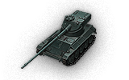
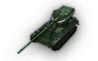
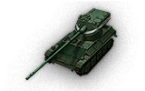
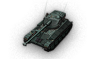
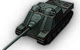
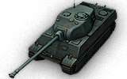
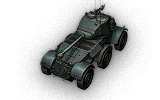
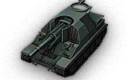
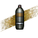

# France · Tier VII

[All nations and tiers](../buffs_nerfs.md) · EU v20410 → RU v14600ru · 3 November 2026

<label><strong>Find a tank</strong><input type="search" placeholder="Try is7, obj140 or xm57" aria-label="Find a tank" style="display:block;width:100%;padding:.7rem;border:1px solid #888;border-radius:4px;margin:.5rem 0;color:inherit;background:transparent"></label>

AMX 13 57 · Tier VII

amx1357

<a href="https://tanks.gg/v20410/tank/amx-13-57">EU stats</a> · <a href="https://tanks.gg/v14600ru/tank/amx-13-57">RU stats</a>
<figure style="display:inline-block"><figcaption>AMX 13 57</figcaption></figure>
<em>Firepower</em> 
<strong>DPM (HP/min)</strong> <small>EU</small> 1 933.72  <small>RU</small> <strong>1 906.17</strong> 
<strong>Rate of fire (rounds/min)</strong> <small>EU</small> 21.49  <small>RU</small> <strong>21.18</strong> 
<strong>Reload time (s)</strong> <small>EU</small> 15.34  <small>RU</small> <strong>15.66</strong> 

AMX 13 57 GF · Tier VII

amx1357gf

<a href="https://tanks.gg/v20410/tank/amx-13-57f">EU stats</a> · <a href="https://tanks.gg/v14600ru/tank/amx-13-57f">RU stats</a>
<figure style="display:inline-block"><figcaption>EU · AMX 13 57 GF</figcaption></figure><figure style="display:inline-block"><figcaption>RU · AMX 13 57 GF</figcaption></figure>
<em>Firepower</em> 
<strong>DPM (HP/min)</strong> <small>EU</small> 1 933.72  <small>RU</small> <strong>1 906.17</strong> 
<strong>Rate of fire (rounds/min)</strong> <small>EU</small> 21.49  <small>RU</small> <strong>21.18</strong> 
<strong>Reload time (s)</strong> <small>EU</small> 15.34  <small>RU</small> <strong>15.66</strong> 

AMX 13 75 · Tier VII

amx1375

<a href="https://tanks.gg/v20410/tank/amx-13-75">EU stats</a> · <a href="https://tanks.gg/v14600ru/tank/amx-13-75">RU stats</a>
<figure style="display:inline-block"><figcaption>AMX 13 75</figcaption></figure>
<em>Firepower</em> 
<strong>DPM (HP/min)</strong> <small>EU</small> 1 668.14  <small>RU</small> <strong>1 644.22</strong> 
<strong>Rate of fire (rounds/min)</strong> <small>EU</small> 12.36  <small>RU</small> <strong>12.18</strong> 
<strong>Reload time (s)</strong> <small>EU</small> 13.42  <small>RU</small> <strong>13.71</strong> 
<strong>Ammo capacity</strong> <small>EU</small> 48  <small>RU</small> <strong>36</strong> 
<strong>Potential damage</strong> <small>EU</small> 6 480  <small>RU</small> <strong>4 860</strong> 

<em>Mobility</em> 
<strong>Tank traverse on hard terrain (°/s)</strong> <small>EU</small> 46.78  <small>RU</small> <strong>56.22</strong> 
<strong>Tank traverse on medium terrain (°/s)</strong> <small>EU</small> 40.94  <small>RU</small> <strong>49.19</strong> 
<strong>Tank traverse on soft terrain (°/s)</strong> <small>EU</small> 23.39  <small>RU</small> <strong>28.11</strong> 

<em>Armor &amp; health</em> 
<strong>Track armor</strong> <small>EU</small> 10  <small>RU</small> <strong>20</strong> 
<strong>Health</strong> <small>EU</small> 950  <small>RU</small> <strong>850</strong> 

AMX AC mle. 46 · Tier VII

amxacmle46

<a href="https://tanks.gg/v20410/tank/amx-ac-46">EU stats</a> · <a href="https://tanks.gg/v14600ru/tank/amx-ac-46">RU stats</a>
<figure style="display:inline-block"><figcaption>AMX AC mle. 46</figcaption></figure>
<em>Firepower</em> 
<strong>DPM (HP/min)</strong> <small>EU</small> 1 644.05  <small>RU</small> <strong>2 040.65</strong> 
<strong>Rate of fire (rounds/min)</strong> <small>EU</small> 5.48  <small>RU</small> <strong>6.80</strong> 
<strong>Reload time (s)</strong> <small>EU</small> 26.85  <small>RU</small> <strong>8.82</strong> 
<strong>Clip size</strong> <small>EU</small> 3 → <small>RU</small> <strong>—</strong> 
<strong>Clip damage · damage</strong> <small>EU</small> 900 → <small>RU</small> <strong>—</strong> 
<strong>Clip damage · time (s)</strong> <small>EU</small> 6 → <small>RU</small> <strong>—</strong> 
<strong>Intra-clip reload</strong> <small>EU</small> 3 → <small>RU</small> <strong>—</strong> 

<em>Gun handling</em> 
<strong>Aim time (s)</strong> <small>EU</small> 2.49  <small>RU</small> <strong>2.59</strong> 
<strong>Dispersion (m/100 m)</strong> <small>EU</small> 0.35  <small>RU</small> <strong>0.33</strong> 
<strong>Dispersion · damaged</strong> <small>EU</small> 0.71  <small>RU</small> <strong>0.65</strong> 
<strong>Dispersion · moving</strong> <small>EU</small> 0.20  <small>RU</small> <strong>0.22</strong> 
<strong>Dispersion · tank traverse</strong> <small>EU</small> 0.20  <small>RU</small> <strong>0.22</strong> 
<strong>Dispersion · turret traverse</strong> <small>EU</small> 0.12  <small>RU</small> <strong>0.20</strong> 

<em>Mobility</em> 
<strong>Forward speed on medium terrain (km/h)</strong> <small>EU</small> 46.73  <small>RU</small> <strong>45.15</strong> 
<strong>Forward speed on soft terrain (km/h)</strong> <small>EU</small> 28.04  <small>RU</small> <strong>27.09</strong> 
<strong>Engine power (hp)</strong> <small>EU</small> 930  <small>RU</small> <strong>898.69</strong> 
<strong>Power/weight (hp/t)</strong> <small>EU</small> 18.42  <small>RU</small> <strong>17.80</strong> 
<strong>Tank traverse (°/s)</strong> <small>EU</small> 41.72  <small>RU</small> <strong>27.12</strong> 
<strong>Tank traverse on hard terrain (°/s)</strong> <small>EU</small> 42.16  <small>RU</small> <strong>37.34</strong> 
<strong>Tank traverse on medium terrain (°/s)</strong> <small>EU</small> 36.54  <small>RU</small> <strong>32.36</strong> 
<strong>Tank traverse on soft terrain (°/s)</strong> <small>EU</small> 21.92  <small>RU</small> <strong>19.42</strong> 

<em>Armor &amp; health</em> 
<strong>Hull armor · front (mm)</strong> <small>EU</small> 140  <small>RU</small> <strong>150</strong> 
<strong>Health</strong> <small>EU</small> 950  <small>RU</small> <strong>1 000</strong> 

AMX M4 mle. 45 · Tier VII

amxm4mle45

<a href="https://tanks.gg/v20410/tank/amx-m4-45">EU stats</a> · <a href="https://tanks.gg/v14600ru/tank/amx-m4-45">RU stats</a>
<figure style="display:inline-block"><figcaption>AMX M4 mle. 45</figcaption></figure>
<strong>Penetration (mm)</strong> <b>EU</b>  AP <strong>175</strong> /  APCR <strong>223</strong> /  HE <strong>54</strong> → <b>RU</b>  AP <strong>212</strong> /  APCR <strong>259</strong> /  HE <strong>45</strong>

<strong>Damage (HP)</strong> <b>EU</b>  AP <strong>300</strong> /  APCR <strong>300</strong> /  HE <strong>400</strong> → <b>RU</b>  AP <strong>240</strong> /  APCR <strong>240</strong> /  HE <strong>320</strong>

<em>Firepower</em> 
<strong>DPM (HP/min)</strong> <small>EU</small> 1 955.63  <small>RU</small> <strong>1 746.42</strong> 
<strong>Module damage</strong> <small>EU</small> 150  <small>RU</small> <strong>122</strong> 
<strong>Rate of fire (rounds/min)</strong> <small>EU</small> 6.52  <small>RU</small> <strong>7.28</strong> 
<strong>Reload time (s)</strong> <small>EU</small> 9.20  <small>RU</small> <strong>8.25</strong> 
<strong>Caliber</strong> <small>EU</small> 105  <small>RU</small> <strong>90</strong> 
<strong>Shell velocity (m/s)</strong> <small>EU</small> 850  <small>RU</small> <strong>1 000</strong> 
<strong>Ammo capacity</strong> <small>EU</small> 60  <small>RU</small> <strong>74</strong> 
<strong>Potential damage</strong> <small>EU</small> 18 000  <small>RU</small> <strong>17 760</strong> 

<em>Gun handling</em> 
<strong>Aim time (s)</strong> <small>EU</small> 2.59  <small>RU</small> <strong>2.40</strong> 
<strong>Dispersion (m/100 m)</strong> <small>EU</small> 0.39  <small>RU</small> <strong>0.35</strong> 
<strong>Dispersion · damaged</strong> <small>EU</small> 0.79  <small>RU</small> <strong>0.69</strong> 
<strong>Dispersion · turret traverse</strong> <small>EU</small> 0.10  <small>RU</small> <strong>0.14</strong> 

<em>Mobility</em> 
<strong>Forward speed on soft terrain (km/h)</strong> <small>EU</small> 25.77  <small>RU</small> <strong>24.75</strong> 
<strong>Engine power (hp)</strong> <small>EU</small> 930  <small>RU</small> <strong>898.69</strong> 
<strong>Weight (kg)</strong> <small>EU</small> 54 930 → <small>RU</small> <strong>55 280</strong> 
<strong>Power/weight (hp/t)</strong> <small>EU</small> 16.93  <small>RU</small> <strong>16.26</strong> 
<strong>Tank traverse (°/s)</strong> <small>EU</small> 39.63  <small>RU</small> <strong>25.03</strong> 
<strong>Tank traverse on hard terrain (°/s)</strong> <small>EU</small> 42.70  <small>RU</small> <strong>34.91</strong> 
<strong>Tank traverse on medium terrain (°/s)</strong> <small>EU</small> 37.01  <small>RU</small> <strong>30.25</strong> 
<strong>Tank traverse on soft terrain (°/s)</strong> <small>EU</small> 22.20  <small>RU</small> <strong>18.15</strong> 

<em>Armor &amp; health</em> 
<strong>Health</strong> <small>EU</small> 1 450  <small>RU</small> <strong>1 400</strong> 

<em>Miscellaneous</em> 
<strong>Stationary camo · after firing</strong> <small>EU</small> 1.30  <small>RU</small> <strong>1.40</strong> 
<strong>Moving camo · after firing</strong> <small>EU</small> 0.66  <small>RU</small> <strong>0.71</strong> 
<strong>Shell cost</strong> <small>EU</small> 270  <small>RU</small> <strong>255</strong> 

Hotchkiss EBR · Tier VII

hotchkissebr

<a href="https://tanks.gg/v20410/tank/ebr-hotch">EU stats</a> · <a href="https://tanks.gg/v14600ru/tank/ebr-hotch">RU stats</a>
<figure style="display:inline-block"><figcaption>Hotchkiss EBR</figcaption></figure>
<em>Mobility</em> 
<strong>Forward speed (km/h)</strong> <small>EU</small> 75  <small>RU</small> <strong>70</strong> 
<strong>Forward speed on hard terrain (km/h)</strong> <small>EU</small> 75  <small>RU</small> <strong>70</strong> 
<strong>Forward speed on medium terrain (km/h)</strong> <small>EU</small> 75  <small>RU</small> <strong>70</strong> 
<strong>Forward speed on soft terrain (km/h)</strong> <small>EU</small> 75  <small>RU</small> <strong>70</strong> 
<strong>Tank traverse on hard terrain (°/s)</strong> <small>EU</small> 41.47  <small>RU</small> <strong>41.52</strong> 
<strong>Tank traverse on medium terrain (°/s)</strong> <small>EU</small> 41.47  <small>RU</small> <strong>41.52</strong> 
<strong>Tank traverse on soft terrain (°/s)</strong> <small>EU</small> 41.47  <small>RU</small> <strong>41.52</strong> 

<em>Armor &amp; health</em> 
<strong>Health</strong> <small>EU</small> 900  <small>RU</small> <strong>750</strong> 

<em>Miscellaneous</em> 
<strong>Stationary camo</strong> <small>EU</small> 18.52  <small>RU</small> <strong>17.78</strong> 
<strong>Stationary camo · after firing</strong> <small>EU</small> 4.33  <small>RU</small> <strong>4.16</strong> 
<strong>Moving camo</strong> <small>EU</small> 18.52  <small>RU</small> <strong>17.78</strong> 
<strong>Moving camo · after firing</strong> <small>EU</small> 4.33  <small>RU</small> <strong>4.16</strong> 
<strong>View range (m)</strong> <small>EU</small> 320  <small>RU</small> <strong>310</strong> 

Lorraine 155 mle. 50 · Tier VII

lorraine155mle50

<a href="https://tanks.gg/v20410/tank/lorr-155-50">EU stats</a> · <a href="https://tanks.gg/v14600ru/tank/lorr-155-50">RU stats</a>
<figure style="display:inline-block"><figcaption>Lorraine 155 mle. 50</figcaption></figure>
<strong>Penetration (mm)</strong> <b>EU</b>  HE <strong>40</strong> /  HE <strong>50</strong> /  HEAT <strong>230</strong> → <b>RU</b>  HE <strong>39</strong> /  HEAT <strong>230</strong>

<strong>Damage (HP)</strong> <b>EU</b>  HE <strong>630</strong> /  HE <strong>770</strong> /  HEAT <strong>420</strong> → <b>RU</b>  HE <strong>800</strong> /  HEAT <strong>500</strong>

<em>Firepower</em> 
<strong>DPM (HP/min)</strong> <small>EU</small> 1 323  <small>RU</small> <strong>1 680</strong> 
<strong>Explosion radius</strong> <small>EU</small> 7.60  <small>RU</small> <strong>5.80</strong> 
<strong>Stun duration · maximum (s)</strong> <small>EU</small> 22 → <small>RU</small> <strong>—</strong> 
<strong>Stun duration · minimum (s)</strong> <small>EU</small> 11 → <small>RU</small> <strong>—</strong> 
<strong>Shell velocity (m/s)</strong> <small>EU</small> 450  <small>RU</small> <strong>482</strong> 
<strong>Max range (m)</strong> <small>EU</small> 1 350  <small>RU</small> <strong>1 416.61</strong> 
<strong>Potential damage</strong> <small>EU</small> 17 640  <small>RU</small> <strong>22 400</strong> 

<em>Mobility</em> 
<strong>Tank traverse on hard terrain (°/s)</strong> <small>EU</small> 31.64  <small>RU</small> <strong>31.66</strong> 
<strong>Tank traverse on medium terrain (°/s)</strong> <small>EU</small> 27.12  <small>RU</small> <strong>27.14</strong> 
<strong>Tank traverse on soft terrain (°/s)</strong> <small>EU</small> 16.51  <small>RU</small> <strong>16.52</strong> 

<em>Armor &amp; health</em> 
<strong>Health · track</strong> <small>EU</small> 180  <small>RU</small> <strong>110</strong> 
<strong>Health · ammo rack</strong> <small>EU</small> 190  <small>RU</small> <strong>100</strong> 
<strong>Track repair time (s)</strong> <small>EU</small> 11.70  <small>RU</small> <strong>12.19</strong> 

<em>Miscellaneous</em> 
<strong>Moving camo</strong> <small>EU</small> 4.27  <small>RU</small> <strong>4.22</strong> 
<strong>Moving camo · after firing</strong> <small>EU</small> 0.58  <small>RU</small> <strong>0.57</strong> 
<strong>Shell cost</strong> <small>EU</small> 1 000  <small>RU</small> <strong>1 140</strong> 

