# France · Tier IX

[All nations and tiers](../buffs_nerfs.md) · EU v20410 → RU v14600ru · 3 November 2026

<label><strong>Find a tank</strong><input type="search" placeholder="Try is7, obj140 or xm57" aria-label="Find a tank" style="display:block;width:100%;padding:.7rem;border:1px solid #888;border-radius:4px;margin:.5rem 0;color:inherit;background:transparent"></label>

AMX 13 90 · Tier IX

amx1390

<a href="https://tanks.gg/v20410/tank/amx-13-90">EU stats</a> · <a href="https://tanks.gg/v14600ru/tank/amx-13-90">RU stats</a>
<figure style="display:inline-block">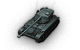<figcaption>AMX 13 90</figcaption></figure>
<strong>Penetration (mm)</strong> <b>EU</b>  APCR <strong>217</strong> /  APCR <strong>248</strong> /  HE <strong>45</strong> → <b>RU</b>  APCR <strong>205</strong> /  APCR <strong>248</strong> /  HE <strong>45</strong>

<em>Firepower</em> 
<strong>DPM (HP/min)</strong> <small>EU</small> 2 014.48  <small>RU</small> <strong>1 977.10</strong> 
<strong>Rate of fire (rounds/min)</strong> <small>EU</small> 8.39  <small>RU</small> <strong>8.24</strong> 
<strong>Reload time (s)</strong> <small>EU</small> 21.09  <small>RU</small> <strong>22.52</strong> 
<strong>Clip damage · time (s)</strong> <small>EU</small> 7.50  <small>RU</small> <strong>6.62</strong> 
<strong>Intra-clip reload</strong> <small>EU</small> 2.50  <small>RU</small> <strong>2.21</strong> 

<em>Gun handling</em> 
<strong>Aim time (s)</strong> <small>EU</small> 2.30  <small>RU</small> <strong>2.59</strong> 
<strong>Dispersion · turret traverse</strong> <small>EU</small> 0.11  <small>RU</small> <strong>0.12</strong> 

<em>Mobility</em> 
<strong>Forward speed (km/h)</strong> <small>EU</small> 68  <small>RU</small> <strong>64</strong> 
<strong>Forward speed on hard terrain (km/h)</strong> <small>EU</small> 68  <small>RU</small> <strong>64</strong> 
<strong>Forward speed on medium terrain (km/h)</strong> <small>EU</small> 68  <small>RU</small> <strong>64</strong> 
<strong>Forward speed on soft terrain (km/h)</strong> <small>EU</small> 68  <small>RU</small> <strong>64</strong> 
<strong>Tank traverse (°/s)</strong> <small>EU</small> 39.63  <small>RU</small> <strong>41.72</strong> 
<strong>Tank traverse on hard terrain (°/s)</strong> <small>EU</small> 41.98  <small>RU</small> <strong>47.57</strong> 
<strong>Tank traverse on medium terrain (°/s)</strong> <small>EU</small> 37.32  <small>RU</small> <strong>42.29</strong> 
<strong>Tank traverse on soft terrain (°/s)</strong> <small>EU</small> 23.99  <small>RU</small> <strong>27.18</strong> 

<em>Armor &amp; health</em> 
<strong>Track armor</strong> <small>EU</small> 10  <small>RU</small> <strong>20</strong> 
<strong>Health</strong> <small>EU</small> 1 500  <small>RU</small> <strong>1 200</strong> 

AMX 50 120 · Tier IX

amx50120

<a href="https://tanks.gg/v20410/tank/amx-50-120">EU stats</a> · <a href="https://tanks.gg/v14600ru/tank/amx-50-120">RU stats</a>
<figure style="display:inline-block">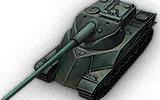<figcaption>AMX 50 120</figcaption></figure>
<em>Firepower</em> 
<strong>DPM (HP/min)</strong> <small>EU</small> 2 338.21  <small>RU</small> <strong>2 274.53</strong> 
<strong>Rate of fire (rounds/min)</strong> <small>EU</small> 5.85  <small>RU</small> <strong>5.69</strong> 
<strong>Reload time (s)</strong> <small>EU</small> 33.56  <small>RU</small> <strong>34.02</strong> 
<strong>Clip damage · time (s)</strong> <small>EU</small> 7.50  <small>RU</small> <strong>8.18</strong> 
<strong>Intra-clip reload</strong> <small>EU</small> 2.50  <small>RU</small> <strong>2.73</strong> 

<em>Gun handling</em> 
<strong>Aim time (s)</strong> <small>EU</small> 2.40  <small>RU</small> <strong>2.30</strong> 
<strong>Dispersion · turret traverse</strong> <small>EU</small> 0.12  <small>RU</small> <strong>0.14</strong> 
<strong>Dispersion · firing</strong> <small>EU</small> 3.50  <small>RU</small> <strong>4</strong> 

<em>Mobility</em> 
<strong>Forward speed on hard terrain (km/h)</strong> <small>EU</small> 54.15  <small>RU</small> <strong>51.58</strong> 
<strong>Forward speed on medium terrain (km/h)</strong> <small>EU</small> 50.28  <small>RU</small> <strong>47.90</strong> 
<strong>Forward speed on soft terrain (km/h)</strong> <small>EU</small> 30.61  <small>RU</small> <strong>29.15</strong> 
<strong>Engine power (hp)</strong> <small>EU</small> 1 110  <small>RU</small> <strong>1 057.28</strong> 
<strong>Power/weight (hp/t)</strong> <small>EU</small> 18.50  <small>RU</small> <strong>17.62</strong> 
<strong>Tank traverse (°/s)</strong> <small>EU</small> 43.81  <small>RU</small> <strong>33.38</strong> 
<strong>Tank traverse on hard terrain (°/s)</strong> <small>EU</small> 47.21  <small>RU</small> <strong>38.74</strong> 
<strong>Tank traverse on medium terrain (°/s)</strong> <small>EU</small> 43.84  <small>RU</small> <strong>35.97</strong> 
<strong>Tank traverse on soft terrain (°/s)</strong> <small>EU</small> 26.68  <small>RU</small> <strong>21.89</strong> 

<em>Armor &amp; health</em> 
<strong>Health</strong> <small>EU</small> 1 850  <small>RU</small> <strong>1 950</strong> 

AMX 50 Foch · Tier IX

amx50foch

<a href="https://tanks.gg/v20410/tank/foch">EU stats</a> · <a href="https://tanks.gg/v14600ru/tank/foch">RU stats</a>
<figure style="display:inline-block">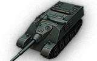<figcaption>AMX 50 Foch</figcaption></figure>
<em>Gun handling</em> 
<strong>Dispersion · moving</strong> <small>EU</small> 0.15  <small>RU</small> <strong>0.18</strong> 
<strong>Dispersion · tank traverse</strong> <small>EU</small> 0.15  <small>RU</small> <strong>0.18</strong> 
<strong>Dispersion · turret traverse</strong> <small>EU</small> 0.10  <small>RU</small> <strong>0.14</strong> 

<em>Mobility</em> 
<strong>Forward speed on soft terrain (km/h)</strong> <small>EU</small> 33.81  <small>RU</small> <strong>33.41</strong> 
<strong>Reverse speed (km/h)</strong> <small>EU</small> 15  <small>RU</small> <strong>18</strong> 
<strong>Engine power (hp)</strong> <small>EU</small> 1 070  <small>RU</small> <strong>1 057.28</strong> 
<strong>Power/weight (hp/t)</strong> <small>EU</small> 21.32  <small>RU</small> <strong>21.07</strong> 
<strong>Tank traverse (°/s)</strong> <small>EU</small> 36.50  <small>RU</small> <strong>29.20</strong> 
<strong>Tank traverse on hard terrain (°/s)</strong> <small>EU</small> 38.25  <small>RU</small> <strong>32.65</strong> 
<strong>Tank traverse on medium terrain (°/s)</strong> <small>EU</small> 35.52  <small>RU</small> <strong>30.32</strong> 
<strong>Tank traverse on soft terrain (°/s)</strong> <small>EU</small> 20.72  <small>RU</small> <strong>17.69</strong> 

AMX M4 mle. 51 · Tier IX

amxm4mle51

<a href="https://tanks.gg/v20410/tank/amx-m4-51">EU stats</a> · <a href="https://tanks.gg/v14600ru/tank/amx-m4-51">RU stats</a>
<figure style="display:inline-block">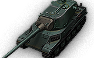<figcaption>AMX M4 mle. 51</figcaption></figure>
<strong>Damage (HP)</strong> <b>EU</b>  AP <strong>490</strong> /  AP <strong>490</strong> /  HE <strong>630</strong> → <b>RU</b>  AP <strong>470</strong> /  AP <strong>470</strong> /  HE <strong>610</strong>

<em>Firepower</em> 
<strong>DPM (HP/min)</strong> <small>EU</small> 2 206.06  <small>RU</small> <strong>2 211.47</strong> 
<strong>Module damage</strong> <small>EU</small> 171  <small>RU</small> <strong>178</strong> 
<strong>Rate of fire (rounds/min)</strong> <small>EU</small> 4.50  <small>RU</small> <strong>4.71</strong> 
<strong>Reload time (s)</strong> <small>EU</small> 13.33  <small>RU</small> <strong>12.75</strong> 
<strong>Potential damage</strong> <small>EU</small> 14 700  <small>RU</small> <strong>14 100</strong> 

<em>Mobility</em> 
<strong>Forward speed (km/h)</strong> <small>EU</small> 33  <small>RU</small> <strong>35</strong> 
<strong>Forward speed on hard terrain (km/h)</strong> <small>EU</small> 33  <small>RU</small> <strong>35</strong> 
<strong>Forward speed on medium terrain (km/h)</strong> <small>EU</small> 33  <small>RU</small> <strong>35</strong> 
<strong>Forward speed on soft terrain (km/h)</strong> <small>EU</small> 27.20  <small>RU</small> <strong>26.52</strong> 
<strong>Engine power (hp)</strong> <small>EU</small> 1 200  <small>RU</small> <strong>1 170</strong> 
<strong>Power/weight (hp/t)</strong> <small>EU</small> 16.44  <small>RU</small> <strong>16.03</strong> 
<strong>Tank traverse on hard terrain (°/s)</strong> <small>EU</small> 31.93  <small>RU</small> <strong>38.93</strong> 
<strong>Tank traverse on medium terrain (°/s)</strong> <small>EU</small> 29.65  <small>RU</small> <strong>36.15</strong> 
<strong>Tank traverse on soft terrain (°/s)</strong> <small>EU</small> 18.05  <small>RU</small> <strong>22</strong> 

AMX M4 mle. 51 FL · Tier IX

amxm4mle51fl

<a href="https://tanks.gg/v20410/tank/amx-m4-51-fl">EU stats</a> · <a href="https://tanks.gg/v14600ru/tank/amx-m4-51-fl">RU stats</a>
<figure style="display:inline-block"><figcaption>AMX M4 mle. 51 FL</figcaption></figure>
<em>Mobility</em> 
<strong>Forward speed (km/h)</strong> <small>EU</small> 33  <small>RU</small> <strong>35</strong> 
<strong>Forward speed on hard terrain (km/h)</strong> <small>EU</small> 33  <small>RU</small> <strong>35</strong> 
<strong>Forward speed on medium terrain (km/h)</strong> <small>EU</small> 33  <small>RU</small> <strong>35</strong> 
<strong>Forward speed on soft terrain (km/h)</strong> <small>EU</small> 27.36  <small>RU</small> <strong>26.67</strong> 
<strong>Engine power (hp)</strong> <small>EU</small> 1 200  <small>RU</small> <strong>1 170</strong> 
<strong>Power/weight (hp/t)</strong> <small>EU</small> 16.53  <small>RU</small> <strong>16.12</strong> 

Bat.-Châtillon 155 55 · Tier IX

batchâtillon15555

<a href="https://tanks.gg/v20410/tank/b-c-155-55">EU stats</a> · <a href="https://tanks.gg/v14600ru/tank/b-c-155-55">RU stats</a>
<figure style="display:inline-block">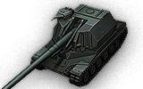<figcaption>Bat.-Châtillon 155 55</figcaption></figure>
<strong>Penetration (mm)</strong> <b>EU</b>  HE <strong>48</strong> /  HE <strong>60</strong> /  AP <strong>310</strong> → <b>RU</b>  HE <strong>39</strong> /  AP <strong>310</strong>

<strong>Damage (HP)</strong> <b>EU</b>  HE <strong>680</strong> /  HE <strong>830</strong> /  AP <strong>460</strong> → <b>RU</b>  HE <strong>900</strong> /  AP <strong>500</strong>

<em>Firepower</em> 
<strong>DPM (HP/min)</strong> <small>EU</small> 1 418.48  <small>RU</small> <strong>2 086</strong> 
<strong>Rate of fire (rounds/min)</strong> <small>EU</small> 2.09  <small>RU</small> <strong>2.32</strong> 
<strong>Reload time (s)</strong> <small>EU</small> 28.76  <small>RU</small> <strong>25.89</strong> 
<strong>Explosion radius</strong> <small>EU</small> 7.60  <small>RU</small> <strong>6.80</strong> 
<strong>Stun duration · maximum (s)</strong> <small>EU</small> 27 → <small>RU</small> <strong>—</strong> 
<strong>Stun duration · minimum (s)</strong> <small>EU</small> 12.15 → <small>RU</small> <strong>—</strong> 
<strong>Potential damage</strong> <small>EU</small> 24 480  <small>RU</small> <strong>32 400</strong> 

<em>Gun handling</em> 
<strong>Dispersion (m/100 m)</strong> <small>EU</small> 0.60  <small>RU</small> <strong>0.58</strong> 
<strong>Dispersion · damaged</strong> <small>EU</small> 1.21  <small>RU</small> <strong>1.15</strong> 
<strong>Dispersion · turret traverse</strong> <small>EU</small> 0.48  <small>RU</small> <strong>0.42</strong> 

<em>Mobility</em> 
<strong>Tank traverse on hard terrain (°/s)</strong> <small>EU</small> 24.71  <small>RU</small> <strong>24.72</strong> 
<strong>Tank traverse on medium terrain (°/s)</strong> <small>EU</small> 21.18  <small>RU</small> <strong>21.19</strong> 
<strong>Tank traverse on soft terrain (°/s)</strong> <small>EU</small> 12.89  <small>RU</small> <strong>12.90</strong> 

<em>Armor &amp; health</em> 
<strong>Health · track</strong> <small>EU</small> 240  <small>RU</small> <strong>150</strong> 
<strong>Health · ammo rack</strong> <small>EU</small> 230  <small>RU</small> <strong>134</strong> 
<strong>Track repair time (s)</strong> <small>EU</small> 11.70  <small>RU</small> <strong>12.63</strong> 

<em>Miscellaneous</em> 
<strong>Shell cost</strong> <small>EU</small> 1 120  <small>RU</small> <strong>1 330</strong> 

Bat.-Châtillon 25 t AP · Tier IX

batchâtillon25tap

<a href="https://tanks.gg/v20410/tank/b-c-25-t-ap">EU stats</a> · <a href="https://tanks.gg/v14600ru/tank/b-c-25-t-ap">RU stats</a>
<figure style="display:inline-block">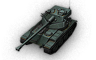<figcaption>Bat.-Châtillon 25 t AP</figcaption></figure>
<strong>Penetration (mm)</strong> <b>EU</b>  AP <strong>242</strong> /  APCR <strong>283</strong> /  HE <strong>50</strong> → <b>RU</b>  AP <strong>248</strong> /  APCR <strong>286</strong> /  HE <strong>50</strong>

<strong>Damage (HP)</strong> <b>EU</b>  AP <strong>360</strong> /  APCR <strong>360</strong> /  HE <strong>440</strong> → <b>RU</b>  AP <strong>320</strong> /  APCR <strong>320</strong> /  HE <strong>420</strong>

<em>Firepower</em> 
<strong>DPM (HP/min)</strong> <small>EU</small> 2 192.45  <small>RU</small> <strong>2 341.45</strong> 
<strong>Rate of fire (rounds/min)</strong> <small>EU</small> 6.09  <small>RU</small> <strong>7.32</strong> 
<strong>Reload time (s)</strong> <small>EU</small> 38.35  <small>RU</small> <strong>37.20</strong> 
<strong>Clip size</strong> <small>EU</small> 5  <small>RU</small> <strong>6</strong> 
<strong>Clip damage · damage</strong> <small>EU</small> 1 800  <small>RU</small> <strong>1 920</strong> 
<strong>Clip damage · time (s)</strong> <small>EU</small> 10.91  <small>RU</small> <strong>12</strong> 
<strong>Intra-clip reload</strong> <small>EU</small> 2.73  <small>RU</small> <strong>2.40</strong> 
<strong>Shell velocity (m/s)</strong> <small>EU</small> 1 000  <small>RU</small> <strong>1 120</strong> 
<strong>Ammo capacity</strong> <small>EU</small> 60  <small>RU</small> <strong>42</strong> 
<strong>Potential damage</strong> <small>EU</small> 21 600  <small>RU</small> <strong>13 440</strong> 

<em>Gun handling</em> 
<strong>Aim time (s)</strong> <small>EU</small> 2.01  <small>RU</small> <strong>2.21</strong> 
<strong>Dispersion (m/100 m)</strong> <small>EU</small> 0.34  <small>RU</small> <strong>0.35</strong> 
<strong>Dispersion · damaged</strong> <small>EU</small> 0.67  <small>RU</small> <strong>0.69</strong> 
<strong>Dispersion · turret traverse</strong> <small>EU</small> 0.10  <small>RU</small> <strong>0.14</strong> 
<strong>Dispersion · firing</strong> <small>EU</small> 3  <small>RU</small> <strong>3.50</strong> 

<em>Mobility</em> 
<strong>Tank traverse on hard terrain (°/s)</strong> <small>EU</small> 46.36  <small>RU</small> <strong>63.87</strong> 
<strong>Tank traverse on medium terrain (°/s)</strong> <small>EU</small> 36.06  <small>RU</small> <strong>49.68</strong> 
<strong>Tank traverse on soft terrain (°/s)</strong> <small>EU</small> 18.03  <small>RU</small> <strong>24.84</strong> 

<em>Armor &amp; health</em> 
<strong>Health · engine</strong> <small>EU</small> 320  <small>RU</small> <strong>160</strong> 

<em>Miscellaneous</em> 
<strong>Stationary camo · after firing</strong> <small>EU</small> 3.22  <small>RU</small> <strong>1.62</strong> 
<strong>Moving camo · after firing</strong> <small>EU</small> 2.40  <small>RU</small> <strong>1.21</strong> 

Char Futur 4 · Tier IX

charfutur4

<a href="https://tanks.gg/v20410/tank/char-futur-4">EU stats</a> · <a href="https://tanks.gg/v14600ru/tank/char-futur-4">RU stats</a>
<figure style="display:inline-block">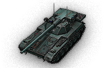<figcaption>EU · Char Futur 4</figcaption></figure><figure style="display:inline-block"><figcaption>RU · Char Futur 4</figcaption></figure>
<em>Firepower</em> 
<strong>DPM (HP/min)</strong> <small>EU</small> 1 858.95  <small>RU</small> <strong>1 829.62</strong> 
<strong>Rate of fire (rounds/min)</strong> <small>EU</small> 4.77  <small>RU</small> <strong>4.69</strong> 
<strong>Reload time (s)</strong> <small>EU</small> 38.35  <small>RU</small> <strong>39.16</strong> 

Char Mle. 75 · Tier IX

charmle75

<a href="https://tanks.gg/v20410/tank/char-mle-75">EU stats</a> · <a href="https://tanks.gg/v14600ru/tank/char-mle-75">RU stats</a>
<figure style="display:inline-block">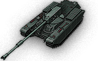<figcaption>Char Mle. 75</figcaption></figure>
<em>Firepower</em> 
<strong>DPM (HP/min)</strong> <small>EU</small> 1 573.12  <small>RU</small> <strong>1 544.51</strong> 
<strong>Rate of fire (rounds/min)</strong> <small>EU</small> 7.87  <small>RU</small> <strong>7.72</strong> 
<strong>Reload time (s)</strong> <small>EU</small> 40.27  <small>RU</small> <strong>41.12</strong> 

Alternate mode

<a href="https://tanks.gg/v20410/tank/char-mle-75-siege">EU stats</a> · <a href="https://tanks.gg/v14600ru/tank/char-mle-75-siege">RU stats</a>
<em>Firepower</em> 
<strong>DPM (HP/min)</strong> <small>EU</small> 1 559.49  <small>RU</small> <strong>1 531.37</strong> 
<strong>Rate of fire (rounds/min)</strong> <small>EU</small> 7.80  <small>RU</small> <strong>7.66</strong> 
<strong>Reload time (s)</strong> <small>EU</small> 40.27  <small>RU</small> <strong>41.12</strong> 

ERAC 105 Proto · Tier IX

erac105proto

<a href="https://tanks.gg/v20410/tank/erac-105-pr">EU stats</a> · <a href="https://tanks.gg/v14600ru/tank/erac-105-pr">RU stats</a>
<figure style="display:inline-block">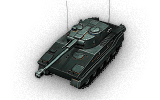<figcaption>EU · ERAC 105 Proto</figcaption></figure><figure style="display:inline-block">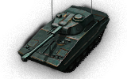<figcaption>RU · ERAC 105 Proto</figcaption></figure>
<strong>Penetration (mm)</strong> <b>EU</b>  APCR <strong>222</strong> /  HEAT <strong>270</strong> /  HE <strong>53</strong> → <b>RU</b>  APCR <strong>215</strong> /  HEAT <strong>250</strong> /  HE <strong>53</strong>

<strong>Damage (HP)</strong> <b>EU</b>  APCR <strong>320</strong> /  HEAT <strong>320</strong> /  HE <strong>420</strong> → <b>RU</b>  APCR <strong>320</strong> /  HEAT <strong>320</strong> /  HE <strong>440</strong>

<em>Firepower</em> 
<strong>DPM (HP/min)</strong> <small>EU</small> 1 871.55  <small>RU</small> <strong>1 562.31</strong> 
<strong>Rate of fire (rounds/min)</strong> <small>EU</small> 5.85  <small>RU</small> <strong>4.88</strong> 
<strong>Reload time (s)</strong> <small>EU</small> 10.26  <small>RU</small> <strong>29.37</strong> 
<strong>Shell velocity (m/s)</strong> <small>EU</small> 1 000  <small>RU</small> <strong>1 163</strong> 
<strong>Ammo capacity</strong> <small>EU</small> 36  <small>RU</small> <strong>42</strong> 
<strong>Potential damage</strong> <small>EU</small> 11 520  <small>RU</small> <strong>13 440</strong> 
<strong>Clip size</strong> <small>EU</small> — → <small>RU</small> <strong>3</strong> 
<strong>Clip damage · damage</strong> <small>EU</small> — → <small>RU</small> <strong>960</strong> 
<strong>Clip damage · time (s)</strong> <small>EU</small> — → <small>RU</small> <strong>7.50</strong> 
<strong>Intra-clip reload</strong> <small>EU</small> — → <small>RU</small> <strong>3.75</strong> 

<em>Gun handling</em> 
<strong>Aim time (s)</strong> <small>EU</small> 1.82  <small>RU</small> <strong>1.73</strong> 
<strong>Dispersion (m/100 m)</strong> <small>EU</small> 0.35  <small>RU</small> <strong>0.42</strong> 
<strong>Dispersion · damaged</strong> <small>EU</small> 0.57  <small>RU</small> <strong>0.67</strong> 
<strong>Dispersion · moving</strong> <small>EU</small> 0.20  <small>RU</small> <strong>0.10</strong> 
<strong>Dispersion · tank traverse</strong> <small>EU</small> 0.20  <small>RU</small> <strong>0.10</strong> 
<strong>Dispersion · turret traverse</strong> <small>EU</small> 0.10  <small>RU</small> <strong>0.12</strong> 
<strong>Dispersion · firing</strong> <small>EU</small> 4  <small>RU</small> <strong>2</strong> 

<em>Mobility</em> 
<strong>Forward speed (km/h)</strong> <small>EU</small> 70  <small>RU</small> <strong>68</strong> 
<strong>Forward speed on hard terrain (km/h)</strong> <small>EU</small> 70  <small>RU</small> <strong>68</strong> 
<strong>Forward speed on medium terrain (km/h)</strong> <small>EU</small> 70  <small>RU</small> <strong>68</strong> 
<strong>Forward speed on soft terrain (km/h)</strong> <small>EU</small> 54.37  <small>RU</small> <strong>58.94</strong> 
<strong>Reverse speed (km/h)</strong> <small>EU</small> 23  <small>RU</small> <strong>25</strong> 
<strong>Engine power (hp)</strong> <small>EU</small> 240  <small>RU</small> <strong>260</strong> 
<strong>Weight (kg)</strong> <small>EU</small> 8 000 → <small>RU</small> <strong>7 995</strong> 
<strong>Power/weight (hp/t)</strong> <small>EU</small> 30  <small>RU</small> <strong>32.52</strong> 
<strong>Turret traverse (°/s)</strong> <small>EU</small> 43.81  <small>RU</small> <strong>49.02</strong> 
<strong>Tank traverse (°/s)</strong> <small>EU</small> 46.93  <small>RU</small> <strong>47.98</strong> 
<strong>Tank traverse on hard terrain (°/s)</strong> <small>EU</small> 44.59  <small>RU</small> <strong>45.58</strong> 
<strong>Tank traverse on medium terrain (°/s)</strong> <small>EU</small> 40.53  <small>RU</small> <strong>41.44</strong> 
<strong>Tank traverse on soft terrain (°/s)</strong> <small>EU</small> 21.23  <small>RU</small> <strong>21.70</strong> 

<em>Armor &amp; health</em> 
<strong>Turret armor · front (mm)</strong> <small>EU</small> 20  <small>RU</small> <strong>25</strong> 
<strong>Health</strong> <small>EU</small> 1 300  <small>RU</small> <strong>1 250</strong> 
<strong>Health · engine</strong> <small>EU</small> 310  <small>RU</small> <strong>320</strong> 
<strong>Health · ammo rack</strong> <small>EU</small> 230  <small>RU</small> <strong>200</strong> 
<strong>Track repair time (s)</strong> <small>EU</small> 11.70  <small>RU</small> <strong>8.02</strong> 

<em>Miscellaneous</em> 
<strong>View range (m)</strong> <small>EU</small> 390  <small>RU</small> <strong>410</strong> 
<strong>Radio range (m)</strong> <small>EU</small> 750  <small>RU</small> <strong>745</strong> 
<strong>Shell cost</strong> <small>EU</small> 655  <small>RU</small> <strong>1 095</strong> 

Lorraine 50 t · Tier IX

lorraine50t

<a href="https://tanks.gg/v20410/tank/lorraine-50-t">EU stats</a> · <a href="https://tanks.gg/v14600ru/tank/lorraine-50-t">RU stats</a>
<figure style="display:inline-block">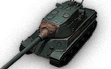<figcaption>EU · Lorraine 50 t</figcaption></figure><figure style="display:inline-block"><figcaption>RU · Lorraine 50 t</figcaption></figure>
<em>Firepower</em> 
<strong>DPM (HP/min)</strong> <small>EU</small> 1 940.47  <small>RU</small> <strong>2 176.70</strong> 
<strong>Rate of fire (rounds/min)</strong> <small>EU</small> 4.85  <small>RU</small> <strong>5.44</strong> 
<strong>Reload time (s)</strong> <small>EU</small> 12.37  <small>RU</small> <strong>11.03</strong> 

<em>Gun handling</em> 
<strong>Aim time (s)</strong> <small>EU</small> 2.68  <small>RU</small> <strong>1.92</strong> 
<strong>Dispersion · moving</strong> <small>EU</small> 0.17  <small>RU</small> <strong>0.13</strong> 
<strong>Dispersion · tank traverse</strong> <small>EU</small> 0.17  <small>RU</small> <strong>0.13</strong> 
<strong>Dispersion · turret traverse</strong> <small>EU</small> 0.12  <small>RU</small> <strong>0.15</strong> 

<em>Armor &amp; health</em> 
<strong>Health</strong> <small>EU</small> 1 750  <small>RU</small> <strong>1 920</strong> 

Panhard EBR 90 · Tier IX

panhardebr90

<a href="https://tanks.gg/v20410/tank/ebr-90">EU stats</a> · <a href="https://tanks.gg/v14600ru/tank/ebr-90">RU stats</a>
<figure style="display:inline-block">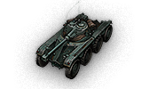<figcaption>Panhard EBR 90</figcaption></figure>
<em>Mobility</em> 
<strong>Tank traverse on hard terrain (°/s)</strong> <small>EU</small> 40.57  <small>RU</small> <strong>40.62</strong> 
<strong>Tank traverse on medium terrain (°/s)</strong> <small>EU</small> 40.57  <small>RU</small> <strong>40.62</strong> 
<strong>Tank traverse on soft terrain (°/s)</strong> <small>EU</small> 40.57  <small>RU</small> <strong>40.62</strong> 

<em>Armor &amp; health</em> 
<strong>Health</strong> <small>EU</small> 1 300  <small>RU</small> <strong>1 150</strong> 

<em>Miscellaneous</em> 
<strong>View range (m)</strong> <small>EU</small> 340  <small>RU</small> <strong>330</strong> 
<strong>Shell cost</strong> <small>EU</small> 374  <small>RU</small> <strong>350</strong> 

Alternate mode

<a href="https://tanks.gg/v20410/tank/ebr-90-siege">EU stats</a> · <a href="https://tanks.gg/v14600ru/tank/ebr-90-siege">RU stats</a>
<em>Mobility</em> 
<strong>Tank traverse on hard terrain (°/s)</strong> <small>EU</small> 40.57  <small>RU</small> <strong>40.62</strong> 
<strong>Tank traverse on medium terrain (°/s)</strong> <small>EU</small> 40.57  <small>RU</small> <strong>40.62</strong> 
<strong>Tank traverse on soft terrain (°/s)</strong> <small>EU</small> 40.57  <small>RU</small> <strong>40.62</strong> 

<em>Armor &amp; health</em> 
<strong>Health</strong> <small>EU</small> 1 300  <small>RU</small> <strong>1 150</strong> 

<em>Miscellaneous</em> 
<strong>View range (m)</strong> <small>EU</small> 340  <small>RU</small> <strong>330</strong> 
<strong>Shell cost</strong> <small>EU</small> 374  <small>RU</small> <strong>350</strong> 

Projet Louis · Tier IX

projetlouis

<a href="https://tanks.gg/v20410/tank/projet-louis">EU stats</a> · <a href="https://tanks.gg/v14600ru/tank/projet-louis">RU stats</a>
<figure style="display:inline-block">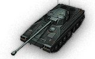<figcaption>EU · Projet Louis</figcaption></figure><figure style="display:inline-block">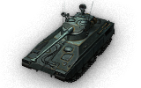<figcaption>RU · Projet Louis</figcaption></figure>
<strong>Penetration (mm)</strong> <b>EU</b>  AP <strong>210</strong> /  APCR <strong>248</strong> /  HE <strong>38</strong> → <b>RU</b>  HEAT <strong>225</strong> /  APCR <strong>250</strong> /  HE <strong>45</strong>

<strong>Damage (HP)</strong> <b>EU</b>  AP <strong>125</strong> /  APCR <strong>125</strong> /  HE <strong>175</strong> → <b>RU</b>  HEAT <strong>200</strong> /  APCR <strong>200</strong> /  HE <strong>280</strong>

<em>Firepower</em> 
<strong>DPM (HP/min)</strong> <small>EU</small> 2 473.42  <small>RU</small> <strong>2 006.15</strong> 
<strong>Module damage</strong> <small>EU</small> 100  <small>RU</small> <strong>122</strong> 
<strong>Rate of fire (rounds/min)</strong> <small>EU</small> 19.79  <small>RU</small> <strong>10.03</strong> 
<strong>Reload time (s)</strong> <small>EU</small> 17.26  <small>RU</small> <strong>28.39</strong> 
<strong>Clip size</strong> <small>EU</small> 8  <small>RU</small> <strong>6</strong> 
<strong>Clip damage · damage</strong> <small>EU</small> 1 000  <small>RU</small> <strong>1 200</strong> 
<strong>Clip damage · time (s)</strong> <small>EU</small> 7  <small>RU</small> <strong>7.50</strong> 
<strong>Intra-clip reload</strong> <small>EU</small> 1  <small>RU</small> <strong>1.50</strong> 
<strong>Caliber</strong> <small>EU</small> 75  <small>RU</small> <strong>90</strong> 
<strong>Shell velocity (m/s)</strong> <small>EU</small> 1 000  <small>RU</small> <strong>950</strong> 
<strong>Normalization</strong> <small>EU</small> 5  <small>RU</small> <strong>0</strong> 
<strong>Ricochet angle</strong> <small>EU</small> 70  <small>RU</small> <strong>85</strong> 
<strong>Spaced armor pen loss</strong> <small>EU</small> 0  <small>RU</small> <strong>0.50</strong> 
<strong>Ammo capacity</strong> <small>EU</small> 80  <small>RU</small> <strong>90</strong> 
<strong>Potential damage</strong> <small>EU</small> 10 000  <small>RU</small> <strong>18 000</strong> 

<em>Gun handling</em> 
<strong>Aim time (s)</strong> <small>EU</small> 1.53  <small>RU</small> <strong>2.40</strong> 
<strong>Dispersion (m/100 m)</strong> <small>EU</small> 0.36  <small>RU</small> <strong>0.33</strong> 
<strong>Dispersion · damaged</strong> <small>EU</small> 0.73  <small>RU</small> <strong>0.65</strong> 
<strong>Dispersion · moving</strong> <small>EU</small> 0.10  <small>RU</small> <strong>0.18</strong> 
<strong>Dispersion · tank traverse</strong> <small>EU</small> 0.10  <small>RU</small> <strong>0.18</strong> 
<strong>Dispersion · turret traverse</strong> <small>EU</small> 0.10  <small>RU</small> <strong>0.12</strong> 
<strong>Dispersion · firing</strong> <small>EU</small> 2.50  <small>RU</small> <strong>4</strong> 
<strong>Elevation (°)</strong> <small>EU</small> 15  <small>RU</small> <strong>10</strong> 
<strong>Depression (°)</strong> <small>EU</small> 9  <small>RU</small> <strong>6</strong> 

<em>Mobility</em> 
<strong>Forward speed (km/h)</strong> <small>EU</small> 65  <small>RU</small> <strong>70</strong> 
<strong>Forward speed on hard terrain (km/h)</strong> <small>EU</small> 65  <small>RU</small> <strong>70</strong> 
<strong>Forward speed on medium terrain (km/h)</strong> <small>EU</small> 65  <small>RU</small> <strong>70</strong> 
<strong>Forward speed on soft terrain (km/h)</strong> <small>EU</small> 58.15  <small>RU</small> <strong>50.34</strong> 
<strong>Reverse speed (km/h)</strong> <small>EU</small> 20  <small>RU</small> <strong>28</strong> 
<strong>Engine power (hp)</strong> <small>EU</small> 550  <small>RU</small> <strong>500</strong> 
<strong>Power/weight (hp/t)</strong> <small>EU</small> 30.56  <small>RU</small> <strong>27.78</strong> 
<strong>Terrain resist (med)</strong> <small>EU</small> 1.15  <small>RU</small> <strong>1.05</strong> 
<strong>Terrain resist (soft)</strong> <small>EU</small> 1.92  <small>RU</small> <strong>2.01</strong> 
<strong>Turret traverse (°/s)</strong> <small>EU</small> 47.98  <small>RU</small> <strong>52.15</strong> 
<strong>Tank traverse (°/s)</strong> <small>EU</small> 52.15  <small>RU</small> <strong>47.98</strong> 
<strong>Tank traverse on hard terrain (°/s)</strong> <small>EU</small> 52.15  <small>RU</small> <strong>45.58</strong> 
<strong>Tank traverse on medium terrain (°/s)</strong> <small>EU</small> 43.46  <small>RU</small> <strong>41.44</strong> 
<strong>Tank traverse on soft terrain (°/s)</strong> <small>EU</small> 26.08  <small>RU</small> <strong>21.70</strong> 

<em>Armor &amp; health</em> 
<strong>Hull armor · front (mm)</strong> <small>EU</small> 50  <small>RU</small> <strong>25</strong> 
<strong>Turret armor · front (mm)</strong> <small>EU</small> 50  <small>RU</small> <strong>40</strong> 
<strong>Turret armor · side (mm)</strong> <small>EU</small> 40  <small>RU</small> <strong>20</strong> 
<strong>Turret armor · rear (mm)</strong> <small>EU</small> 25  <small>RU</small> <strong>20</strong> 
<strong>Health</strong> <small>EU</small> 1 400  <small>RU</small> <strong>1 350</strong> 
<strong>Health · engine</strong> <small>EU</small> 310  <small>RU</small> <strong>320</strong> 
<strong>Health · ammo rack</strong> <small>EU</small> 230  <small>RU</small> <strong>200</strong> 
<strong>Health · fuel tank</strong> <small>EU</small> 200  <small>RU</small> <strong>175</strong> 
<strong>Track repair time (s)</strong> <small>EU</small> 11.70  <small>RU</small> <strong>12.03</strong> 

<em>Miscellaneous</em> 
<strong>Stationary camo</strong> <small>EU</small> 15.90  <small>RU</small> <strong>14.42</strong> 
<strong>Stationary camo · after firing</strong> <small>EU</small> 3.72  <small>RU</small> <strong>3.24</strong> 
<strong>Moving camo</strong> <small>EU</small> 15.90  <small>RU</small> <strong>14.42</strong> 
<strong>Moving camo · after firing</strong> <small>EU</small> 3.72  <small>RU</small> <strong>3.24</strong> 
<strong>View range (m)</strong> <small>EU</small> 380  <small>RU</small> <strong>410</strong> 
<strong>Radio range (m)</strong> <small>EU</small> 670  <small>RU</small> <strong>750</strong> 
<strong>Shell cost</strong> <small>EU</small> 224  <small>RU</small> <strong>445</strong> 

