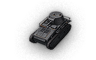

# Germany · Tier I

[All nations and tiers](../buffs_nerfs.md) · EU v20410 → RU v14600ru · 3 November 2026

<label><strong>Find a tank</strong><input type="search" placeholder="Try is7, obj140 or xm57" aria-label="Find a tank" style="display:block;width:100%;padding:.7rem;border:1px solid #888;border-radius:4px;margin:.5rem 0;color:inherit;background:transparent"></label>

Leichttraktor · Tier I

leichttraktor

<a href="https://tanks.gg/v20410/tank/ltr">EU stats</a> · <a href="https://tanks.gg/v14600ru/tank/ltr">RU stats</a>
<figure style="display:inline-block"><figcaption>Leichttraktor</figcaption></figure>
<em>Firepower</em> 
<strong>DPM (HP/min)</strong> <small>EU</small> 1 091.48  <small>RU</small> <strong>763.73</strong> 
<strong>Rate of fire (rounds/min)</strong> <small>EU</small> 99.23  <small>RU</small> <strong>69.43</strong> 
<strong>Reload time (s)</strong> <small>EU</small> 4.51  <small>RU</small> <strong>7.67</strong> 
<strong>Clip damage · time (s)</strong> <small>EU</small> 2.75  <small>RU</small> <strong>2.70</strong> 
<strong>Clip damage · burst damage · time (s)</strong> <small>EU</small> 0.50  <small>RU</small> <strong>0.30</strong> 
<strong>Intra-clip reload</strong> <small>EU</small> 0.25  <small>RU</small> <strong>0.50</strong> 

<em>Gun handling</em> 
<strong>Dispersion (m/100 m)</strong> <small>EU</small> 0.53  <small>RU</small> <strong>0.45</strong> 
<strong>Dispersion · damaged</strong> <small>EU</small> 1.06  <small>RU</small> <strong>0.90</strong> 
<strong>Dispersion · moving</strong> <small>EU</small> 0.36  <small>RU</small> <strong>0.10</strong> 
<strong>Dispersion · tank traverse</strong> <small>EU</small> 0.36  <small>RU</small> <strong>0.10</strong> 
<strong>Dispersion · firing</strong> <small>EU</small> 1.40  <small>RU</small> <strong>2</strong> 

<em>Mobility</em> 
<strong>Forward speed on soft terrain (km/h)</strong> <small>EU</small> 22.62  <small>RU</small> <strong>21.40</strong> 
<strong>Engine power (hp)</strong> <small>EU</small> 95  <small>RU</small> <strong>89.87</strong> 
<strong>Power/weight (hp/t)</strong> <small>EU</small> 12.48  <small>RU</small> <strong>11.81</strong> 

<em>Armor &amp; health</em> 
<strong>Track repair time (s)</strong> <small>EU</small> 6  <small>RU</small> <strong>3</strong> 

<em>Miscellaneous</em> 
<strong>View range (m)</strong> <small>EU</small> 310  <small>RU</small> <strong>300</strong> 

