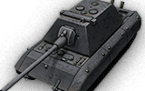
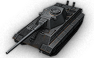
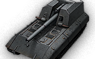
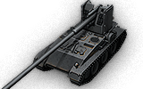
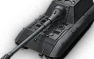
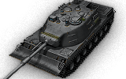
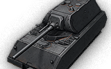
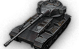
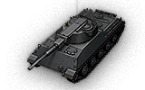
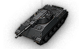

# Germany · Tier X

[All nations and tiers](../buffs_nerfs.md) · EU v20410 → RU v14600ru · 3 November 2026

<label><strong>Find a tank</strong><input type="search" placeholder="Try is7, obj140 or xm57" aria-label="Find a tank" style="display:block;width:100%;padding:.7rem;border:1px solid #888;border-radius:4px;margin:.5rem 0;color:inherit;background:transparent"></label>

E 100 · Tier X

e100

<a href="https://tanks.gg/v20410/tank/e-100">EU stats</a> · <a href="https://tanks.gg/v14600ru/tank/e-100">RU stats</a>
<figure style="display:inline-block"><figcaption>E 100</figcaption></figure>
<em>Mobility</em> 
<strong>Turret traverse (°/s)</strong> <small>EU</small> 22.95  <small>RU</small> <strong>20.86</strong> 

<em>Armor &amp; health</em> 
<strong>Turret armor · front (mm)</strong> <small>EU</small> 280  <small>RU</small> <strong>270</strong> 

E 50 Ausf. M · Tier X

e50ausfm

<a href="https://tanks.gg/v20410/tank/e-50-m">EU stats</a> · <a href="https://tanks.gg/v14600ru/tank/e-50-m">RU stats</a>
<figure style="display:inline-block"><figcaption>E 50 Ausf. M</figcaption></figure>
<em>Firepower</em> 
<strong>DPM (HP/min)</strong> <small>EU</small> 2 652.85  <small>RU</small> <strong>2 542.31</strong> 
<strong>Rate of fire (rounds/min)</strong> <small>EU</small> 6.80  <small>RU</small> <strong>6.52</strong> 
<strong>Reload time (s)</strong> <small>EU</small> 8.82  <small>RU</small> <strong>9.20</strong> 

<em>Mobility</em> 
<strong>Forward speed on medium terrain (km/h)</strong> <small>EU</small> 60  <small>RU</small> <strong>59.61</strong> 
<strong>Forward speed on soft terrain (km/h)</strong> <small>EU</small> 34.52  <small>RU</small> <strong>33.69</strong> 
<strong>Engine power (hp)</strong> <small>EU</small> 1 300  <small>RU</small> <strong>1 268.74</strong> 
<strong>Power/weight (hp/t)</strong> <small>EU</small> 20.86  <small>RU</small> <strong>20.36</strong> 

<em>Armor &amp; health</em> 
<strong>Hull armor · front (mm)</strong> <small>EU</small> 160  <small>RU</small> <strong>150</strong> 

G.W. E 100 · Tier X

gwe100

<a href="https://tanks.gg/v20410/tank/gw-e-100">EU stats</a> · <a href="https://tanks.gg/v14600ru/tank/gw-e-100">RU stats</a>
<figure style="display:inline-block"><figcaption>G.W. E 100</figcaption></figure>
<strong>Penetration (mm)</strong> <b>EU</b>  HE <strong>53</strong> /  HE <strong>66</strong> /  AP <strong>372</strong> → <b>RU</b>  HE <strong>53</strong> /  AP <strong>361</strong>

<strong>Damage (HP)</strong> <b>EU</b>  HE <strong>900</strong> /  HE <strong>1200</strong> /  AP <strong>640</strong> → <b>RU</b>  HE <strong>1250</strong> /  AP <strong>700</strong>

<em>Firepower</em> 
<strong>DPM (HP/min)</strong> <small>EU</small> 1 444.15  <small>RU</small> <strong>2 005.77</strong> 
<strong>Explosion radius</strong> <small>EU</small> 11.40  <small>RU</small> <strong>9</strong> 
<strong>Stun duration · maximum (s)</strong> <small>EU</small> 31 → <small>RU</small> <strong>—</strong> 
<strong>Stun duration · minimum (s)</strong> <small>EU</small> 12.40 → <small>RU</small> <strong>—</strong> 
<strong>Potential damage</strong> <small>EU</small> 27 000  <small>RU</small> <strong>37 500</strong> 

<em>Gun handling</em> 
<strong>Aim time (s)</strong> <small>EU</small> 4.60  <small>RU</small> <strong>4.41</strong> 

<em>Armor &amp; health</em> 
<strong>Health · ammo rack</strong> <small>EU</small> 250  <small>RU</small> <strong>150</strong> 

<em>Miscellaneous</em> 
<strong>Shell cost</strong> <small>EU</small> 2 080  <small>RU</small> <strong>2 390</strong> 

Grille 15 · Tier X

grille15

<a href="https://tanks.gg/v20410/tank/grille-15">EU stats</a> · <a href="https://tanks.gg/v14600ru/tank/grille-15">RU stats</a>
<figure style="display:inline-block"><figcaption>Grille 15</figcaption></figure>
<em>Mobility</em> 
<strong>Tank traverse (°/s)</strong> <small>EU</small> 29.20  <small>RU</small> <strong>25.03</strong> 
<strong>Tank traverse on hard terrain (°/s)</strong> <small>EU</small> 27.74  <small>RU</small> <strong>23.78</strong> 
<strong>Tank traverse on medium terrain (°/s)</strong> <small>EU</small> 23.12  <small>RU</small> <strong>19.82</strong> 
<strong>Tank traverse on soft terrain (°/s)</strong> <small>EU</small> 7.93  <small>RU</small> <strong>6.79</strong> 

Jagdpanzer E 100 · Tier X

jagdpanzere100

<a href="https://tanks.gg/v20410/tank/jgpz-e-100">EU stats</a> · <a href="https://tanks.gg/v14600ru/tank/jgpz-e-100">RU stats</a>
<figure style="display:inline-block"><figcaption>Jagdpanzer E 100</figcaption></figure>
<em>Armor &amp; health</em> 
<strong>Health · engine</strong> <small>EU</small> 345  <small>RU</small> <strong>360</strong> 

Kampfpanzer 07 P(E) · Tier X

kampfpanzer07pe

<a href="https://tanks.gg/v20410/tank/kpz-07-pe">EU stats</a> · <a href="https://tanks.gg/v14600ru/tank/kpz-07-pe">RU stats</a>
<figure style="display:inline-block"><figcaption>Kampfpanzer 07 P(E)</figcaption></figure>
<em>Gun handling</em> 
<strong>Dispersion · moving</strong> <small>EU</small> 0.15  <small>RU</small> <strong>0.12</strong> 
<strong>Dispersion · tank traverse</strong> <small>EU</small> 0.15  <small>RU</small> <strong>0.12</strong> 

<em>Armor &amp; health</em> 
<strong>Hull armor · front (mm)</strong> <small>EU</small> 160  <small>RU</small> <strong>180</strong> 
<strong>Turret armor · front (mm)</strong> <small>EU</small> 190  <small>RU</small> <strong>210</strong> 
<strong>Health</strong> <small>EU</small> 2 200  <small>RU</small> <strong>2 400</strong> 

Maus · Tier X

maus

<a href="https://tanks.gg/v20410/tank/maus">EU stats</a> · <a href="https://tanks.gg/v14600ru/tank/maus">RU stats</a>
<figure style="display:inline-block"><figcaption>Maus</figcaption></figure>
<em>Mobility</em> 
<strong>Forward speed on soft terrain (km/h)</strong> <small>EU</small> 18.70  <small>RU</small> <strong>17.74</strong> 
<strong>Engine power (hp)</strong> <small>EU</small> 1 950  <small>RU</small> <strong>1 850.24</strong> 
<strong>Power/weight (hp/t)</strong> <small>EU</small> 10.32  <small>RU</small> <strong>9.79</strong> 

<em>Miscellaneous</em> 
<strong>Moving camo</strong> <small>EU</small> 0.74  <small>RU</small> <strong>0.68</strong> 
<strong>Moving camo · after firing</strong> <small>EU</small> 0.12  <small>RU</small> <strong>0.11</strong> 

Pz.Kpfw. VII · Tier X

pzkpfwvii

<a href="https://tanks.gg/v20410/tank/pzkpfw-vii">EU stats</a> · <a href="https://tanks.gg/v14600ru/tank/pzkpfw-vii">RU stats</a>
<figure style="display:inline-block"><figcaption>Pz.Kpfw. VII</figcaption></figure>
<strong>Penetration (mm)</strong> <b>EU</b>  AP <strong>276</strong> /  APCR <strong>325</strong> /  HE <strong>65</strong> → <b>RU</b>  AP <strong>258</strong> /  APCR <strong>315</strong> /  HE <strong>65</strong>

<em>Firepower</em> 
<strong>DPM (HP/min)</strong> <small>EU</small> 2 190.30  <small>RU</small> <strong>2 384</strong> 
<strong>Rate of fire (rounds/min)</strong> <small>EU</small> 3.91  <small>RU</small> <strong>4.26</strong> 
<strong>Reload time (s)</strong> <small>EU</small> 15.34  <small>RU</small> <strong>14.09</strong> 

<em>Gun handling</em> 
<strong>Dispersion (m/100 m)</strong> <small>EU</small> 0.32  <small>RU</small> <strong>0.35</strong> 
<strong>Dispersion · damaged</strong> <small>EU</small> 0.63  <small>RU</small> <strong>0.71</strong> 

<em>Mobility</em> 
<strong>Forward speed on soft terrain (km/h)</strong> <small>EU</small> 18.61  <small>RU</small> <strong>17.49</strong> 
<strong>Engine power (hp)</strong> <small>EU</small> 1 350  <small>RU</small> <strong>1 268.74</strong> 
<strong>Power/weight (hp/t)</strong> <small>EU</small> 11.25  <small>RU</small> <strong>10.57</strong> 

Rheinmetall Panzerwagen · Tier X

rheinmetallpanzerwagen

<a href="https://tanks.gg/v20410/tank/rhm-pzw">EU stats</a> · <a href="https://tanks.gg/v14600ru/tank/rhm-pzw">RU stats</a>
<figure style="display:inline-block"><figcaption>EU · Rheinmetall Panzerwagen</figcaption></figure><figure style="display:inline-block"><figcaption>RU · Rheinmetall Panzerwagen</figcaption></figure>
<strong>Penetration (mm)</strong> <b>EU</b>  APCR <strong>251</strong> /  HEAT <strong>285</strong> /  HE <strong>75</strong> → <b>RU</b>  APCR <strong>242</strong> /  HEAT <strong>280</strong> /  HE <strong>120</strong>

<strong>Damage (HP)</strong> <b>EU</b>  APCR <strong>350</strong> /  HEAT <strong>350</strong> /  HE <strong>420</strong> → <b>RU</b>  APCR <strong>320</strong> /  HEAT <strong>320</strong> /  HE <strong>420</strong>

<em>Firepower</em> 
<strong>DPM (HP/min)</strong> <small>EU</small> 2 433.67  <small>RU</small> <strong>2 451.60</strong> 
<strong>Rate of fire (rounds/min)</strong> <small>EU</small> 6.95  <small>RU</small> <strong>7.66</strong> 
<strong>Reload time (s)</strong> <small>EU</small> 8.63  <small>RU</small> <strong>7.83</strong> 
<strong>Potential damage</strong> <small>EU</small> 12 250  <small>RU</small> <strong>11 200</strong> 

<em>Gun handling</em> 
<strong>Dispersion · moving</strong> <small>EU</small> 0.09  <small>RU</small> <strong>0.10</strong> 
<strong>Dispersion · tank traverse</strong> <small>EU</small> 0.09  <small>RU</small> <strong>0.10</strong> 
<strong>Dispersion · turret traverse</strong> <small>EU</small> 0.06  <small>RU</small> <strong>0.08</strong> 

<em>Mobility</em> 
<strong>Forward speed (km/h)</strong> <small>EU</small> 72  <small>RU</small> <strong>75</strong> 
<strong>Forward speed on hard terrain (km/h)</strong> <small>EU</small> 72  <small>RU</small> <strong>75</strong> 
<strong>Forward speed on medium terrain (km/h)</strong> <small>EU</small> 72  <small>RU</small> <strong>75</strong> 
<strong>Forward speed on soft terrain (km/h)</strong> <small>EU</small> 72  <small>RU</small> <strong>74.43</strong> 
<strong>Engine power (hp)</strong> <small>EU</small> 1 050  <small>RU</small> <strong>1 100</strong> 
<strong>Power/weight (hp/t)</strong> <small>EU</small> 42  <small>RU</small> <strong>44</strong> 
<strong>Terrain resist (hard)</strong> <small>EU</small> 0.77  <small>RU</small> <strong>0.96</strong> 
<strong>Terrain resist (med)</strong> <small>EU</small> 0.86  <small>RU</small> <strong>1.08</strong> 
<strong>Terrain resist (soft)</strong> <small>EU</small> 1.73  <small>RU</small> <strong>2.16</strong> 
<strong>Tank traverse (°/s)</strong> <small>EU</small> 45.89  <small>RU</small> <strong>56.32</strong> 
<strong>Tank traverse on hard terrain (°/s)</strong> <small>EU</small> 43.60  <small>RU</small> <strong>53.51</strong> 
<strong>Tank traverse on medium terrain (°/s)</strong> <small>EU</small> 38.75  <small>RU</small> <strong>47.56</strong> 
<strong>Tank traverse on soft terrain (°/s)</strong> <small>EU</small> 19.38  <small>RU</small> <strong>23.78</strong> 

<em>Armor &amp; health</em> 
<strong>Track armor</strong> <small>EU</small> 15  <small>RU</small> <strong>20</strong> 
<strong>Health</strong> <small>EU</small> 1 850  <small>RU</small> <strong>1 600</strong> 

