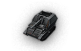
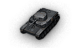
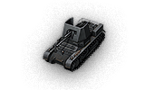
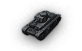
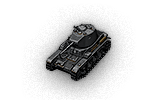
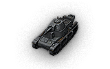
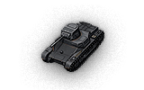
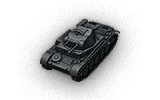
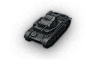
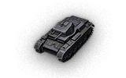

# Germany · Tier II

[All nations and tiers](../buffs_nerfs.md) · EU v20410 → RU v14600ru · 3 November 2026

<label><strong>Find a tank</strong><input type="search" placeholder="Try is7, obj140 or xm57" aria-label="Find a tank" style="display:block;width:100%;padding:.7rem;border:1px solid #888;border-radius:4px;margin:.5rem 0;color:inherit;background:transparent"></label>

G.Pz. Mk. VI (e) · Tier II

gpzmkvie

<a href="https://tanks.gg/v20410/tank/gpz-mk-vi">EU stats</a> · <a href="https://tanks.gg/v14600ru/tank/gpz-mk-vi">RU stats</a>
<figure style="display:inline-block"><figcaption>G.Pz. Mk. VI (e)</figcaption></figure>
<em>Gun handling</em> 
<strong>Aim time (s)</strong> <small>EU</small> 6.23  <small>RU</small> <strong>5.27</strong> 
<strong>Dispersion · moving</strong> <small>EU</small> 0.58  <small>RU</small> <strong>0.30</strong> 
<strong>Dispersion · tank traverse</strong> <small>EU</small> 0.58  <small>RU</small> <strong>0.30</strong> 
<strong>Dispersion · turret traverse</strong> <small>EU</small> 0.60  <small>RU</small> <strong>0.40</strong> 

<em>Armor &amp; health</em> 
<strong>Health</strong> <small>EU</small> 180  <small>RU</small> <strong>200</strong> 
<strong>Track repair time (s)</strong> <small>EU</small> 13.16  <small>RU</small> <strong>3</strong> 

MKA · Tier II

mka

<a href="https://tanks.gg/v20410/tank/mka">EU stats</a> · <a href="https://tanks.gg/v14600ru/tank/mka">RU stats</a>
<figure style="display:inline-block"><figcaption>MKA</figcaption></figure>
<em>Gun handling</em> 
<strong>Aim time (s)</strong> <small>EU</small> 2.21  <small>RU</small> <strong>1.53</strong> 
<strong>Dispersion (m/100 m)</strong> <small>EU</small> 0.40  <small>RU</small> <strong>0.38</strong> 
<strong>Dispersion · damaged</strong> <small>EU</small> 0.81  <small>RU</small> <strong>0.77</strong> 

<em>Armor &amp; health</em> 
<strong>Track repair time (s)</strong> <small>EU</small> 12.03  <small>RU</small> <strong>3</strong> 

Panzerjäger I · Tier II

panzerjägeri

<a href="https://tanks.gg/v20410/tank/pzjag-i">EU stats</a> · <a href="https://tanks.gg/v14600ru/tank/pzjag-i">RU stats</a>
<figure style="display:inline-block"><figcaption>Panzerjäger I</figcaption></figure>
<em>Gun handling</em> 
<strong>Dispersion · moving</strong> <small>EU</small> 0.32  <small>RU</small> <strong>0.28</strong> 
<strong>Dispersion · tank traverse</strong> <small>EU</small> 0.32  <small>RU</small> <strong>0.28</strong> 

<em>Armor &amp; health</em> 
<strong>Health</strong> <small>EU</small> 240  <small>RU</small> <strong>380</strong> 
<strong>Track repair time (s)</strong> <small>EU</small> 12.03  <small>RU</small> <strong>3</strong> 

Pz.Kpfw. 35 (t) · Tier II

pzkpfw35t

<a href="https://tanks.gg/v20410/tank/pz-35-t">EU stats</a> · <a href="https://tanks.gg/v14600ru/tank/pz-35-t">RU stats</a>
<figure style="display:inline-block"><figcaption>Pz.Kpfw. 35 (t)</figcaption></figure>
<em>Gun handling</em> 
<strong>Aim time (s)</strong> <small>EU</small> 1.60  <small>RU</small> <strong>1</strong> 
<strong>Dispersion · moving</strong> <small>EU</small> 0.34  <small>RU</small> <strong>0.24</strong> 
<strong>Dispersion · tank traverse</strong> <small>EU</small> 0.34  <small>RU</small> <strong>0.24</strong> 
<strong>Dispersion · firing</strong> <small>EU</small> 1.30  <small>RU</small> <strong>1</strong> 

<em>Mobility</em> 
<strong>Turret traverse (°/s)</strong> <small>EU</small> 26  <small>RU</small> <strong>38</strong> 

<em>Armor &amp; health</em> 
<strong>Track repair time (s)</strong> <small>EU</small> 12.03  <small>RU</small> <strong>3</strong> 

Pz.Kpfw. 35 R · Tier II

pzkpfw35r

<a href="https://tanks.gg/v20410/tank/pz-35-r">EU stats</a> · <a href="https://tanks.gg/v14600ru/tank/pz-35-r">RU stats</a>
<figure style="display:inline-block"><figcaption>Pz.Kpfw. 35 R</figcaption></figure>
<em>Armor &amp; health</em> 
<strong>Track repair time (s)</strong> <small>EU</small> 12.03  <small>RU</small> <strong>3</strong> 

Pz.Kpfw. 38H 735 (f) · Tier II

pzkpfw38h735f

<a href="https://tanks.gg/v20410/tank/pz-38h">EU stats</a> · <a href="https://tanks.gg/v14600ru/tank/pz-38h">RU stats</a>
<figure style="display:inline-block"><figcaption>Pz.Kpfw. 38H 735 (f)</figcaption></figure>
<em>Armor &amp; health</em> 
<strong>Track repair time (s)</strong> <small>EU</small> 12.03  <small>RU</small> <strong>3</strong> 

Pz.Kpfw. I · Tier II

pzkpfwi

<a href="https://tanks.gg/v20410/tank/pz-i">EU stats</a> · <a href="https://tanks.gg/v14600ru/tank/pz-i">RU stats</a>
<figure style="display:inline-block"><figcaption>Pz.Kpfw. I</figcaption></figure>
<em>Gun handling</em> 
<strong>Aim time (s)</strong> <small>EU</small> 1.50  <small>RU</small> <strong>1</strong> 
<strong>Dispersion (m/100 m)</strong> <small>EU</small> 0.51  <small>RU</small> <strong>0.50</strong> 
<strong>Dispersion · damaged</strong> <small>EU</small> 1.02  <small>RU</small> <strong>1</strong> 
<strong>Dispersion · moving</strong> <small>EU</small> 0.26  <small>RU</small> <strong>0.22</strong> 
<strong>Dispersion · tank traverse</strong> <small>EU</small> 0.26  <small>RU</small> <strong>0.22</strong> 

<em>Mobility</em> 
<strong>Turret traverse (°/s)</strong> <small>EU</small> 24  <small>RU</small> <strong>38</strong> 

<em>Armor &amp; health</em> 
<strong>Health</strong> <small>EU</small> 320  <small>RU</small> <strong>360</strong> 
<strong>Track repair time (s)</strong> <small>EU</small> 12.03  <small>RU</small> <strong>3</strong> 

Pz.Kpfw. II · Tier II

pzkpfwii

<a href="https://tanks.gg/v20410/tank/pz-ii">EU stats</a> · <a href="https://tanks.gg/v14600ru/tank/pz-ii">RU stats</a>
<figure style="display:inline-block"><figcaption>EU · Pz.Kpfw. II</figcaption></figure><figure style="display:inline-block"><figcaption>RU · Pz.Kpfw. II</figcaption></figure>
<strong>Penetration (mm)</strong> <b>EU</b>  AP <strong>49</strong> /  APCR <strong>72</strong> /  HE <strong>18</strong> → <b>RU</b>  AP <strong>39</strong> /  APCR <strong>51</strong>

<strong>Damage (HP)</strong> <b>EU</b>  AP <strong>40</strong> /  APCR <strong>40</strong> /  HE <strong>50</strong> → <b>RU</b>  AP <strong>11</strong> /  APCR <strong>11</strong>

<em>Firepower</em> 
<strong>DPM (HP/min)</strong> <small>EU</small> 1 137.82  <small>RU</small> <strong>1 336.25</strong> 
<strong>Module damage</strong> <small>EU</small> 50  <small>RU</small> <strong>27</strong> 
<strong>Rate of fire (rounds/min)</strong> <small>EU</small> 28.45  <small>RU</small> <strong>121.48</strong> 
<strong>Reload time (s)</strong> <small>EU</small> 2.11  <small>RU</small> <strong>3.74</strong> 
<strong>Caliber</strong> <small>EU</small> 37  <small>RU</small> <strong>20</strong> 
<strong>Shell velocity (m/s)</strong> <small>EU</small> 750  <small>RU</small> <strong>900</strong> 
<strong>Max range (m)</strong> <small>EU</small> 720  <small>RU</small> <strong>400</strong> 
<strong>Ammo capacity</strong> <small>EU</small> 200  <small>RU</small> <strong>640</strong> 
<strong>Potential damage</strong> <small>EU</small> 8 000  <small>RU</small> <strong>7 040</strong> 
<strong>Clip size</strong> <small>EU</small> — → <small>RU</small> <strong>10</strong> 
<strong>Clip size · burst size</strong> <small>EU</small> — → <small>RU</small> <strong>2</strong> 
<strong>Clip damage · damage</strong> <small>EU</small> — → <small>RU</small> <strong>110</strong> 
<strong>Clip damage · time (s)</strong> <small>EU</small> — → <small>RU</small> <strong>1.20</strong> 
<strong>Clip damage · burst damage · damage</strong> <small>EU</small> — → <small>RU</small> <strong>22</strong> 
<strong>Clip damage · burst damage · time (s)</strong> <small>EU</small> — → <small>RU</small> <strong>0.13</strong> 
<strong>Intra-clip reload</strong> <small>EU</small> — → <small>RU</small> <strong>0.13</strong> 

<em>Gun handling</em> 
<strong>Aim time (s)</strong> <small>EU</small> 1.70  <small>RU</small> <strong>1.60</strong> 
<strong>Dispersion (m/100 m)</strong> <small>EU</small> 0.40  <small>RU</small> <strong>0.45</strong> 
<strong>Dispersion · damaged</strong> <small>EU</small> 0.80  <small>RU</small> <strong>0.90</strong> 
<strong>Dispersion · moving</strong> <small>EU</small> 0.28  <small>RU</small> <strong>0.23</strong> 
<strong>Dispersion · tank traverse</strong> <small>EU</small> 0.28  <small>RU</small> <strong>0.23</strong> 
<strong>Dispersion · turret traverse</strong> <small>EU</small> 0.12  <small>RU</small> <strong>0.08</strong> 
<strong>Dispersion · firing</strong> <small>EU</small> 3  <small>RU</small> <strong>1.30</strong> 

<em>Mobility</em> 
<strong>Forward speed on soft terrain (km/h)</strong> <small>EU</small> 31.86  <small>RU</small> <strong>29.91</strong> 
<strong>Engine power (hp)</strong> <small>EU</small> 180  <small>RU</small> <strong>169.17</strong> 
<strong>Weight (kg)</strong> <small>EU</small> 9 350 → <small>RU</small> <strong>9 360</strong> 
<strong>Power/weight (hp/t)</strong> <small>EU</small> 19.25  <small>RU</small> <strong>18.07</strong> 
<strong>Tank traverse (°/s)</strong> <small>EU</small> 54.24  <small>RU</small> <strong>41.72</strong> 
<strong>Tank traverse on hard terrain (°/s)</strong> <small>EU</small> 58.28  <small>RU</small> <strong>41.54</strong> 
<strong>Tank traverse on medium terrain (°/s)</strong> <small>EU</small> 45.79  <small>RU</small> <strong>32.64</strong> 
<strong>Tank traverse on soft terrain (°/s)</strong> <small>EU</small> 27.87  <small>RU</small> <strong>19.87</strong> 

<em>Armor &amp; health</em> 
<strong>Health</strong> <small>EU</small> 340  <small>RU</small> <strong>350</strong> 
<strong>Track repair time (s)</strong> <small>EU</small> 12.03  <small>RU</small> <strong>3</strong> 

<em>Miscellaneous</em> 
<strong>Stationary camo · after firing</strong> <small>EU</small> 4.53  <small>RU</small> <strong>3.38</strong> 
<strong>Moving camo · after firing</strong> <small>EU</small> 3.40  <small>RU</small> <strong>2.54</strong> 
<strong>Shell cost</strong> <small>EU</small> 12  <small>RU</small> <strong>3</strong> 

Pz.Kpfw. II Ausf. D · Tier II

pzkpfwiiausfd

<a href="https://tanks.gg/v20410/tank/pz-ii-d">EU stats</a> · <a href="https://tanks.gg/v14600ru/tank/pz-ii-d">RU stats</a>
<figure style="display:inline-block"><figcaption>Pz.Kpfw. II Ausf. D</figcaption></figure>
<strong>Penetration (mm)</strong> <b>EU</b>  AP <strong>23</strong> /  APCR <strong>46</strong> → <b>RU</b>  AP <strong>32</strong> /  APCR <strong>46</strong>

<em>Gun handling</em> 
<strong>Aim time (s)</strong> <small>EU</small> 1.40  <small>RU</small> <strong>1</strong> 
<strong>Dispersion (m/100 m)</strong> <small>EU</small> 0.57  <small>RU</small> <strong>0.50</strong> 
<strong>Dispersion · damaged</strong> <small>EU</small> 1.14  <small>RU</small> <strong>1</strong> 
<strong>Dispersion · firing</strong> <small>EU</small> 1.20  <small>RU</small> <strong>0.50</strong> 

<em>Mobility</em> 
<strong>Forward speed on hard terrain (km/h)</strong> <small>EU</small> 55  <small>RU</small> <strong>50.92</strong> 
<strong>Forward speed on medium terrain (km/h)</strong> <small>EU</small> 42.68  <small>RU</small> <strong>51.90</strong> 
<strong>Forward speed on soft terrain (km/h)</strong> <small>EU</small> 24.39  <small>RU</small> <strong>29.66</strong> 
<strong>Engine power (hp)</strong> <small>EU</small> 148.02  <small>RU</small> <strong>180</strong> 
<strong>Power/weight (hp/t)</strong> <small>EU</small> 13.46  <small>RU</small> <strong>16.36</strong> 
<strong>Terrain resist (hard)</strong> <small>EU</small> 0.86  <small>RU</small> <strong>1.17</strong> 
<strong>Tank traverse on medium terrain (°/s)</strong> <small>EU</small> 35.20  <small>RU</small> <strong>47.83</strong> 
<strong>Tank traverse on soft terrain (°/s)</strong> <small>EU</small> 20.11  <small>RU</small> <strong>27.33</strong> 

<em>Armor &amp; health</em> 
<strong>Track repair time (s)</strong> <small>EU</small> 12.03  <small>RU</small> <strong>3</strong> 

