# Germany · Tier III

[All nations and tiers](../buffs_nerfs.md) · EU v20410 → RU v14600ru · 3 November 2026

<label><strong>Find a tank</strong><input type="search" placeholder="Try is7, obj140 or xm57" aria-label="Find a tank" style="display:block;width:100%;padding:.7rem;border:1px solid #888;border-radius:4px;margin:.5rem 0;color:inherit;background:transparent"></label>

43 M. Toldi III · Tier III

43mtoldiiii

<a href="https://tanks.gg/v20410/tank/toldi-iii">EU stats</a> · <a href="https://tanks.gg/v14600ru/tank/toldi-iii">RU stats</a>
<figure style="display:inline-block">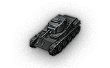<figcaption>43 M. Toldi III</figcaption></figure>
<strong>Penetration (mm)</strong> <b>EU</b>  AP <strong>64</strong> /  AP <strong>80</strong> /  HE <strong>20</strong> → <b>RU</b>  AP <strong>64</strong> /  AP <strong>90</strong> /  HE <strong>20</strong>

<em>Firepower</em> 
<strong>DPM (HP/min)</strong> <small>EU</small> 704.03  <small>RU</small> <strong>1 005.75</strong> 
<strong>Rate of fire (rounds/min)</strong> <small>EU</small> 15.65  <small>RU</small> <strong>22.35</strong> 
<strong>Reload time (s)</strong> <small>EU</small> 3.84  <small>RU</small> <strong>2.68</strong> 

<em>Gun handling</em> 
<strong>Aim time (s)</strong> <small>EU</small> 2.01  <small>RU</small> <strong>1.63</strong> 
<strong>Dispersion (m/100 m)</strong> <small>EU</small> 0.41  <small>RU</small> <strong>0.38</strong> 
<strong>Dispersion · damaged</strong> <small>EU</small> 0.82  <small>RU</small> <strong>0.77</strong> 
<strong>Dispersion · moving</strong> <small>EU</small> 0.30  <small>RU</small> <strong>0.24</strong> 
<strong>Dispersion · tank traverse</strong> <small>EU</small> 0.30  <small>RU</small> <strong>0.24</strong> 
<strong>Dispersion · turret traverse</strong> <small>EU</small> 0.14  <small>RU</small> <strong>0.10</strong> 
<strong>Dispersion · firing</strong> <small>EU</small> 4  <small>RU</small> <strong>2</strong> 

<em>Armor &amp; health</em> 
<strong>Health</strong> <small>EU</small> 410  <small>RU</small> <strong>460</strong> 
<strong>Track repair time (s)</strong> <small>EU</small> 10.03  <small>RU</small> <strong>4</strong> 

<em>Miscellaneous</em> 
<strong>View range (m)</strong> <small>EU</small> 270  <small>RU</small> <strong>300</strong> 

Großtraktor - Krupp · Tier III

großtraktorkrupp

<a href="https://tanks.gg/v20410/tank/grtr">EU stats</a> · <a href="https://tanks.gg/v14600ru/tank/grtr">RU stats</a>
<figure style="display:inline-block">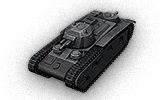<figcaption>Großtraktor - Krupp</figcaption></figure>
<em>Gun handling</em> 
<strong>Aim time (s)</strong> <small>EU</small> 2.11  <small>RU</small> <strong>1.73</strong> 
<strong>Dispersion (m/100 m)</strong> <small>EU</small> 0.53  <small>RU</small> <strong>0.43</strong> 
<strong>Dispersion · damaged</strong> <small>EU</small> 1.05  <small>RU</small> <strong>0.86</strong> 
<strong>Dispersion · turret traverse</strong> <small>EU</small> 0.16  <small>RU</small> <strong>0.10</strong> 
<strong>Dispersion · firing</strong> <small>EU</small> 4  <small>RU</small> <strong>3</strong> 

<em>Mobility</em> 
<strong>Reverse speed (km/h)</strong> <small>EU</small> 12  <small>RU</small> <strong>15</strong> 

<em>Armor &amp; health</em> 
<strong>Track repair time (s)</strong> <small>EU</small> 12.03  <small>RU</small> <strong>4</strong> 

Marder II · Tier III

marderii

<a href="https://tanks.gg/v20410/tank/marder-ii">EU stats</a> · <a href="https://tanks.gg/v14600ru/tank/marder-ii">RU stats</a>
<figure style="display:inline-block">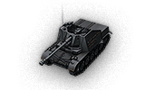<figcaption>Marder II</figcaption></figure>
<em>Gun handling</em> 
<strong>Aim time (s)</strong> <small>EU</small> 2.40  <small>RU</small> <strong>1.53</strong> 
<strong>Dispersion · moving</strong> <small>EU</small> 0.30  <small>RU</small> <strong>0.24</strong> 
<strong>Dispersion · tank traverse</strong> <small>EU</small> 0.30  <small>RU</small> <strong>0.24</strong> 
<strong>Dispersion · turret traverse</strong> <small>EU</small> 0.18  <small>RU</small> <strong>0.10</strong> 
<strong>Dispersion · firing</strong> <small>EU</small> 4  <small>RU</small> <strong>2</strong> 

<em>Mobility</em> 
<strong>Reverse speed (km/h)</strong> <small>EU</small> 12  <small>RU</small> <strong>16</strong> 

<em>Armor &amp; health</em> 
<strong>Health</strong> <small>EU</small> 295  <small>RU</small> <strong>500</strong> 
<strong>Track repair time (s)</strong> <small>EU</small> 10.03  <small>RU</small> <strong>4</strong> 

Pz.Kpfw. 38 (t) · Tier III

pzkpfw38t

<a href="https://tanks.gg/v20410/tank/pz-38-t">EU stats</a> · <a href="https://tanks.gg/v14600ru/tank/pz-38-t">RU stats</a>
<figure style="display:inline-block">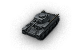<figcaption>Pz.Kpfw. 38 (t)</figcaption></figure>
<em>Armor &amp; health</em> 
<strong>Health</strong> <small>EU</small> 445  <small>RU</small> <strong>450</strong> 
<strong>Track repair time (s)</strong> <small>EU</small> 12.03  <small>RU</small> <strong>4</strong> 

Pz.Kpfw. I Ausf. C · Tier III

pzkpfwiausfc

<a href="https://tanks.gg/v20410/tank/pz-i-c">EU stats</a> · <a href="https://tanks.gg/v14600ru/tank/pz-i-c">RU stats</a>
<figure style="display:inline-block">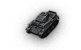<figcaption>Pz.Kpfw. I Ausf. C</figcaption></figure>
<strong>Penetration (mm)</strong> <b>EU</b>  AP <strong>33</strong> /  APCR <strong>43</strong> → <b>RU</b>  AP <strong>42</strong> /  APCR <strong>60</strong>

<em>Firepower</em> 
<strong>Max range (m)</strong> <small>EU</small> 400  <small>RU</small> <strong>450</strong> 

<em>Gun handling</em> 
<strong>Aim time (s)</strong> <small>EU</small> 1.40  <small>RU</small> <strong>1</strong> 

<em>Armor &amp; health</em> 
<strong>Health</strong> <small>EU</small> 410  <small>RU</small> <strong>450</strong> 
<strong>Track repair time (s)</strong> <small>EU</small> 10.03  <small>RU</small> <strong>4</strong> 

Pz.Kpfw. II Ausf. G · Tier III

pzkpfwiiausfg

<a href="https://tanks.gg/v20410/tank/pz-ii-g">EU stats</a> · <a href="https://tanks.gg/v14600ru/tank/pz-ii-g">RU stats</a>
<figure style="display:inline-block">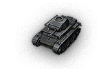<figcaption>Pz.Kpfw. II Ausf. G</figcaption></figure>
<em>Firepower</em> 
<strong>DPM (HP/min)</strong> <small>EU</small> 890.72  <small>RU</small> <strong>841.56</strong> 
<strong>Rate of fire (rounds/min)</strong> <small>EU</small> 29.69  <small>RU</small> <strong>28.05</strong> 
<strong>Reload time (s)</strong> <small>EU</small> 15  <small>RU</small> <strong>12</strong> 
<strong>Clip size</strong> <small>EU</small> 8  <small>RU</small> <strong>6</strong> 
<strong>Clip damage · damage</strong> <small>EU</small> 240  <small>RU</small> <strong>180</strong> 
<strong>Clip damage · time (s)</strong> <small>EU</small> 1.17  <small>RU</small> <strong>0.83</strong> 
<strong>Ammo capacity</strong> <small>EU</small> 320  <small>RU</small> <strong>318</strong> 
<strong>Potential damage</strong> <small>EU</small> 9 600  <small>RU</small> <strong>9 540</strong> 

<em>Gun handling</em> 
<strong>Aim time (s)</strong> <small>EU</small> 2.30  <small>RU</small> <strong>1.60</strong> 
<strong>Dispersion · turret traverse</strong> <small>EU</small> 0.20  <small>RU</small> <strong>0.12</strong> 
<strong>Dispersion · firing</strong> <small>EU</small> 3  <small>RU</small> <strong>1.40</strong> 

<em>Mobility</em> 
<strong>Forward speed on hard terrain (km/h)</strong> <small>EU</small> 65  <small>RU</small> <strong>61.42</strong> 
<strong>Forward speed on medium terrain (km/h)</strong> <small>EU</small> 65  <small>RU</small> <strong>56.30</strong> 
<strong>Forward speed on soft terrain (km/h)</strong> <small>EU</small> 33.96  <small>RU</small> <strong>29.37</strong> 
<strong>Engine power (hp)</strong> <small>EU</small> 220  <small>RU</small> <strong>190.31</strong> 
<strong>Power/weight (hp/t)</strong> <small>EU</small> 20.52  <small>RU</small> <strong>17.75</strong> 
<strong>Tank traverse (°/s)</strong> <small>EU</small> 57.36  <small>RU</small> <strong>45.89</strong> 
<strong>Tank traverse on hard terrain (°/s)</strong> <small>EU</small> 58.99  <small>RU</small> <strong>51.68</strong> 
<strong>Tank traverse on medium terrain (°/s)</strong> <small>EU</small> 54.07  <small>RU</small> <strong>47.37</strong> 
<strong>Tank traverse on soft terrain (°/s)</strong> <small>EU</small> 28.21  <small>RU</small> <strong>24.72</strong> 

<em>Armor &amp; health</em> 
<strong>Health</strong> <small>EU</small> 430  <small>RU</small> <strong>460</strong> 
<strong>Track repair time (s)</strong> <small>EU</small> 10.03  <small>RU</small> <strong>4</strong> 

Pz.Kpfw. II Ausf. J · Tier III

pzkpfwiiausfj

<a href="https://tanks.gg/v20410/tank/pz-ii-j">EU stats</a> · <a href="https://tanks.gg/v14600ru/tank/pz-ii-j">RU stats</a>
<figure style="display:inline-block">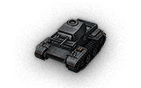<figcaption>Pz.Kpfw. II Ausf. J</figcaption></figure>
<em>Armor &amp; health</em> 
<strong>Health</strong> <small>EU</small> 465  <small>RU</small> <strong>470</strong> 
<strong>Track repair time (s)</strong> <small>EU</small> 12.03  <small>RU</small> <strong>4</strong> 

Pz.Kpfw. III Ausf. E · Tier III

pzkpfwiiiausfe

<a href="https://tanks.gg/v20410/tank/pz-iii-e">EU stats</a> · <a href="https://tanks.gg/v14600ru/tank/pz-iii-e">RU stats</a>
<figure style="display:inline-block">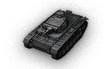<figcaption>EU · Pz.Kpfw. III Ausf. E</figcaption></figure><figure style="display:inline-block">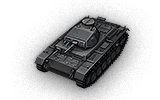<figcaption>RU · Pz.Kpfw. III Ausf. E</figcaption></figure>
<em>Gun handling</em> 
<strong>Aim time (s)</strong> <small>EU</small> 2.01  <small>RU</small> <strong>2.21</strong> 
<strong>Dispersion (m/100 m)</strong> <small>EU</small> 0.40  <small>RU</small> <strong>0.46</strong> 
<strong>Dispersion · damaged</strong> <small>EU</small> 0.81  <small>RU</small> <strong>0.92</strong> 
<strong>Dispersion · moving</strong> <small>EU</small> 0.26  <small>RU</small> <strong>0.29</strong> 
<strong>Dispersion · tank traverse</strong> <small>EU</small> 0.26  <small>RU</small> <strong>0.29</strong> 

<em>Mobility</em> 
<strong>Forward speed on soft terrain (km/h)</strong> <small>EU</small> 47.48  <small>RU</small> <strong>45.79</strong> 
<strong>Engine power (hp)</strong> <small>EU</small> 480  <small>RU</small> <strong>465.20</strong> 
<strong>Weight (kg)</strong> <small>EU</small> 16 730 → <small>RU</small> <strong>16 810</strong> 
<strong>Power/weight (hp/t)</strong> <small>EU</small> 28.69  <small>RU</small> <strong>27.67</strong> 
<strong>Tank traverse (°/s)</strong> <small>EU</small> 57.36  <small>RU</small> <strong>45.89</strong> 
<strong>Tank traverse on hard terrain (°/s)</strong> <small>EU</small> 61.19  <small>RU</small> <strong>50.83</strong> 
<strong>Tank traverse on medium terrain (°/s)</strong> <small>EU</small> 51.78  <small>RU</small> <strong>43.01</strong> 
<strong>Tank traverse on soft terrain (°/s)</strong> <small>EU</small> 29.26  <small>RU</small> <strong>24.31</strong> 

<em>Armor &amp; health</em> 
<strong>Health</strong> <small>EU</small> 430  <small>RU</small> <strong>460</strong> 
<strong>Track repair time (s)</strong> <small>EU</small> 10.03  <small>RU</small> <strong>4</strong> 

<em>Miscellaneous</em> 
<strong>View range (m)</strong> <small>EU</small> 330  <small>RU</small> <strong>320</strong> 
<strong>Radio range (m)</strong> <small>EU</small> 432.85  <small>RU</small> <strong>474.56</strong> 

Pz.Kpfw. IV Ausf. A · Tier III

pzkpfwivausfa

<a href="https://tanks.gg/v20410/tank/pz-iv-a">EU stats</a> · <a href="https://tanks.gg/v14600ru/tank/pz-iv-a">RU stats</a>
<figure style="display:inline-block">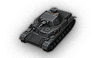<figcaption>Pz.Kpfw. IV Ausf. A</figcaption></figure>
<strong>Penetration (mm)</strong> <b>EU</b>  AP <strong>43</strong> /  HEAT <strong>87</strong> /  HE <strong>38</strong> → <b>RU</b>  AP <strong>83</strong> /  HEAT <strong>117</strong> /  HE <strong>38</strong>

<em>Gun handling</em> 
<strong>Aim time (s)</strong> <small>EU</small> 1.82  <small>RU</small> <strong>1.63</strong> 
<strong>Dispersion (m/100 m)</strong> <small>EU</small> 0.48  <small>RU</small> <strong>0.44</strong> 
<strong>Dispersion · damaged</strong> <small>EU</small> 0.96  <small>RU</small> <strong>0.88</strong> 
<strong>Dispersion · moving</strong> <small>EU</small> 0.29  <small>RU</small> <strong>0.24</strong> 
<strong>Dispersion · tank traverse</strong> <small>EU</small> 0.29  <small>RU</small> <strong>0.24</strong> 

<em>Armor &amp; health</em> 
<strong>Health</strong> <small>EU</small> 480  <small>RU</small> <strong>550</strong> 
<strong>Track repair time (s)</strong> <small>EU</small> 10.03  <small>RU</small> <strong>4</strong> 

Pz.Kpfw. M 15 · Tier III

pzkpfwm15

<a href="https://tanks.gg/v20410/tank/pz-m-15">EU stats</a> · <a href="https://tanks.gg/v14600ru/tank/pz-m-15">RU stats</a>
<figure style="display:inline-block">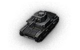<figcaption>EU · Pz.Kpfw. M 15</figcaption></figure><figure style="display:inline-block"><figcaption>RU · Pz.Kpfw. M 15</figcaption></figure>
<em>Firepower</em> 
<strong>DPM (HP/min)</strong> <small>EU</small> 1 043  <small>RU</small> <strong>1 192</strong> 
<strong>Rate of fire (rounds/min)</strong> <small>EU</small> 26.08  <small>RU</small> <strong>29.80</strong> 
<strong>Reload time (s)</strong> <small>EU</small> 2.30  <small>RU</small> <strong>2.01</strong> 

<em>Gun handling</em> 
<strong>Aim time (s)</strong> <small>EU</small> 2  <small>RU</small> <strong>1.60</strong> 
<strong>Dispersion · turret traverse</strong> <small>EU</small> 0.12  <small>RU</small> <strong>0.10</strong> 
<strong>Dispersion · firing</strong> <small>EU</small> 4  <small>RU</small> <strong>2</strong> 

<em>Armor &amp; health</em> 
<strong>Track repair time (s)</strong> <small>EU</small> 10.03  <small>RU</small> <strong>4</strong> 

Pz.Kpfw. S35 739 (f) · Tier III

pzkpfws35739f

<a href="https://tanks.gg/v20410/tank/pz-s35">EU stats</a> · <a href="https://tanks.gg/v14600ru/tank/pz-s35">RU stats</a>
<figure style="display:inline-block">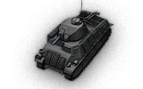<figcaption>Pz.Kpfw. S35 739 (f)</figcaption></figure>
<em>Armor &amp; health</em> 
<strong>Health</strong> <small>EU</small> 465  <small>RU</small> <strong>540</strong> 
<strong>Track repair time (s)</strong> <small>EU</small> 12.03  <small>RU</small> <strong>4</strong> 

Pz.Kpfw. T 15 · Tier III

pzkpfwt15

<a href="https://tanks.gg/v20410/tank/pz-t-15">EU stats</a> · <a href="https://tanks.gg/v14600ru/tank/pz-t-15">RU stats</a>
<figure style="display:inline-block">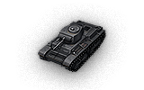<figcaption>Pz.Kpfw. T 15</figcaption></figure>
<em>Firepower</em> 
<strong>DPM (HP/min)</strong> <small>EU</small> 1 095.15  <small>RU</small> <strong>1 192</strong> 
<strong>Rate of fire (rounds/min)</strong> <small>EU</small> 27.38  <small>RU</small> <strong>29.80</strong> 
<strong>Reload time (s)</strong> <small>EU</small> 2.19  <small>RU</small> <strong>2.01</strong> 

<em>Gun handling</em> 
<strong>Aim time (s)</strong> <small>EU</small> 1.71  <small>RU</small> <strong>1.60</strong> 
<strong>Dispersion (m/100 m)</strong> <small>EU</small> 0.41  <small>RU</small> <strong>0.38</strong> 
<strong>Dispersion · damaged</strong> <small>EU</small> 0.82  <small>RU</small> <strong>0.76</strong> 
<strong>Dispersion · firing</strong> <small>EU</small> 4  <small>RU</small> <strong>1.40</strong> 

<em>Armor &amp; health</em> 
<strong>Health</strong> <small>EU</small> 465  <small>RU</small> <strong>470</strong> 
<strong>Track repair time (s)</strong> <small>EU</small> 10.03  <small>RU</small> <strong>4</strong> 

Sturmpanzer I Bison · Tier III

sturmpanzeribison

<a href="https://tanks.gg/v20410/tank/bison">EU stats</a> · <a href="https://tanks.gg/v14600ru/tank/bison">RU stats</a>
<figure style="display:inline-block">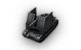<figcaption>Sturmpanzer I Bison</figcaption></figure>
<strong>Penetration (mm)</strong> <b>EU</b>  HE <strong>35</strong> /  HE <strong>44</strong> /  HEAT <strong>98</strong> → <b>RU</b>  HE <strong>38</strong> /  HEAT <strong>98</strong>

<strong>Damage (HP)</strong> <b>EU</b>  HE <strong>350</strong> /  HE <strong>450</strong> /  HEAT <strong>300</strong> → <b>RU</b>  HE <strong>500</strong> /  HEAT <strong>300</strong>

<em>Firepower</em> 
<strong>DPM (HP/min)</strong> <small>EU</small> 960.66  <small>RU</small> <strong>1 372.37</strong> 
<strong>Explosion radius</strong> <small>EU</small> 6.20  <small>RU</small> <strong>4.70</strong> 
<strong>Stun duration · maximum (s)</strong> <small>EU</small> 6.60 → <small>RU</small> <strong>—</strong> 
<strong>Stun duration · minimum (s)</strong> <small>EU</small> 3.96 → <small>RU</small> <strong>—</strong> 
<strong>Shell velocity (m/s)</strong> <small>EU</small> 275  <small>RU</small> <strong>294</strong> 
<strong>Max range (m)</strong> <small>EU</small> 605  <small>RU</small> <strong>1 329.78</strong> 
<strong>Potential damage</strong> <small>EU</small> 7 350  <small>RU</small> <strong>10 500</strong> 

<em>Armor &amp; health</em> 
<strong>Health</strong> <small>EU</small> 230  <small>RU</small> <strong>250</strong> 
<strong>Track repair time (s)</strong> <small>EU</small> 12.63  <small>RU</small> <strong>4</strong> 

<em>Miscellaneous</em> 
<strong>View range (m)</strong> <small>EU</small> 245  <small>RU</small> <strong>300</strong> 
<strong>Shell cost</strong> <small>EU</small> 280  <small>RU</small> <strong>310</strong> 

Wespe · Tier III

wespe

<a href="https://tanks.gg/v20410/tank/wespe">EU stats</a> · <a href="https://tanks.gg/v14600ru/tank/wespe">RU stats</a>
<figure style="display:inline-block">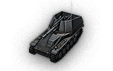<figcaption>Wespe</figcaption></figure>
<em>Armor &amp; health</em> 
<strong>Health</strong> <small>EU</small> 230  <small>RU</small> <strong>250</strong> 
<strong>Track repair time (s)</strong> <small>EU</small> 12.63  <small>RU</small> <strong>4</strong> 

<em>Miscellaneous</em> 
<strong>View range (m)</strong> <small>EU</small> 250  <small>RU</small> <strong>300</strong> 

