# Germany · Tier IV

[All nations and tiers](../buffs_nerfs.md) · EU v20410 → RU v14600ru · 3 November 2026

<label><strong>Find a tank</strong><input type="search" placeholder="Try is7, obj140 or xm57" aria-label="Find a tank" style="display:block;width:100%;padding:.7rem;border:1px solid #888;border-radius:4px;margin:.5rem 0;color:inherit;background:transparent"></label>

Durchbruchswagen 2 · Tier IV

durchbruchswagen2

<a href="https://tanks.gg/v20410/tank/dw-2">EU stats</a> · <a href="https://tanks.gg/v14600ru/tank/dw-2">RU stats</a>
<figure style="display:inline-block">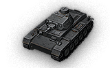<figcaption>Durchbruchswagen 2</figcaption></figure>
<em>Armor &amp; health</em> 
<strong>Health</strong> <small>EU</small> 670  <small>RU</small> <strong>730</strong> 
<strong>Track repair time (s)</strong> <small>EU</small> 12.03  <small>RU</small> <strong>5</strong> 

Jagdpanzer 38(t) Hetzer · Tier IV

jagdpanzer38thetzer

<a href="https://tanks.gg/v20410/tank/hetzer">EU stats</a> · <a href="https://tanks.gg/v14600ru/tank/hetzer">RU stats</a>
<figure style="display:inline-block">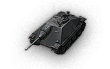<figcaption>Jagdpanzer 38(t) Hetzer</figcaption></figure>
<em>Firepower</em> 
<strong>DPM (HP/min)</strong> <small>EU</small> 2 235  <small>RU</small> <strong>2 546.86</strong> 
<strong>Rate of fire (rounds/min)</strong> <small>EU</small> 6.39  <small>RU</small> <strong>7.28</strong> 
<strong>Reload time (s)</strong> <small>EU</small> 9.40  <small>RU</small> <strong>8.25</strong> 

<em>Gun handling</em> 
<strong>Aim time (s)</strong> <small>EU</small> 2.21  <small>RU</small> <strong>1.63</strong> 

<em>Armor &amp; health</em> 
<strong>Health</strong> <small>EU</small> 415  <small>RU</small> <strong>550</strong> 
<strong>Track repair time (s)</strong> <small>EU</small> 10.03  <small>RU</small> <strong>5</strong> 

<em>Miscellaneous</em> 
<strong>View range (m)</strong> <small>EU</small> 260  <small>RU</small> <strong>300</strong> 

Marder 38T · Tier IV

marder38t

<a href="https://tanks.gg/v20410/tank/marder-38t">EU stats</a> · <a href="https://tanks.gg/v14600ru/tank/marder-38t">RU stats</a>
<figure style="display:inline-block">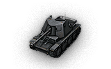<figcaption>Marder 38T</figcaption></figure>
<em>Gun handling</em> 
<strong>Dispersion · moving</strong> <small>EU</small> 0.28  <small>RU</small> <strong>0.25</strong> 
<strong>Dispersion · tank traverse</strong> <small>EU</small> 0.28  <small>RU</small> <strong>0.25</strong> 

<em>Armor &amp; health</em> 
<strong>Health</strong> <small>EU</small> 415  <small>RU</small> <strong>550</strong> 
<strong>Track repair time (s)</strong> <small>EU</small> 10.03  <small>RU</small> <strong>5</strong> 

Pz.Kpfw. 38 (t) n.A. · Tier IV

pzkpfw38tna

<a href="https://tanks.gg/v20410/tank/pz-38-na">EU stats</a> · <a href="https://tanks.gg/v14600ru/tank/pz-38-na">RU stats</a>
<figure style="display:inline-block">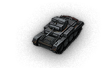<figcaption>Pz.Kpfw. 38 (t) n.A.</figcaption></figure>
<em>Armor &amp; health</em> 
<strong>Track repair time (s)</strong> <small>EU</small> 12.03  <small>RU</small> <strong>5</strong> 

Pz.Kpfw. B2 740 (f) · Tier IV

pzkpfwb2740f

<a href="https://tanks.gg/v20410/tank/pz-b2">EU stats</a> · <a href="https://tanks.gg/v14600ru/tank/pz-b2">RU stats</a>
<figure style="display:inline-block">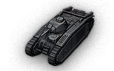<figcaption>Pz.Kpfw. B2 740 (f)</figcaption></figure>
<em>Firepower</em> 
<strong>DPM (HP/min)</strong> <small>EU</small> 1 436.84  <small>RU</small> <strong>1 437.79</strong> 
<strong>Rate of fire (rounds/min)</strong> <small>EU</small> 27.63  <small>RU</small> <strong>27.65</strong> 

<em>Gun handling</em> 
<strong>Aim time (s)</strong> <small>EU</small> 1.14  <small>RU</small> <strong>1.10</strong> 
<strong>Dispersion (m/100 m)</strong> <small>EU</small> 0.39  <small>RU</small> <strong>0.36</strong> 
<strong>Dispersion · damaged</strong> <small>EU</small> 0.78  <small>RU</small> <strong>0.72</strong> 
<strong>Dispersion · turret traverse</strong> <small>EU</small> 0.06  <small>RU</small> <strong>0.10</strong> 
<strong>Dispersion · firing</strong> <small>EU</small> 2.50  <small>RU</small> <strong>2</strong> 

<em>Armor &amp; health</em> 
<strong>Health</strong> <small>EU</small> 610  <small>RU</small> <strong>720</strong> 
<strong>Track repair time (s)</strong> <small>EU</small> 12.03  <small>RU</small> <strong>5</strong> 

Pz.Kpfw. II Luchs · Tier IV

pzkpfwiiluchs

<a href="https://tanks.gg/v20410/tank/luchs">EU stats</a> · <a href="https://tanks.gg/v14600ru/tank/luchs">RU stats</a>
<figure style="display:inline-block">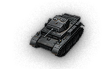<figcaption>Pz.Kpfw. II Luchs</figcaption></figure>
<em>Gun handling</em> 
<strong>Dispersion (m/100 m)</strong> <small>EU</small> 0.50  <small>RU</small> <strong>0.45</strong> 
<strong>Dispersion · damaged</strong> <small>EU</small> 1  <small>RU</small> <strong>0.90</strong> 
<strong>Dispersion · firing</strong> <small>EU</small> 3  <small>RU</small> <strong>1.60</strong> 

<em>Mobility</em> 
<strong>Forward speed on soft terrain (km/h)</strong> <small>EU</small> 51.23  <small>RU</small> <strong>48.74</strong> 
<strong>Engine power (hp)</strong> <small>EU</small> 400  <small>RU</small> <strong>380.62</strong> 
<strong>Power/weight (hp/t)</strong> <small>EU</small> 30.96  <small>RU</small> <strong>29.46</strong> 
<strong>Tank traverse on hard terrain (°/s)</strong> <small>EU</small> 34.13  <small>RU</small> <strong>60.08</strong> 
<strong>Tank traverse on medium terrain (°/s)</strong> <small>EU</small> 31.28  <small>RU</small> <strong>55.07</strong> 
<strong>Tank traverse on soft terrain (°/s)</strong> <small>EU</small> 16.32  <small>RU</small> <strong>28.73</strong> 

<em>Armor &amp; health</em> 
<strong>Health · engine</strong> <small>EU</small> 135  <small>RU</small> <strong>80</strong> 
<strong>Track repair time (s)</strong> <small>EU</small> 10.03  <small>RU</small> <strong>5</strong> 

Pz.Kpfw. III Ausf. J · Tier IV

pzkpfwiiiausfj

<a href="https://tanks.gg/v20410/tank/pz-iii-j">EU stats</a> · <a href="https://tanks.gg/v14600ru/tank/pz-iii-j">RU stats</a>
<figure style="display:inline-block">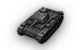<figcaption>EU · Pz.Kpfw. III Ausf. J</figcaption></figure><figure style="display:inline-block">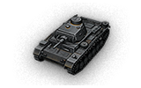<figcaption>RU · Pz.Kpfw. III Ausf. J</figcaption></figure>
<strong>Penetration (mm)</strong> <b>EU</b>  AP <strong>96</strong> /  APCR <strong>130</strong> /  HE <strong>25</strong> → <b>RU</b>  AP <strong>83</strong> /  HEAT <strong>117</strong> /  HE <strong>38</strong>

<strong>Damage (HP)</strong> <b>EU</b>  AP <strong>70</strong> /  APCR <strong>70</strong> /  HE <strong>90</strong> → <b>RU</b>  AP <strong>110</strong> /  HEAT <strong>110</strong> /  HE <strong>175</strong>

<em>Firepower</em> 
<strong>DPM (HP/min)</strong> <small>EU</small> 1 991.18  <small>RU</small> <strong>1 678.98</strong> 
<strong>Module damage</strong> <small>EU</small> 68  <small>RU</small> <strong>100</strong> 
<strong>Rate of fire (rounds/min)</strong> <small>EU</small> 28.45  <small>RU</small> <strong>15.26</strong> 
<strong>Reload time (s)</strong> <small>EU</small> 2.11  <small>RU</small> <strong>3.93</strong> 
<strong>Caliber</strong> <small>EU</small> 50  <small>RU</small> <strong>75</strong> 
<strong>Shell velocity (m/s)</strong> <small>EU</small> 835  <small>RU</small> <strong>385</strong> 
<strong>Ammo capacity</strong> <small>EU</small> 140  <small>RU</small> <strong>125</strong> 
<strong>Potential damage</strong> <small>EU</small> 9 800  <small>RU</small> <strong>13 750</strong> 

<em>Gun handling</em> 
<strong>Aim time (s)</strong> <small>EU</small> 2.01  <small>RU</small> <strong>1.92</strong> 
<strong>Dispersion (m/100 m)</strong> <small>EU</small> 0.35  <small>RU</small> <strong>0.40</strong> 
<strong>Dispersion · damaged</strong> <small>EU</small> 0.69  <small>RU</small> <strong>0.81</strong> 
<strong>Dispersion · turret traverse</strong> <small>EU</small> 0.12  <small>RU</small> <strong>0.10</strong> 
<strong>Dispersion · firing</strong> <small>EU</small> 3.50  <small>RU</small> <strong>2</strong> 

<em>Mobility</em> 
<strong>Forward speed on soft terrain (km/h)</strong> <small>EU</small> 57.64  <small>RU</small> <strong>52.36</strong> 
<strong>Engine power (hp)</strong> <small>EU</small> 510  <small>RU</small> <strong>465.20</strong> 
<strong>Weight (kg)</strong> <small>EU</small> 19 810 → <small>RU</small> <strong>19 890</strong> 
<strong>Power/weight (hp/t)</strong> <small>EU</small> 25.74  <small>RU</small> <strong>23.39</strong> 
<strong>Turret traverse (°/s)</strong> <small>EU</small> 45.89  <small>RU</small> <strong>47.98</strong> 
<strong>Tank traverse (°/s)</strong> <small>EU</small> 66.75  <small>RU</small> <strong>46.93</strong> 
<strong>Tank traverse on hard terrain (°/s)</strong> <small>EU</small> 68.78  <small>RU</small> <strong>55.80</strong> 
<strong>Tank traverse on medium terrain (°/s)</strong> <small>EU</small> 62.52  <small>RU</small> <strong>50.73</strong> 
<strong>Tank traverse on soft terrain (°/s)</strong> <small>EU</small> 40.46  <small>RU</small> <strong>32.82</strong> 

<em>Armor &amp; health</em> 
<strong>Health</strong> <small>EU</small> 570  <small>RU</small> <strong>640</strong> 
<strong>Health · engine</strong> <small>EU</small> 135  <small>RU</small> <strong>86</strong> 
<strong>Track repair time (s)</strong> <small>EU</small> 10.03  <small>RU</small> <strong>5</strong> 

<em>Miscellaneous</em> 
<strong>Stationary camo · after firing</strong> <small>EU</small> 4.51  <small>RU</small> <strong>4.25</strong> 
<strong>Moving camo · after firing</strong> <small>EU</small> 3.39  <small>RU</small> <strong>3.19</strong> 
<strong>View range (m)</strong> <small>EU</small> 340  <small>RU</small> <strong>330</strong> 

Pz.Kpfw. IV Ausf. D · Tier IV

pzkpfwivausfd

<a href="https://tanks.gg/v20410/tank/pz-iv-d">EU stats</a> · <a href="https://tanks.gg/v14600ru/tank/pz-iv-d">RU stats</a>
<figure style="display:inline-block">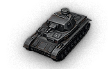<figcaption>Pz.Kpfw. IV Ausf. D</figcaption></figure>
<em>Gun handling</em> 
<strong>Aim time (s)</strong> <small>EU</small> 2.40  <small>RU</small> <strong>1.82</strong> 
<strong>Dispersion (m/100 m)</strong> <small>EU</small> 0.38  <small>RU</small> <strong>0.36</strong> 
<strong>Dispersion · damaged</strong> <small>EU</small> 0.77  <small>RU</small> <strong>0.73</strong> 
<strong>Dispersion · moving</strong> <small>EU</small> 0.29  <small>RU</small> <strong>0.20</strong> 
<strong>Dispersion · tank traverse</strong> <small>EU</small> 0.29  <small>RU</small> <strong>0.20</strong> 

<em>Armor &amp; health</em> 
<strong>Health</strong> <small>EU</small> 540  <small>RU</small> <strong>630</strong> 
<strong>Track repair time (s)</strong> <small>EU</small> 10.03  <small>RU</small> <strong>5</strong> 

Pz.Sfl. IC · Tier IV

pzsflic

<a href="https://tanks.gg/v20410/tank/pzsfl-ic">EU stats</a> · <a href="https://tanks.gg/v14600ru/tank/pzsfl-ic">RU stats</a>
<figure style="display:inline-block">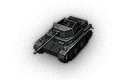<figcaption>Pz.Sfl. IC</figcaption></figure>
<em>Firepower</em> 
<strong>DPM (HP/min)</strong> <small>EU</small> 927.31  <small>RU</small> <strong>1 079.67</strong> 
<strong>Rate of fire (rounds/min)</strong> <small>EU</small> 13.25  <small>RU</small> <strong>15.42</strong> 
<strong>Reload time (s)</strong> <small>EU</small> 9.59  <small>RU</small> <strong>7.67</strong> 

<em>Gun handling</em> 
<strong>Aim time (s)</strong> <small>EU</small> 2  <small>RU</small> <strong>1.80</strong> 
<strong>Dispersion · moving</strong> <small>EU</small> 0.28  <small>RU</small> <strong>0.22</strong> 
<strong>Dispersion · tank traverse</strong> <small>EU</small> 0.28  <small>RU</small> <strong>0.22</strong> 
<strong>Dispersion · firing</strong> <small>EU</small> 3  <small>RU</small> <strong>2</strong> 

<em>Mobility</em> 
<strong>Turret traverse (°/s)</strong> <small>EU</small> 28  <small>RU</small> <strong>34</strong> 

<em>Armor &amp; health</em> 
<strong>Health</strong> <small>EU</small> 415  <small>RU</small> <strong>550</strong> 
<strong>Track repair time (s)</strong> <small>EU</small> 10.03  <small>RU</small> <strong>5</strong> 

Pz.Sfl. IVb · Tier IV

pzsflivb

<a href="https://tanks.gg/v20410/tank/pzsfl-ivb">EU stats</a> · <a href="https://tanks.gg/v14600ru/tank/pzsfl-ivb">RU stats</a>
<figure style="display:inline-block">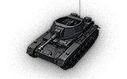<figcaption>Pz.Sfl. IVb</figcaption></figure>
<em>Armor &amp; health</em> 
<strong>Health</strong> <small>EU</small> 305  <small>RU</small> <strong>320</strong> 
<strong>Track repair time (s)</strong> <small>EU</small> 12.96  <small>RU</small> <strong>5</strong> 

<em>Miscellaneous</em> 
<strong>View range (m)</strong> <small>EU</small> 255  <small>RU</small> <strong>300</strong> 

StuG III Ausf. B · Tier IV

stugiiiausfb

<a href="https://tanks.gg/v20410/tank/stug-iii-b">EU stats</a> · <a href="https://tanks.gg/v14600ru/tank/stug-iii-b">RU stats</a>
<figure style="display:inline-block">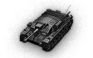<figcaption>EU · StuG III Ausf. B</figcaption></figure><figure style="display:inline-block">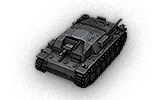<figcaption>RU · StuG III Ausf. B</figcaption></figure>
<strong>Penetration (mm)</strong> <b>EU</b>  HEAT <strong>92</strong> /  HEAT <strong>104</strong> /  HE <strong>53</strong> → <b>RU</b>  AP <strong>64</strong> /  HEAT <strong>104</strong> /  HE <strong>53</strong>

<strong>Damage (HP)</strong> <b>EU</b>  HEAT <strong>350</strong> /  HEAT <strong>350</strong> /  HE <strong>410</strong> → <b>RU</b>  AP <strong>350</strong> /  HEAT <strong>350</strong> /  HE <strong>410</strong>

<em>Firepower</em> 
<strong>Shell velocity (m/s)</strong> <small>EU</small> 376  <small>RU</small> <strong>470</strong> 
<strong>Normalization</strong> <small>EU</small> 0  <small>RU</small> <strong>5</strong> 
<strong>Ricochet angle</strong> <small>EU</small> 85  <small>RU</small> <strong>70</strong> 
<strong>Spaced armor pen loss</strong> <small>EU</small> 0.50  <small>RU</small> <strong>0</strong> 

<em>Mobility</em> 
<strong>Forward speed on soft terrain (km/h)</strong> <small>EU</small> 31.31  <small>RU</small> <strong>30.34</strong> 
<strong>Reverse speed (km/h)</strong> <small>EU</small> 14  <small>RU</small> <strong>10</strong> 
<strong>Engine power (hp)</strong> <small>EU</small> 480  <small>RU</small> <strong>465.20</strong> 
<strong>Power/weight (hp/t)</strong> <small>EU</small> 20.57  <small>RU</small> <strong>19.93</strong> 
<strong>Tank traverse on hard terrain (°/s)</strong> <small>EU</small> 44.01  <small>RU</small> <strong>48.41</strong> 
<strong>Tank traverse on medium terrain (°/s)</strong> <small>EU</small> 32.27  <small>RU</small> <strong>35.50</strong> 
<strong>Tank traverse on soft terrain (°/s)</strong> <small>EU</small> 19.36  <small>RU</small> <strong>21.30</strong> 

<em>Armor &amp; health</em> 
<strong>Health</strong> <small>EU</small> 400  <small>RU</small> <strong>550</strong> 
<strong>Health · engine</strong> <small>EU</small> 135  <small>RU</small> <strong>86</strong> 
<strong>Health · track</strong> <small>EU</small> 95  <small>RU</small> <strong>100</strong> 
<strong>Track repair time (s)</strong> <small>EU</small> 11.82  <small>RU</small> <strong>5</strong> 

<em>Miscellaneous</em> 
<strong>Shell cost</strong> <small>EU</small> 190  <small>RU</small> <strong>120</strong> 

Sturmpanzer II · Tier IV

sturmpanzerii

<a href="https://tanks.gg/v20410/tank/stpz-ii">EU stats</a> · <a href="https://tanks.gg/v14600ru/tank/stpz-ii">RU stats</a>
<figure style="display:inline-block">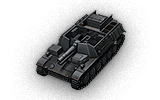<figcaption>Sturmpanzer II</figcaption></figure>
<strong>Penetration (mm)</strong> <b>EU</b>  HE <strong>35</strong> /  HE <strong>44</strong> /  HEAT <strong>98</strong> → <b>RU</b>  HE <strong>38</strong> /  HEAT <strong>98</strong>

<strong>Damage (HP)</strong> <b>EU</b>  HE <strong>350</strong> /  HE <strong>450</strong> /  HEAT <strong>300</strong> → <b>RU</b>  HE <strong>500</strong> /  HEAT <strong>300</strong>

<em>Firepower</em> 
<strong>DPM (HP/min)</strong> <small>EU</small> 1 258.79  <small>RU</small> <strong>1 798.28</strong> 
<strong>Explosion radius</strong> <small>EU</small> 6.20  <small>RU</small> <strong>4.70</strong> 
<strong>Stun duration · maximum (s)</strong> <small>EU</small> 6.60 → <small>RU</small> <strong>—</strong> 
<strong>Stun duration · minimum (s)</strong> <small>EU</small> 3.96 → <small>RU</small> <strong>—</strong> 
<strong>Shell velocity (m/s)</strong> <small>EU</small> 275  <small>RU</small> <strong>294</strong> 
<strong>Max range (m)</strong> <small>EU</small> 605  <small>RU</small> <strong>1 329.78</strong> 
<strong>Potential damage</strong> <small>EU</small> 19 250  <small>RU</small> <strong>27 500</strong> 

<em>Gun handling</em> 
<strong>Aim time (s)</strong> <small>EU</small> 6.23  <small>RU</small> <strong>5.94</strong> 
<strong>Dispersion (m/100 m)</strong> <small>EU</small> 0.81  <small>RU</small> <strong>0.77</strong> 
<strong>Dispersion · damaged</strong> <small>EU</small> 1.61  <small>RU</small> <strong>1.53</strong> 

<em>Armor &amp; health</em> 
<strong>Health</strong> <small>EU</small> 290  <small>RU</small> <strong>300</strong> 
<strong>Track repair time (s)</strong> <small>EU</small> 13.40  <small>RU</small> <strong>5</strong> 

<em>Miscellaneous</em> 
<strong>View range (m)</strong> <small>EU</small> 255  <small>RU</small> <strong>300</strong> 
<strong>Shell cost</strong> <small>EU</small> 280  <small>RU</small> <strong>310</strong> 

VK 20.01 (D) · Tier IV

vk2001d

<a href="https://tanks.gg/v20410/tank/vk-2001-d">EU stats</a> · <a href="https://tanks.gg/v14600ru/tank/vk-2001-d">RU stats</a>
<figure style="display:inline-block">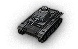<figcaption>VK 20.01 (D)</figcaption></figure>
<strong>Penetration (mm)</strong> <b>EU</b>  AP <strong>43</strong> /  HEAT <strong>87</strong> /  HE <strong>38</strong> → <b>RU</b>  AP <strong>83</strong> /  HEAT <strong>117</strong> /  HE <strong>38</strong>

<em>Firepower</em> 
<strong>DPM (HP/min)</strong> <small>EU</small> 1 600.88  <small>RU</small> <strong>1 678.98</strong> 
<strong>Rate of fire (rounds/min)</strong> <small>EU</small> 14.55  <small>RU</small> <strong>15.26</strong> 
<strong>Reload time (s)</strong> <small>EU</small> 4.12  <small>RU</small> <strong>3.93</strong> 

<em>Gun handling</em> 
<strong>Aim time (s)</strong> <small>EU</small> 2.21  <small>RU</small> <strong>2.01</strong> 
<strong>Dispersion (m/100 m)</strong> <small>EU</small> 0.53  <small>RU</small> <strong>0.40</strong> 
<strong>Dispersion · damaged</strong> <small>EU</small> 1.05  <small>RU</small> <strong>0.81</strong> 
<strong>Dispersion · turret traverse</strong> <small>EU</small> 0.16  <small>RU</small> <strong>0.12</strong> 

<em>Armor &amp; health</em> 
<strong>Health</strong> <small>EU</small> 540  <small>RU</small> <strong>640</strong> 
<strong>Track repair time (s)</strong> <small>EU</small> 10.03  <small>RU</small> <strong>5</strong> 

