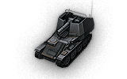
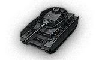
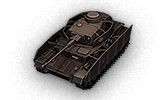
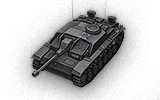
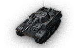
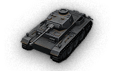
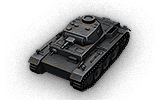

# Germany · Tier V

[All nations and tiers](../buffs_nerfs.md) · EU v20410 → RU v14600ru · 3 November 2026

<label><strong>Find a tank</strong><input type="search" placeholder="Try is7, obj140 or xm57" aria-label="Find a tank" style="display:block;width:100%;padding:.7rem;border:1px solid #888;border-radius:4px;margin:.5rem 0;color:inherit;background:transparent"></label>

Grille · Tier V

grille

<a href="https://tanks.gg/v20410/tank/grille">EU stats</a> · <a href="https://tanks.gg/v14600ru/tank/grille">RU stats</a>
<figure style="display:inline-block"><figcaption>Grille</figcaption></figure>
<strong>Penetration (mm)</strong> <b>EU</b>  HE <strong>38</strong> /  HE <strong>48</strong> /  HEAT <strong>154</strong> → <b>RU</b>  HE <strong>38</strong> /  HEAT <strong>154</strong>

<strong>Damage (HP)</strong> <b>EU</b>  HE <strong>480</strong> /  HE <strong>580</strong> /  HEAT <strong>340</strong> → <b>RU</b>  HE <strong>600</strong> /  HEAT <strong>350</strong>

<em>Firepower</em> 
<strong>DPM (HP/min)</strong> <small>EU</small> 1 278.23  <small>RU</small> <strong>1 788</strong> 
<strong>Rate of fire (rounds/min)</strong> <small>EU</small> 2.66  <small>RU</small> <strong>2.98</strong> 
<strong>Reload time (s)</strong> <small>EU</small> 22.53  <small>RU</small> <strong>20.13</strong> 
<strong>Explosion radius</strong> <small>EU</small> 6.70  <small>RU</small> <strong>5.20</strong> 
<strong>Stun duration · maximum (s)</strong> <small>EU</small> 10.50 → <small>RU</small> <strong>—</strong> 
<strong>Stun duration · minimum (s)</strong> <small>EU</small> 6.30 → <small>RU</small> <strong>—</strong> 
<strong>Shell velocity (m/s)</strong> <small>EU</small> 355  <small>RU</small> <strong>380</strong> 
<strong>Max range (m)</strong> <small>EU</small> 840.17  <small>RU</small> <strong>1 337.04</strong> 
<strong>Potential damage</strong> <small>EU</small> 17 280  <small>RU</small> <strong>21 600</strong> 

<em>Mobility</em> 
<strong>Tank traverse on hard terrain (°/s)</strong> <small>EU</small> 26.43  <small>RU</small> <strong>26.18</strong> 
<strong>Tank traverse on medium terrain (°/s)</strong> <small>EU</small> 22.65  <small>RU</small> <strong>22.44</strong> 
<strong>Tank traverse on soft terrain (°/s)</strong> <small>EU</small> 13.79  <small>RU</small> <strong>13.66</strong> 

<em>Armor &amp; health</em> 
<strong>Health · engine</strong> <small>EU</small> 170  <small>RU</small> <strong>40</strong> 
<strong>Health · ammo rack</strong> <small>EU</small> 150  <small>RU</small> <strong>80</strong> 

<em>Miscellaneous</em> 
<strong>Shell cost</strong> <small>EU</small> 505  <small>RU</small> <strong>595</strong> 

Pz.Kpfw. IV Ausf. H · Tier V

pzkpfwivausfh

<a href="https://tanks.gg/v20410/tank/pz-iv-h">EU stats</a> · <a href="https://tanks.gg/v14600ru/tank/pz-iv-h">RU stats</a>
<figure style="display:inline-block"><figcaption>Pz.Kpfw. IV Ausf. H</figcaption></figure>
<em>Mobility</em> 
<strong>Forward speed on soft terrain (km/h)</strong> <small>EU</small> 29.64  <small>RU</small> <strong>28.73</strong> 
<strong>Engine power (hp)</strong> <small>EU</small> 480  <small>RU</small> <strong>465.20</strong> 
<strong>Power/weight (hp/t)</strong> <small>EU</small> 18.69  <small>RU</small> <strong>18.12</strong> 
<strong>Tank traverse (°/s)</strong> <small>EU</small> 44.85  <small>RU</small> <strong>33.38</strong> 
<strong>Tank traverse on hard terrain (°/s)</strong> <small>EU</small> 46.01  <small>RU</small> <strong>40.06</strong> 
<strong>Tank traverse on medium terrain (°/s)</strong> <small>EU</small> 41.83  <small>RU</small> <strong>36.42</strong> 
<strong>Tank traverse on soft terrain (°/s)</strong> <small>EU</small> 19.17  <small>RU</small> <strong>16.69</strong> 

<em>Armor &amp; health</em> 
<strong>Health</strong> <small>EU</small> 700  <small>RU</small> <strong>630</strong> 
<strong>Health · engine</strong> <small>EU</small> 170  <small>RU</small> <strong>86</strong> 

Pz.Kpfw. IV Ausf. H Ankou · Tier V

pzkpfwivausfhankou

<a href="https://tanks.gg/v20410/tank/pz-iv-h-ankou">EU stats</a> · <a href="https://tanks.gg/v14600ru/tank/pz-iv-h-ankou">RU stats</a>
<figure style="display:inline-block"><figcaption>Pz.Kpfw. IV Ausf. H Ankou</figcaption></figure>
<em>Firepower</em> 
<strong>DPM (HP/min)</strong> <small>EU</small> 1 912.17  <small>RU</small> <strong>1 720.95</strong> 
<strong>Rate of fire (rounds/min)</strong> <small>EU</small> 17.38  <small>RU</small> <strong>15.65</strong> 
<strong>Reload time (s)</strong> <small>EU</small> 3.45  <small>RU</small> <strong>3.84</strong> 

<em>Gun handling</em> 
<strong>Aim time (s)</strong> <small>EU</small> 2.01  <small>RU</small> <strong>2.21</strong> 
<strong>Dispersion (m/100 m)</strong> <small>EU</small> 0.35  <small>RU</small> <strong>0.37</strong> 
<strong>Dispersion · damaged</strong> <small>EU</small> 0.71  <small>RU</small> <strong>0.75</strong> 
<strong>Dispersion · firing</strong> <small>EU</small> 3  <small>RU</small> <strong>4</strong> 

<em>Mobility</em> 
<strong>Forward speed on soft terrain (km/h)</strong> <small>EU</small> 30.45  <small>RU</small> <strong>29.51</strong> 
<strong>Engine power (hp)</strong> <small>EU</small> 480  <small>RU</small> <strong>465.20</strong> 
<strong>Power/weight (hp/t)</strong> <small>EU</small> 19.20  <small>RU</small> <strong>18.61</strong> 
<strong>Tank traverse (°/s)</strong> <small>EU</small> 44.85  <small>RU</small> <strong>33.38</strong> 
<strong>Tank traverse on hard terrain (°/s)</strong> <small>EU</small> 44.85  <small>RU</small> <strong>33.38</strong> 
<strong>Tank traverse on medium terrain (°/s)</strong> <small>EU</small> 40.77  <small>RU</small> <strong>30.34</strong> 
<strong>Tank traverse on soft terrain (°/s)</strong> <small>EU</small> 18.69  <small>RU</small> <strong>13.91</strong> 

<em>Armor &amp; health</em> 
<strong>Health</strong> <small>EU</small> 700  <small>RU</small> <strong>630</strong> 
<strong>Health · engine</strong> <small>EU</small> 170  <small>RU</small> <strong>86</strong> 

StuG III Ausf. G · Tier V

stugiiiausfg

<a href="https://tanks.gg/v20410/tank/stug-iii-g">EU stats</a> · <a href="https://tanks.gg/v14600ru/tank/stug-iii-g">RU stats</a>
<figure style="display:inline-block"><figcaption>StuG III Ausf. G</figcaption></figure>
<em>Gun handling</em> 
<strong>Dispersion · moving</strong> <small>EU</small> 0.20  <small>RU</small> <strong>0.21</strong> 
<strong>Dispersion · tank traverse</strong> <small>EU</small> 0.20  <small>RU</small> <strong>0.21</strong> 

<em>Mobility</em> 
<strong>Forward speed on soft terrain (km/h)</strong> <small>EU</small> 33.71  <small>RU</small> <strong>32.67</strong> 
<strong>Reverse speed (km/h)</strong> <small>EU</small> 14  <small>RU</small> <strong>10</strong> 
<strong>Engine power (hp)</strong> <small>EU</small> 480  <small>RU</small> <strong>465.20</strong> 
<strong>Power/weight (hp/t)</strong> <small>EU</small> 20.37  <small>RU</small> <strong>19.75</strong> 
<strong>Tank traverse on hard terrain (°/s)</strong> <small>EU</small> 51.60  <small>RU</small> <strong>61.63</strong> 
<strong>Tank traverse on medium terrain (°/s)</strong> <small>EU</small> 40.54  <small>RU</small> <strong>48.43</strong> 
<strong>Tank traverse on soft terrain (°/s)</strong> <small>EU</small> 24.68  <small>RU</small> <strong>29.48</strong> 

<em>Armor &amp; health</em> 
<strong>Health</strong> <small>EU</small> 500  <small>RU</small> <strong>460</strong> 
<strong>Health · engine</strong> <small>EU</small> 170  <small>RU</small> <strong>86</strong> 
<strong>Health · track</strong> <small>EU</small> 115  <small>RU</small> <strong>100</strong> 
<strong>Track repair time (s)</strong> <small>EU</small> 11.80  <small>RU</small> <strong>12.03</strong> 

VK 16.02 Leopard · Tier V

vk1602leopard

<a href="https://tanks.gg/v20410/tank/leopard">EU stats</a> · <a href="https://tanks.gg/v14600ru/tank/leopard">RU stats</a>
<figure style="display:inline-block"><figcaption>VK 16.02 Leopard</figcaption></figure>
<strong>Penetration (mm)</strong> <b>EU</b>  AP <strong>116</strong> /  APCR <strong>140</strong> /  HE <strong>25</strong> → <b>RU</b>  AP <strong>100</strong> /  APCR <strong>130</strong> /  HE <strong>25</strong>

<em>Firepower</em> 
<strong>DPM (HP/min)</strong> <small>EU</small> 2 086  <small>RU</small> <strong>1 904.61</strong> 
<strong>Rate of fire (rounds/min)</strong> <small>EU</small> 29.80  <small>RU</small> <strong>27.21</strong> 
<strong>Reload time (s)</strong> <small>EU</small> 2.01  <small>RU</small> <strong>2.21</strong> 

<em>Gun handling</em> 
<strong>Aim time (s)</strong> <small>EU</small> 1.50  <small>RU</small> <strong>1.70</strong> 
<strong>Dispersion (m/100 m)</strong> <small>EU</small> 0.35  <small>RU</small> <strong>0.39</strong> 
<strong>Dispersion · damaged</strong> <small>EU</small> 0.70  <small>RU</small> <strong>0.78</strong> 

<em>Mobility</em> 
<strong>Tank traverse on hard terrain (°/s)</strong> <small>EU</small> 38.12  <small>RU</small> <strong>41.24</strong> 
<strong>Tank traverse on medium terrain (°/s)</strong> <small>EU</small> 34.65  <small>RU</small> <strong>37.49</strong> 
<strong>Tank traverse on soft terrain (°/s)</strong> <small>EU</small> 18.15  <small>RU</small> <strong>19.64</strong> 

<em>Armor &amp; health</em> 
<strong>Health</strong> <small>EU</small> 650  <small>RU</small> <strong>580</strong> 
<strong>Health · engine</strong> <small>EU</small> 170  <small>RU</small> <strong>86</strong> 

VK 30.01 (H) · Tier V

vk3001h

<a href="https://tanks.gg/v20410/tank/vk-3001-h">EU stats</a> · <a href="https://tanks.gg/v14600ru/tank/vk-3001-h">RU stats</a>
<figure style="display:inline-block"><figcaption>EU · VK 30.01 (H)</figcaption></figure><figure style="display:inline-block"><figcaption>RU · VK 30.01 (H)</figcaption></figure>
<strong>Penetration (mm)</strong> <b>EU</b>  AP <strong>142</strong> /  APCR <strong>189</strong> /  HE <strong>38</strong> → <b>RU</b>  AP <strong>157</strong> /  APCR <strong>221</strong>

<strong>Damage (HP)</strong> <b>EU</b>  AP <strong>135</strong> /  APCR <strong>135</strong> /  HE <strong>175</strong> → <b>RU</b>  AP <strong>135</strong> /  APCR <strong>135</strong>

<em>Gun handling</em> 
<strong>Aim time (s)</strong> <small>EU</small> 2.21  <small>RU</small> <strong>2.40</strong> 
<strong>Dispersion · turret traverse</strong> <small>EU</small> 0.12  <small>RU</small> <strong>0.20</strong> 

<em>Mobility</em> 
<strong>Forward speed (km/h)</strong> <small>EU</small> 45  <small>RU</small> <strong>40</strong> 
<strong>Forward speed on hard terrain (km/h)</strong> <small>EU</small> 45  <small>RU</small> <strong>40</strong> 
<strong>Forward speed on medium terrain (km/h)</strong> <small>EU</small> 45  <small>RU</small> <strong>36.43</strong> 
<strong>Forward speed on soft terrain (km/h)</strong> <small>EU</small> 22.74  <small>RU</small> <strong>17.49</strong> 
<strong>Engine power (hp)</strong> <small>EU</small> 550  <small>RU</small> <strong>422.91</strong> 
<strong>Power/weight (hp/t)</strong> <small>EU</small> 14.94  <small>RU</small> <strong>11.49</strong> 
<strong>Turret traverse (°/s)</strong> <small>EU</small> 39.63  <small>RU</small> <strong>29.20</strong> 
<strong>Tank traverse (°/s)</strong> <small>EU</small> 33.38  <small>RU</small> <strong>31.29</strong> 
<strong>Tank traverse on hard terrain (°/s)</strong> <small>EU</small> 31.27  <small>RU</small> <strong>34.45</strong> 
<strong>Tank traverse on medium terrain (°/s)</strong> <small>EU</small> 26.06  <small>RU</small> <strong>28.70</strong> 
<strong>Tank traverse on soft terrain (°/s)</strong> <small>EU</small> 12.51  <small>RU</small> <strong>13.78</strong> 

