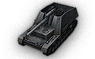
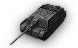
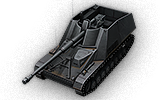
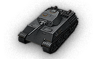
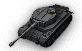
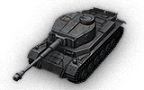
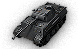
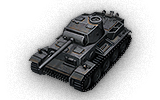

# Germany · Tier VI

[All nations and tiers](../buffs_nerfs.md) · EU v20410 → RU v14600ru · 3 November 2026

<label><strong>Find a tank</strong><input type="search" placeholder="Try is7, obj140 or xm57" aria-label="Find a tank" style="display:block;width:100%;padding:.7rem;border:1px solid #888;border-radius:4px;margin:.5rem 0;color:inherit;background:transparent"></label>

Hummel · Tier VI

hummel

<a href="https://tanks.gg/v20410/tank/hummel">EU stats</a> · <a href="https://tanks.gg/v14600ru/tank/hummel">RU stats</a>
<figure style="display:inline-block"><figcaption>Hummel</figcaption></figure>
<strong>Penetration (mm)</strong> <b>EU</b>  HE <strong>39</strong> /  HE <strong>49</strong> /  HEAT <strong>188</strong> → <b>RU</b>  HE <strong>38</strong> /  HEAT <strong>188</strong>

<strong>Damage (HP)</strong> <b>EU</b>  HE <strong>600</strong> /  HE <strong>730</strong> /  HEAT <strong>400</strong> → <b>RU</b>  HE <strong>750</strong> /  HEAT <strong>450</strong>

<em>Firepower</em> 
<strong>DPM (HP/min)</strong> <small>EU</small> 1 207.33  <small>RU</small> <strong>1 618.45</strong> 
<strong>Rate of fire (rounds/min)</strong> <small>EU</small> 2.01  <small>RU</small> <strong>2.16</strong> 
<strong>Reload time (s)</strong> <small>EU</small> 29.82  <small>RU</small> <strong>27.80</strong> 
<strong>Explosion radius</strong> <small>EU</small> 6.70  <small>RU</small> <strong>5.60</strong> 
<strong>Stun duration · maximum (s)</strong> <small>EU</small> 16 → <small>RU</small> <strong>—</strong> 
<strong>Stun duration · minimum (s)</strong> <small>EU</small> 9.60 → <small>RU</small> <strong>—</strong> 
<strong>Shell velocity (m/s)</strong> <small>EU</small> 420  <small>RU</small> <strong>435</strong> 
<strong>Max range (m)</strong> <small>EU</small> 1 253.10  <small>RU</small> <strong>1 325.27</strong> 
<strong>Potential damage</strong> <small>EU</small> 10 800  <small>RU</small> <strong>13 500</strong> 

<em>Mobility</em> 
<strong>Tank traverse on hard terrain (°/s)</strong> <small>EU</small> 27.57  <small>RU</small> <strong>29.77</strong> 
<strong>Tank traverse on medium terrain (°/s)</strong> <small>EU</small> 23.63  <small>RU</small> <strong>25.52</strong> 
<strong>Tank traverse on soft terrain (°/s)</strong> <small>EU</small> 14.39  <small>RU</small> <strong>15.53</strong> 

<em>Armor &amp; health</em> 
<strong>Health · engine</strong> <small>EU</small> 205  <small>RU</small> <strong>86</strong> 
<strong>Health · ammo rack</strong> <small>EU</small> 170  <small>RU</small> <strong>90</strong> 

<em>Miscellaneous</em> 
<strong>Shell cost</strong> <small>EU</small> 980  <small>RU</small> <strong>1 170</strong> 

Jagdpanzer IV · Tier VI

jagdpanzeriv

<a href="https://tanks.gg/v20410/tank/jgpz-iv">EU stats</a> · <a href="https://tanks.gg/v14600ru/tank/jgpz-iv">RU stats</a>
<figure style="display:inline-block"><figcaption>Jagdpanzer IV</figcaption></figure>
<strong>Penetration (mm)</strong> <b>EU</b>  AP <strong>160</strong> /  APCR <strong>198</strong> /  HE <strong>44</strong> → <b>RU</b>  AP <strong>145</strong> /  APCR <strong>194</strong> /  HE <strong>44</strong>

<em>Firepower</em> 
<strong>Shell velocity (m/s)</strong> <small>EU</small> 890  <small>RU</small> <strong>773</strong> 

<em>Mobility</em> 
<strong>Forward speed on soft terrain (km/h)</strong> <small>EU</small> 32.09  <small>RU</small> <strong>31.10</strong> 
<strong>Reverse speed (km/h)</strong> <small>EU</small> 14  <small>RU</small> <strong>12</strong> 
<strong>Engine power (hp)</strong> <small>EU</small> 480  <small>RU</small> <strong>465.20</strong> 
<strong>Power/weight (hp/t)</strong> <small>EU</small> 19.39  <small>RU</small> <strong>18.79</strong> 
<strong>Tank traverse (°/s)</strong> <small>EU</small> 54.24  <small>RU</small> <strong>36.50</strong> 
<strong>Tank traverse on hard terrain (°/s)</strong> <small>EU</small> 58.15  <small>RU</small> <strong>46.51</strong> 
<strong>Tank traverse on medium terrain (°/s)</strong> <small>EU</small> 49.20  <small>RU</small> <strong>39.35</strong> 
<strong>Tank traverse on soft terrain (°/s)</strong> <small>EU</small> 27.81  <small>RU</small> <strong>22.24</strong> 

<em>Armor &amp; health</em> 
<strong>Health · engine</strong> <small>EU</small> 205  <small>RU</small> <strong>86</strong> 
<strong>Health · track</strong> <small>EU</small> 145  <small>RU</small> <strong>120</strong> 
<strong>Track repair time (s)</strong> <small>EU</small> 11.62  <small>RU</small> <strong>12.03</strong> 

Nashorn · Tier VI

nashorn

<a href="https://tanks.gg/v20410/tank/nashorn">EU stats</a> · <a href="https://tanks.gg/v14600ru/tank/nashorn">RU stats</a>
<figure style="display:inline-block"><figcaption>Nashorn</figcaption></figure>
<em>Gun handling</em> 
<strong>Depression (°)</strong> <small>EU</small> 5  <small>RU</small> <strong>8</strong> 

<em>Mobility</em> 
<strong>Forward speed on soft terrain (km/h)</strong> <small>EU</small> 27.71  <small>RU</small> <strong>22.83</strong> 
<strong>Engine power (hp)</strong> <small>EU</small> 385  <small>RU</small> <strong>317.18</strong> 
<strong>Power/weight (hp/t)</strong> <small>EU</small> 16.02  <small>RU</small> <strong>13.20</strong> 
<strong>Tank traverse (°/s)</strong> <small>EU</small> 46.93  <small>RU</small> <strong>37.55</strong> 
<strong>Tank traverse on hard terrain (°/s)</strong> <small>EU</small> 49.41  <small>RU</small> <strong>41.20</strong> 
<strong>Tank traverse on medium terrain (°/s)</strong> <small>EU</small> 41.18  <small>RU</small> <strong>34.33</strong> 
<strong>Tank traverse on soft terrain (°/s)</strong> <small>EU</small> 22.46  <small>RU</small> <strong>18.73</strong> 

<em>Armor &amp; health</em> 
<strong>Health · engine</strong> <small>EU</small> 205  <small>RU</small> <strong>86</strong> 

VK 28.01 · Tier VI

vk2801

<a href="https://tanks.gg/v20410/tank/vk-2801">EU stats</a> · <a href="https://tanks.gg/v14600ru/tank/vk-2801">RU stats</a>
<figure style="display:inline-block"><figcaption>VK 28.01</figcaption></figure>
<em>Mobility</em> 
<strong>Tank traverse (°/s)</strong> <small>EU</small> 60.49  <small>RU</small> <strong>47.98</strong> 
<strong>Tank traverse on hard terrain (°/s)</strong> <small>EU</small> 66.66  <small>RU</small> <strong>52.70</strong> 
<strong>Tank traverse on medium terrain (°/s)</strong> <small>EU</small> 58.33  <small>RU</small> <strong>46.11</strong> 
<strong>Tank traverse on soft terrain (°/s)</strong> <small>EU</small> 27.45  <small>RU</small> <strong>21.70</strong> 

<em>Armor &amp; health</em> 
<strong>Health</strong> <small>EU</small> 780  <small>RU</small> <strong>680</strong> 

VK 30.01 (P) · Tier VI

vk3001p

<a href="https://tanks.gg/v20410/tank/vk-3001-p">EU stats</a> · <a href="https://tanks.gg/v14600ru/tank/vk-3001-p">RU stats</a>
<figure style="display:inline-block"><figcaption>EU · VK 30.01 (P)</figcaption></figure><figure style="display:inline-block"><figcaption>RU · VK 30.01 (P)</figcaption></figure>
<strong>Penetration (mm)</strong> <b>EU</b>  AP <strong>162</strong> /  APCR <strong>199</strong> /  HE <strong>44</strong> → <b>RU</b>  AP <strong>145</strong> /  APCR <strong>194</strong> /  HE <strong>44</strong>

<em>Firepower</em> 
<strong>DPM (HP/min)</strong> <small>EU</small> 1 835.68  <small>RU</small> <strong>1 995.30</strong> 
<strong>Rate of fire (rounds/min)</strong> <small>EU</small> 8.34  <small>RU</small> <strong>9.07</strong> 
<strong>Reload time (s)</strong> <small>EU</small> 7.19  <small>RU</small> <strong>6.62</strong> 

<em>Mobility</em> 
<strong>Forward speed on soft terrain (km/h)</strong> <small>EU</small> 22.87  <small>RU</small> <strong>22.50</strong> 
<strong>Engine power (hp)</strong> <small>EU</small> 720  <small>RU</small> <strong>708.38</strong> 
<strong>Power/weight (hp/t)</strong> <small>EU</small> 14.93  <small>RU</small> <strong>14.69</strong> 
<strong>Tank traverse on hard terrain (°/s)</strong> <small>EU</small> 31.51  <small>RU</small> <strong>41.80</strong> 
<strong>Tank traverse on medium terrain (°/s)</strong> <small>EU</small> 22.83  <small>RU</small> <strong>30.28</strong> 
<strong>Tank traverse on soft terrain (°/s)</strong> <small>EU</small> 11.41  <small>RU</small> <strong>15.14</strong> 

<em>Armor &amp; health</em> 
<strong>Hull armor · front (mm)</strong> <small>EU</small> 160  <small>RU</small> <strong>75</strong> 
<strong>Turret armor · front (mm)</strong> <small>EU</small> 160  <small>RU</small> <strong>100</strong> 
<strong>Health</strong> <small>EU</small> 1 150  <small>RU</small> <strong>1 100</strong> 

VK 30.02 (M) · Tier VI

vk3002m

<a href="https://tanks.gg/v20410/tank/vk-3002-m">EU stats</a> · <a href="https://tanks.gg/v14600ru/tank/vk-3002-m">RU stats</a>
<figure style="display:inline-block"><figcaption>VK 30.02 (M)</figcaption></figure>
<em>Gun handling</em> 
<strong>Aim time (s)</strong> <small>EU</small> 1.92  <small>RU</small> <strong>2.21</strong> 
<strong>Dispersion (m/100 m)</strong> <small>EU</small> 0.33  <small>RU</small> <strong>0.34</strong> 
<strong>Dispersion · damaged</strong> <small>EU</small> 0.65  <small>RU</small> <strong>0.67</strong> 
<strong>Dispersion · turret traverse</strong> <small>EU</small> 0.10  <small>RU</small> <strong>0.12</strong> 

<em>Mobility</em> 
<strong>Forward speed on soft terrain (km/h)</strong> <small>EU</small> 29.91  <small>RU</small> <strong>29.12</strong> 
<strong>Engine power (hp)</strong> <small>EU</small> 760  <small>RU</small> <strong>740.10</strong> 
<strong>Power/weight (hp/t)</strong> <small>EU</small> 18.07  <small>RU</small> <strong>17.60</strong> 
<strong>Tank traverse (°/s)</strong> <small>EU</small> 39.63  <small>RU</small> <strong>31.29</strong> 
<strong>Tank traverse on hard terrain (°/s)</strong> <small>EU</small> 38.32  <small>RU</small> <strong>34.07</strong> 
<strong>Tank traverse on medium terrain (°/s)</strong> <small>EU</small> 31.93  <small>RU</small> <strong>28.39</strong> 
<strong>Tank traverse on soft terrain (°/s)</strong> <small>EU</small> 16.66  <small>RU</small> <strong>14.81</strong> 

<em>Armor &amp; health</em> 
<strong>Health</strong> <small>EU</small> 1 100  <small>RU</small> <strong>940</strong> 

VK 36.01 (H) · Tier VI

vk3601h

<a href="https://tanks.gg/v20410/tank/vk-3601-h">EU stats</a> · <a href="https://tanks.gg/v14600ru/tank/vk-3601-h">RU stats</a>
<figure style="display:inline-block"><figcaption>VK 36.01 (H)</figcaption></figure>
<em>Mobility</em> 
<strong>Forward speed on hard terrain (km/h)</strong> <small>EU</small> 41.53  <small>RU</small> <strong>39.92</strong> 
<strong>Forward speed on medium terrain (km/h)</strong> <small>EU</small> 35.60  <small>RU</small> <strong>34.22</strong> 
<strong>Forward speed on soft terrain (km/h)</strong> <small>EU</small> 17.19  <small>RU</small> <strong>16.52</strong> 
<strong>Engine power (hp)</strong> <small>EU</small> 550  <small>RU</small> <strong>528.64</strong> 
<strong>Power/weight (hp/t)</strong> <small>EU</small> 13.10  <small>RU</small> <strong>12.59</strong> 
<strong>Tank traverse (°/s)</strong> <small>EU</small> 34.42  <small>RU</small> <strong>25.03</strong> 
<strong>Tank traverse on hard terrain (°/s)</strong> <small>EU</small> 33.67  <small>RU</small> <strong>29.29</strong> 
<strong>Tank traverse on medium terrain (°/s)</strong> <small>EU</small> 28.86  <small>RU</small> <strong>25.10</strong> 
<strong>Tank traverse on soft terrain (°/s)</strong> <small>EU</small> 13.93  <small>RU</small> <strong>12.12</strong> 

<em>Armor &amp; health</em> 
<strong>Health</strong> <small>EU</small> 1 250  <small>RU</small> <strong>1 200</strong> 

<em>Miscellaneous</em> 
<strong>Moving camo</strong> <small>EU</small> 3.26  <small>RU</small> <strong>3.21</strong> 
<strong>Moving camo · after firing</strong> <small>EU</small> 0.78  <small>RU</small> <strong>0.76</strong> 

