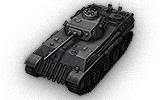
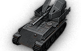
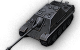
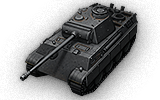
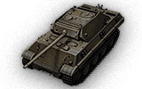
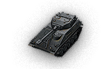
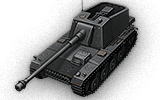
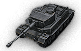
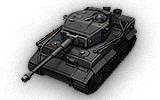
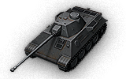

# Germany · Tier VII

[All nations and tiers](../buffs_nerfs.md) · EU v20410 → RU v14600ru · 3 November 2026

<label><strong>Find a tank</strong><input type="search" placeholder="Try is7, obj140 or xm57" aria-label="Find a tank" style="display:block;width:100%;padding:.7rem;border:1px solid #888;border-radius:4px;margin:.5rem 0;color:inherit;background:transparent"></label>

Aufklärungspanzer Panther · Tier VII

aufklärungspanzerpanther

<a href="https://tanks.gg/v20410/tank/aufklpanther">EU stats</a> · <a href="https://tanks.gg/v14600ru/tank/aufklpanther">RU stats</a>
<figure style="display:inline-block"><figcaption>Aufklärungspanzer Panther</figcaption></figure>
<strong>Penetration (mm)</strong> <b>EU</b>  AP <strong>157</strong> /  APCR <strong>205</strong> → <b>RU</b>  AP <strong>178</strong> /  APCR <strong>235</strong>

<em>Firepower</em> 
<strong>DPM (HP/min)</strong> <small>EU</small> 1 624.67  <small>RU</small> <strong>2 484.79</strong> 
<strong>Rate of fire (rounds/min)</strong> <small>EU</small> 12.03  <small>RU</small> <strong>18.41</strong> 
<strong>Reload time (s)</strong> <small>EU</small> 4.99  <small>RU</small> <strong>3.26</strong> 

<em>Armor &amp; health</em> 
<strong>Health</strong> <small>EU</small> 1 050  <small>RU</small> <strong>1 150</strong> 

G.W. Panther · Tier VII

gwpanther

<a href="https://tanks.gg/v20410/tank/gw-panther">EU stats</a> · <a href="https://tanks.gg/v14600ru/tank/gw-panther">RU stats</a>
<figure style="display:inline-block"><figcaption>G.W. Panther</figcaption></figure>
<strong>Penetration (mm)</strong> <b>EU</b>  HE <strong>39</strong> /  HE <strong>49</strong> /  HEAT <strong>224</strong> → <b>RU</b>  HE <strong>38</strong> /  HEAT <strong>224</strong>

<strong>Damage (HP)</strong> <b>EU</b>  HE <strong>600</strong> /  HE <strong>730</strong> /  HEAT <strong>400</strong> → <b>RU</b>  HE <strong>800</strong> /  HEAT <strong>450</strong>

<em>Firepower</em> 
<strong>DPM (HP/min)</strong> <small>EU</small> 1 390.67  <small>RU</small> <strong>1 854.22</strong> 
<strong>Explosion radius</strong> <small>EU</small> 7.20  <small>RU</small> <strong>6</strong> 
<strong>Stun duration · maximum (s)</strong> <small>EU</small> 18 → <small>RU</small> <strong>—</strong> 
<strong>Stun duration · minimum (s)</strong> <small>EU</small> 9.90 → <small>RU</small> <strong>—</strong> 
<strong>Shell velocity (m/s)</strong> <small>EU</small> 440  <small>RU</small> <strong>435</strong> 
<strong>Max range (m)</strong> <small>EU</small> 1 299.33  <small>RU</small> <strong>1 332.57</strong> 
<strong>Potential damage</strong> <small>EU</small> 18 000  <small>RU</small> <strong>24 000</strong> 

<em>Gun handling</em> 
<strong>Dispersion (m/100 m)</strong> <small>EU</small> 0.61  <small>RU</small> <strong>0.63</strong> 
<strong>Dispersion · damaged</strong> <small>EU</small> 1.23  <small>RU</small> <strong>1.27</strong> 

<em>Mobility</em> 
<strong>Tank traverse on hard terrain (°/s)</strong> <small>EU</small> 27.47  <small>RU</small> <strong>27.38</strong> 
<strong>Tank traverse on medium terrain (°/s)</strong> <small>EU</small> 23.24  <small>RU</small> <strong>23.17</strong> 
<strong>Tank traverse on soft terrain (°/s)</strong> <small>EU</small> 14.39  <small>RU</small> <strong>14.34</strong> 

<em>Armor &amp; health</em> 
<strong>Health · ammo rack</strong> <small>EU</small> 190  <small>RU</small> <strong>100</strong> 

<em>Miscellaneous</em> 
<strong>Shell cost</strong> <small>EU</small> 1 120  <small>RU</small> <strong>1 280</strong> 

Jagdpanther · Tier VII

jagdpanther

<a href="https://tanks.gg/v20410/tank/jpanther">EU stats</a> · <a href="https://tanks.gg/v14600ru/tank/jpanther">RU stats</a>
<figure style="display:inline-block"><figcaption>Jagdpanther</figcaption></figure>
<strong>Penetration (mm)</strong> <b>EU</b>  AP <strong>208</strong> /  APCR <strong>252</strong> /  HE <strong>60</strong> → <b>RU</b>  AP <strong>200</strong> /  APCR <strong>244</strong> /  HE <strong>60</strong>

<em>Mobility</em> 
<strong>Forward speed on medium terrain (km/h)</strong> <small>EU</small> 48.33  <small>RU</small> <strong>47.06</strong> 
<strong>Forward speed on soft terrain (km/h)</strong> <small>EU</small> 26.18  <small>RU</small> <strong>25.49</strong> 
<strong>Reverse speed (km/h)</strong> <small>EU</small> 14  <small>RU</small> <strong>12</strong> 
<strong>Engine power (hp)</strong> <small>EU</small> 760  <small>RU</small> <strong>740.10</strong> 
<strong>Power/weight (hp/t)</strong> <small>EU</small> 16.51  <small>RU</small> <strong>16.08</strong> 
<strong>Tank traverse (°/s)</strong> <small>EU</small> 36.50  <small>RU</small> <strong>33.38</strong> 
<strong>Tank traverse on hard terrain (°/s)</strong> <small>EU</small> 36.49  <small>RU</small> <strong>32.88</strong> 
<strong>Tank traverse on medium terrain (°/s)</strong> <small>EU</small> 30.87  <small>RU</small> <strong>27.82</strong> 
<strong>Tank traverse on soft terrain (°/s)</strong> <small>EU</small> 16.72  <small>RU</small> <strong>15.07</strong> 

<em>Armor &amp; health</em> 
<strong>Health</strong> <small>EU</small> 900  <small>RU</small> <strong>850</strong> 
<strong>Health · engine</strong> <small>EU</small> 240  <small>RU</small> <strong>260</strong> 
<strong>Track repair time (s)</strong> <small>EU</small> 11.70  <small>RU</small> <strong>12.03</strong> 

Panther · Tier VII

panther

<a href="https://tanks.gg/v20410/tank/panther">EU stats</a> · <a href="https://tanks.gg/v14600ru/tank/panther">RU stats</a>
<figure style="display:inline-block"><figcaption>Panther</figcaption></figure>
<em>Firepower</em> 
<strong>Ammo capacity</strong> <small>EU</small> 95  <small>RU</small> <strong>80</strong> 
<strong>Potential damage</strong> <small>EU</small> 12 825  <small>RU</small> <strong>10 800</strong> 

<em>Gun handling</em> 
<strong>Aim time (s)</strong> <small>EU</small> 1.82  <small>RU</small> <strong>2.21</strong> 
<strong>Dispersion (m/100 m)</strong> <small>EU</small> 0.29  <small>RU</small> <strong>0.31</strong> 
<strong>Dispersion · damaged</strong> <small>EU</small> 0.58  <small>RU</small> <strong>0.61</strong> 
<strong>Dispersion · turret traverse</strong> <small>EU</small> 0.10  <small>RU</small> <strong>0.16</strong> 
<strong>Dispersion · firing</strong> <small>EU</small> 3  <small>RU</small> <strong>3.50</strong> 

<em>Mobility</em> 
<strong>Forward speed on medium terrain (km/h)</strong> <small>EU</small> 55  <small>RU</small> <strong>51.88</strong> 
<strong>Forward speed on soft terrain (km/h)</strong> <small>EU</small> 28.76  <small>RU</small> <strong>27.07</strong> 
<strong>Engine power (hp)</strong> <small>EU</small> 780  <small>RU</small> <strong>740.10</strong> 
<strong>Weight (kg)</strong> <small>EU</small> 44 885 → <small>RU</small> <strong>45 245</strong> 
<strong>Power/weight (hp/t)</strong> <small>EU</small> 17.38  <small>RU</small> <strong>16.36</strong> 
<strong>Tank traverse (°/s)</strong> <small>EU</small> 37.55  <small>RU</small> <strong>33.38</strong> 
<strong>Tank traverse on hard terrain (°/s)</strong> <small>EU</small> 37.83  <small>RU</small> <strong>33.55</strong> 
<strong>Tank traverse on medium terrain (°/s)</strong> <small>EU</small> 31.52  <small>RU</small> <strong>27.96</strong> 
<strong>Tank traverse on soft terrain (°/s)</strong> <small>EU</small> 16.45  <small>RU</small> <strong>14.59</strong> 

<em>Armor &amp; health</em> 
<strong>Health</strong> <small>EU</small> 1 400  <small>RU</small> <strong>1 300</strong> 

<em>Miscellaneous</em> 
<strong>Stationary camo · after firing</strong> <small>EU</small> 2.26  <small>RU</small> <strong>2.14</strong> 
<strong>Moving camo · after firing</strong> <small>EU</small> 1.69  <small>RU</small> <strong>1.60</strong> 

Panther/M10 · Tier VII

pantherm10

<a href="https://tanks.gg/v20410/tank/pantherm10">EU stats</a> · <a href="https://tanks.gg/v14600ru/tank/pantherm10">RU stats</a>
<figure style="display:inline-block"><figcaption>Panther/M10</figcaption></figure>
<em>Gun handling</em> 
<strong>Aim time (s)</strong> <small>EU</small> 2.01  <small>RU</small> <strong>2.21</strong> 
<strong>Dispersion · turret traverse</strong> <small>EU</small> 0.10  <small>RU</small> <strong>0.11</strong> 

Spähpanzer SP I C · Tier VII

spähpanzerspic

<a href="https://tanks.gg/v20410/tank/sp-i-c">EU stats</a> · <a href="https://tanks.gg/v14600ru/tank/sp-i-c">RU stats</a>
<figure style="display:inline-block"><figcaption>Spähpanzer SP I C</figcaption></figure>
<em>Firepower</em> 
<strong>DPM (HP/min)</strong> <small>EU</small> 1 835.68  <small>RU</small> <strong>1 797.84</strong> 
<strong>Rate of fire (rounds/min)</strong> <small>EU</small> 8.34  <small>RU</small> <strong>8.17</strong> 
<strong>Reload time (s)</strong> <small>EU</small> 7.19  <small>RU</small> <strong>7.34</strong> 
<strong>Shell velocity (m/s)</strong> <small>EU</small> 820  <small>RU</small> <strong>630</strong> 

<em>Mobility</em> 
<strong>Tank traverse (°/s)</strong> <small>EU</small> 66.75  <small>RU</small> <strong>45.89</strong> 
<strong>Tank traverse on hard terrain (°/s)</strong> <small>EU</small> 76.45  <small>RU</small> <strong>52.33</strong> 
<strong>Tank traverse on medium terrain (°/s)</strong> <small>EU</small> 67.96  <small>RU</small> <strong>46.51</strong> 
<strong>Tank traverse on soft terrain (°/s)</strong> <small>EU</small> 33.98  <small>RU</small> <strong>23.26</strong> 

<em>Armor &amp; health</em> 
<strong>Health</strong> <small>EU</small> 1 000  <small>RU</small> <strong>880</strong> 

Sturer Emil · Tier VII

stureremil

<a href="https://tanks.gg/v20410/tank/st-emil">EU stats</a> · <a href="https://tanks.gg/v14600ru/tank/st-emil">RU stats</a>
<figure style="display:inline-block"><figcaption>Sturer Emil</figcaption></figure>
<strong>Penetration (mm)</strong> <b>EU</b>  AP <strong>231</strong> /  APCR <strong>252</strong> /  HE <strong>65</strong> → <b>RU</b>  AP <strong>231</strong> /  HE <strong>65</strong>

<strong>Damage (HP)</strong> <b>EU</b>  AP <strong>490</strong> /  APCR <strong>490</strong> /  HE <strong>630</strong> → <b>RU</b>  AP <strong>490</strong> /  HE <strong>630</strong>

<em>Firepower</em> 
<strong>Ammo capacity</strong> <small>EU</small> 21  <small>RU</small> <strong>20</strong> 
<strong>Potential damage</strong> <small>EU</small> 10 290  <small>RU</small> <strong>9 800</strong> 

<em>Gun handling</em> 
<strong>Aim time (s)</strong> <small>EU</small> 2.40  <small>RU</small> <strong>2.01</strong> 

<em>Mobility</em> 
<strong>Forward speed on soft terrain (km/h)</strong> <small>EU</small> 21.10  <small>RU</small> <strong>17.88</strong> 
<strong>Engine power (hp)</strong> <small>EU</small> 425  <small>RU</small> <strong>360</strong> 
<strong>Power/weight (hp/t)</strong> <small>EU</small> 11.64  <small>RU</small> <strong>9.86</strong> 
<strong>Tank traverse (°/s)</strong> <small>EU</small> 40.68  <small>RU</small> <strong>37.55</strong> 
<strong>Tank traverse on hard terrain (°/s)</strong> <small>EU</small> 37.78  <small>RU</small> <strong>37.14</strong> 
<strong>Tank traverse on medium terrain (°/s)</strong> <small>EU</small> 34.35  <small>RU</small> <strong>33.76</strong> 
<strong>Tank traverse on soft terrain (°/s)</strong> <small>EU</small> 17.99  <small>RU</small> <strong>17.68</strong> 

<em>Armor &amp; health</em> 
<strong>Health</strong> <small>EU</small> 950  <small>RU</small> <strong>850</strong> 
<strong>Health · engine</strong> <small>EU</small> 240  <small>RU</small> <strong>120</strong> 

Tiger (P) · Tier VII

tigerp

<a href="https://tanks.gg/v20410/tank/tiger-p">EU stats</a> · <a href="https://tanks.gg/v14600ru/tank/tiger-p">RU stats</a>
<figure style="display:inline-block"><figcaption>Tiger (P)</figcaption></figure>
<em>Gun handling</em> 
<strong>Aim time (s)</strong> <small>EU</small> 2.21  <small>RU</small> <strong>2.78</strong> 

<em>Mobility</em> 
<strong>Forward speed on hard terrain (km/h)</strong> <small>EU</small> 35  <small>RU</small> <strong>33.81</strong> 
<strong>Forward speed on medium terrain (km/h)</strong> <small>EU</small> 33.92  <small>RU</small> <strong>29.31</strong> 
<strong>Forward speed on soft terrain (km/h)</strong> <small>EU</small> 16.96  <small>RU</small> <strong>14.65</strong> 
<strong>Engine power (hp)</strong> <small>EU</small> 820  <small>RU</small> <strong>708.38</strong> 
<strong>Power/weight (hp/t)</strong> <small>EU</small> 13.37  <small>RU</small> <strong>11.55</strong> 
<strong>Tank traverse (°/s)</strong> <small>EU</small> 30.25  <small>RU</small> <strong>22.95</strong> 
<strong>Tank traverse on hard terrain (°/s)</strong> <small>EU</small> 30.82  <small>RU</small> <strong>25.88</strong> 
<strong>Tank traverse on medium terrain (°/s)</strong> <small>EU</small> 26.71  <small>RU</small> <strong>22.43</strong> 
<strong>Tank traverse on soft terrain (°/s)</strong> <small>EU</small> 13.36  <small>RU</small> <strong>11.22</strong> 

<em>Armor &amp; health</em> 
<strong>Health</strong> <small>EU</small> 1 550  <small>RU</small> <strong>1 500</strong> 

Tiger I · Tier VII

tigeri

<a href="https://tanks.gg/v20410/tank/tiger-i">EU stats</a> · <a href="https://tanks.gg/v14600ru/tank/tiger-i">RU stats</a>
<figure style="display:inline-block"><figcaption>Tiger I</figcaption></figure>
<em>Mobility</em> 
<strong>Forward speed on medium terrain (km/h)</strong> <small>EU</small> 35.86  <small>RU</small> <strong>34.92</strong> 
<strong>Forward speed on soft terrain (km/h)</strong> <small>EU</small> 17.31  <small>RU</small> <strong>16.86</strong> 
<strong>Engine power (hp)</strong> <small>EU</small> 760  <small>RU</small> <strong>740.10</strong> 
<strong>Power/weight (hp/t)</strong> <small>EU</small> 13.19  <small>RU</small> <strong>12.85</strong> 
<strong>Tank traverse (°/s)</strong> <small>EU</small> 30.25  <small>RU</small> <strong>27.12</strong> 
<strong>Tank traverse on hard terrain (°/s)</strong> <small>EU</small> 30.24  <small>RU</small> <strong>26.75</strong> 
<strong>Tank traverse on medium terrain (°/s)</strong> <small>EU</small> 25.92  <small>RU</small> <strong>22.93</strong> 
<strong>Tank traverse on soft terrain (°/s)</strong> <small>EU</small> 12.52  <small>RU</small> <strong>11.07</strong> 

<em>Armor &amp; health</em> 
<strong>Health</strong> <small>EU</small> 1 550  <small>RU</small> <strong>1 500</strong> 

<em>Miscellaneous</em> 
<strong>Moving camo</strong> <small>EU</small> 3.31  <small>RU</small> <strong>3.34</strong> 
<strong>Moving camo · after firing</strong> <small>EU</small> 0.74  <small>RU</small> <strong>0.75</strong> 

VK 30.02 (D) · Tier VII

vk3002d

<a href="https://tanks.gg/v20410/tank/vk-3002-d">EU stats</a> · <a href="https://tanks.gg/v14600ru/tank/vk-3002-d">RU stats</a>
<figure style="display:inline-block"><figcaption>VK 30.02 (D)</figcaption></figure>
<em>Mobility</em> 
<strong>Forward speed on soft terrain (km/h)</strong> <small>EU</small> 47.94  <small>RU</small> <strong>46.84</strong> 
<strong>Engine power (hp)</strong> <small>EU</small> 870  <small>RU</small> <strong>850</strong> 
<strong>Power/weight (hp/t)</strong> <small>EU</small> 21.91  <small>RU</small> <strong>21.40</strong> 
<strong>Tank traverse (°/s)</strong> <small>EU</small> 62.58  <small>RU</small> <strong>44.85</strong> 
<strong>Tank traverse on hard terrain (°/s)</strong> <small>EU</small> 63.38  <small>RU</small> <strong>49.48</strong> 
<strong>Tank traverse on medium terrain (°/s)</strong> <small>EU</small> 57.04  <small>RU</small> <strong>44.53</strong> 
<strong>Tank traverse on soft terrain (°/s)</strong> <small>EU</small> 32.60  <small>RU</small> <strong>25.45</strong> 

<em>Armor &amp; health</em> 
<strong>Health</strong> <small>EU</small> 1 350  <small>RU</small> <strong>1 250</strong> 

