# Germany · Tier VIII

[All nations and tiers](../buffs_nerfs.md) · EU v20410 → RU v14600ru · 3 November 2026

<label><strong>Find a tank</strong><input type="search" placeholder="Try is7, obj140 or xm57" aria-label="Find a tank" style="display:block;width:100%;padding:.7rem;border:1px solid #888;border-radius:4px;margin:.5rem 0;color:inherit;background:transparent"></label>

Ferdinand · Tier VIII

ferdinand

<a href="https://tanks.gg/v20410/tank/ferdinand">EU stats</a> · <a href="https://tanks.gg/v14600ru/tank/ferdinand">RU stats</a>
<figure style="display:inline-block">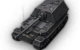<figcaption>Ferdinand</figcaption></figure>
<em>Mobility</em> 
<strong>Forward speed on medium terrain (km/h)</strong> <small>EU</small> 30  <small>RU</small> <strong>29.79</strong> 
<strong>Forward speed on soft terrain (km/h)</strong> <small>EU</small> 17.70  <small>RU</small> <strong>17.46</strong> 
<strong>Engine power (hp)</strong> <small>EU</small> 900  <small>RU</small> <strong>888.12</strong> 
<strong>Power/weight (hp/t)</strong> <small>EU</small> 13.48  <small>RU</small> <strong>13.31</strong> 
<strong>Tank traverse (°/s)</strong> <small>EU</small> 34.42  <small>RU</small> <strong>21.90</strong> 
<strong>Tank traverse on hard terrain (°/s)</strong> <small>EU</small> 36.36  <small>RU</small> <strong>28.76</strong> 
<strong>Tank traverse on medium terrain (°/s)</strong> <small>EU</small> 23.53  <small>RU</small> <strong>18.61</strong> 
<strong>Tank traverse on soft terrain (°/s)</strong> <small>EU</small> 13.79  <small>RU</small> <strong>10.91</strong> 

<em>Armor &amp; health</em> 
<strong>Hull armor · front (mm)</strong> <small>EU</small> 220  <small>RU</small> <strong>240</strong> 
<strong>Health</strong> <small>EU</small> 1 600  <small>RU</small> <strong>1 500</strong> 
<strong>Health · engine</strong> <small>EU</small> 275  <small>RU</small> <strong>255</strong> 
<strong>Track repair time (s)</strong> <small>EU</small> 11.70  <small>RU</small> <strong>12.03</strong> 

<em>Miscellaneous</em> 
<strong>Fire chance (%)</strong> <small>EU</small> 20  <small>RU</small> <strong>15</strong> 

Ferdinand FL · Tier VIII

ferdinandfl

<a href="https://tanks.gg/v20410/tank/ferdinand-fl">EU stats</a> · <a href="https://tanks.gg/v14600ru/tank/ferdinand-fl">RU stats</a>
<figure style="display:inline-block"><figcaption>Ferdinand FL</figcaption></figure>
<em>Mobility</em> 
<strong>Forward speed on medium terrain (km/h)</strong> <small>EU</small> 30  <small>RU</small> <strong>29.79</strong> 
<strong>Forward speed on soft terrain (km/h)</strong> <small>EU</small> 17.70  <small>RU</small> <strong>17.46</strong> 
<strong>Engine power (hp)</strong> <small>EU</small> 900  <small>RU</small> <strong>888.12</strong> 
<strong>Power/weight (hp/t)</strong> <small>EU</small> 13.48  <small>RU</small> <strong>13.31</strong> 
<strong>Tank traverse (°/s)</strong> <small>EU</small> 34.42  <small>RU</small> <strong>21.90</strong> 
<strong>Tank traverse on hard terrain (°/s)</strong> <small>EU</small> 32.70  <small>RU</small> <strong>20.81</strong> 
<strong>Tank traverse on medium terrain (°/s)</strong> <small>EU</small> 21.16  <small>RU</small> <strong>13.46</strong> 
<strong>Tank traverse on soft terrain (°/s)</strong> <small>EU</small> 12.40  <small>RU</small> <strong>7.89</strong> 

<em>Armor &amp; health</em> 
<strong>Hull armor · front (mm)</strong> <small>EU</small> 220  <small>RU</small> <strong>240</strong> 
<strong>Health</strong> <small>EU</small> 1 600  <small>RU</small> <strong>1 500</strong> 
<strong>Health · engine</strong> <small>EU</small> 275  <small>RU</small> <strong>255</strong> 
<strong>Track repair time (s)</strong> <small>EU</small> 11.70  <small>RU</small> <strong>12.03</strong> 

<em>Miscellaneous</em> 
<strong>Fire chance (%)</strong> <small>EU</small> 20  <small>RU</small> <strong>15</strong> 

G.W. Tiger (P) · Tier VIII

gwtigerp

<a href="https://tanks.gg/v20410/tank/gw-tiger-p">EU stats</a> · <a href="https://tanks.gg/v14600ru/tank/gw-tiger-p">RU stats</a>
<figure style="display:inline-block">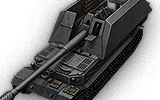<figcaption>G.W. Tiger (P)</figcaption></figure>
<strong>Penetration (mm)</strong> <b>EU</b>  HE <strong>53</strong> /  HE <strong>66</strong> /  AP <strong>296</strong> → <b>RU</b>  HE <strong>53</strong> /  AP <strong>296</strong>

<strong>Damage (HP)</strong> <b>EU</b>  HE <strong>900</strong> /  HE <strong>1200</strong> /  AP <strong>640</strong> → <b>RU</b>  HE <strong>1250</strong> /  AP <strong>700</strong>

<em>Firepower</em> 
<strong>DPM (HP/min)</strong> <small>EU</small> 1 224.39  <small>RU</small> <strong>1 700.54</strong> 
<strong>Explosion radius</strong> <small>EU</small> 11.40  <small>RU</small> <strong>9</strong> 
<strong>Stun duration · maximum (s)</strong> <small>EU</small> 31 → <small>RU</small> <strong>—</strong> 
<strong>Stun duration · minimum (s)</strong> <small>EU</small> 12.40 → <small>RU</small> <strong>—</strong> 
<strong>Potential damage</strong> <small>EU</small> 13 500  <small>RU</small> <strong>18 750</strong> 

<em>Mobility</em> 
<strong>Tank traverse on hard terrain (°/s)</strong> <small>EU</small> 17.10  <small>RU</small> <strong>17.08</strong> 
<strong>Tank traverse on medium terrain (°/s)</strong> <small>EU</small> 14.82  <small>RU</small> <strong>14.80</strong> 
<strong>Tank traverse on soft terrain (°/s)</strong> <small>EU</small> 8.89  <small>RU</small> <strong>8.88</strong> 

<em>Armor &amp; health</em> 
<strong>Health · ammo rack</strong> <small>EU</small> 210  <small>RU</small> <strong>120</strong> 

<em>Miscellaneous</em> 
<strong>Shell cost</strong> <small>EU</small> 2 080  <small>RU</small> <strong>2 390</strong> 

HWK 12 · Tier VIII

hwk12

<a href="https://tanks.gg/v20410/tank/hwk-12">EU stats</a> · <a href="https://tanks.gg/v14600ru/tank/hwk-12">RU stats</a>
<figure style="display:inline-block">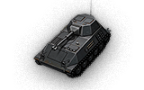<figcaption>HWK 12</figcaption></figure>
<strong>Penetration (mm)</strong> <b>EU</b>  AP <strong>198</strong> /  HEAT <strong>250</strong> /  HE <strong>45</strong> → <b>RU</b>  AP <strong>180</strong> /  HEAT <strong>250</strong> /  HE <strong>45</strong>

<strong>Damage (HP)</strong> <b>EU</b>  AP <strong>250</strong> /  HEAT <strong>250</strong> /  HE <strong>320</strong> → <b>RU</b>  AP <strong>240</strong> /  HEAT <strong>240</strong> /  HE <strong>320</strong>

<em>Firepower</em> 
<strong>DPM (HP/min)</strong> <small>EU</small> 1 980.38  <small>RU</small> <strong>1 910.34</strong> 
<strong>Rate of fire (rounds/min)</strong> <small>EU</small> 7.92  <small>RU</small> <strong>7.96</strong> 
<strong>Reload time (s)</strong> <small>EU</small> 7.57  <small>RU</small> <strong>7.54</strong> 
<strong>Shell velocity (m/s)</strong> <small>EU</small> 1 150  <small>RU</small> <strong>630</strong> 
<strong>Potential damage</strong> <small>EU</small> 12 500  <small>RU</small> <strong>12 000</strong> 

<em>Gun handling</em> 
<strong>Aim time (s)</strong> <small>EU</small> 1.73  <small>RU</small> <strong>1.92</strong> 
<strong>Dispersion (m/100 m)</strong> <small>EU</small> 0.34  <small>RU</small> <strong>0.35</strong> 
<strong>Dispersion · damaged</strong> <small>EU</small> 0.67  <small>RU</small> <strong>0.69</strong> 
<strong>Dispersion · turret traverse</strong> <small>EU</small> 0.10  <small>RU</small> <strong>0.12</strong> 

<em>Mobility</em> 
<strong>Forward speed (km/h)</strong> <small>EU</small> 68  <small>RU</small> <strong>65</strong> 
<strong>Forward speed on hard terrain (km/h)</strong> <small>EU</small> 68  <small>RU</small> <strong>65</strong> 
<strong>Forward speed on medium terrain (km/h)</strong> <small>EU</small> 68  <small>RU</small> <strong>65</strong> 
<strong>Forward speed on soft terrain (km/h)</strong> <small>EU</small> 68  <small>RU</small> <strong>57.71</strong> 
<strong>Engine power (hp)</strong> <small>EU</small> 430  <small>RU</small> <strong>450</strong> 
<strong>Power/weight (hp/t)</strong> <small>EU</small> 34.41  <small>RU</small> <strong>36.01</strong> 
<strong>Terrain resist (hard)</strong> <small>EU</small> 0.86  <small>RU</small> <strong>1.08</strong> 
<strong>Terrain resist (med)</strong> <small>EU</small> 0.96  <small>RU</small> <strong>1.20</strong> 
<strong>Terrain resist (soft)</strong> <small>EU</small> 1.82  <small>RU</small> <strong>2.28</strong> 
<strong>Tank traverse (°/s)</strong> <small>EU</small> 49.02  <small>RU</small> <strong>45.89</strong> 
<strong>Tank traverse on hard terrain (°/s)</strong> <small>EU</small> 51.50  <small>RU</small> <strong>57.47</strong> 
<strong>Tank traverse on medium terrain (°/s)</strong> <small>EU</small> 46.35  <small>RU</small> <strong>51.73</strong> 
<strong>Tank traverse on soft terrain (°/s)</strong> <small>EU</small> 24.39  <small>RU</small> <strong>27.22</strong> 

<em>Armor &amp; health</em> 
<strong>Track armor</strong> <small>EU</small> 5  <small>RU</small> <strong>10</strong> 
<strong>Health</strong> <small>EU</small> 1 350  <small>RU</small> <strong>1 100</strong> 

<em>Miscellaneous</em> 
<strong>View range (m)</strong> <small>EU</small> 400  <small>RU</small> <strong>410</strong> 

HWK 30 · Tier VIII

hwk30

<a href="https://tanks.gg/v20410/tank/hwk-30">EU stats</a> · <a href="https://tanks.gg/v14600ru/tank/hwk-30">RU stats</a>
<figure style="display:inline-block">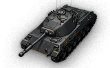<figcaption>HWK 30</figcaption></figure>
<em>Firepower</em> 
<strong>Normalization</strong> <small>EU</small> 5  <small>RU</small> <strong>2</strong> 

Indien-Panzer · Tier VIII

indienpanzer

<a href="https://tanks.gg/v20410/tank/indien-pz">EU stats</a> · <a href="https://tanks.gg/v14600ru/tank/indien-pz">RU stats</a>
<figure style="display:inline-block">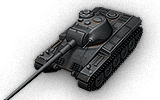<figcaption>Indien-Panzer</figcaption></figure>
<strong>Penetration (mm)</strong> <b>EU</b>  AP <strong>218</strong> /  APCR <strong>259</strong> /  HE <strong>90</strong> → <b>RU</b>  AP <strong>234</strong> /  APCR <strong>268</strong> /  HE <strong>90</strong>

<strong>Damage (HP)</strong> <b>EU</b>  AP <strong>300</strong> /  APCR <strong>300</strong> /  HE <strong>360</strong> → <b>RU</b>  AP <strong>280</strong> /  APCR <strong>280</strong> /  HE <strong>370</strong>

<em>Firepower</em> 
<strong>DPM (HP/min)</strong> <small>EU</small> 2 109.44  <small>RU</small> <strong>2 433.67</strong> 
<strong>Rate of fire (rounds/min)</strong> <small>EU</small> 7.03  <small>RU</small> <strong>8.69</strong> 
<strong>Reload time (s)</strong> <small>EU</small> 8.53  <small>RU</small> <strong>6.90</strong> 
<strong>Potential damage</strong> <small>EU</small> 18 300  <small>RU</small> <strong>17 080</strong> 

<em>Gun handling</em> 
<strong>Aim time (s)</strong> <small>EU</small> 1.82  <small>RU</small> <strong>1.92</strong> 

<em>Mobility</em> 
<strong>Forward speed (km/h)</strong> <small>EU</small> 55  <small>RU</small> <strong>60</strong> 
<strong>Forward speed on hard terrain (km/h)</strong> <small>EU</small> 55  <small>RU</small> <strong>60</strong> 
<strong>Forward speed on medium terrain (km/h)</strong> <small>EU</small> 53.80  <small>RU</small> <strong>60</strong> 
<strong>Forward speed on soft terrain (km/h)</strong> <small>EU</small> 28.07  <small>RU</small> <strong>33.09</strong> 
<strong>Engine power (hp)</strong> <small>EU</small> 670  <small>RU</small> <strong>790</strong> 
<strong>Power/weight (hp/t)</strong> <small>EU</small> 16.96  <small>RU</small> <strong>20</strong> 
<strong>Tank traverse (°/s)</strong> <small>EU</small> 54.24  <small>RU</small> <strong>39.63</strong> 
<strong>Tank traverse on hard terrain (°/s)</strong> <small>EU</small> 58.86  <small>RU</small> <strong>40.03</strong> 
<strong>Tank traverse on medium terrain (°/s)</strong> <small>EU</small> 53.96  <small>RU</small> <strong>36.70</strong> 
<strong>Tank traverse on soft terrain (°/s)</strong> <small>EU</small> 28.15  <small>RU</small> <strong>19.15</strong> 

<em>Armor &amp; health</em> 
<strong>Health</strong> <small>EU</small> 1 450  <small>RU</small> <strong>1 400</strong> 

<em>Miscellaneous</em> 
<strong>View range (m)</strong> <small>EU</small> 380  <small>RU</small> <strong>390</strong> 

Jagdpanther II · Tier VIII

jagdpantherii

<a href="https://tanks.gg/v20410/tank/jpanther-ii">EU stats</a> · <a href="https://tanks.gg/v14600ru/tank/jpanther-ii">RU stats</a>
<figure style="display:inline-block">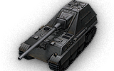<figcaption>Jagdpanther II</figcaption></figure>
<em>Armor &amp; health</em> 
<strong>Hull armor · front (mm)</strong> <small>EU</small> 100  <small>RU</small> <strong>120</strong> 
<strong>Health</strong> <small>EU</small> 1 150  <small>RU</small> <strong>1 350</strong> 

Kanonenjagdpanzer · Tier VIII

kanonenjagdpanzer

<a href="https://tanks.gg/v20410/tank/kanjpz">EU stats</a> · <a href="https://tanks.gg/v14600ru/tank/kanjpz">RU stats</a>
<figure style="display:inline-block">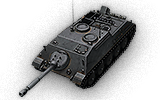<figcaption>Kanonenjagdpanzer</figcaption></figure>
<strong>Penetration (mm)</strong> <b>EU</b>  AP <strong>238</strong> /  HEAT <strong>250</strong> /  HE <strong>102</strong> → <b>RU</b>  APCR <strong>242</strong> /  HEAT <strong>290</strong> /  HE <strong>102</strong>

<strong>Damage (HP)</strong> <b>EU</b>  AP <strong>240</strong> /  HEAT <strong>240</strong> /  HE <strong>320</strong> → <b>RU</b>  APCR <strong>240</strong> /  HEAT <strong>240</strong> /  HE <strong>320</strong>

<em>Firepower</em> 
<strong>DPM (HP/min)</strong> <small>EU</small> 2 384  <small>RU</small> <strong>1 866.12</strong> 
<strong>Rate of fire (rounds/min)</strong> <small>EU</small> 9.93  <small>RU</small> <strong>7.78</strong> 
<strong>Reload time (s)</strong> <small>EU</small> 6.04  <small>RU</small> <strong>26.37</strong> 
<strong>Shell velocity (m/s)</strong> <small>EU</small> 1 030  <small>RU</small> <strong>1 330</strong> 
<strong>Normalization</strong> <small>EU</small> 5  <small>RU</small> <strong>2</strong> 
<strong>Ammo capacity</strong> <small>EU</small> 51  <small>RU</small> <strong>56</strong> 
<strong>Potential damage</strong> <small>EU</small> 12 240  <small>RU</small> <strong>13 440</strong> 
<strong>Clip size</strong> <small>EU</small> — → <small>RU</small> <strong>4</strong> 
<strong>Clip damage · damage</strong> <small>EU</small> — → <small>RU</small> <strong>960</strong> 
<strong>Clip damage · time (s)</strong> <small>EU</small> — → <small>RU</small> <strong>4.50</strong> 
<strong>Intra-clip reload</strong> <small>EU</small> — → <small>RU</small> <strong>1.50</strong> 

<em>Gun handling</em> 
<strong>Aim time (s)</strong> <small>EU</small> 1.73  <small>RU</small> <strong>1.44</strong> 
<strong>Dispersion · moving</strong> <small>EU</small> 0.24  <small>RU</small> <strong>0.28</strong> 
<strong>Dispersion · tank traverse</strong> <small>EU</small> 0.24  <small>RU</small> <strong>0.28</strong> 
<strong>Dispersion · firing</strong> <small>EU</small> 4  <small>RU</small> <strong>3.40</strong> 

<em>Armor &amp; health</em> 
<strong>Health</strong> <small>EU</small> 1 200  <small>RU</small> <strong>1 050</strong> 

Leichter Kpz. 70 (K) · EU VIII → RU X

leichterkpz70k

<a href="https://tanks.gg/v20410/tank/lkpz-70-k">EU stats</a> · <a href="https://tanks.gg/v14600ru/tank/lkpz70-k">RU stats</a>
<figure style="display:inline-block">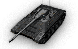<figcaption>EU · Leichter Kpz. 70 (K)</figcaption></figure><figure style="display:inline-block">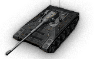<figcaption>RU · LKpz.70 K</figcaption></figure>
<strong>Penetration (mm)</strong> <b>EU</b>  APCR <strong>190</strong> /  HEAT <strong>260</strong> /  HE <strong>105</strong> → <b>RU</b>  APCR <strong>248</strong> /  HEAT <strong>280</strong> /  HE <strong>105</strong>

<strong>Damage (HP)</strong> <b>EU</b>  APCR <strong>240</strong> /  HEAT <strong>240</strong> /  HE <strong>320</strong> → <b>RU</b>  APCR <strong>360</strong> /  HEAT <strong>360</strong> /  HE <strong>460</strong>

<em>General</em> 
<strong>Tier</strong> <small>EU</small> 8 → <small>RU</small> <strong>10</strong> 

<em>Firepower</em> 
<strong>DPM (HP/min)</strong> <small>EU</small> 1 766.96  <small>RU</small> <strong>1 765.15</strong> 
<strong>Module damage</strong> <small>EU</small> 122  <small>RU</small> <strong>150</strong> 
<strong>Rate of fire (rounds/min)</strong> <small>EU</small> 7.36  <small>RU</small> <strong>4.90</strong> 
<strong>Reload time (s)</strong> <small>EU</small> 8.15  <small>RU</small> <strong>12.24</strong> 
<strong>Caliber</strong> <small>EU</small> 90  <small>RU</small> <strong>105</strong> 
<strong>Shell velocity (m/s)</strong> <small>EU</small> 1 000  <small>RU</small> <strong>1 150</strong> 
<strong>Normalization</strong> <small>EU</small> 5  <small>RU</small> <strong>2</strong> 
<strong>Ammo capacity</strong> <small>EU</small> 50  <small>RU</small> <strong>42</strong> 
<strong>Potential damage</strong> <small>EU</small> 12 000  <small>RU</small> <strong>15 120</strong> 
<strong>Clip size</strong> <small>EU</small> — → <small>RU</small> <strong>3</strong> 
<strong>Clip damage · damage</strong> <small>EU</small> — → <small>RU</small> <strong>1 080</strong> 
<strong>Clip damage · time (s)</strong> <small>EU</small> — → <small>RU</small> <strong>12</strong> 
<strong>Intra-clip reload</strong> <small>EU</small> — → <small>RU</small> <strong>6</strong> 

<em>Gun handling</em> 
<strong>Aim time (s)</strong> <small>EU</small> 2.01  <small>RU</small> <strong>2.40</strong> 
<strong>Dispersion (m/100 m)</strong> <small>EU</small> 0.32  <small>RU</small> <strong>0.29</strong> 
<strong>Dispersion · damaged</strong> <small>EU</small> 0.63  <small>RU</small> <strong>0.58</strong> 
<strong>Dispersion · moving</strong> <small>EU</small> 0.12  <small>RU</small> <strong>0.18</strong> 
<strong>Dispersion · tank traverse</strong> <small>EU</small> 0.12  <small>RU</small> <strong>0.18</strong> 
<strong>Dispersion · turret traverse</strong> <small>EU</small> 0.10  <small>RU</small> <strong>0.08</strong> 
<strong>Dispersion · firing</strong> <small>EU</small> 3.50  <small>RU</small> <strong>4</strong> 

<em>Mobility</em> 
<strong>Forward speed (km/h)</strong> <small>EU</small> 60  <small>RU</small> <strong>70</strong> 
<strong>Forward speed on hard terrain (km/h)</strong> <small>EU</small> 60  <small>RU</small> <strong>70</strong> 
<strong>Forward speed on medium terrain (km/h)</strong> <small>EU</small> 60  <small>RU</small> <strong>70</strong> 
<strong>Forward speed on soft terrain (km/h)</strong> <small>EU</small> 60  <small>RU</small> <strong>70</strong> 
<strong>Reverse speed (km/h)</strong> <small>EU</small> 20  <small>RU</small> <strong>25</strong> 
<strong>Engine power (hp)</strong> <small>EU</small> 700  <small>RU</small> <strong>950</strong> 
<strong>Weight (kg)</strong> <small>EU</small> 25 000 → <small>RU</small> <strong>23 995</strong> 
<strong>Power/weight (hp/t)</strong> <small>EU</small> 28  <small>RU</small> <strong>39.59</strong> 
<strong>Auto siege on/off · engage (km/h)</strong> <small>EU</small> 10 → <small>RU</small> <strong>30</strong> 
<strong>Auto siege on/off · disengage (km/h)</strong> <small>EU</small> 26 → <small>RU</small> <strong>30</strong> 

<em>Armor &amp; health</em> 
<strong>Hull armor · front (mm)</strong> <small>EU</small> 30  <small>RU</small> <strong>50</strong> 
<strong>Hull armor · side (mm)</strong> <small>EU</small> 15  <small>RU</small> <strong>35</strong> 
<strong>Hull armor · rear (mm)</strong> <small>EU</small> 15  <small>RU</small> <strong>40</strong> 
<strong>Turret armor · front (mm)</strong> <small>EU</small> 40  <small>RU</small> <strong>50</strong> 
<strong>Turret armor · side (mm)</strong> <small>EU</small> 25  <small>RU</small> <strong>50</strong> 
<strong>Turret armor · rear (mm)</strong> <small>EU</small> 20  <small>RU</small> <strong>25</strong> 
<strong>Health</strong> <small>EU</small> 1 150  <small>RU</small> <strong>1 500</strong> 
<strong>Health · track</strong> <small>EU</small> 220  <small>RU</small> <strong>250</strong> 
<strong>Health · ammo rack</strong> <small>EU</small> 200  <small>RU</small> <strong>260</strong> 
<strong>Track repair time (s)</strong> <small>EU</small> 10.03  <small>RU</small> <strong>8.02</strong> 

<em>Miscellaneous</em> 
<strong>Stationary camo</strong> <small>EU</small> 16.64  <small>RU</small> <strong>16.42</strong> 
<strong>Stationary camo · after firing</strong> <small>EU</small> 3.96  <small>RU</small> <strong>3.25</strong> 
<strong>Moving camo</strong> <small>EU</small> 16.64  <small>RU</small> <strong>16.42</strong> 
<strong>Moving camo · after firing</strong> <small>EU</small> 3.96  <small>RU</small> <strong>3.25</strong> 
<strong>View range (m)</strong> <small>EU</small> 380  <small>RU</small> <strong>390</strong> 
<strong>Fire chance (%)</strong> <small>EU</small> 12  <small>RU</small> <strong>10</strong> 
<strong>Shell cost</strong> <small>EU</small> 390  <small>RU</small> <strong>980</strong> 

Alternate mode

<a href="https://tanks.gg/v20410/tank/lkpz-70-k-siege">EU stats</a> · <a href="https://tanks.gg/v14600ru/tank/lkpz70-k-siege">RU stats</a>
<em>General</em> 
<strong>Tier</strong> <small>EU</small> 8 → <small>RU</small> <strong>10</strong> 

<em>Firepower</em> 
<strong>DPM (HP/min)</strong> <small>EU</small> 1 766.96  <small>RU</small> <strong>1 765.15</strong> 
<strong>Module damage</strong> <small>EU</small> 122  <small>RU</small> <strong>150</strong> 
<strong>Rate of fire (rounds/min)</strong> <small>EU</small> 7.36  <small>RU</small> <strong>4.90</strong> 
<strong>Reload time (s)</strong> <small>EU</small> 8.15  <small>RU</small> <strong>12.24</strong> 
<strong>Caliber</strong> <small>EU</small> 90  <small>RU</small> <strong>105</strong> 
<strong>Shell velocity (m/s)</strong> <small>EU</small> 1 000  <small>RU</small> <strong>1 150</strong> 
<strong>Normalization</strong> <small>EU</small> 5  <small>RU</small> <strong>2</strong> 
<strong>Ammo capacity</strong> <small>EU</small> 50  <small>RU</small> <strong>42</strong> 
<strong>Potential damage</strong> <small>EU</small> 12 000  <small>RU</small> <strong>15 120</strong> 
<strong>Clip size</strong> <small>EU</small> — → <small>RU</small> <strong>3</strong> 
<strong>Clip damage · damage</strong> <small>EU</small> — → <small>RU</small> <strong>1 080</strong> 
<strong>Clip damage · time (s)</strong> <small>EU</small> — → <small>RU</small> <strong>12</strong> 
<strong>Intra-clip reload</strong> <small>EU</small> — → <small>RU</small> <strong>6</strong> 

<em>Gun handling</em> 
<strong>Aim time (s)</strong> <small>EU</small> 2.01  <small>RU</small> <strong>2.40</strong> 
<strong>Dispersion (m/100 m)</strong> <small>EU</small> 0.32  <small>RU</small> <strong>0.29</strong> 
<strong>Dispersion · damaged</strong> <small>EU</small> 0.63  <small>RU</small> <strong>0.58</strong> 
<strong>Dispersion · moving</strong> <small>EU</small> 0.12  <small>RU</small> <strong>0.10</strong> 
<strong>Dispersion · tank traverse</strong> <small>EU</small> 0.12  <small>RU</small> <strong>0.10</strong> 
<strong>Dispersion · turret traverse</strong> <small>EU</small> 0.10  <small>RU</small> <strong>0.08</strong> 
<strong>Dispersion · firing</strong> <small>EU</small> 3.50  <small>RU</small> <strong>4</strong> 

<em>Mobility</em> 
<strong>Forward speed (km/h)</strong> <small>EU</small> 60  <small>RU</small> <strong>70</strong> 
<strong>Forward speed on hard terrain (km/h)</strong> <small>EU</small> 60  <small>RU</small> <strong>70</strong> 
<strong>Forward speed on medium terrain (km/h)</strong> <small>EU</small> 60  <small>RU</small> <strong>70</strong> 
<strong>Forward speed on soft terrain (km/h)</strong> <small>EU</small> 60  <small>RU</small> <strong>70</strong> 
<strong>Reverse speed (km/h)</strong> <small>EU</small> 20  <small>RU</small> <strong>25</strong> 
<strong>Engine power (hp)</strong> <small>EU</small> 700  <small>RU</small> <strong>950</strong> 
<strong>Weight (kg)</strong> <small>EU</small> 25 000 → <small>RU</small> <strong>23 995</strong> 
<strong>Power/weight (hp/t)</strong> <small>EU</small> 28  <small>RU</small> <strong>39.59</strong> 
<strong>Auto siege on/off · engage (km/h)</strong> <small>EU</small> 10 → <small>RU</small> <strong>30</strong> 
<strong>Auto siege on/off · disengage (km/h)</strong> <small>EU</small> 26 → <small>RU</small> <strong>30</strong> 

<em>Armor &amp; health</em> 
<strong>Hull armor · front (mm)</strong> <small>EU</small> 30  <small>RU</small> <strong>50</strong> 
<strong>Hull armor · side (mm)</strong> <small>EU</small> 15  <small>RU</small> <strong>35</strong> 
<strong>Hull armor · rear (mm)</strong> <small>EU</small> 15  <small>RU</small> <strong>40</strong> 
<strong>Turret armor · front (mm)</strong> <small>EU</small> 40  <small>RU</small> <strong>50</strong> 
<strong>Turret armor · side (mm)</strong> <small>EU</small> 25  <small>RU</small> <strong>50</strong> 
<strong>Turret armor · rear (mm)</strong> <small>EU</small> 20  <small>RU</small> <strong>25</strong> 
<strong>Health</strong> <small>EU</small> 1 150  <small>RU</small> <strong>1 500</strong> 
<strong>Health · track</strong> <small>EU</small> 220  <small>RU</small> <strong>250</strong> 
<strong>Health · ammo rack</strong> <small>EU</small> 200  <small>RU</small> <strong>260</strong> 
<strong>Track repair time (s)</strong> <small>EU</small> 10.03  <small>RU</small> <strong>8.02</strong> 

<em>Miscellaneous</em> 
<strong>Stationary camo</strong> <small>EU</small> 16.64  <small>RU</small> <strong>16.42</strong> 
<strong>Stationary camo · after firing</strong> <small>EU</small> 3.96  <small>RU</small> <strong>3.25</strong> 
<strong>Moving camo</strong> <small>EU</small> 16.64  <small>RU</small> <strong>16.42</strong> 
<strong>Moving camo · after firing</strong> <small>EU</small> 3.96  <small>RU</small> <strong>3.25</strong> 
<strong>View range (m)</strong> <small>EU</small> 380  <small>RU</small> <strong>390</strong> 
<strong>Fire chance (%)</strong> <small>EU</small> 12  <small>RU</small> <strong>10</strong> 
<strong>Shell cost</strong> <small>EU</small> 390  <small>RU</small> <strong>980</strong> 

Löwe · Tier VIII

löwe

<a href="https://tanks.gg/v20410/tank/lowe">EU stats</a> · <a href="https://tanks.gg/v14600ru/tank/lowe">RU stats</a>
<figure style="display:inline-block">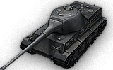<figcaption>Löwe</figcaption></figure>
<em>Firepower</em> 
<strong>DPM (HP/min)</strong> <small>EU</small> 1 668.80  <small>RU</small> <strong>2 002.56</strong> 
<strong>Rate of fire (rounds/min)</strong> <small>EU</small> 5.21  <small>RU</small> <strong>6.26</strong> 
<strong>Reload time (s)</strong> <small>EU</small> 11.51  <small>RU</small> <strong>9.59</strong> 

<em>Armor &amp; health</em> 
<strong>Hull armor · front (mm)</strong> <small>EU</small> 150  <small>RU</small> <strong>180</strong> 

Löwe FL · Tier VIII

löwefl

<a href="https://tanks.gg/v20410/tank/lowe-fl">EU stats</a> · <a href="https://tanks.gg/v14600ru/tank/lowe-fl">RU stats</a>
<figure style="display:inline-block"><figcaption>Löwe FL</figcaption></figure>
<em>Firepower</em> 
<strong>DPM (HP/min)</strong> <small>EU</small> 1 668.80  <small>RU</small> <strong>2 002.56</strong> 
<strong>Rate of fire (rounds/min)</strong> <small>EU</small> 5.21  <small>RU</small> <strong>6.26</strong> 
<strong>Reload time (s)</strong> <small>EU</small> 11.51  <small>RU</small> <strong>9.59</strong> 

<em>Armor &amp; health</em> 
<strong>Hull armor · front (mm)</strong> <small>EU</small> 150  <small>RU</small> <strong>180</strong> 

M48A2 Räumpanzer · Tier VIII

m48a2räumpanzer

<a href="https://tanks.gg/v20410/tank/m48-rpz">EU stats</a> · <a href="https://tanks.gg/v14600ru/tank/m48-rpz">RU stats</a>
<figure style="display:inline-block">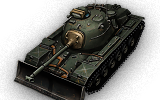<figcaption>M48A2 Räumpanzer</figcaption></figure>
<strong>Penetration (mm)</strong> <b>EU</b>  AP <strong>212</strong> /  APCR <strong>255</strong> /  HE <strong>45</strong> → <b>RU</b>  AP <strong>205</strong> /  APCR <strong>255</strong> /  HE <strong>45</strong>

<strong>Damage (HP)</strong> <b>EU</b>  AP <strong>280</strong> /  APCR <strong>280</strong> /  HE <strong>380</strong> → <b>RU</b>  AP <strong>240</strong> /  APCR <strong>240</strong> /  HE <strong>320</strong>

<em>Firepower</em> 
<strong>DPM (HP/min)</strong> <small>EU</small> 2 503.20  <small>RU</small> <strong>2 145.60</strong> 
<strong>Potential damage</strong> <small>EU</small> 17 920  <small>RU</small> <strong>15 360</strong> 

<em>Mobility</em> 
<strong>Forward speed on medium terrain (km/h)</strong> <small>EU</small> 40  <small>RU</small> <strong>35.34</strong> 
<strong>Forward speed on soft terrain (km/h)</strong> <small>EU</small> 21.14  <small>RU</small> <strong>18.32</strong> 
<strong>Engine power (hp)</strong> <small>EU</small> 750  <small>RU</small> <strong>650</strong> 
<strong>Power/weight (hp/t)</strong> <small>EU</small> 15  <small>RU</small> <strong>13</strong> 

Mittlerer Kpz. Pr. 68 (P) · Tier VIII

mittlererkpzpr68p

<a href="https://tanks.gg/v20410/tank/mkpz-68-p">EU stats</a> · <a href="https://tanks.gg/v14600ru/tank/pr68-p">RU stats</a>
<figure style="display:inline-block">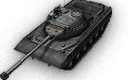<figcaption>Mittlerer Kpz. Pr. 68 (P)</figcaption></figure>
<em>Mobility</em> 
<strong>Forward speed (km/h)</strong> <small>EU</small> 50  <small>RU</small> <strong>55</strong> 
<strong>Forward speed on hard terrain (km/h)</strong> <small>EU</small> 50  <small>RU</small> <strong>55</strong> 
<strong>Forward speed on medium terrain (km/h)</strong> <small>EU</small> 50  <small>RU</small> <strong>55</strong> 
<strong>Forward speed on soft terrain (km/h)</strong> <small>EU</small> 29.33  <small>RU</small> <strong>33.85</strong> 
<strong>Reverse speed (km/h)</strong> <small>EU</small> 18  <small>RU</small> <strong>20</strong> 
<strong>Engine power (hp)</strong> <small>EU</small> 780  <small>RU</small> <strong>900</strong> 
<strong>Power/weight (hp/t)</strong> <small>EU</small> 16.96  <small>RU</small> <strong>19.57</strong> 

Alternate mode

<a href="https://tanks.gg/v20410/tank/mkpz-68-p-siege">EU stats</a> · <a href="https://tanks.gg/v14600ru/tank/pr68-p-siege">RU stats</a>
<em>Mobility</em> 
<strong>Forward speed (km/h)</strong> <small>EU</small> 50  <small>RU</small> <strong>55</strong> 
<strong>Forward speed on hard terrain (km/h)</strong> <small>EU</small> 50  <small>RU</small> <strong>55</strong> 
<strong>Forward speed on medium terrain (km/h)</strong> <small>EU</small> 50  <small>RU</small> <strong>55</strong> 
<strong>Forward speed on soft terrain (km/h)</strong> <small>EU</small> 29.33  <small>RU</small> <strong>33.85</strong> 
<strong>Reverse speed (km/h)</strong> <small>EU</small> 18  <small>RU</small> <strong>20</strong> 
<strong>Engine power (hp)</strong> <small>EU</small> 780  <small>RU</small> <strong>900</strong> 
<strong>Power/weight (hp/t)</strong> <small>EU</small> 16.96  <small>RU</small> <strong>19.57</strong> 

Panther II · Tier VIII

pantherii

<a href="https://tanks.gg/v20410/tank/panther-ii">EU stats</a> · <a href="https://tanks.gg/v14600ru/tank/panther-ii">RU stats</a>
<figure style="display:inline-block">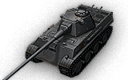<figcaption>Panther II</figcaption></figure>
<em>Mobility</em> 
<strong>Forward speed on medium terrain (km/h)</strong> <small>EU</small> 55  <small>RU</small> <strong>51.48</strong> 
<strong>Forward speed on soft terrain (km/h)</strong> <small>EU</small> 26.89  <small>RU</small> <strong>24.52</strong> 
<strong>Engine power (hp)</strong> <small>EU</small> 800  <small>RU</small> <strong>740.10</strong> 
<strong>Weight (kg)</strong> <small>EU</small> 53 922 → <small>RU</small> <strong>54 710</strong> 
<strong>Power/weight (hp/t)</strong> <small>EU</small> 14.84  <small>RU</small> <strong>13.53</strong> 
<strong>Tank traverse (°/s)</strong> <small>EU</small> 41.72  <small>RU</small> <strong>37.55</strong> 
<strong>Tank traverse on hard terrain (°/s)</strong> <small>EU</small> 41.17  <small>RU</small> <strong>36.80</strong> 
<strong>Tank traverse on medium terrain (°/s)</strong> <small>EU</small> 32.93  <small>RU</small> <strong>29.44</strong> 
<strong>Tank traverse on soft terrain (°/s)</strong> <small>EU</small> 15.68  <small>RU</small> <strong>14.02</strong> 

<em>Armor &amp; health</em> 
<strong>Hull armor · front (mm)</strong> <small>EU</small> 120  <small>RU</small> <strong>150</strong> 
<strong>Hull armor · side (mm)</strong> <small>EU</small> 80  <small>RU</small> <strong>70</strong> 
<strong>Turret armor · front (mm)</strong> <small>EU</small> 180  <small>RU</small> <strong>190</strong> 
<strong>Turret armor · side (mm)</strong> <small>EU</small> 80  <small>RU</small> <strong>100</strong> 
<strong>Turret armor · rear (mm)</strong> <small>EU</small> 80  <small>RU</small> <strong>100</strong> 
<strong>Health</strong> <small>EU</small> 1 650  <small>RU</small> <strong>1 500</strong> 

<em>Miscellaneous</em> 
<strong>Stationary camo · after firing</strong> <small>EU</small> 2.22  <small>RU</small> <strong>1.76</strong> 
<strong>Moving camo · after firing</strong> <small>EU</small> 1.66  <small>RU</small> <strong>1.31</strong> 

Panther mit 8,8 cm L/71 · Tier VIII

panthermit88cml71

<a href="https://tanks.gg/v20410/tank/panther-88">EU stats</a> · <a href="https://tanks.gg/v14600ru/tank/panther-88">RU stats</a>
<figure style="display:inline-block">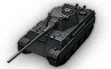<figcaption>Panther mit 8,8 cm L/71</figcaption></figure>
<strong>Penetration (mm)</strong> <b>EU</b>  AP <strong>230</strong> /  APCR <strong>265</strong> /  HE <strong>44</strong> → <b>RU</b>  AP <strong>223</strong> /  APCR <strong>261</strong> /  HE <strong>44</strong>

<em>Firepower</em> 
<strong>DPM (HP/min)</strong> <small>EU</small> 2 615.28  <small>RU</small> <strong>2 539.48</strong> 
<strong>Rate of fire (rounds/min)</strong> <small>EU</small> 9.34  <small>RU</small> <strong>9.07</strong> 
<strong>Reload time (s)</strong> <small>EU</small> 6.42  <small>RU</small> <strong>6.62</strong> 

<em>Gun handling</em> 
<strong>Dispersion · moving</strong> <small>EU</small> 0.16  <small>RU</small> <strong>0.14</strong> 
<strong>Dispersion · tank traverse</strong> <small>EU</small> 0.16  <small>RU</small> <strong>0.14</strong> 
<strong>Dispersion · turret traverse</strong> <small>EU</small> 0.10  <small>RU</small> <strong>0.12</strong> 
<strong>Dispersion · firing</strong> <small>EU</small> 3  <small>RU</small> <strong>4</strong> 

<em>Mobility</em> 
<strong>Forward speed on soft terrain (km/h)</strong> <small>EU</small> 46.38  <small>RU</small> <strong>38.20</strong> 
<strong>Engine power (hp)</strong> <small>EU</small> 850  <small>RU</small> <strong>700</strong> 
<strong>Power/weight (hp/t)</strong> <small>EU</small> 18.28  <small>RU</small> <strong>15.05</strong> 

<em>Armor &amp; health</em> 
<strong>Health</strong> <small>EU</small> 1 600  <small>RU</small> <strong>1 500</strong> 

Panzer 58 · Tier VIII

panzer58

<a href="https://tanks.gg/v20410/tank/pz-58">EU stats</a> · <a href="https://tanks.gg/v14600ru/tank/pz-58">RU stats</a>
<figure style="display:inline-block"><figcaption>Panzer 58</figcaption></figure>
<strong>Damage (HP)</strong> <b>EU</b>  AP <strong>300</strong> /  APCR <strong>300</strong> /  HE <strong>360</strong> → <b>RU</b>  AP <strong>280</strong> /  APCR <strong>280</strong> /  HE <strong>370</strong>

<em>Firepower</em> 
<strong>DPM (HP/min)</strong> <small>EU</small> 2 346.75  <small>RU</small> <strong>2 467.94</strong> 
<strong>Rate of fire (rounds/min)</strong> <small>EU</small> 7.82  <small>RU</small> <strong>8.81</strong> 
<strong>Reload time (s)</strong> <small>EU</small> 7.67  <small>RU</small> <strong>6.81</strong> 
<strong>Potential damage</strong> <small>EU</small> 14 400  <small>RU</small> <strong>13 440</strong> 

<em>Mobility</em> 
<strong>Forward speed (km/h)</strong> <small>EU</small> 55  <small>RU</small> <strong>50</strong> 
<strong>Forward speed on hard terrain (km/h)</strong> <small>EU</small> 55  <small>RU</small> <strong>50</strong> 
<strong>Forward speed on medium terrain (km/h)</strong> <small>EU</small> 55  <small>RU</small> <strong>50</strong> 
<strong>Forward speed on soft terrain (km/h)</strong> <small>EU</small> 54.22  <small>RU</small> <strong>50</strong> 
<strong>Engine power (hp)</strong> <small>EU</small> 700  <small>RU</small> <strong>660</strong> 
<strong>Power/weight (hp/t)</strong> <small>EU</small> 19.94  <small>RU</small> <strong>18.80</strong> 

Panzer 58 FL · Tier VIII

panzer58fl

<a href="https://tanks.gg/v20410/tank/pz-58-fl">EU stats</a> · <a href="https://tanks.gg/v14600ru/tank/pz-58-fl">RU stats</a>
<figure style="display:inline-block">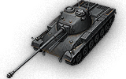<figcaption>Panzer 58 FL</figcaption></figure>
<strong>Damage (HP)</strong> <b>EU</b>  AP <strong>300</strong> /  APCR <strong>300</strong> /  HE <strong>360</strong> → <b>RU</b>  AP <strong>280</strong> /  APCR <strong>280</strong> /  HE <strong>370</strong>

<em>Firepower</em> 
<strong>DPM (HP/min)</strong> <small>EU</small> 2 346.75  <small>RU</small> <strong>2 467.94</strong> 
<strong>Rate of fire (rounds/min)</strong> <small>EU</small> 7.82  <small>RU</small> <strong>8.81</strong> 
<strong>Reload time (s)</strong> <small>EU</small> 7.67  <small>RU</small> <strong>6.81</strong> 
<strong>Potential damage</strong> <small>EU</small> 14 400  <small>RU</small> <strong>13 440</strong> 

<em>Mobility</em> 
<strong>Forward speed (km/h)</strong> <small>EU</small> 55  <small>RU</small> <strong>50</strong> 
<strong>Forward speed on hard terrain (km/h)</strong> <small>EU</small> 55  <small>RU</small> <strong>50</strong> 
<strong>Forward speed on medium terrain (km/h)</strong> <small>EU</small> 55  <small>RU</small> <strong>50</strong> 
<strong>Forward speed on soft terrain (km/h)</strong> <small>EU</small> 54.22  <small>RU</small> <strong>50</strong> 
<strong>Engine power (hp)</strong> <small>EU</small> 700  <small>RU</small> <strong>660</strong> 
<strong>Power/weight (hp/t)</strong> <small>EU</small> 19.94  <small>RU</small> <strong>18.80</strong> 

Panzer 58 Mutz · Tier VIII

panzer58mutz

<a href="https://tanks.gg/v20410/tank/pz-58-mutz">EU stats</a> · <a href="https://tanks.gg/v14600ru/tank/pz-58-mutz">RU stats</a>
<figure style="display:inline-block">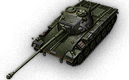<figcaption>Panzer 58 Mutz</figcaption></figure>
<strong>Damage (HP)</strong> <b>EU</b>  AP <strong>300</strong> /  APCR <strong>300</strong> /  HE <strong>360</strong> → <b>RU</b>  AP <strong>280</strong> /  APCR <strong>280</strong> /  HE <strong>370</strong>

<em>Firepower</em> 
<strong>DPM (HP/min)</strong> <small>EU</small> 2 346.75  <small>RU</small> <strong>2 467.94</strong> 
<strong>Rate of fire (rounds/min)</strong> <small>EU</small> 7.82  <small>RU</small> <strong>8.81</strong> 
<strong>Reload time (s)</strong> <small>EU</small> 7.67  <small>RU</small> <strong>6.81</strong> 
<strong>Potential damage</strong> <small>EU</small> 14 400  <small>RU</small> <strong>13 440</strong> 

<em>Mobility</em> 
<strong>Forward speed (km/h)</strong> <small>EU</small> 55  <small>RU</small> <strong>50</strong> 
<strong>Forward speed on hard terrain (km/h)</strong> <small>EU</small> 55  <small>RU</small> <strong>50</strong> 
<strong>Forward speed on medium terrain (km/h)</strong> <small>EU</small> 55  <small>RU</small> <strong>50</strong> 
<strong>Forward speed on soft terrain (km/h)</strong> <small>EU</small> 54.22  <small>RU</small> <strong>50</strong> 
<strong>Engine power (hp)</strong> <small>EU</small> 700  <small>RU</small> <strong>660</strong> 
<strong>Power/weight (hp/t)</strong> <small>EU</small> 19.94  <small>RU</small> <strong>18.80</strong> 

Rhm.-Borsig Waffenträger · Tier VIII

rhmborsigwaffenträger

<a href="https://tanks.gg/v20410/tank/rhm-b-wt">EU stats</a> · <a href="https://tanks.gg/v14600ru/tank/rhm-b-wt">RU stats</a>
<figure style="display:inline-block">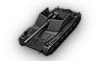<figcaption>Rhm.-Borsig Waffenträger</figcaption></figure>
<em>Mobility</em> 
<strong>Forward speed on soft terrain (km/h)</strong> <small>EU</small> 22.45  <small>RU</small> <strong>21.37</strong> 
<strong>Engine power (hp)</strong> <small>EU</small> 230  <small>RU</small> <strong>218.86</strong> 
<strong>Power/weight (hp/t)</strong> <small>EU</small> 12.39  <small>RU</small> <strong>11.79</strong> 
<strong>Tank traverse (°/s)</strong> <small>EU</small> 46.93  <small>RU</small> <strong>39.63</strong> 
<strong>Tank traverse on hard terrain (°/s)</strong> <small>EU</small> 54.54  <small>RU</small> <strong>48.10</strong> 
<strong>Tank traverse on medium terrain (°/s)</strong> <small>EU</small> 44.63  <small>RU</small> <strong>39.36</strong> 
<strong>Tank traverse on soft terrain (°/s)</strong> <small>EU</small> 23.38  <small>RU</small> <strong>20.62</strong> 

<em>Armor &amp; health</em> 
<strong>Health</strong> <small>EU</small> 1 150  <small>RU</small> <strong>1 100</strong> 
<strong>Health · engine</strong> <small>EU</small> 275  <small>RU</small> <strong>80</strong> 

Schwarzpanzer 58 · Tier VIII

schwarzpanzer58

<a href="https://tanks.gg/v20410/tank/schwarzpz58">EU stats</a> · <a href="https://tanks.gg/v14600ru/tank/schwarzpz58">RU stats</a>
<figure style="display:inline-block">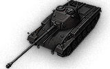<figcaption>Schwarzpanzer 58</figcaption></figure>
<strong>Damage (HP)</strong> <b>EU</b>  AP <strong>300</strong> /  APCR <strong>300</strong> /  HE <strong>360</strong> → <b>RU</b>  AP <strong>280</strong> /  APCR <strong>280</strong> /  HE <strong>370</strong>

<em>Firepower</em> 
<strong>DPM (HP/min)</strong> <small>EU</small> 2 346.75  <small>RU</small> <strong>2 467.94</strong> 
<strong>Rate of fire (rounds/min)</strong> <small>EU</small> 7.82  <small>RU</small> <strong>8.81</strong> 
<strong>Reload time (s)</strong> <small>EU</small> 7.67  <small>RU</small> <strong>6.81</strong> 
<strong>Potential damage</strong> <small>EU</small> 14 400  <small>RU</small> <strong>13 440</strong> 

<em>Mobility</em> 
<strong>Forward speed (km/h)</strong> <small>EU</small> 55  <small>RU</small> <strong>50</strong> 
<strong>Forward speed on hard terrain (km/h)</strong> <small>EU</small> 55  <small>RU</small> <strong>50</strong> 
<strong>Forward speed on medium terrain (km/h)</strong> <small>EU</small> 55  <small>RU</small> <strong>50</strong> 
<strong>Forward speed on soft terrain (km/h)</strong> <small>EU</small> 54.22  <small>RU</small> <strong>50</strong> 
<strong>Engine power (hp)</strong> <small>EU</small> 700  <small>RU</small> <strong>660</strong> 
<strong>Power/weight (hp/t)</strong> <small>EU</small> 19.94  <small>RU</small> <strong>18.80</strong> 

Tiger II · Tier VIII

tigerii

<a href="https://tanks.gg/v20410/tank/tiger-ii">EU stats</a> · <a href="https://tanks.gg/v14600ru/tank/tiger-ii">RU stats</a>
<figure style="display:inline-block">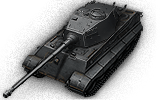<figcaption>EU · Tiger II</figcaption></figure><figure style="display:inline-block"><figcaption>RU · Tiger II</figcaption></figure>
<em>Gun handling</em> 
<strong>Aim time (s)</strong> <small>EU</small> 2.21  <small>RU</small> <strong>2.40</strong> 
<strong>Dispersion · turret traverse</strong> <small>EU</small> 0.10  <small>RU</small> <strong>0.12</strong> 

<em>Mobility</em> 
<strong>Forward speed on medium terrain (km/h)</strong> <small>EU</small> 38  <small>RU</small> <strong>33.09</strong> 
<strong>Forward speed on soft terrain (km/h)</strong> <small>EU</small> 20.99  <small>RU</small> <strong>17.26</strong> 
<strong>Engine power (hp)</strong> <small>EU</small> 900  <small>RU</small> <strong>740.10</strong> 
<strong>Power/weight (hp/t)</strong> <small>EU</small> 12.69  <small>RU</small> <strong>10.43</strong> 
<strong>Tank traverse (°/s)</strong> <small>EU</small> 33.38  <small>RU</small> <strong>29.20</strong> 
<strong>Tank traverse on hard terrain (°/s)</strong> <small>EU</small> 33.43  <small>RU</small> <strong>28.66</strong> 
<strong>Tank traverse on medium terrain (°/s)</strong> <small>EU</small> 27.86  <small>RU</small> <strong>23.88</strong> 
<strong>Tank traverse on soft terrain (°/s)</strong> <small>EU</small> 14.54  <small>RU</small> <strong>12.46</strong> 

<em>Armor &amp; health</em> 
<strong>Hull armor · side (mm)</strong> <small>EU</small> 80  <small>RU</small> <strong>100</strong> 
<strong>Turret armor · side (mm)</strong> <small>EU</small> 120  <small>RU</small> <strong>140</strong> 
<strong>Health</strong> <small>EU</small> 1 800  <small>RU</small> <strong>1 700</strong> 

Tiger II FL · Tier VIII

tigeriifl

<a href="https://tanks.gg/v20410/tank/tiger-ii-fl">EU stats</a> · <a href="https://tanks.gg/v14600ru/tank/tiger-ii-fl">RU stats</a>
<figure style="display:inline-block">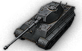<figcaption>Tiger II FL</figcaption></figure>
<em>Gun handling</em> 
<strong>Aim time (s)</strong> <small>EU</small> 2.21  <small>RU</small> <strong>2.40</strong> 
<strong>Dispersion · turret traverse</strong> <small>EU</small> 0.10  <small>RU</small> <strong>0.12</strong> 

<em>Mobility</em> 
<strong>Forward speed on medium terrain (km/h)</strong> <small>EU</small> 38  <small>RU</small> <strong>33.09</strong> 
<strong>Forward speed on soft terrain (km/h)</strong> <small>EU</small> 20.99  <small>RU</small> <strong>17.26</strong> 
<strong>Engine power (hp)</strong> <small>EU</small> 900  <small>RU</small> <strong>740.10</strong> 
<strong>Power/weight (hp/t)</strong> <small>EU</small> 12.69  <small>RU</small> <strong>10.43</strong> 
<strong>Tank traverse (°/s)</strong> <small>EU</small> 33.38  <small>RU</small> <strong>29.20</strong> 
<strong>Tank traverse on hard terrain (°/s)</strong> <small>EU</small> 31.71  <small>RU</small> <strong>27.74</strong> 
<strong>Tank traverse on medium terrain (°/s)</strong> <small>EU</small> 26.42  <small>RU</small> <strong>23.12</strong> 
<strong>Tank traverse on soft terrain (°/s)</strong> <small>EU</small> 13.79  <small>RU</small> <strong>12.06</strong> 

<em>Armor &amp; health</em> 
<strong>Health</strong> <small>EU</small> 1 800  <small>RU</small> <strong>1 600</strong> 

VK 100.01 (P) · Tier VIII

vk10001p

<a href="https://tanks.gg/v20410/tank/vk-10001-p">EU stats</a> · <a href="https://tanks.gg/v14600ru/tank/vk-10001-p">RU stats</a>
<figure style="display:inline-block">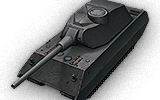<figcaption>VK 100.01 (P)</figcaption></figure>
<em>Firepower</em> 
<strong>Module damage</strong> <small>EU</small> 180  <small>RU</small> <strong>165</strong> 

<em>Mobility</em> 
<strong>Tank traverse on hard terrain (°/s)</strong> <small>EU</small> 16.13  <small>RU</small> <strong>17.72</strong> 
<strong>Tank traverse on medium terrain (°/s)</strong> <small>EU</small> 14.33  <small>RU</small> <strong>15.75</strong> 
<strong>Tank traverse on soft terrain (°/s)</strong> <small>EU</small> 6.45  <small>RU</small> <strong>7.09</strong> 

<em>Armor &amp; health</em> 
<strong>Health</strong> <small>EU</small> 1 800  <small>RU</small> <strong>1 700</strong> 

VK 168.01 (P) · Tier VIII

vk16801p

<a href="https://tanks.gg/v20410/tank/vk-16801-p">EU stats</a> · <a href="https://tanks.gg/v14600ru/tank/vk-16801-p">RU stats</a>
<figure style="display:inline-block">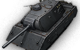<figcaption>VK 168.01 (P)</figcaption></figure>
<em>Armor &amp; health</em> 
<strong>Track armor</strong> <small>EU</small> 40  <small>RU</small> <strong>20</strong> 

VK 168.01 Mauerbrecher · Tier VIII

vk16801mauerbrecher

<a href="https://tanks.gg/v20410/tank/mauerbrecher">EU stats</a> · <a href="https://tanks.gg/v14600ru/tank/mauerbrecher">RU stats</a>
<figure style="display:inline-block">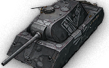<figcaption>VK 168.01 Mauerbrecher</figcaption></figure>
<em>Armor &amp; health</em> 
<strong>Track armor</strong> <small>EU</small> 40  <small>RU</small> <strong>20</strong> 

VK 45.02 (P) Ausf. A · Tier VIII

vk4502pausfa

<a href="https://tanks.gg/v20410/tank/vk-4502-a">EU stats</a> · <a href="https://tanks.gg/v14600ru/tank/vk-4502-a">RU stats</a>
<figure style="display:inline-block">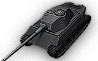<figcaption>VK 45.02 (P) Ausf. A</figcaption></figure>
<strong>Penetration (mm)</strong> <b>EU</b>  AP <strong>212</strong> /  APCR <strong>260</strong> /  HE <strong>60</strong> → <b>RU</b>  AP <strong>200</strong> /  APCR <strong>244</strong> /  HE <strong>60</strong>

<em>Firepower</em> 
<strong>DPM (HP/min)</strong> <small>EU</small> 2 301.79  <small>RU</small> <strong>1 982.73</strong> 
<strong>Rate of fire (rounds/min)</strong> <small>EU</small> 7.19  <small>RU</small> <strong>6.20</strong> 
<strong>Reload time (s)</strong> <small>EU</small> 8.34  <small>RU</small> <strong>9.68</strong> 

<em>Gun handling</em> 
<strong>Aim time (s)</strong> <small>EU</small> 1.92  <small>RU</small> <strong>2.21</strong> 
<strong>Dispersion (m/100 m)</strong> <small>EU</small> 0.34  <small>RU</small> <strong>0.35</strong> 
<strong>Dispersion · damaged</strong> <small>EU</small> 0.67  <small>RU</small> <strong>0.71</strong> 
<strong>Dispersion · moving</strong> <small>EU</small> 0.18  <small>RU</small> <strong>0.20</strong> 
<strong>Dispersion · tank traverse</strong> <small>EU</small> 0.18  <small>RU</small> <strong>0.20</strong> 

<em>Mobility</em> 
<strong>Forward speed (km/h)</strong> <small>EU</small> 38  <small>RU</small> <strong>32</strong> 
<strong>Forward speed on hard terrain (km/h)</strong> <small>EU</small> 38  <small>RU</small> <strong>32</strong> 
<strong>Forward speed on medium terrain (km/h)</strong> <small>EU</small> 38  <small>RU</small> <strong>32</strong> 
<strong>Forward speed on soft terrain (km/h)</strong> <small>EU</small> 26.71  <small>RU</small> <strong>20.13</strong> 
<strong>Reverse speed (km/h)</strong> <small>EU</small> 16  <small>RU</small> <strong>15</strong> 
<strong>Engine power (hp)</strong> <small>EU</small> 920  <small>RU</small> <strong>888.12</strong> 
<strong>Weight (kg)</strong> <small>EU</small> 57 000 → <small>RU</small> <strong>73 000</strong> 
<strong>Power/weight (hp/t)</strong> <small>EU</small> 16.14  <small>RU</small> <strong>12.17</strong> 
<strong>Turret traverse (°/s)</strong> <small>EU</small> 26.08  <small>RU</small> <strong>22.95</strong> 
<strong>Tank traverse (°/s)</strong> <small>EU</small> 44.85  <small>RU</small> <strong>22.95</strong> 
<strong>Tank traverse on hard terrain (°/s)</strong> <small>EU</small> 42.81  <small>RU</small> <strong>29</strong> 
<strong>Tank traverse on medium terrain (°/s)</strong> <small>EU</small> 36.23  <small>RU</small> <strong>24.54</strong> 
<strong>Tank traverse on soft terrain (°/s)</strong> <small>EU</small> 20.48  <small>RU</small> <strong>13.87</strong> 

<em>Armor &amp; health</em> 
<strong>Hull armor · front (mm)</strong> <small>EU</small> 150  <small>RU</small> <strong>170</strong> 
<strong>Hull armor · side (mm)</strong> <small>EU</small> 80  <small>RU</small> <strong>120</strong> 
<strong>Turret armor · rear (mm)</strong> <small>EU</small> 120  <small>RU</small> <strong>80</strong> 
<strong>Health</strong> <small>EU</small> 1 750  <small>RU</small> <strong>1 650</strong> 

<em>Miscellaneous</em> 
<strong>Fire chance (%)</strong> <small>EU</small> 20  <small>RU</small> <strong>15</strong> 

VK 75.01 (K) · Tier VIII

vk7501k

<a href="https://tanks.gg/v20410/tank/vk-7501-k">EU stats</a> · <a href="https://tanks.gg/v14600ru/tank/vk-7501-k">RU stats</a>
<figure style="display:inline-block">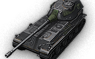<figcaption>VK 75.01 (K)</figcaption></figure>
<em>Firepower</em> 
<strong>DPM (HP/min)</strong> <small>EU</small> 1 722.71  <small>RU</small> <strong>1 916.51</strong> 
<strong>Rate of fire (rounds/min)</strong> <small>EU</small> 3.52  <small>RU</small> <strong>3.91</strong> 
<strong>Reload time (s)</strong> <small>EU</small> 17.07  <small>RU</small> <strong>15.34</strong> 

<em>Gun handling</em> 
<strong>Dispersion · moving</strong> <small>EU</small> 0.28  <small>RU</small> <strong>0.22</strong> 
<strong>Dispersion · tank traverse</strong> <small>EU</small> 0.28  <small>RU</small> <strong>0.22</strong> 
<strong>Dispersion · turret traverse</strong> <small>EU</small> 0.17  <small>RU</small> <strong>0.14</strong> 
<strong>Depression (°)</strong> <small>EU</small> 5  <small>RU</small> <strong>7</strong> 

