# Germany · Tier IX

[All nations and tiers](../buffs_nerfs.md) · EU v20410 → RU v14600ru · 3 November 2026

<label><strong>Find a tank</strong><input type="search" placeholder="Try is7, obj140 or xm57" aria-label="Find a tank" style="display:block;width:100%;padding:.7rem;border:1px solid #888;border-radius:4px;margin:.5rem 0;color:inherit;background:transparent"></label>

E 50 · Tier IX

e50

<a href="https://tanks.gg/v20410/tank/e-50">EU stats</a> · <a href="https://tanks.gg/v14600ru/tank/e-50">RU stats</a>
<figure style="display:inline-block">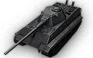<figcaption>E 50</figcaption></figure>
<em>Mobility</em> 
<strong>Forward speed on medium terrain (km/h)</strong> <small>EU</small> 60  <small>RU</small> <strong>57.85</strong> 
<strong>Forward speed on soft terrain (km/h)</strong> <small>EU</small> 28.95  <small>RU</small> <strong>27.55</strong> 
<strong>Engine power (hp)</strong> <small>EU</small> 1 000  <small>RU</small> <strong>951.55</strong> 
<strong>Power/weight (hp/t)</strong> <small>EU</small> 15.97  <small>RU</small> <strong>15.20</strong> 
<strong>Tank traverse (°/s)</strong> <small>EU</small> 45.89  <small>RU</small> <strong>33.38</strong> 
<strong>Tank traverse on hard terrain (°/s)</strong> <small>EU</small> 47.56  <small>RU</small> <strong>38.54</strong> 
<strong>Tank traverse on medium terrain (°/s)</strong> <small>EU</small> 38.05  <small>RU</small> <strong>30.83</strong> 
<strong>Tank traverse on soft terrain (°/s)</strong> <small>EU</small> 18.12  <small>RU</small> <strong>14.68</strong> 

<em>Armor &amp; health</em> 
<strong>Health</strong> <small>EU</small> 1 800  <small>RU</small> <strong>1 750</strong> 

E 50 FL · Tier IX

e50fl

<a href="https://tanks.gg/v20410/tank/e-50-fl">EU stats</a> · <a href="https://tanks.gg/v14600ru/tank/e-50-fl">RU stats</a>
<figure style="display:inline-block"><figcaption>E 50 FL</figcaption></figure>
<em>Mobility</em> 
<strong>Forward speed on medium terrain (km/h)</strong> <small>EU</small> 60  <small>RU</small> <strong>57.85</strong> 
<strong>Forward speed on soft terrain (km/h)</strong> <small>EU</small> 28.95  <small>RU</small> <strong>27.55</strong> 
<strong>Engine power (hp)</strong> <small>EU</small> 1 000  <small>RU</small> <strong>951.55</strong> 
<strong>Power/weight (hp/t)</strong> <small>EU</small> 15.97  <small>RU</small> <strong>15.20</strong> 
<strong>Tank traverse (°/s)</strong> <small>EU</small> 45.89  <small>RU</small> <strong>33.38</strong> 
<strong>Tank traverse on hard terrain (°/s)</strong> <small>EU</small> 43.60  <small>RU</small> <strong>31.71</strong> 
<strong>Tank traverse on medium terrain (°/s)</strong> <small>EU</small> 34.88  <small>RU</small> <strong>25.37</strong> 
<strong>Tank traverse on soft terrain (°/s)</strong> <small>EU</small> 16.61  <small>RU</small> <strong>12.08</strong> 

<em>Armor &amp; health</em> 
<strong>Health</strong> <small>EU</small> 1 800  <small>RU</small> <strong>1 750</strong> 

E 75 · Tier IX

e75

<a href="https://tanks.gg/v20410/tank/e-75">EU stats</a> · <a href="https://tanks.gg/v14600ru/tank/e-75">RU stats</a>
<figure style="display:inline-block">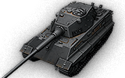<figcaption>E 75</figcaption></figure>
<em>Gun handling</em> 
<strong>Dispersion (m/100 m)</strong> <small>EU</small> 0.37  <small>RU</small> <strong>0.35</strong> 
<strong>Dispersion · damaged</strong> <small>EU</small> 0.75  <small>RU</small> <strong>0.71</strong> 

<em>Mobility</em> 
<strong>Forward speed on hard terrain (km/h)</strong> <small>EU</small> 37.77  <small>RU</small> <strong>35.94</strong> 
<strong>Forward speed on medium terrain (km/h)</strong> <small>EU</small> 34.62  <small>RU</small> <strong>32.95</strong> 
<strong>Forward speed on soft terrain (km/h)</strong> <small>EU</small> 18.89  <small>RU</small> <strong>17.97</strong> 
<strong>Engine power (hp)</strong> <small>EU</small> 1 000  <small>RU</small> <strong>951.55</strong> 
<strong>Power/weight (hp/t)</strong> <small>EU</small> 10.92  <small>RU</small> <strong>10.39</strong> 
<strong>Tank traverse (°/s)</strong> <small>EU</small> 25.03  <small>RU</small> <strong>31.29</strong> 
<strong>Tank traverse on hard terrain (°/s)</strong> <small>EU</small> 24.31  <small>RU</small> <strong>35.46</strong> 
<strong>Tank traverse on medium terrain (°/s)</strong> <small>EU</small> 22.28  <small>RU</small> <strong>32.51</strong> 
<strong>Tank traverse on soft terrain (°/s)</strong> <small>EU</small> 12.15  <small>RU</small> <strong>17.73</strong> 

<em>Armor &amp; health</em> 
<strong>Health</strong> <small>EU</small> 2 000  <small>RU</small> <strong>1 950</strong> 

E 77 · Tier IX

e77

<a href="https://tanks.gg/v20410/tank/e-77">EU stats</a> · <a href="https://tanks.gg/v14600ru/tank/e-77">RU stats</a>
<figure style="display:inline-block">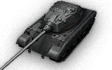<figcaption>EU · E 77</figcaption></figure><figure style="display:inline-block">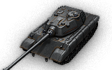<figcaption>RU · E 77</figcaption></figure>
<strong>Damage (HP)</strong> <b>EU</b>  AP <strong>460</strong> /  APCR <strong>460</strong> /  HE <strong>640</strong> → <b>RU</b>  AP <strong>530</strong> /  APCR <strong>530</strong> /  HE <strong>670</strong>

<em>Firepower</em> 
<strong>DPM (HP/min)</strong> <small>EU</small> 2 248.97  <small>RU</small> <strong>2 047.37</strong> 
<strong>Module damage</strong> <small>EU</small> 165  <small>RU</small> <strong>180</strong> 
<strong>Rate of fire (rounds/min)</strong> <small>EU</small> 4.89  <small>RU</small> <strong>3.86</strong> 
<strong>Reload time (s)</strong> <small>EU</small> 12.27  <small>RU</small> <strong>15.53</strong> 
<strong>Shell velocity (m/s)</strong> <small>EU</small> 1 080  <small>RU</small> <strong>920</strong> 
<strong>Potential damage</strong> <small>EU</small> 18 400  <small>RU</small> <strong>21 200</strong> 

<em>Gun handling</em> 
<strong>Aim time (s)</strong> <small>EU</small> 2.40  <small>RU</small> <strong>2.59</strong> 
<strong>Dispersion (m/100 m)</strong> <small>EU</small> 0.37  <small>RU</small> <strong>0.34</strong> 
<strong>Dispersion · damaged</strong> <small>EU</small> 0.75  <small>RU</small> <strong>0.67</strong> 
<strong>Dispersion · moving</strong> <small>EU</small> 0.24  <small>RU</small> <strong>0.22</strong> 
<strong>Dispersion · tank traverse</strong> <small>EU</small> 0.24  <small>RU</small> <strong>0.22</strong> 
<strong>Dispersion · firing</strong> <small>EU</small> 3  <small>RU</small> <strong>4</strong> 

<em>Mobility</em> 
<strong>Forward speed (km/h)</strong> <small>EU</small> 40  <small>RU</small> <strong>45</strong> 
<strong>Forward speed on hard terrain (km/h)</strong> <small>EU</small> 40  <small>RU</small> <strong>42.58</strong> 
<strong>Forward speed on medium terrain (km/h)</strong> <small>EU</small> 34.79  <small>RU</small> <strong>39.03</strong> 
<strong>Forward speed on soft terrain (km/h)</strong> <small>EU</small> 23.66  <small>RU</small> <strong>21.29</strong> 
<strong>Engine power (hp)</strong> <small>EU</small> 1 010  <small>RU</small> <strong>800</strong> 
<strong>Power/weight (hp/t)</strong> <small>EU</small> 15.54  <small>RU</small> <strong>12.31</strong> 
<strong>Terrain resist (med)</strong> <small>EU</small> 1.63  <small>RU</small> <strong>1.15</strong> 
<strong>Terrain resist (soft)</strong> <small>EU</small> 2.40  <small>RU</small> <strong>2.11</strong> 
<strong>Turret traverse (°/s)</strong> <small>EU</small> 26.08  <small>RU</small> <strong>25.03</strong> 
<strong>Tank traverse (°/s)</strong> <small>EU</small> 31.29  <small>RU</small> <strong>34.42</strong> 
<strong>Tank traverse on hard terrain (°/s)</strong> <small>EU</small> 29.73  <small>RU</small> <strong>32.70</strong> 
<strong>Tank traverse on medium terrain (°/s)</strong> <small>EU</small> 19.23  <small>RU</small> <strong>29.97</strong> 
<strong>Tank traverse on soft terrain (°/s)</strong> <small>EU</small> 13.08  <small>RU</small> <strong>16.35</strong> 

<em>Armor &amp; health</em> 
<strong>Hull armor · front (mm)</strong> <small>EU</small> 135  <small>RU</small> <strong>160</strong> 
<strong>Hull armor · rear (mm)</strong> <small>EU</small> 80  <small>RU</small> <strong>50</strong> 
<strong>Turret armor · front (mm)</strong> <small>EU</small> 290  <small>RU</small> <strong>250</strong> 
<strong>Turret armor · side (mm)</strong> <small>EU</small> 160  <small>RU</small> <strong>130</strong> 
<strong>Turret armor · rear (mm)</strong> <small>EU</small> 80  <small>RU</small> <strong>50</strong> 
<strong>Health</strong> <small>EU</small> 1 800  <small>RU</small> <strong>1 850</strong> 

<em>Miscellaneous</em> 
<strong>Stationary camo</strong> <small>EU</small> 5.53  <small>RU</small> <strong>6.16</strong> 
<strong>Stationary camo · after firing</strong> <small>EU</small> 0.90  <small>RU</small> <strong>0.94</strong> 
<strong>Moving camo</strong> <small>EU</small> 2.74  <small>RU</small> <strong>3.08</strong> 
<strong>Moving camo · after firing</strong> <small>EU</small> 0.44  <small>RU</small> <strong>0.47</strong> 
<strong>Shell cost</strong> <small>EU</small> 1 070  <small>RU</small> <strong>1 130</strong> 

G.W. Tiger · Tier IX

gwtiger

<a href="https://tanks.gg/v20410/tank/gw-tiger">EU stats</a> · <a href="https://tanks.gg/v14600ru/tank/gw-tiger">RU stats</a>
<figure style="display:inline-block">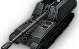<figcaption>G.W. Tiger</figcaption></figure>
<strong>Penetration (mm)</strong> <b>EU</b>  HE <strong>53</strong> /  HE <strong>66</strong> /  AP <strong>296</strong> → <b>RU</b>  HE <strong>53</strong> /  AP <strong>296</strong>

<strong>Damage (HP)</strong> <b>EU</b>  HE <strong>900</strong> /  HE <strong>1200</strong> /  AP <strong>640</strong> → <b>RU</b>  HE <strong>1250</strong> /  AP <strong>700</strong>

<em>Firepower</em> 
<strong>DPM (HP/min)</strong> <small>EU</small> 1 341  <small>RU</small> <strong>1 862.50</strong> 
<strong>Explosion radius</strong> <small>EU</small> 11.40  <small>RU</small> <strong>9</strong> 
<strong>Stun duration · maximum (s)</strong> <small>EU</small> 31 → <small>RU</small> <strong>—</strong> 
<strong>Stun duration · minimum (s)</strong> <small>EU</small> 12.40 → <small>RU</small> <strong>—</strong> 
<strong>Potential damage</strong> <small>EU</small> 13 500  <small>RU</small> <strong>18 750</strong> 

<em>Mobility</em> 
<strong>Tank traverse on hard terrain (°/s)</strong> <small>EU</small> 17.19  <small>RU</small> <strong>17.16</strong> 
<strong>Tank traverse on medium terrain (°/s)</strong> <small>EU</small> 14.90  <small>RU</small> <strong>14.87</strong> 
<strong>Tank traverse on soft terrain (°/s)</strong> <small>EU</small> 8.94  <small>RU</small> <strong>8.92</strong> 

<em>Armor &amp; health</em> 
<strong>Health · ammo rack</strong> <small>EU</small> 230  <small>RU</small> <strong>134</strong> 

<em>Miscellaneous</em> 
<strong>Shell cost</strong> <small>EU</small> 2 080  <small>RU</small> <strong>2 390</strong> 

Jagdtiger · Tier IX

jagdtiger

<a href="https://tanks.gg/v20410/tank/jagdtiger">EU stats</a> · <a href="https://tanks.gg/v14600ru/tank/jagdtiger">RU stats</a>
<figure style="display:inline-block">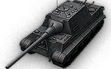<figcaption>Jagdtiger</figcaption></figure>
<em>Mobility</em> 
<strong>Forward speed on hard terrain (km/h)</strong> <small>EU</small> 38  <small>RU</small> <strong>33.92</strong> 
<strong>Forward speed on medium terrain (km/h)</strong> <small>EU</small> 32.18  <small>RU</small> <strong>28.70</strong> 
<strong>Forward speed on soft terrain (km/h)</strong> <small>EU</small> 17.43  <small>RU</small> <strong>15.54</strong> 
<strong>Engine power (hp)</strong> <small>EU</small> 830  <small>RU</small> <strong>740.10</strong> 
<strong>Power/weight (hp/t)</strong> <small>EU</small> 10.99  <small>RU</small> <strong>9.80</strong> 
<strong>Tank traverse (°/s)</strong> <small>EU</small> 31.29  <small>RU</small> <strong>27.12</strong> 
<strong>Tank traverse on hard terrain (°/s)</strong> <small>EU</small> 31.68  <small>RU</small> <strong>27.39</strong> 
<strong>Tank traverse on medium terrain (°/s)</strong> <small>EU</small> 26.81  <small>RU</small> <strong>23.18</strong> 
<strong>Tank traverse on soft terrain (°/s)</strong> <small>EU</small> 14.52  <small>RU</small> <strong>12.56</strong> 

<em>Armor &amp; health</em> 
<strong>Health</strong> <small>EU</small> 2 000  <small>RU</small> <strong>2 100</strong> 
<strong>Health · engine</strong> <small>EU</small> 310  <small>RU</small> <strong>260</strong> 
<strong>Health · track</strong> <small>EU</small> 240  <small>RU</small> <strong>250</strong> 
<strong>Track repair time (s)</strong> <small>EU</small> 11.70  <small>RU</small> <strong>12.03</strong> 

Jagdtiger FL · Tier IX

jagdtigerfl

<a href="https://tanks.gg/v20410/tank/jagdtiger-fl">EU stats</a> · <a href="https://tanks.gg/v14600ru/tank/jagdtiger-fl">RU stats</a>
<figure style="display:inline-block"><figcaption>Jagdtiger FL</figcaption></figure>
<em>Mobility</em> 
<strong>Forward speed on hard terrain (km/h)</strong> <small>EU</small> 38  <small>RU</small> <strong>33.92</strong> 
<strong>Forward speed on medium terrain (km/h)</strong> <small>EU</small> 32.18  <small>RU</small> <strong>28.70</strong> 
<strong>Forward speed on soft terrain (km/h)</strong> <small>EU</small> 17.43  <small>RU</small> <strong>15.54</strong> 
<strong>Engine power (hp)</strong> <small>EU</small> 830  <small>RU</small> <strong>740.10</strong> 
<strong>Power/weight (hp/t)</strong> <small>EU</small> 10.99  <small>RU</small> <strong>9.80</strong> 
<strong>Tank traverse (°/s)</strong> <small>EU</small> 31.29  <small>RU</small> <strong>27.12</strong> 
<strong>Tank traverse on hard terrain (°/s)</strong> <small>EU</small> 29.73  <small>RU</small> <strong>25.76</strong> 
<strong>Tank traverse on medium terrain (°/s)</strong> <small>EU</small> 25.15  <small>RU</small> <strong>21.80</strong> 
<strong>Tank traverse on soft terrain (°/s)</strong> <small>EU</small> 13.62  <small>RU</small> <strong>11.81</strong> 

<em>Armor &amp; health</em> 
<strong>Health</strong> <small>EU</small> 2 000  <small>RU</small> <strong>2 100</strong> 
<strong>Health · engine</strong> <small>EU</small> 310  <small>RU</small> <strong>260</strong> 
<strong>Health · track</strong> <small>EU</small> 240  <small>RU</small> <strong>250</strong> 
<strong>Track repair time (s)</strong> <small>EU</small> 11.70  <small>RU</small> <strong>12.03</strong> 

KJPZ TIII Jäger · Tier IX

kjpztiiijäger

<a href="https://tanks.gg/v20410/tank/tiii-jager">EU stats</a> · <a href="https://tanks.gg/v14600ru/tank/tiii-jager">RU stats</a>
<figure style="display:inline-block">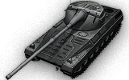<figcaption>EU · KJPZ TIII Jäger</figcaption></figure><figure style="display:inline-block">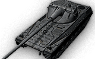<figcaption>RU · KJPZ TIII Jäger</figcaption></figure>
<strong>Penetration (mm)</strong> <b>EU</b>  AP <strong>268</strong> /  APCR <strong>326</strong> /  HE <strong>65</strong> → <b>RU</b>  APCR <strong>256</strong> /  HEAT <strong>320</strong> /  HE <strong>110</strong>

<strong>Damage (HP)</strong> <b>EU</b>  AP <strong>450</strong> /  APCR <strong>450</strong> /  HE <strong>530</strong> → <b>RU</b>  APCR <strong>390</strong> /  HEAT <strong>390</strong> /  HE <strong>515</strong>

<em>Firepower</em> 
<strong>DPM (HP/min)</strong> <small>EU</small> 2 816.10  <small>RU</small> <strong>2 179.13</strong> 
<strong>Module damage</strong> <small>EU</small> 165  <small>RU</small> <strong>160</strong> 
<strong>Rate of fire (rounds/min)</strong> <small>EU</small> 6.26  <small>RU</small> <strong>5.59</strong> 
<strong>Reload time (s)</strong> <small>EU</small> 9.59  <small>RU</small> <strong>10.74</strong> 
<strong>Shell velocity (m/s)</strong> <small>EU</small> 1 210  <small>RU</small> <strong>1 334</strong> 
<strong>Normalization</strong> <small>EU</small> 5  <small>RU</small> <strong>2</strong> 
<strong>Ammo capacity</strong> <small>EU</small> 44  <small>RU</small> <strong>60</strong> 
<strong>Potential damage</strong> <small>EU</small> 19 800  <small>RU</small> <strong>23 400</strong> 
<strong>Clip size</strong> <small>EU</small> — → <small>RU</small> <strong>3</strong> 
<strong>Clip damage · damage</strong> <small>EU</small> — → <small>RU</small> <strong>1 170</strong> 
<strong>Clip damage · time (s)</strong> <small>EU</small> — → <small>RU</small> <strong>10</strong> 
<strong>Intra-clip reload</strong> <small>EU</small> — → <small>RU</small> <strong>5</strong> 

<em>Gun handling</em> 
<strong>Aim time (s)</strong> <small>EU</small> 1.53  <small>RU</small> <strong>1.73</strong> 
<strong>Dispersion (m/100 m)</strong> <small>EU</small> 0.27  <small>RU</small> <strong>0.31</strong> 
<strong>Dispersion · damaged</strong> <small>EU</small> 0.54  <small>RU</small> <strong>0.61</strong> 
<strong>Dispersion · moving</strong> <small>EU</small> 0.20  <small>RU</small> <strong>0.26</strong> 
<strong>Dispersion · tank traverse</strong> <small>EU</small> 0.20  <small>RU</small> <strong>0.26</strong> 
<strong>Dispersion · firing</strong> <small>EU</small> 4  <small>RU</small> <strong>7</strong> 
<strong>Depression (°)</strong> <small>EU</small> 7  <small>RU</small> <strong>10</strong> 
<strong>Gun traverse · left (°)</strong> <small>EU</small> -30  <small>RU</small> <strong>-180</strong> 
<strong>Gun traverse · right (°)</strong> <small>EU</small> 30  <small>RU</small> <strong>180</strong> 

<em>Mobility</em> 
<strong>Forward speed (km/h)</strong> <small>EU</small> 45  <small>RU</small> <strong>55</strong> 
<strong>Forward speed on hard terrain (km/h)</strong> <small>EU</small> 45  <small>RU</small> <strong>55</strong> 
<strong>Forward speed on medium terrain (km/h)</strong> <small>EU</small> 45  <small>RU</small> <strong>55</strong> 
<strong>Forward speed on soft terrain (km/h)</strong> <small>EU</small> 29.91  <small>RU</small> <strong>38.22</strong> 
<strong>Reverse speed (km/h)</strong> <small>EU</small> 18  <small>RU</small> <strong>16</strong> 
<strong>Engine power (hp)</strong> <small>EU</small> 900  <small>RU</small> <strong>1 150</strong> 
<strong>Power/weight (hp/t)</strong> <small>EU</small> 18.07  <small>RU</small> <strong>23.09</strong> 
<strong>Turret traverse (°/s)</strong> <small>EU</small> 31.29  <small>RU</small> <strong>25.03</strong> 
<strong>Tank traverse (°/s)</strong> <small>EU</small> 41.72  <small>RU</small> <strong>31.29</strong> 
<strong>Tank traverse on hard terrain (°/s)</strong> <small>EU</small> 39.63  <small>RU</small> <strong>29.73</strong> 
<strong>Tank traverse on medium terrain (°/s)</strong> <small>EU</small> 33.54  <small>RU</small> <strong>25.15</strong> 
<strong>Tank traverse on soft terrain (°/s)</strong> <small>EU</small> 18.96  <small>RU</small> <strong>14.22</strong> 

<em>Armor &amp; health</em> 
<strong>Hull armor · front (mm)</strong> <small>EU</small> 30  <small>RU</small> <strong>54</strong> 
<strong>Health</strong> <small>EU</small> 1 700  <small>RU</small> <strong>1 500</strong> 
<strong>Health · engine</strong> <small>EU</small> 255  <small>RU</small> <strong>360</strong> 
<strong>Health · ammo rack</strong> <small>EU</small> 220  <small>RU</small> <strong>260</strong> 

<em>Miscellaneous</em> 
<strong>View range (m)</strong> <small>EU</small> 370  <small>RU</small> <strong>380</strong> 

KPz 3 Projekt 07 HK · Tier IX

kpz3projekt07hk

<a href="https://tanks.gg/v20410/tank/kpz-3-pr07hk">EU stats</a> · <a href="https://tanks.gg/v14600ru/tank/kpz-3-pr07hk">RU stats</a>
<figure style="display:inline-block">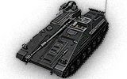<figcaption>KPz 3 Projekt 07 HK</figcaption></figure>
<em>Firepower</em> 
<strong>DPM (HP/min)</strong> <small>EU</small> 3 465.97  <small>RU</small> <strong>2 682</strong> 
<strong>Rate of fire (rounds/min)</strong> <small>EU</small> 9.63  <small>RU</small> <strong>7.45</strong> 
<strong>Reload time (s)</strong> <small>EU</small> 6.23  <small>RU</small> <strong>8.05</strong> 

<em>Gun handling</em> 
<strong>Aim time (s)</strong> <small>EU</small> 2.40  <small>RU</small> <strong>2.45</strong> 
<strong>Dispersion · damaged</strong> <small>EU</small> 0.67  <small>RU</small> <strong>0.69</strong> 
<strong>Dispersion · moving</strong> <small>EU</small> 0.06  <small>RU</small> <strong>0.12</strong> 
<strong>Dispersion · tank traverse</strong> <small>EU</small> 0.06  <small>RU</small> <strong>0.12</strong> 
<strong>Dispersion · turret traverse</strong> <small>EU</small> 0.05  <small>RU</small> <strong>0.10</strong> 

<em>Mobility</em> 
<strong>Turret traverse (°/s)</strong> <small>EU</small> 16.69  <small>RU</small> <strong>16.34</strong> 

<em>Armor &amp; health</em> 
<strong>Health</strong> <small>EU</small> 1 700  <small>RU</small> <strong>1 600</strong> 
<strong>Health · engine</strong> <small>EU</small> 360  <small>RU</small> <strong>400</strong> 

Alternate mode

<a href="https://tanks.gg/v20410/tank/kpz-3-pr07hk-siege">EU stats</a> · <a href="https://tanks.gg/v14600ru/tank/kpz-3-pr07hk-siege">RU stats</a>
<em>Firepower</em> 
<strong>DPM (HP/min)</strong> <small>EU</small> 2 619.63  <small>RU</small> <strong>3 313.06</strong> 
<strong>Rate of fire (rounds/min)</strong> <small>EU</small> 7.28  <small>RU</small> <strong>9.20</strong> 
<strong>Reload time (s)</strong> <small>EU</small> 8.25  <small>RU</small> <strong>6.52</strong> 

<em>Gun handling</em> 
<strong>Aim time (s)</strong> <small>EU</small> 1.44  <small>RU</small> <strong>1.47</strong> 
<strong>Dispersion · damaged</strong> <small>EU</small> 0.48  <small>RU</small> <strong>0.49</strong> 
<strong>Dispersion · moving</strong> <small>EU</small> 0.30  <small>RU</small> <strong>0.12</strong> 
<strong>Dispersion · tank traverse</strong> <small>EU</small> 0.20  <small>RU</small> <strong>0.12</strong> 
<strong>Dispersion · turret traverse</strong> <small>EU</small> 0.05  <small>RU</small> <strong>0.10</strong> 

<em>Mobility</em> 
<strong>Turret traverse (°/s)</strong> <small>EU</small> 16.69  <small>RU</small> <strong>16.34</strong> 

<em>Armor &amp; health</em> 
<strong>Health</strong> <small>EU</small> 1 700  <small>RU</small> <strong>1 600</strong> 
<strong>Health · engine</strong> <small>EU</small> 360  <small>RU</small> <strong>400</strong> 

Kpz. Erich Konzept I · EU IX → RU X

kpzerichkonzepti

<a href="https://tanks.gg/v20410/tank/kpz-ek-i">EU stats</a> · <a href="https://tanks.gg/v14600ru/tank/erich-kn-i">RU stats</a>
<figure style="display:inline-block">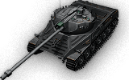<figcaption>EU · Kpz. Erich Konzept I</figcaption></figure><figure style="display:inline-block">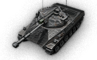<figcaption>RU · Erich Konzept I</figcaption></figure>
<strong>Penetration (mm)</strong> <b>EU</b>  APCR <strong>270</strong> /  HEAT <strong>320</strong> /  HE <strong>60</strong> → <b>RU</b>  AP <strong>254</strong> /  HEAT <strong>320</strong> /  HE <strong>76</strong>

<strong>Damage (HP)</strong> <b>EU</b>  APCR <strong>400</strong> /  HEAT <strong>400</strong> /  HE <strong>515</strong> → <b>RU</b>  AP <strong>700</strong> /  HEAT <strong>700</strong> /  HE <strong>910</strong>

<em>General</em> 
<strong>Tier</strong> <small>EU</small> 9 → <small>RU</small> <strong>10</strong> 

<em>Firepower</em> 
<strong>DPM (HP/min)</strong> <small>EU</small> 2 406.92  <small>RU</small> <strong>1 991.18</strong> 
<strong>Module damage</strong> <small>EU</small> 165  <small>RU</small> <strong>203</strong> 
<strong>Rate of fire (rounds/min)</strong> <small>EU</small> 6.02  <small>RU</small> <strong>2.84</strong> 
<strong>Reload time (s)</strong> <small>EU</small> 9.97  <small>RU</small> <strong>21.09</strong> 
<strong>Caliber</strong> <small>EU</small> 120  <small>RU</small> <strong>152.40</strong> 
<strong>Shell velocity (m/s)</strong> <small>EU</small> 1 350  <small>RU</small> <strong>900</strong> 
<strong>Normalization</strong> <small>EU</small> 2  <small>RU</small> <strong>5</strong> 
<strong>Ammo capacity</strong> <small>EU</small> 50  <small>RU</small> <strong>24</strong> 
<strong>Potential damage</strong> <small>EU</small> 20 000  <small>RU</small> <strong>16 800</strong> 

<em>Gun handling</em> 
<strong>Aim time (s)</strong> <small>EU</small> 2.11  <small>RU</small> <strong>2.88</strong> 
<strong>Dispersion (m/100 m)</strong> <small>EU</small> 0.29  <small>RU</small> <strong>0.40</strong> 
<strong>Dispersion · damaged</strong> <small>EU</small> 0.58  <small>RU</small> <strong>0.81</strong> 
<strong>Dispersion · moving</strong> <small>EU</small> 0.14  <small>RU</small> <strong>0.20</strong> 
<strong>Dispersion · tank traverse</strong> <small>EU</small> 0.14  <small>RU</small> <strong>0.20</strong> 
<strong>Dispersion · turret traverse</strong> <small>EU</small> 0.10  <small>RU</small> <strong>0.08</strong> 
<strong>Dispersion · firing</strong> <small>EU</small> 3.50  <small>RU</small> <strong>3</strong> 
<strong>Depression (°)</strong> <small>EU</small> 10  <small>RU</small> <strong>12</strong> 

<em>Mobility</em> 
<strong>Forward speed (km/h)</strong> <small>EU</small> 65  <small>RU</small> <strong>70</strong> 
<strong>Forward speed on hard terrain (km/h)</strong> <small>EU</small> 65  <small>RU</small> <strong>70</strong> 
<strong>Forward speed on medium terrain (km/h)</strong> <small>EU</small> 65  <small>RU</small> <strong>70</strong> 
<strong>Forward speed on soft terrain (km/h)</strong> <small>EU</small> 41.19  <small>RU</small> <strong>70</strong> 
<strong>Reverse speed (km/h)</strong> <small>EU</small> 20  <small>RU</small> <strong>25</strong> 
<strong>Engine power (hp)</strong> <small>EU</small> 1 000  <small>RU</small> <strong>1 470</strong> 
<strong>Weight (kg)</strong> <small>EU</small> 44 000 → <small>RU</small> <strong>47 000</strong> 
<strong>Power/weight (hp/t)</strong> <small>EU</small> 22.73  <small>RU</small> <strong>31.28</strong> 
<strong>Terrain resist (soft)</strong> <small>EU</small> 2.01  <small>RU</small> <strong>1.54</strong> 
<strong>Turret traverse (°/s)</strong> <small>EU</small> 39.63  <small>RU</small> <strong>31.29</strong> 
<strong>Tank traverse (°/s)</strong> <small>EU</small> 50.06  <small>RU</small> <strong>33.38</strong> 
<strong>Tank traverse on hard terrain (°/s)</strong> <small>EU</small> 47.56  <small>RU</small> <strong>31.71</strong> 
<strong>Tank traverse on medium terrain (°/s)</strong> <small>EU</small> 38.05  <small>RU</small> <strong>25.37</strong> 
<strong>Tank traverse on soft terrain (°/s)</strong> <small>EU</small> 18.12  <small>RU</small> <strong>15.82</strong> 

<em>Armor &amp; health</em> 
<strong>Hull armor · front (mm)</strong> <small>EU</small> 50  <small>RU</small> <strong>70</strong> 
<strong>Hull armor · side (mm)</strong> <small>EU</small> 35  <small>RU</small> <strong>65</strong> 
<strong>Turret armor · front (mm)</strong> <small>EU</small> 90  <small>RU</small> <strong>70</strong> 
<strong>Track armor</strong> <small>EU</small> 20  <small>RU</small> <strong>25</strong> 
<strong>Health</strong> <small>EU</small> 1 650  <small>RU</small> <strong>1 850</strong> 
<strong>Health · engine</strong> <small>EU</small> 310  <small>RU</small> <strong>255</strong> 
<strong>Health · track</strong> <small>EU</small> 240  <small>RU</small> <strong>250</strong> 
<strong>Health · ammo rack</strong> <small>EU</small> 230  <small>RU</small> <strong>260</strong> 
<strong>Track repair time (s)</strong> <small>EU</small> 11.70  <small>RU</small> <strong>12.03</strong> 

<em>Miscellaneous</em> 
<strong>Stationary camo · after firing</strong> <small>EU</small> 2.33  <small>RU</small> <strong>1.75</strong> 
<strong>Moving camo · after firing</strong> <small>EU</small> 1.74  <small>RU</small> <strong>1.31</strong> 
<strong>Radio range (m)</strong> <small>EU</small> 670  <small>RU</small> <strong>750</strong> 
<strong>Shell cost</strong> <small>EU</small> 996  <small>RU</small> <strong>1 680</strong> 

Kunze Panzer · Tier IX

kunzepanzer

<a href="https://tanks.gg/v20410/tank/kunze-panzer">EU stats</a> · <a href="https://tanks.gg/v14600ru/tank/kunze-panzer">RU stats</a>
<figure style="display:inline-block">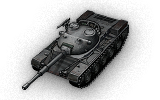<figcaption>EU · Kunze Panzer</figcaption></figure><figure style="display:inline-block"><figcaption>RU · Kunze Panzer</figcaption></figure>

Alternate mode

<a href="https://tanks.gg/v20410/tank/kunze-panzer-siege">EU stats</a> · <a href="https://tanks.gg/v14600ru/tank/kunze-panzer-siege">RU stats</a>
<em>Firepower</em> 
<strong>DPM (HP/min)</strong> <small>EU</small> 1 984.24  <small>RU</small> <strong>2 624.32</strong> 
<strong>Rate of fire (rounds/min)</strong> <small>EU</small> 5.09  <small>RU</small> <strong>6.73</strong> 
<strong>Reload time (s)</strong> <small>EU</small> 11.79  <small>RU</small> <strong>8.92</strong> 

<em>Gun handling</em> 
<strong>Dispersion · moving</strong> <small>EU</small> 0.25  <small>RU</small> <strong>0.15</strong> 
<strong>Dispersion · tank traverse</strong> <small>EU</small> 0.25  <small>RU</small> <strong>0.15</strong> 
<strong>Dispersion · turret traverse</strong> <small>EU</small> 0.10  <small>RU</small> <strong>0.08</strong> 

Leopard Prototyp A · Tier IX

leopardprototypa

<a href="https://tanks.gg/v20410/tank/leopard-pt-a">EU stats</a> · <a href="https://tanks.gg/v14600ru/tank/leopard-pt-a">RU stats</a>
<figure style="display:inline-block">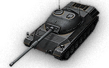<figcaption>Leopard Prototyp A</figcaption></figure>
<em>Mobility</em> 
<strong>Tank traverse on hard terrain (°/s)</strong> <small>EU</small> 52.01  <small>RU</small> <strong>52.05</strong> 
<strong>Tank traverse on medium terrain (°/s)</strong> <small>EU</small> 47.29  <small>RU</small> <strong>47.32</strong> 
<strong>Tank traverse on soft terrain (°/s)</strong> <small>EU</small> 23.64  <small>RU</small> <strong>23.66</strong> 

Mäuschen · Tier IX

mäuschen

<a href="https://tanks.gg/v20410/tank/mauschen">EU stats</a> · <a href="https://tanks.gg/v14600ru/tank/mauschen">RU stats</a>
<figure style="display:inline-block">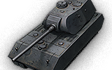<figcaption>Mäuschen</figcaption></figure>
<em>Mobility</em> 
<strong>Forward speed on soft terrain (km/h)</strong> <small>EU</small> 19.72  <small>RU</small> <strong>18.66</strong> 
<strong>Engine power (hp)</strong> <small>EU</small> 1 850  <small>RU</small> <strong>1 750</strong> 
<strong>Power/weight (hp/t)</strong> <small>EU</small> 10.89  <small>RU</small> <strong>10.30</strong> 
<strong>Tank traverse on hard terrain (°/s)</strong> <small>EU</small> 16.04  <small>RU</small> <strong>18.41</strong> 
<strong>Tank traverse on medium terrain (°/s)</strong> <small>EU</small> 13.57  <small>RU</small> <strong>15.58</strong> 
<strong>Tank traverse on soft terrain (°/s)</strong> <small>EU</small> 8.40  <small>RU</small> <strong>9.65</strong> 

<em>Armor &amp; health</em> 
<strong>Health</strong> <small>EU</small> 2 400  <small>RU</small> <strong>2 300</strong> 

Spähpanzer Ru 251 · Tier IX

spähpanzerru251

<a href="https://tanks.gg/v20410/tank/ru-251">EU stats</a> · <a href="https://tanks.gg/v14600ru/tank/ru-251">RU stats</a>
<figure style="display:inline-block">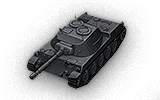<figcaption>Spähpanzer Ru 251</figcaption></figure>
<strong>Penetration (mm)</strong> <b>EU</b>  APCR <strong>224</strong> /  HEAT <strong>260</strong> /  HE <strong>70</strong> → <b>RU</b>  APCR <strong>215</strong> /  HEAT <strong>250</strong> /  HE <strong>102</strong>

<strong>Damage (HP)</strong> <b>EU</b>  APCR <strong>280</strong> /  HEAT <strong>280</strong> /  HE <strong>350</strong> → <b>RU</b>  APCR <strong>240</strong> /  HEAT <strong>240</strong> /  HE <strong>320</strong>

<em>Firepower</em> 
<strong>DPM (HP/min)</strong> <small>EU</small> 2 190.30  <small>RU</small> <strong>2 145.60</strong> 
<strong>Rate of fire (rounds/min)</strong> <small>EU</small> 7.82  <small>RU</small> <strong>8.94</strong> 
<strong>Reload time (s)</strong> <small>EU</small> 7.67  <small>RU</small> <strong>6.71</strong> 
<strong>Shell velocity (m/s)</strong> <small>EU</small> 1 180  <small>RU</small> <strong>1 080</strong> 
<strong>Normalization</strong> <small>EU</small> 5  <small>RU</small> <strong>2</strong> 
<strong>Ammo capacity</strong> <small>EU</small> 45  <small>RU</small> <strong>41</strong> 
<strong>Potential damage</strong> <small>EU</small> 12 600  <small>RU</small> <strong>9 840</strong> 

<em>Gun handling</em> 
<strong>Aim time (s)</strong> <small>EU</small> 1.53  <small>RU</small> <strong>1.92</strong> 
<strong>Dispersion (m/100 m)</strong> <small>EU</small> 0.33  <small>RU</small> <strong>0.35</strong> 
<strong>Dispersion · damaged</strong> <small>EU</small> 0.65  <small>RU</small> <strong>0.69</strong> 
<strong>Dispersion · moving</strong> <small>EU</small> 0.11  <small>RU</small> <strong>0.12</strong> 
<strong>Dispersion · tank traverse</strong> <small>EU</small> 0.11  <small>RU</small> <strong>0.12</strong> 

<em>Mobility</em> 
<strong>Tank traverse (°/s)</strong> <small>EU</small> 49.02  <small>RU</small> <strong>45.89</strong> 
<strong>Tank traverse on hard terrain (°/s)</strong> <small>EU</small> 49.26  <small>RU</small> <strong>55.91</strong> 
<strong>Tank traverse on medium terrain (°/s)</strong> <small>EU</small> 43.79  <small>RU</small> <strong>49.70</strong> 
<strong>Tank traverse on soft terrain (°/s)</strong> <small>EU</small> 24.63  <small>RU</small> <strong>27.96</strong> 

<em>Armor &amp; health</em> 
<strong>Track armor</strong> <small>EU</small> 10  <small>RU</small> <strong>20</strong> 
<strong>Health</strong> <small>EU</small> 1 600  <small>RU</small> <strong>1 400</strong> 

<em>Miscellaneous</em> 
<strong>Stationary camo</strong> <small>EU</small> 16.81  <small>RU</small> <strong>17.38</strong> 
<strong>Stationary camo · after firing</strong> <small>EU</small> 4  <small>RU</small> <strong>4.14</strong> 
<strong>Moving camo</strong> <small>EU</small> 16.81  <small>RU</small> <strong>17.38</strong> 
<strong>Moving camo · after firing</strong> <small>EU</small> 4  <small>RU</small> <strong>4.14</strong> 
<strong>View range (m)</strong> <small>EU</small> 400  <small>RU</small> <strong>410</strong> 

T 55A · Tier IX

t55a

<a href="https://tanks.gg/v20410/tank/t-55a">EU stats</a> · <a href="https://tanks.gg/v14600ru/tank/t-55a">RU stats</a>
<figure style="display:inline-block">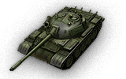<figcaption>T 55A</figcaption></figure>
<strong>Penetration (mm)</strong> <b>EU</b>  AP <strong>221</strong> /  HEAT <strong>330</strong> /  HE <strong>50</strong> → <b>RU</b>  AP <strong>241</strong> /  HEAT <strong>330</strong> /  HE <strong>50</strong>

<em>Gun handling</em> 
<strong>Depression (°)</strong> <small>EU</small> 5  <small>RU</small> <strong>7</strong> 

Tiger-Maus · Tier IX

tigermaus

<a href="https://tanks.gg/v20410/tank/tiger-maus">EU stats</a> · <a href="https://tanks.gg/v14600ru/tank/tiger-maus">RU stats</a>
<figure style="display:inline-block">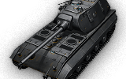<figcaption>EU · Tiger-Maus</figcaption></figure><figure style="display:inline-block">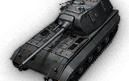<figcaption>RU · Pz.Kpfw. Tiger-Maus 120t</figcaption></figure>
<strong>Damage (HP)</strong> <b>EU</b>  AP <strong>530</strong> /  APCR <strong>530</strong> /  HE <strong>670</strong> → <b>RU</b>  AP <strong>490</strong> /  APCR <strong>490</strong> /  HE <strong>630</strong>

<em>Firepower</em> 
<strong>DPM (HP/min)</strong> <small>EU</small> 2 139.83  <small>RU</small> <strong>1 953.13</strong> 
<strong>Rate of fire (rounds/min)</strong> <small>EU</small> 4.04  <small>RU</small> <strong>3.99</strong> 
<strong>Reload time (s)</strong> <small>EU</small> 14.86  <small>RU</small> <strong>15.05</strong> 
<strong>Potential damage</strong> <small>EU</small> 31 800  <small>RU</small> <strong>29 400</strong> 

<em>Mobility</em> 
<strong>Forward speed (km/h)</strong> <small>EU</small> 32  <small>RU</small> <strong>24</strong> 
<strong>Forward speed on hard terrain (km/h)</strong> <small>EU</small> 32  <small>RU</small> <strong>24</strong> 
<strong>Forward speed on medium terrain (km/h)</strong> <small>EU</small> 22.39  <small>RU</small> <strong>23.32</strong> 
<strong>Forward speed on soft terrain (km/h)</strong> <small>EU</small> 15.22  <small>RU</small> <strong>15.86</strong> 
<strong>Reverse speed (km/h)</strong> <small>EU</small> 16  <small>RU</small> <strong>14</strong> 
<strong>Engine power (hp)</strong> <small>EU</small> 1 200  <small>RU</small> <strong>1 250</strong> 
<strong>Power/weight (hp/t)</strong> <small>EU</small> 10  <small>RU</small> <strong>10.42</strong> 

<em>Armor &amp; health</em> 
<strong>Hull armor · rear (mm)</strong> <small>EU</small> 100  <small>RU</small> <strong>130</strong> 
<strong>Turret armor · front (mm)</strong> <small>EU</small> 300  <small>RU</small> <strong>240</strong> 
<strong>Track armor</strong> <small>EU</small> 40  <small>RU</small> <strong>25</strong> 
<strong>Health · engine</strong> <small>EU</small> 255  <small>RU</small> <strong>320</strong> 

<em>Miscellaneous</em> 
<strong>Shell cost</strong> <small>EU</small> 1 300  <small>RU</small> <strong>1 070</strong> 

VK 45.02 (P) Ausf. B · Tier IX

vk4502pausfb

<a href="https://tanks.gg/v20410/tank/vk-4502-b">EU stats</a> · <a href="https://tanks.gg/v14600ru/tank/vk-4502-b">RU stats</a>
<figure style="display:inline-block">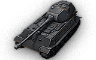<figcaption>VK 45.02 (P) Ausf. B</figcaption></figure>
<em>Firepower</em> 
<strong>DPM (HP/min)</strong> <small>EU</small> 1 953.13  <small>RU</small> <strong>2 086</strong> 
<strong>Rate of fire (rounds/min)</strong> <small>EU</small> 3.99  <small>RU</small> <strong>4.26</strong> 
<strong>Reload time (s)</strong> <small>EU</small> 15.05  <small>RU</small> <strong>14.09</strong> 

<em>Gun handling</em> 
<strong>Aim time (s)</strong> <small>EU</small> 2.49  <small>RU</small> <strong>2.21</strong> 

<em>Mobility</em> 
<strong>Forward speed on medium terrain (km/h)</strong> <small>EU</small> 26.21  <small>RU</small> <strong>25.31</strong> 
<strong>Forward speed on soft terrain (km/h)</strong> <small>EU</small> 17.83  <small>RU</small> <strong>17.21</strong> 
<strong>Engine power (hp)</strong> <small>EU</small> 920  <small>RU</small> <strong>888.12</strong> 
<strong>Power/weight (hp/t)</strong> <small>EU</small> 11.71  <small>RU</small> <strong>11.30</strong> 
<strong>Tank traverse (°/s)</strong> <small>EU</small> 31.29  <small>RU</small> <strong>20.86</strong> 
<strong>Tank traverse on hard terrain (°/s)</strong> <small>EU</small> 29.47  <small>RU</small> <strong>25.60</strong> 
<strong>Tank traverse on medium terrain (°/s)</strong> <small>EU</small> 19.07  <small>RU</small> <strong>16.57</strong> 
<strong>Tank traverse on soft terrain (°/s)</strong> <small>EU</small> 12.97  <small>RU</small> <strong>11.26</strong> 

<em>Armor &amp; health</em> 
<strong>Health</strong> <small>EU</small> 2 050  <small>RU</small> <strong>1 950</strong> 

Waffenträger auf Pz. IV · Tier IX

waffenträgeraufpziv

<a href="https://tanks.gg/v20410/tank/wt-auf-pz-iv">EU stats</a> · <a href="https://tanks.gg/v14600ru/tank/wt-auf-pz-iv">RU stats</a>
<figure style="display:inline-block">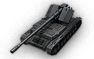<figcaption>Waffenträger auf Pz. IV</figcaption></figure>
<em>Mobility</em> 
<strong>Forward speed on soft terrain (km/h)</strong> <small>EU</small> 28.77  <small>RU</small> <strong>27.66</strong> 
<strong>Engine power (hp)</strong> <small>EU</small> 440  <small>RU</small> <strong>422.91</strong> 
<strong>Power/weight (hp/t)</strong> <small>EU</small> 17.39  <small>RU</small> <strong>16.71</strong> 
<strong>Tank traverse (°/s)</strong> <small>EU</small> 43.81  <small>RU</small> <strong>37.55</strong> 
<strong>Tank traverse on hard terrain (°/s)</strong> <small>EU</small> 47.65  <small>RU</small> <strong>42.12</strong> 
<strong>Tank traverse on medium terrain (°/s)</strong> <small>EU</small> 40.32  <small>RU</small> <strong>35.64</strong> 
<strong>Tank traverse on soft terrain (°/s)</strong> <small>EU</small> 22.79  <small>RU</small> <strong>20.14</strong> 

<em>Armor &amp; health</em> 
<strong>Health · engine</strong> <small>EU</small> 310  <small>RU</small> <strong>80</strong> 

