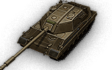
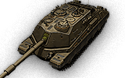
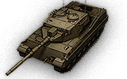
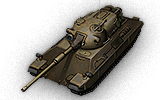
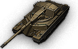

# Italy · Tier X

[All nations and tiers](../buffs_nerfs.md) · EU v20410 → RU v14600ru · 3 November 2026

<label><strong>Find a tank</strong><input type="search" placeholder="Try is7, obj140 or xm57" aria-label="Find a tank" style="display:block;width:100%;padding:.7rem;border:1px solid #888;border-radius:4px;margin:.5rem 0;color:inherit;background:transparent"></label>

Carro da Combattimento 45 t · Tier X

carrodacombattimento45t

<a href="https://tanks.gg/v20410/tank/carro-45-t">EU stats</a> · <a href="https://tanks.gg/v14600ru/tank/carro-45-t">RU stats</a>
<figure style="display:inline-block"><figcaption>Carro da Combattimento 45 t</figcaption></figure>
<em>Firepower</em> 
<strong>DPM (HP/min)</strong> <small>EU</small> 2 503.20  <small>RU</small> <strong>2 634.95</strong> 
<strong>Rate of fire (rounds/min)</strong> <small>EU</small> 6.26  <small>RU</small> <strong>6.59</strong> 
<strong>Reload time (s)</strong> <small>EU</small> 9.59  <small>RU</small> <strong>9.11</strong> 
<strong>Clip size</strong> <small>EU</small> 4  <small>RU</small> <strong>3</strong> 
<strong>Clip damage · damage</strong> <small>EU</small> 1 600  <small>RU</small> <strong>1 200</strong> 
<strong>Clip damage · time (s)</strong> <small>EU</small> 12  <small>RU</small> <strong>8</strong> 

<em>Gun handling</em> 
<strong>Aim time (s)</strong> <small>EU</small> 2.88  <small>RU</small> <strong>2.30</strong> 
<strong>Dispersion (m/100 m)</strong> <small>EU</small> 0.36  <small>RU</small> <strong>0.35</strong> 
<strong>Dispersion · damaged</strong> <small>EU</small> 0.73  <small>RU</small> <strong>0.69</strong> 

Controcarro 3 Minotauro · Tier X

controcarro3minotauro

<a href="https://tanks.gg/v20410/tank/minotauro">EU stats</a> · <a href="https://tanks.gg/v14600ru/tank/minotauro">RU stats</a>
<figure style="display:inline-block"><figcaption>Controcarro 3 Minotauro</figcaption></figure>
<em>Gun handling</em> 
<strong>Dispersion · moving</strong> <small>EU</small> 0.15  <small>RU</small> <strong>0.20</strong> 
<strong>Dispersion · tank traverse</strong> <small>EU</small> 0.15  <small>RU</small> <strong>0.10</strong> 

<em>Mobility</em> 
<strong>Forward speed on soft terrain (km/h)</strong> <small>EU</small> 22.45  <small>RU</small> <strong>20.15</strong> 
<strong>Engine power (hp)</strong> <small>EU</small> 780  <small>RU</small> <strong>700</strong> 
<strong>Power/weight (hp/t)</strong> <small>EU</small> 13.57  <small>RU</small> <strong>12.17</strong> 
<strong>Tank traverse (°/s)</strong> <small>EU</small> 31.29  <small>RU</small> <strong>25.03</strong> 
<strong>Tank traverse on hard terrain (°/s)</strong> <small>EU</small> 29.73  <small>RU</small> <strong>23.78</strong> 
<strong>Tank traverse on medium terrain (°/s)</strong> <small>EU</small> 27.25  <small>RU</small> <strong>21.80</strong> 
<strong>Tank traverse on soft terrain (°/s)</strong> <small>EU</small> 14.22  <small>RU</small> <strong>11.37</strong> 

<em>Armor &amp; health</em> 
<strong>Health</strong> <small>EU</small> 2 000  <small>RU</small> <strong>2 100</strong> 
<strong>Health · engine</strong> <small>EU</small> 340  <small>RU</small> <strong>360</strong> 

Lion · Tier X

lion

<a href="https://tanks.gg/v20410/tank/lion">EU stats</a> · <a href="https://tanks.gg/v14600ru/tank/lion">RU stats</a>
<figure style="display:inline-block"><figcaption>Lion</figcaption></figure>
<em>Gun handling</em> 
<strong>Aim time (s)</strong> <small>EU</small> 2.59  <small>RU</small> <strong>2.30</strong> 
<strong>Dispersion · moving</strong> <small>EU</small> 0.20  <small>RU</small> <strong>0.17</strong> 
<strong>Dispersion · tank traverse</strong> <small>EU</small> 0.20  <small>RU</small> <strong>0.17</strong> 

<em>Mobility</em> 
<strong>Reverse speed (km/h)</strong> <small>EU</small> 15  <small>RU</small> <strong>18</strong> 

Progetto M40 mod. 65 · Tier X

progettom40mod65

<a href="https://tanks.gg/v20410/tank/progetto-65">EU stats</a> · <a href="https://tanks.gg/v14600ru/tank/progetto-65">RU stats</a>
<figure style="display:inline-block"><figcaption>Progetto M40 mod. 65</figcaption></figure>
<em>Gun handling</em> 
<strong>Aim time (s)</strong> <small>EU</small> 2.11  <small>RU</small> <strong>2.01</strong> 
<strong>Dispersion (m/100 m)</strong> <small>EU</small> 0.34  <small>RU</small> <strong>0.33</strong> 
<strong>Dispersion · damaged</strong> <small>EU</small> 0.67  <small>RU</small> <strong>0.65</strong> 
<strong>Dispersion · moving</strong> <small>EU</small> 0.15  <small>RU</small> <strong>0.18</strong> 
<strong>Dispersion · tank traverse</strong> <small>EU</small> 0.15  <small>RU</small> <strong>0.18</strong> 
<strong>Dispersion · firing</strong> <small>EU</small> 3  <small>RU</small> <strong>4</strong> 

Rinoceronte · Tier X

rinoceronte

<a href="https://tanks.gg/v20410/tank/rinoceronte">EU stats</a> · <a href="https://tanks.gg/v14600ru/tank/rinoceronte">RU stats</a>
<figure style="display:inline-block"><figcaption>Rinoceronte</figcaption></figure>
<em>Firepower</em> 
<strong>DPM (HP/min)</strong> <small>EU</small> 1 953.13  <small>RU</small> <strong>2 145.15</strong> 
<strong>Module damage</strong> <small>EU</small> 171  <small>RU</small> <strong>180</strong> 
<strong>Rate of fire (rounds/min)</strong> <small>EU</small> 3.99  <small>RU</small> <strong>4.38</strong> 
<strong>Reload time (s)</strong> <small>EU</small> 15.05  <small>RU</small> <strong>13.71</strong> 
<strong>Ammo capacity</strong> <small>EU</small> 33  <small>RU</small> <strong>39</strong> 
<strong>Potential damage</strong> <small>EU</small> 16 170  <small>RU</small> <strong>19 110</strong> 

<em>Armor &amp; health</em> 
<strong>Health</strong> <small>EU</small> 2 000  <small>RU</small> <strong>2 300</strong> 

