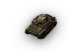
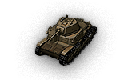

# Italy · Tier II

[All nations and tiers](../buffs_nerfs.md) · EU v20410 → RU v14600ru · 3 November 2026

<label><strong>Find a tank</strong><input type="search" placeholder="Try is7, obj140 or xm57" aria-label="Find a tank" style="display:block;width:100%;padding:.7rem;border:1px solid #888;border-radius:4px;margin:.5rem 0;color:inherit;background:transparent"></label>

L6/40 · Tier II

l640

<a href="https://tanks.gg/v20410/tank/l640">EU stats</a> · <a href="https://tanks.gg/v14600ru/tank/l640">RU stats</a>
<figure style="display:inline-block"><figcaption>L6/40</figcaption></figure>
<em>Gun handling</em> 
<strong>Dispersion (m/100 m)</strong> <small>EU</small> 0.47  <small>RU</small> <strong>0.46</strong> 
<strong>Dispersion · damaged</strong> <small>EU</small> 0.94  <small>RU</small> <strong>0.92</strong> 
<strong>Dispersion · moving</strong> <small>EU</small> 0.28  <small>RU</small> <strong>0.24</strong> 
<strong>Dispersion · tank traverse</strong> <small>EU</small> 0.28  <small>RU</small> <strong>0.24</strong> 

<em>Armor &amp; health</em> 
<strong>Track repair time (s)</strong> <small>EU</small> 12.03  <small>RU</small> <strong>3</strong> 

M14/41 · Tier II

m1441

<a href="https://tanks.gg/v20410/tank/m1441">EU stats</a> · <a href="https://tanks.gg/v14600ru/tank/m1441">RU stats</a>
<figure style="display:inline-block"><figcaption>M14/41</figcaption></figure>
<em>Firepower</em> 
<strong>DPM (HP/min)</strong> <small>EU</small> 894  <small>RU</small> <strong>1 738.33</strong> 
<strong>Rate of fire (rounds/min)</strong> <small>EU</small> 17.88  <small>RU</small> <strong>34.77</strong> 
<strong>Reload time (s)</strong> <small>EU</small> 3.36  <small>RU</small> <strong>1.73</strong> 

<em>Gun handling</em> 
<strong>Dispersion · moving</strong> <small>EU</small> 0.31  <small>RU</small> <strong>0.24</strong> 
<strong>Dispersion · tank traverse</strong> <small>EU</small> 0.31  <small>RU</small> <strong>0.24</strong> 
<strong>Dispersion · turret traverse</strong> <small>EU</small> 0.14  <small>RU</small> <strong>0.10</strong> 
<strong>Dispersion · firing</strong> <small>EU</small> 4  <small>RU</small> <strong>2</strong> 

<em>Mobility</em> 
<strong>Tank traverse on hard terrain (°/s)</strong> <small>EU</small> 45.52  <small>RU</small> <strong>39.31</strong> 
<strong>Tank traverse on medium terrain (°/s)</strong> <small>EU</small> 41.72  <small>RU</small> <strong>36.03</strong> 
<strong>Tank traverse on soft terrain (°/s)</strong> <small>EU</small> 22.76  <small>RU</small> <strong>19.65</strong> 

<em>Armor &amp; health</em> 
<strong>Health</strong> <small>EU</small> 380  <small>RU</small> <strong>450</strong> 
<strong>Track repair time (s)</strong> <small>EU</small> 12.03  <small>RU</small> <strong>3</strong> 

