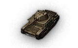
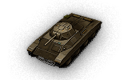

# Italy · Tier III

[All nations and tiers](../buffs_nerfs.md) · EU v20410 → RU v14600ru · 3 November 2026

<label><strong>Find a tank</strong><input type="search" placeholder="Try is7, obj140 or xm57" aria-label="Find a tank" style="display:block;width:100%;padding:.7rem;border:1px solid #888;border-radius:4px;margin:.5rem 0;color:inherit;background:transparent"></label>

M15/42 · Tier III

m1542

<a href="https://tanks.gg/v20410/tank/m1542">EU stats</a> · <a href="https://tanks.gg/v14600ru/tank/m1542">RU stats</a>
<figure style="display:inline-block"><figcaption>M15/42</figcaption></figure>
<strong>Penetration (mm)</strong> <b>EU</b>  AP <strong>70</strong> /  HEAT <strong>95</strong> /  HE <strong>35</strong> → <b>RU</b>  AP <strong>70</strong> /  HEAT <strong>95</strong> /  HE <strong>45</strong>

<em>Firepower</em> 
<strong>DPM (HP/min)</strong> <small>EU</small> 1 117.50  <small>RU</small> <strong>1 422.27</strong> 
<strong>Rate of fire (rounds/min)</strong> <small>EU</small> 22.35  <small>RU</small> <strong>28.45</strong> 
<strong>Reload time (s)</strong> <small>EU</small> 2.68  <small>RU</small> <strong>2.11</strong> 

<em>Gun handling</em> 
<strong>Aim time (s)</strong> <small>EU</small> 1.80  <small>RU</small> <strong>1.70</strong> 

<em>Mobility</em> 
<strong>Tank traverse on hard terrain (°/s)</strong> <small>EU</small> 48.70  <small>RU</small> <strong>56.39</strong> 
<strong>Tank traverse on medium terrain (°/s)</strong> <small>EU</small> 36.07  <small>RU</small> <strong>41.77</strong> 
<strong>Tank traverse on soft terrain (°/s)</strong> <small>EU</small> 24.97  <small>RU</small> <strong>28.92</strong> 

<em>Armor &amp; health</em> 
<strong>Health</strong> <small>EU</small> 470  <small>RU</small> <strong>530</strong> 
<strong>Track repair time (s)</strong> <small>EU</small> 10.03  <small>RU</small> <strong>4</strong> 

M16/43 Sahariano · Tier III

m1643sahariano

<a href="https://tanks.gg/v20410/tank/sahariano">EU stats</a> · <a href="https://tanks.gg/v14600ru/tank/sahariano">RU stats</a>
<figure style="display:inline-block"><figcaption>M16/43 Sahariano</figcaption></figure>
<em>Firepower</em> 
<strong>DPM (HP/min)</strong> <small>EU</small> 1 111.11  <small>RU</small> <strong>1 153.85</strong> 
<strong>Rate of fire (rounds/min)</strong> <small>EU</small> 22.22  <small>RU</small> <strong>23.08</strong> 
<strong>Reload time (s)</strong> <small>EU</small> 2.70  <small>RU</small> <strong>2.60</strong> 

<em>Gun handling</em> 
<strong>Aim time (s)</strong> <small>EU</small> 1.92  <small>RU</small> <strong>1.53</strong> 
<strong>Dispersion · turret traverse</strong> <small>EU</small> 0.14  <small>RU</small> <strong>0.10</strong> 
<strong>Dispersion · firing</strong> <small>EU</small> 3.50  <small>RU</small> <strong>1.50</strong> 

<em>Armor &amp; health</em> 
<strong>Health</strong> <small>EU</small> 450  <small>RU</small> <strong>540</strong> 
<strong>Track repair time (s)</strong> <small>EU</small> 10.03  <small>RU</small> <strong>4</strong> 

