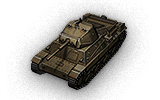

# Italy · Tier IV

[All nations and tiers](../buffs_nerfs.md) · EU v20410 → RU v14600ru · 3 November 2026

<label><strong>Find a tank</strong><input type="search" placeholder="Try is7, obj140 or xm57" aria-label="Find a tank" style="display:block;width:100%;padding:.7rem;border:1px solid #888;border-radius:4px;margin:.5rem 0;color:inherit;background:transparent"></label>

P26/40 · Tier IV

p2640

<a href="https://tanks.gg/v20410/tank/p2640">EU stats</a> · <a href="https://tanks.gg/v14600ru/tank/p2640">RU stats</a>
<figure style="display:inline-block"><figcaption>P26/40</figcaption></figure>
<strong>Penetration (mm)</strong> <b>EU</b>  AP <strong>97</strong> /  HEAT <strong>130</strong> /  HE <strong>50</strong> → <b>RU</b>  AP <strong>97</strong> /  HEAT <strong>130</strong> /  HE <strong>70</strong>

<em>Mobility</em> 
<strong>Tank traverse on hard terrain (°/s)</strong> <small>EU</small> 55.72  <small>RU</small> <strong>59.10</strong> 
<strong>Tank traverse on medium terrain (°/s)</strong> <small>EU</small> 47.15  <small>RU</small> <strong>50.01</strong> 
<strong>Tank traverse on soft terrain (°/s)</strong> <small>EU</small> 26.65  <small>RU</small> <strong>28.27</strong> 

<em>Armor &amp; health</em> 
<strong>Health</strong> <small>EU</small> 570  <small>RU</small> <strong>630</strong> 
<strong>Track repair time (s)</strong> <small>EU</small> 10.03  <small>RU</small> <strong>5</strong> 

