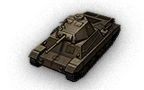
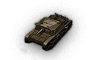

# Italy · Tier V

[All nations and tiers](../buffs_nerfs.md) · EU v20410 → RU v14600ru · 3 November 2026

<label><strong>Find a tank</strong><input type="search" placeholder="Try is7, obj140 or xm57" aria-label="Find a tank" style="display:block;width:100%;padding:.7rem;border:1px solid #888;border-radius:4px;margin:.5rem 0;color:inherit;background:transparent"></label>

P.43 · Tier V

p43

<a href="https://tanks.gg/v20410/tank/p43">EU stats</a> · <a href="https://tanks.gg/v14600ru/tank/p43">RU stats</a>
<figure style="display:inline-block"><figcaption>P.43</figcaption></figure>
<strong>Penetration (mm)</strong> <b>EU</b>  AP <strong>118</strong> /  APCR <strong>146</strong> /  HE <strong>75</strong> → <b>RU</b>  AP <strong>118</strong> /  APCR <strong>146</strong> /  HE <strong>38</strong>

<em>Mobility</em> 
<strong>Tank traverse on hard terrain (°/s)</strong> <small>EU</small> 52.29  <small>RU</small> <strong>63.85</strong> 
<strong>Tank traverse on medium terrain (°/s)</strong> <small>EU</small> 47.54  <small>RU</small> <strong>58.04</strong> 
<strong>Tank traverse on soft terrain (°/s)</strong> <small>EU</small> 21.79  <small>RU</small> <strong>26.60</strong> 

<em>Armor &amp; health</em> 
<strong>Health</strong> <small>EU</small> 660  <small>RU</small> <strong>600</strong> 

Semovente M41 · Tier V

semoventem41

<a href="https://tanks.gg/v20410/tank/smv-m41">EU stats</a> · <a href="https://tanks.gg/v14600ru/tank/semovente">RU stats</a>
<figure style="display:inline-block"><figcaption>Semovente M41</figcaption></figure>
<em>Mobility</em> 
<strong>Forward speed (km/h)</strong> <small>EU</small> 45  <small>RU</small> <strong>35</strong> 
<strong>Forward speed on hard terrain (km/h)</strong> <small>EU</small> 45  <small>RU</small> <strong>35</strong> 
<strong>Forward speed on medium terrain (km/h)</strong> <small>EU</small> 45  <small>RU</small> <strong>35</strong> 
<strong>Tank traverse on hard terrain (°/s)</strong> <small>EU</small> 48.99  <small>RU</small> <strong>74.23</strong> 
<strong>Tank traverse on medium terrain (°/s)</strong> <small>EU</small> 41.45  <small>RU</small> <strong>62.81</strong> 
<strong>Tank traverse on soft terrain (°/s)</strong> <small>EU</small> 23.43  <small>RU</small> <strong>35.50</strong> 

<em>Armor &amp; health</em> 
<strong>Health</strong> <small>EU</small> 500  <small>RU</small> <strong>460</strong> 
<strong>Health · engine</strong> <small>EU</small> 140  <small>RU</small> <strong>104</strong> 

