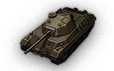
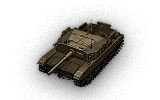

# Italy · Tier VI

[All nations and tiers](../buffs_nerfs.md) · EU v20410 → RU v14600ru · 3 November 2026

<label><strong>Find a tank</strong><input type="search" placeholder="Try is7, obj140 or xm57" aria-label="Find a tank" style="display:block;width:100%;padding:.7rem;border:1px solid #888;border-radius:4px;margin:.5rem 0;color:inherit;background:transparent"></label>

P.43 bis · Tier VI

p43bis

<a href="https://tanks.gg/v20410/tank/p43-bis">EU stats</a> · <a href="https://tanks.gg/v14600ru/tank/p43-bis">RU stats</a>
<figure style="display:inline-block"><figcaption>P.43 bis</figcaption></figure>
<em>Firepower</em> 
<strong>DPM (HP/min)</strong> <small>EU</small> 1 877.40  <small>RU</small> <strong>2 002.56</strong> 
<strong>Rate of fire (rounds/min)</strong> <small>EU</small> 7.82  <small>RU</small> <strong>8.34</strong> 
<strong>Reload time (s)</strong> <small>EU</small> 7.67  <small>RU</small> <strong>7.19</strong> 

<em>Mobility</em> 
<strong>Tank traverse on hard terrain (°/s)</strong> <small>EU</small> 47.88  <small>RU</small> <strong>50.42</strong> 
<strong>Tank traverse on medium terrain (°/s)</strong> <small>EU</small> 28.73  <small>RU</small> <strong>30.25</strong> 
<strong>Tank traverse on soft terrain (°/s)</strong> <small>EU</small> 18.74  <small>RU</small> <strong>19.73</strong> 

<em>Armor &amp; health</em> 
<strong>Health</strong> <small>EU</small> 900  <small>RU</small> <strong>830</strong> 

Semovente M43 Bassotto · Tier VI

semoventem43bassotto

<a href="https://tanks.gg/v20410/tank/bassotto">EU stats</a> · <a href="https://tanks.gg/v14600ru/tank/bassotto">RU stats</a>
<figure style="display:inline-block"><figcaption>Semovente M43 Bassotto</figcaption></figure>
<strong>Penetration (mm)</strong> <b>EU</b>  APCR <strong>175</strong> /  HEAT <strong>215</strong> /  HE <strong>45</strong> → <b>RU</b>  HE <strong>105</strong> /  HEAT <strong>230</strong>

<strong>Damage (HP)</strong> <b>EU</b>  APCR <strong>360</strong> /  HEAT <strong>360</strong> /  HE <strong>440</strong> → <b>RU</b>  HE <strong>440</strong> /  HEAT <strong>360</strong>

<em>Firepower</em> 
<strong>DPM (HP/min)</strong> <small>EU</small> 2 105.50  <small>RU</small> <strong>3 441.90</strong> 
<strong>Module damage</strong> <small>EU</small> 138  <small>RU</small> <strong>150</strong> 
<strong>Rate of fire (rounds/min)</strong> <small>EU</small> 5.85  <small>RU</small> <strong>7.82</strong> 
<strong>Reload time (s)</strong> <small>EU</small> 10.26  <small>RU</small> <strong>7.67</strong> 
<strong>Caliber</strong> <small>EU</small> 102  <small>RU</small> <strong>105</strong> 
<strong>Shell velocity (m/s)</strong> <small>EU</small> 900  <small>RU</small> <strong>410</strong> 
<strong>Normalization</strong> <small>EU</small> 2  <small>RU</small> <strong>0</strong> 
<strong>Ricochet angle</strong> <small>EU</small> 70  <small>RU</small> <strong>90</strong> 
<strong>Ammo capacity</strong> <small>EU</small> 60  <small>RU</small> <strong>55</strong> 
<strong>Potential damage</strong> <small>EU</small> 21 600  <small>RU</small> <strong>24 200</strong> 
<strong>Explosion radius</strong> <small>EU</small> — → <small>RU</small> <strong>1.91</strong> 

<em>Gun handling</em> 
<strong>Aim time (s)</strong> <small>EU</small> 2.70  <small>RU</small> <strong>3.70</strong> 
<strong>Dispersion (m/100 m)</strong> <small>EU</small> 0.40  <small>RU</small> <strong>0.44</strong> 
<strong>Dispersion · damaged</strong> <small>EU</small> 0.80  <small>RU</small> <strong>0.88</strong> 
<strong>Dispersion · turret traverse</strong> <small>EU</small> 0.12  <small>RU</small> <strong>0.20</strong> 
<strong>Dispersion · firing</strong> <small>EU</small> 4  <small>RU</small> <strong>7</strong> 
<strong>Depression (°)</strong> <small>EU</small> 5  <small>RU</small> <strong>10</strong> 
<strong>Gun traverse · left (°)</strong> <small>EU</small> -11  <small>RU</small> <strong>-17</strong> 
<strong>Gun traverse · right (°)</strong> <small>EU</small> 11  <small>RU</small> <strong>17</strong> 

<em>Mobility</em> 
<strong>Forward speed on soft terrain (km/h)</strong> <small>EU</small> 31.42  <small>RU</small> <strong>31.62</strong> 
<strong>Weight (kg)</strong> <small>EU</small> 15 800 → <small>RU</small> <strong>15 700</strong> 
<strong>Power/weight (hp/t)</strong> <small>EU</small> 18.99  <small>RU</small> <strong>19.11</strong> 
<strong>Tank traverse on hard terrain (°/s)</strong> <small>EU</small> 53.78  <small>RU</small> <strong>91.66</strong> 
<strong>Tank traverse on medium terrain (°/s)</strong> <small>EU</small> 45.51  <small>RU</small> <strong>77.56</strong> 
<strong>Tank traverse on soft terrain (°/s)</strong> <small>EU</small> 25.72  <small>RU</small> <strong>43.84</strong> 

<em>Armor &amp; health</em> 
<strong>Health · engine</strong> <small>EU</small> 180  <small>RU</small> <strong>84</strong> 

<em>Miscellaneous</em> 
<strong>Shell cost</strong> <small>EU</small> 490  <small>RU</small> <strong>720</strong> 

