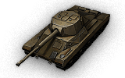
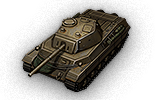
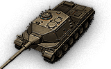

# Italy · Tier VII

[All nations and tiers](../buffs_nerfs.md) · EU v20410 → RU v14600ru · 3 November 2026

<label><strong>Find a tank</strong><input type="search" placeholder="Try is7, obj140 or xm57" aria-label="Find a tank" style="display:block;width:100%;padding:.7rem;border:1px solid #888;border-radius:4px;margin:.5rem 0;color:inherit;background:transparent"></label>

Carro d&#x27;assalto P.88 · Tier VII

carrodassaltop88

<a href="https://tanks.gg/v20410/tank/carro-p88">EU stats</a> · <a href="https://tanks.gg/v14600ru/tank/carro-p88">RU stats</a>
<figure style="display:inline-block"><figcaption>Carro d&#x27;assalto P.88</figcaption></figure>
<strong>Penetration (mm)</strong> <b>EU</b>  AP <strong>202</strong> /  APCR <strong>235</strong> /  HE <strong>45</strong> → <b>RU</b>  AP <strong>202</strong> /  APCR <strong>220</strong> /  HE <strong>45</strong>

<em>Firepower</em> 
<strong>DPM (HP/min)</strong> <small>EU</small> 1 766.96  <small>RU</small> <strong>1 788</strong> 
<strong>Rate of fire (rounds/min)</strong> <small>EU</small> 7.36  <small>RU</small> <strong>7.45</strong> 
<strong>Reload time (s)</strong> <small>EU</small> 8.15  <small>RU</small> <strong>8.05</strong> 

<em>Mobility</em> 
<strong>Tank traverse (°/s)</strong> <small>EU</small> 30.25  <small>RU</small> <strong>26.08</strong> 
<strong>Tank traverse on hard terrain (°/s)</strong> <small>EU</small> 33.80  <small>RU</small> <strong>29.07</strong> 
<strong>Tank traverse on medium terrain (°/s)</strong> <small>EU</small> 30.98  <small>RU</small> <strong>26.65</strong> 
<strong>Tank traverse on soft terrain (°/s)</strong> <small>EU</small> 16.16  <small>RU</small> <strong>13.90</strong> 

<em>Armor &amp; health</em> 
<strong>Track armor</strong> <small>EU</small> 20  <small>RU</small> <strong>25</strong> 
<strong>Health</strong> <small>EU</small> 1 300  <small>RU</small> <strong>1 250</strong> 

<em>Miscellaneous</em> 
<strong>View range (m)</strong> <small>EU</small> 350  <small>RU</small> <strong>360</strong> 

P.43 ter · Tier VII

p43ter

<a href="https://tanks.gg/v20410/tank/p43-ter">EU stats</a> · <a href="https://tanks.gg/v14600ru/tank/p43-ter">RU stats</a>
<figure style="display:inline-block"><figcaption>P.43 ter</figcaption></figure>
<strong>Penetration (mm)</strong> <b>EU</b>  AP <strong>165</strong> /  APCR <strong>195</strong> /  HE <strong>45</strong> → <b>RU</b>  AP <strong>195</strong> /  APCR <strong>235</strong> /  HE <strong>45</strong>

<em>Firepower</em> 
<strong>DPM (HP/min)</strong> <small>EU</small> 2 029.62  <small>RU</small> <strong>1 877.40</strong> 
<strong>Rate of fire (rounds/min)</strong> <small>EU</small> 8.46  <small>RU</small> <strong>7.82</strong> 
<strong>Reload time (s)</strong> <small>EU</small> 7.09  <small>RU</small> <strong>7.67</strong> 

<em>Mobility</em> 
<strong>Tank traverse on hard terrain (°/s)</strong> <small>EU</small> 50.71  <small>RU</small> <strong>67.46</strong> 
<strong>Tank traverse on medium terrain (°/s)</strong> <small>EU</small> 46.10  <small>RU</small> <strong>61.33</strong> 
<strong>Tank traverse on soft terrain (°/s)</strong> <small>EU</small> 29.83  <small>RU</small> <strong>39.68</strong> 

<em>Armor &amp; health</em> 
<strong>Health</strong> <small>EU</small> 1 200  <small>RU</small> <strong>1 100</strong> 

SMV CC-56 · Tier VII

smvcc56

<a href="https://tanks.gg/v20410/tank/smv-cc-56">EU stats</a> · <a href="https://tanks.gg/v14600ru/tank/smv-cc-56">RU stats</a>
<figure style="display:inline-block"><figcaption>SMV CC-56</figcaption></figure>
<em>Mobility</em> 
<strong>Tank traverse on hard terrain (°/s)</strong> <small>EU</small> 25.79  <small>RU</small> <strong>25.80</strong> 
<strong>Tank traverse on medium terrain (°/s)</strong> <small>EU</small> 23.64  <small>RU</small> <strong>23.65</strong> 
<strong>Tank traverse on soft terrain (°/s)</strong> <small>EU</small> 12.33  <small>RU</small> <strong>12.34</strong> 

<em>Armor &amp; health</em> 
<strong>Health · engine</strong> <small>EU</small> 220  <small>RU</small> <strong>260</strong> 

