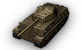
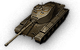
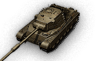
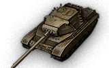
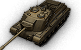

# Italy · Tier VIII

[All nations and tiers](../buffs_nerfs.md) · EU v20410 → RU v14600ru · 3 November 2026

<label><strong>Find a tank</strong><input type="search" placeholder="Try is7, obj140 or xm57" aria-label="Find a tank" style="display:block;width:100%;padding:.7rem;border:1px solid #888;border-radius:4px;margin:.5rem 0;color:inherit;background:transparent"></label>

P.44 Pantera · Tier VIII

p44pantera

<a href="https://tanks.gg/v20410/tank/p44-pantera">EU stats</a> · <a href="https://tanks.gg/v14600ru/tank/p44-pantera">RU stats</a>
<figure style="display:inline-block"><figcaption>P.44 Pantera</figcaption></figure>
<em>Firepower</em> 
<strong>DPM (HP/min)</strong> <small>EU</small> 1 877.40  <small>RU</small> <strong>2 002.56</strong> 
<strong>Rate of fire (rounds/min)</strong> <small>EU</small> 7.82  <small>RU</small> <strong>8.34</strong> 
<strong>Reload time (s)</strong> <small>EU</small> 7.67  <small>RU</small> <strong>7.19</strong> 

<em>Gun handling</em> 
<strong>Dispersion · moving</strong> <small>EU</small> 0.18  <small>RU</small> <strong>0.16</strong> 
<strong>Dispersion · tank traverse</strong> <small>EU</small> 0.18  <small>RU</small> <strong>0.16</strong> 

<em>Mobility</em> 
<strong>Tank traverse on hard terrain (°/s)</strong> <small>EU</small> 61.20  <small>RU</small> <strong>75.29</strong> 
<strong>Tank traverse on medium terrain (°/s)</strong> <small>EU</small> 48.96  <small>RU</small> <strong>60.23</strong> 
<strong>Tank traverse on soft terrain (°/s)</strong> <small>EU</small> 23.31  <small>RU</small> <strong>28.68</strong> 

<em>Armor &amp; health</em> 
<strong>Health</strong> <small>EU</small> 1 550  <small>RU</small> <strong>1 400</strong> 

Progetto CC55 mod. 54 · Tier VIII

progettocc55mod54

<a href="https://tanks.gg/v20410/tank/progetto-54">EU stats</a> · <a href="https://tanks.gg/v14600ru/tank/progetto-54">RU stats</a>
<figure style="display:inline-block"><figcaption>Progetto CC55 mod. 54</figcaption></figure>
<em>Firepower</em> 
<strong>DPM (HP/min)</strong> <small>EU</small> 1 540.43  <small>RU</small> <strong>1 907.20</strong> 
<strong>Rate of fire (rounds/min)</strong> <small>EU</small> 4.81  <small>RU</small> <strong>5.96</strong> 
<strong>Reload time (s)</strong> <small>EU</small> 12.46  <small>RU</small> <strong>10.07</strong> 

<em>Gun handling</em> 
<strong>Aim time (s)</strong> <small>EU</small> 2.40  <small>RU</small> <strong>2.21</strong> 

<em>Mobility</em> 
<strong>Tank traverse on hard terrain (°/s)</strong> <small>EU</small> 30.53  <small>RU</small> <strong>39.70</strong> 
<strong>Tank traverse on medium terrain (°/s)</strong> <small>EU</small> 27.98  <small>RU</small> <strong>36.39</strong> 
<strong>Tank traverse on soft terrain (°/s)</strong> <small>EU</small> 14.60  <small>RU</small> <strong>18.98</strong> 

<em>Armor &amp; health</em> 
<strong>Health</strong> <small>EU</small> 1 600  <small>RU</small> <strong>1 450</strong> 

Prototipo 6 · EU VIII → RU IX

prototipo6

<a href="https://tanks.gg/v20410/tank/prototipo-6">EU stats</a> · <a href="https://tanks.gg/v14600ru/tank/prototipo-6">RU stats</a>
<figure style="display:inline-block"><figcaption>EU · Prototipo 6</figcaption></figure><figure style="display:inline-block"><figcaption>RU · Prototipo 6</figcaption></figure>
<strong>Penetration (mm)</strong> <b>EU</b>  AP <strong>226</strong> /  APCR <strong>272</strong> /  HE <strong>53</strong> → <b>RU</b>  APCR <strong>256</strong> /  HEAT <strong>310</strong> /  HE <strong>90</strong>

<strong>Damage (HP)</strong> <b>EU</b>  AP <strong>300</strong> /  APCR <strong>300</strong> /  HE <strong>400</strong> → <b>RU</b>  APCR <strong>240</strong> /  HEAT <strong>240</strong> /  HE <strong>320</strong>

<em>General</em> 
<strong>Tier</strong> <small>EU</small> 8 → <small>RU</small> <strong>9</strong> 

<em>Firepower</em> 
<strong>DPM (HP/min)</strong> <small>EU</small> 2 086  <small>RU</small> <strong>2 145.60</strong> 
<strong>Module damage</strong> <small>EU</small> 150  <small>RU</small> <strong>120</strong> 
<strong>Rate of fire (rounds/min)</strong> <small>EU</small> 6.95  <small>RU</small> <strong>8.94</strong> 
<strong>Reload time (s)</strong> <small>EU</small> 8.63  <small>RU</small> <strong>6.71</strong> 
<strong>Clip size</strong> <small>EU</small> 3  <small>RU</small> <strong>5</strong> 
<strong>Clip damage · damage</strong> <small>EU</small> 900  <small>RU</small> <strong>1 200</strong> 
<strong>Clip damage · time (s)</strong> <small>EU</small> 5  <small>RU</small> <strong>6</strong> 
<strong>Intra-clip reload</strong> <small>EU</small> 2.50  <small>RU</small> <strong>1.50</strong> 
<strong>Caliber</strong> <small>EU</small> 105  <small>RU</small> <strong>90</strong> 
<strong>Shell velocity (m/s)</strong> <small>EU</small> 1 030  <small>RU</small> <strong>1 475</strong> 
<strong>Normalization</strong> <small>EU</small> 5  <small>RU</small> <strong>2</strong> 
<strong>Ammo capacity</strong> <small>EU</small> 50  <small>RU</small> <strong>90</strong> 
<strong>Potential damage</strong> <small>EU</small> 15 000  <small>RU</small> <strong>21 600</strong> 

<em>Gun handling</em> 
<strong>Aim time (s)</strong> <small>EU</small> 2.40  <small>RU</small> <strong>1.82</strong> 
<strong>Dispersion (m/100 m)</strong> <small>EU</small> 0.31  <small>RU</small> <strong>0.32</strong> 
<strong>Dispersion · damaged</strong> <small>EU</small> 0.61  <small>RU</small> <strong>0.63</strong> 
<strong>Dispersion · moving</strong> <small>EU</small> 0.18  <small>RU</small> <strong>0.22</strong> 
<strong>Dispersion · tank traverse</strong> <small>EU</small> 0.18  <small>RU</small> <strong>0.22</strong> 
<strong>Dispersion · turret traverse</strong> <small>EU</small> 0.14  <small>RU</small> <strong>0.15</strong> 
<strong>Depression (°)</strong> <small>EU</small> 9  <small>RU</small> <strong>10</strong> 

<em>Mobility</em> 
<strong>Forward speed (km/h)</strong> <small>EU</small> 50  <small>RU</small> <strong>60</strong> 
<strong>Forward speed on hard terrain (km/h)</strong> <small>EU</small> 50  <small>RU</small> <strong>60</strong> 
<strong>Forward speed on medium terrain (km/h)</strong> <small>EU</small> 50  <small>RU</small> <strong>58.80</strong> 
<strong>Forward speed on soft terrain (km/h)</strong> <small>EU</small> 50  <small>RU</small> <strong>38.34</strong> 
<strong>Reverse speed (km/h)</strong> <small>EU</small> 18  <small>RU</small> <strong>20</strong> 
<strong>Engine power (hp)</strong> <small>EU</small> 600  <small>RU</small> <strong>700</strong> 
<strong>Weight (kg)</strong> <small>EU</small> 30 000 → <small>RU</small> <strong>30 208</strong> 
<strong>Power/weight (hp/t)</strong> <small>EU</small> 20  <small>RU</small> <strong>23.17</strong> 
<strong>Terrain resist (hard)</strong> <small>EU</small> 0.38  <small>RU</small> <strong>1.15</strong> 
<strong>Terrain resist (med)</strong> <small>EU</small> 0.48  <small>RU</small> <strong>1.44</strong> 
<strong>Terrain resist (soft)</strong> <small>EU</small> 0.96  <small>RU</small> <strong>2.21</strong> 
<strong>Turret traverse (°/s)</strong> <small>EU</small> 36.50  <small>RU</small> <strong>47.98</strong> 
<strong>Tank traverse (°/s)</strong> <small>EU</small> 43.81  <small>RU</small> <strong>56.32</strong> 
<strong>Tank traverse on hard terrain (°/s)</strong> <small>EU</small> 41.62  <small>RU</small> <strong>53.51</strong> 
<strong>Tank traverse on medium terrain (°/s)</strong> <small>EU</small> 33.29  <small>RU</small> <strong>42.80</strong> 
<strong>Tank traverse on soft terrain (°/s)</strong> <small>EU</small> 16.65  <small>RU</small> <strong>27.92</strong> 

<em>Armor &amp; health</em> 
<strong>Hull armor · side (mm)</strong> <small>EU</small> 35  <small>RU</small> <strong>40</strong> 
<strong>Hull armor · rear (mm)</strong> <small>EU</small> 30  <small>RU</small> <strong>25</strong> 
<strong>Turret armor · front (mm)</strong> <small>EU</small> 170  <small>RU</small> <strong>70</strong> 
<strong>Turret armor · side (mm)</strong> <small>EU</small> 60  <small>RU</small> <strong>40</strong> 
<strong>Health</strong> <small>EU</small> 1 300  <small>RU</small> <strong>1 650</strong> 
<strong>Health · engine</strong> <small>EU</small> 275  <small>RU</small> <strong>360</strong> 
<strong>Health · track</strong> <small>EU</small> 220  <small>RU</small> <strong>240</strong> 
<strong>Health · ammo rack</strong> <small>EU</small> 210  <small>RU</small> <strong>220</strong> 
<strong>Health · fuel tank</strong> <small>EU</small> 175  <small>RU</small> <strong>200</strong> 
<strong>Track repair time (s)</strong> <small>EU</small> 11.70  <small>RU</small> <strong>8.02</strong> 

<em>Miscellaneous</em> 
<strong>Stationary camo</strong> <small>EU</small> 15.85  <small>RU</small> <strong>15.79</strong> 
<strong>Stationary camo · after firing</strong> <small>EU</small> 3.14  <small>RU</small> <strong>3.55</strong> 
<strong>Moving camo</strong> <small>EU</small> 11.91  <small>RU</small> <strong>11.86</strong> 
<strong>Moving camo · after firing</strong> <small>EU</small> 2.36  <small>RU</small> <strong>2.67</strong> 
<strong>View range (m)</strong> <small>EU</small> 380  <small>RU</small> <strong>390</strong> 
<strong>Radio range (m)</strong> <small>EU</small> 745  <small>RU</small> <strong>710</strong> 
<strong>Fire chance (%)</strong> <small>EU</small> 15  <small>RU</small> <strong>10</strong> 
<strong>Shell cost</strong> <small>EU</small> 555  <small>RU</small> <strong>560</strong> 

SMV CC-67 · Tier VIII

smvcc67

<a href="https://tanks.gg/v20410/tank/smv-cc-67">EU stats</a> · <a href="https://tanks.gg/v14600ru/tank/smv-cc-67">RU stats</a>
<figure style="display:inline-block"><figcaption>SMV CC-67</figcaption></figure>
<em>Gun handling</em> 
<strong>Dispersion · moving</strong> <small>EU</small> 0.17  <small>RU</small> <strong>0.23</strong> 
<strong>Dispersion · tank traverse</strong> <small>EU</small> 0.17  <small>RU</small> <strong>0.10</strong> 

<em>Mobility</em> 
<strong>Tank traverse on hard terrain (°/s)</strong> <small>EU</small> 28.81  <small>RU</small> <strong>28.72</strong> 
<strong>Tank traverse on medium terrain (°/s)</strong> <small>EU</small> 26.41  <small>RU</small> <strong>26.33</strong> 
<strong>Tank traverse on soft terrain (°/s)</strong> <small>EU</small> 13.78  <small>RU</small> <strong>13.73</strong> 

<em>Armor &amp; health</em> 
<strong>Track armor</strong> <small>EU</small> 20  <small>RU</small> <strong>25</strong> 
<strong>Health · engine</strong> <small>EU</small> 260  <small>RU</small> <strong>360</strong> 

<em>Miscellaneous</em> 
<strong>Moving camo</strong> <small>EU</small> 9.35  <small>RU</small> <strong>8.72</strong> 
<strong>Moving camo · after firing</strong> <small>EU</small> 1.68  <small>RU</small> <strong>1.57</strong> 

