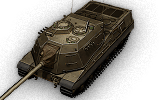
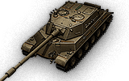
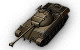

# Italy · Tier IX

[All nations and tiers](../buffs_nerfs.md) · EU v20410 → RU v14600ru · 3 November 2026

<label><strong>Find a tank</strong><input type="search" placeholder="Try is7, obj140 or xm57" aria-label="Find a tank" style="display:block;width:100%;padding:.7rem;border:1px solid #888;border-radius:4px;margin:.5rem 0;color:inherit;background:transparent"></label>

Controcarro 1 Mk. 2 · Tier IX

controcarro1mk2

<a href="https://tanks.gg/v20410/tank/cc-1-mk-2">EU stats</a> · <a href="https://tanks.gg/v14600ru/tank/cc-1-mk-2">RU stats</a>
<figure style="display:inline-block"><figcaption>Controcarro 1 Mk. 2</figcaption></figure>
<em>Firepower</em> 
<strong>Module damage</strong> <small>EU</small> 171  <small>RU</small> <strong>180</strong> 

<em>Gun handling</em> 
<strong>Dispersion · moving</strong> <small>EU</small> 0.16  <small>RU</small> <strong>0.22</strong> 
<strong>Dispersion · tank traverse</strong> <small>EU</small> 0.16  <small>RU</small> <strong>0.10</strong> 

<em>Mobility</em> 
<strong>Tank traverse (°/s)</strong> <small>EU</small> 29.20  <small>RU</small> <strong>22.95</strong> 
<strong>Tank traverse on hard terrain (°/s)</strong> <small>EU</small> 28.03  <small>RU</small> <strong>22.01</strong> 
<strong>Tank traverse on medium terrain (°/s)</strong> <small>EU</small> 25.70  <small>RU</small> <strong>20.18</strong> 
<strong>Tank traverse on soft terrain (°/s)</strong> <small>EU</small> 13.41  <small>RU</small> <strong>10.53</strong> 

<em>Armor &amp; health</em> 
<strong>Hull armor · front (mm)</strong> <small>EU</small> 240  <small>RU</small> <strong>290</strong> 
<strong>Health</strong> <small>EU</small> 1 800  <small>RU</small> <strong>1 900</strong> 
<strong>Health · engine</strong> <small>EU</small> 300  <small>RU</small> <strong>360</strong> 

Progetto C50 mod. 66 · Tier IX

progettoc50mod66

<a href="https://tanks.gg/v20410/tank/progetto-66">EU stats</a> · <a href="https://tanks.gg/v14600ru/tank/progetto-66">RU stats</a>
<figure style="display:inline-block"><figcaption>Progetto C50 mod. 66</figcaption></figure>
<em>Gun handling</em> 
<strong>Aim time (s)</strong> <small>EU</small> 2.59  <small>RU</small> <strong>2.21</strong> 
<strong>Dispersion (m/100 m)</strong> <small>EU</small> 0.35  <small>RU</small> <strong>0.33</strong> 
<strong>Dispersion · damaged</strong> <small>EU</small> 0.69  <small>RU</small> <strong>0.65</strong> 

<em>Mobility</em> 
<strong>Forward speed on medium terrain (km/h)</strong> <small>EU</small> 43.74  <small>RU</small> <strong>45</strong> 
<strong>Forward speed on soft terrain (km/h)</strong> <small>EU</small> 22.82  <small>RU</small> <strong>25.14</strong> 
<strong>Engine power (hp)</strong> <small>EU</small> 690  <small>RU</small> <strong>760</strong> 
<strong>Power/weight (hp/t)</strong> <small>EU</small> 13.79  <small>RU</small> <strong>15.19</strong> 
<strong>Tank traverse on hard terrain (°/s)</strong> <small>EU</small> 30.94  <small>RU</small> <strong>31.06</strong> 
<strong>Tank traverse on medium terrain (°/s)</strong> <small>EU</small> 28.36  <small>RU</small> <strong>28.48</strong> 
<strong>Tank traverse on soft terrain (°/s)</strong> <small>EU</small> 14.80  <small>RU</small> <strong>14.86</strong> 

<em>Armor &amp; health</em> 
<strong>Track armor</strong> <small>EU</small> 20  <small>RU</small> <strong>30</strong> 
<strong>Health</strong> <small>EU</small> 1 900  <small>RU</small> <strong>1 850</strong> 

<em>Miscellaneous</em> 
<strong>Moving camo</strong> <small>EU</small> 3.60  <small>RU</small> <strong>3.54</strong> 
<strong>Moving camo · after firing</strong> <small>EU</small> 0.65  <small>RU</small> <strong>0.64</strong> 

Prototipo Standard B · Tier IX

prototipostandardb

<a href="https://tanks.gg/v20410/tank/standard-b">EU stats</a> · <a href="https://tanks.gg/v14600ru/tank/standard-b">RU stats</a>
<figure style="display:inline-block"><figcaption>Prototipo Standard B</figcaption></figure>
<em>Gun handling</em> 
<strong>Aim time (s)</strong> <small>EU</small> 2.40  <small>RU</small> <strong>2.21</strong> 
<strong>Dispersion · damaged</strong> <small>EU</small> 0.71  <small>RU</small> <strong>0.69</strong> 

<em>Mobility</em> 
<strong>Forward speed on soft terrain (km/h)</strong> <small>EU</small> 34.62  <small>RU</small> <strong>34.60</strong> 
<strong>Power/weight (hp/t)</strong> <small>EU</small> 20.01  <small>RU</small> <strong>20</strong> 
<strong>Tank traverse on hard terrain (°/s)</strong> <small>EU</small> 62.10  <small>RU</small> <strong>62.03</strong> 
<strong>Tank traverse on medium terrain (°/s)</strong> <small>EU</small> 56.46  <small>RU</small> <strong>56.39</strong> 
<strong>Tank traverse on soft terrain (°/s)</strong> <small>EU</small> 28.23  <small>RU</small> <strong>28.19</strong> 

<em>Armor &amp; health</em> 
<strong>Health</strong> <small>EU</small> 1 750  <small>RU</small> <strong>1 700</strong> 

