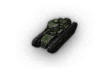
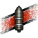

# Japan · Tier I

[All nations and tiers](../buffs_nerfs.md) · EU v20410 → RU v14600ru · 3 November 2026

<label><strong>Find a tank</strong><input type="search" placeholder="Try is7, obj140 or xm57" aria-label="Find a tank" style="display:block;width:100%;padding:.7rem;border:1px solid #888;border-radius:4px;margin:.5rem 0;color:inherit;background:transparent"></label>

Renault Otsu · Tier I

renaultotsu

<a href="https://tanks.gg/v20410/tank/r-otsu">EU stats</a> · <a href="https://tanks.gg/v14600ru/tank/r-otsu">RU stats</a>
<figure style="display:inline-block"><figcaption>Renault Otsu</figcaption></figure>
<strong>Penetration (mm)</strong> <b>EU</b>  AP <strong>42</strong> /  AP <strong>65</strong> /  HE <strong>18</strong> → <b>RU</b>  AP <strong>33</strong> /  AP <strong>49</strong> /  HE <strong>18</strong>

<em>Firepower</em> 
<strong>Shell velocity (m/s)</strong> <small>EU</small> 700  <small>RU</small> <strong>580</strong> 

<em>Gun handling</em> 
<strong>Aim time (s)</strong> <small>EU</small> 2.30  <small>RU</small> <strong>2</strong> 
<strong>Dispersion (m/100 m)</strong> <small>EU</small> 0.46  <small>RU</small> <strong>0.40</strong> 
<strong>Dispersion · damaged</strong> <small>EU</small> 0.92  <small>RU</small> <strong>0.80</strong> 
<strong>Dispersion · moving</strong> <small>EU</small> 0.36  <small>RU</small> <strong>0.10</strong> 
<strong>Dispersion · tank traverse</strong> <small>EU</small> 0.36  <small>RU</small> <strong>0.10</strong> 
<strong>Dispersion · turret traverse</strong> <small>EU</small> 0.14  <small>RU</small> <strong>0.10</strong> 
<strong>Dispersion · firing</strong> <small>EU</small> 3.50  <small>RU</small> <strong>3</strong> 

<em>Mobility</em> 
<strong>Forward speed (km/h)</strong> <small>EU</small> 23  <small>RU</small> <strong>28</strong> 
<strong>Forward speed on hard terrain (km/h)</strong> <small>EU</small> 23  <small>RU</small> <strong>28</strong> 
<strong>Forward speed on medium terrain (km/h)</strong> <small>EU</small> 23  <small>RU</small> <strong>27.19</strong> 
<strong>Forward speed on soft terrain (km/h)</strong> <small>EU</small> 17.83  <small>RU</small> <strong>14.14</strong> 
<strong>Engine power (hp)</strong> <small>EU</small> 100  <small>RU</small> <strong>79.30</strong> 
<strong>Power/weight (hp/t)</strong> <small>EU</small> 11.71  <small>RU</small> <strong>9.29</strong> 

<em>Armor &amp; health</em> 
<strong>Health</strong> <small>EU</small> 240  <small>RU</small> <strong>280</strong> 
<strong>Track repair time (s)</strong> <small>EU</small> 6  <small>RU</small> <strong>3</strong> 

<em>Miscellaneous</em> 
<strong>View range (m)</strong> <small>EU</small> 280  <small>RU</small> <strong>300</strong> 

