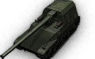
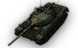
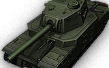
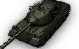

# Japan · Tier X

[All nations and tiers](../buffs_nerfs.md) · EU v20410 → RU v14600ru · 3 November 2026

<label><strong>Find a tank</strong><input type="search" placeholder="Try is7, obj140 or xm57" aria-label="Find a tank" style="display:block;width:100%;padding:.7rem;border:1px solid #888;border-radius:4px;margin:.5rem 0;color:inherit;background:transparent"></label>

Ho-Ri 3 · Tier X

hori3

<a href="https://tanks.gg/v20410/tank/ho-ri-3">EU stats</a> · <a href="https://tanks.gg/v14600ru/tank/ho-ri-3">RU stats</a>
<figure style="display:inline-block"><figcaption>EU · Ho-Ri 3</figcaption></figure><figure style="display:inline-block"><figcaption>RU · Ho-Ri 3</figcaption></figure>
<em>Gun handling</em> 
<strong>Aim time (s)</strong> <small>EU</small> 2.40  <small>RU</small> <strong>2.11</strong> 
<strong>Dispersion (m/100 m)</strong> <small>EU</small> 0.35  <small>RU</small> <strong>0.29</strong> 
<strong>Dispersion · damaged</strong> <small>EU</small> 0.69  <small>RU</small> <strong>0.58</strong> 
<strong>Dispersion · moving</strong> <small>EU</small> 0.14  <small>RU</small> <strong>0.22</strong> 
<strong>Dispersion · tank traverse</strong> <small>EU</small> 0.14  <small>RU</small> <strong>0.22</strong> 

<em>Mobility</em> 
<strong>Reverse speed (km/h)</strong> <small>EU</small> 15  <small>RU</small> <strong>18</strong> 

<em>Armor &amp; health</em> 
<strong>Hull armor · front (mm)</strong> <small>EU</small> 300  <small>RU</small> <strong>250</strong> 
<strong>Health</strong> <small>EU</small> 2 000  <small>RU</small> <strong>1 800</strong> 
<strong>Health · engine</strong> <small>EU</small> 345  <small>RU</small> <strong>360</strong> 
<strong>Track repair time (s)</strong> <small>EU</small> 11.79  <small>RU</small> <strong>12.03</strong> 

<em>Miscellaneous</em> 
<strong>View range (m)</strong> <small>EU</small> 380  <small>RU</small> <strong>400</strong> 

STB-1 · Tier X

stb1

<a href="https://tanks.gg/v20410/tank/stb-1">EU stats</a> · <a href="https://tanks.gg/v14600ru/tank/stb-1">RU stats</a>
<figure style="display:inline-block"><figcaption>STB-1</figcaption></figure>
<em>Gun handling</em> 
<strong>Dispersion · turret traverse</strong> <small>EU</small> 0.08  <small>RU</small> <strong>0.11</strong> 

<em>Mobility</em> 
<strong>Tank traverse (°/s)</strong> <small>EU</small> 59.45  <small>RU</small> <strong>54.24</strong> 
<strong>Tank traverse on hard terrain (°/s)</strong> <small>EU</small> 56.48  <small>RU</small> <strong>51.52</strong> 
<strong>Tank traverse on medium terrain (°/s)</strong> <small>EU</small> 51.34  <small>RU</small> <strong>46.84</strong> 
<strong>Tank traverse on soft terrain (°/s)</strong> <small>EU</small> 25.67  <small>RU</small> <strong>23.42</strong> 

Alternate mode

<a href="https://tanks.gg/v20410/tank/stb-1-siege">EU stats</a> · <a href="https://tanks.gg/v14600ru/tank/stb-1-siege">RU stats</a>
<em>Gun handling</em> 
<strong>Dispersion · turret traverse</strong> <small>EU</small> 0.08  <small>RU</small> <strong>0.11</strong> 

<em>Mobility</em> 
<strong>Tank traverse (°/s)</strong> <small>EU</small> 59.45  <small>RU</small> <strong>54.24</strong> 
<strong>Tank traverse on hard terrain (°/s)</strong> <small>EU</small> 56.48  <small>RU</small> <strong>51.52</strong> 
<strong>Tank traverse on medium terrain (°/s)</strong> <small>EU</small> 51.34  <small>RU</small> <strong>46.84</strong> 
<strong>Tank traverse on soft terrain (°/s)</strong> <small>EU</small> 25.67  <small>RU</small> <strong>23.42</strong> 

Type 5 Heavy · Tier X

type5heavy

<a href="https://tanks.gg/v20410/tank/type-5-h">EU stats</a> · <a href="https://tanks.gg/v14600ru/tank/type-5-h">RU stats</a>
<figure style="display:inline-block"><figcaption>Type 5 Heavy</figcaption></figure>
<strong>Penetration (mm)</strong> <b>EU</b>  AP <strong>257</strong> /  AP <strong>290</strong> /  HE <strong>130</strong> → <b>RU</b>  AP <strong>252</strong> /  AP <strong>295</strong> /  HE <strong>90</strong>

<strong>Damage (HP)</strong> <b>EU</b>  AP <strong>700</strong> /  AP <strong>700</strong> /  HE <strong>1100</strong> → <b>RU</b>  AP <strong>700</strong> /  AP <strong>700</strong> /  HE <strong>900</strong>

<em>Firepower</em> 
<strong>DPM (HP/min)</strong> <small>EU</small> 2 342.57  <small>RU</small> <strong>2 503.20</strong> 
<strong>Rate of fire (rounds/min)</strong> <small>EU</small> 3.35  <small>RU</small> <strong>3.58</strong> 
<strong>Reload time (s)</strong> <small>EU</small> 17.93  <small>RU</small> <strong>16.78</strong> 
<strong>Shell velocity (m/s)</strong> <small>EU</small> 850  <small>RU</small> <strong>900</strong> 

<em>Gun handling</em> 
<strong>Aim time (s)</strong> <small>EU</small> 2.59  <small>RU</small> <strong>2.49</strong> 
<strong>Dispersion (m/100 m)</strong> <small>EU</small> 0.38  <small>RU</small> <strong>0.40</strong> 
<strong>Dispersion · damaged</strong> <small>EU</small> 0.77  <small>RU</small> <strong>0.81</strong> 
<strong>Dispersion · turret traverse</strong> <small>EU</small> 0.14  <small>RU</small> <strong>0.12</strong> 

<em>Mobility</em> 
<strong>Tank traverse on hard terrain (°/s)</strong> <small>EU</small> 20.86  <small>RU</small> <strong>20.71</strong> 
<strong>Tank traverse on medium terrain (°/s)</strong> <small>EU</small> 19.12  <small>RU</small> <strong>18.98</strong> 
<strong>Tank traverse on soft terrain (°/s)</strong> <small>EU</small> 11.47  <small>RU</small> <strong>11.39</strong> 

<em>Armor &amp; health</em> 
<strong>Hull armor · front (mm)</strong> <small>EU</small> 310  <small>RU</small> <strong>330</strong> 
<strong>Turret armor · front (mm)</strong> <small>EU</small> 315  <small>RU</small> <strong>320</strong> 
<strong>Turret armor · rear (mm)</strong> <small>EU</small> 170  <small>RU</small> <strong>200</strong> 

<em>Miscellaneous</em> 
<strong>Shell cost</strong> <small>EU</small> 1 799  <small>RU</small> <strong>1 200</strong> 

Type 71 · Tier X

type71

<a href="https://tanks.gg/v20410/tank/type-71">EU stats</a> · <a href="https://tanks.gg/v14600ru/tank/type-71">RU stats</a>
<figure style="display:inline-block"><figcaption>Type 71</figcaption></figure>
<strong>Penetration (mm)</strong> <b>EU</b>  AP <strong>260</strong> /  APCR <strong>320</strong> /  HE <strong>60</strong> → <b>RU</b>  AP <strong>260</strong> /  HEAT <strong>330</strong> /  HE <strong>60</strong>

<strong>Damage (HP)</strong> <b>EU</b>  AP <strong>430</strong> /  APCR <strong>430</strong> /  HE <strong>520</strong> → <b>RU</b>  AP <strong>420</strong> /  HEAT <strong>420</strong> /  HE <strong>540</strong>

<em>Firepower</em> 
<strong>DPM (HP/min)</strong> <small>EU</small> 2 804.35  <small>RU</small> <strong>2 680.85</strong> 
<strong>Rate of fire (rounds/min)</strong> <small>EU</small> 6.52  <small>RU</small> <strong>6.38</strong> 
<strong>Reload time (s)</strong> <small>EU</small> 9.20  <small>RU</small> <strong>9.40</strong> 
<strong>Shell velocity (m/s)</strong> <small>EU</small> 1 050  <small>RU</small> <strong>1 230</strong> 
<strong>Ammo capacity</strong> <small>EU</small> 45  <small>RU</small> <strong>50</strong> 
<strong>Potential damage</strong> <small>EU</small> 19 350  <small>RU</small> <strong>21 000</strong> 

<em>Gun handling</em> 
<strong>Cooldown delay</strong> <small>EU</small> 11.63  <small>RU</small> <strong>12.01</strong> 
<strong>Dispersion (m/100 m)</strong> <small>EU</small> 0.21  <small>RU</small> <strong>0.27</strong> 
<strong>Dispersion · damaged</strong> <small>EU</small> 0.42  <small>RU</small> <strong>0.54</strong> 
<strong>Dispersion · moving</strong> <small>EU</small> 0.14  <small>RU</small> <strong>0.12</strong> 
<strong>Dispersion · tank traverse</strong> <small>EU</small> 0.14  <small>RU</small> <strong>0.12</strong> 
<strong>Elevation (°)</strong> <small>EU</small> 25  <small>RU</small> <strong>26</strong> 
<strong>Depression (°)</strong> <small>EU</small> 12  <small>RU</small> <strong>15</strong> 

<em>Mobility</em> 
<strong>Forward speed on soft terrain (km/h)</strong> <small>EU</small> 28.96  <small>RU</small> <strong>40</strong> 
<strong>Engine power (hp)</strong> <small>EU</small> 1 050  <small>RU</small> <strong>1 100</strong> 
<strong>Power/weight (hp/t)</strong> <small>EU</small> 17.50  <small>RU</small> <strong>18.33</strong> 
<strong>Terrain resist (hard)</strong> <small>EU</small> 1.05  <small>RU</small> <strong>0.34</strong> 
<strong>Terrain resist (med)</strong> <small>EU</small> 1.25  <small>RU</small> <strong>0.77</strong> 
<strong>Terrain resist (soft)</strong> <small>EU</small> 2.21  <small>RU</small> <strong>1.49</strong> 
<strong>Turret traverse (°/s)</strong> <small>EU</small> 36.50  <small>RU</small> <strong>33.38</strong> 
<strong>Tank traverse on medium terrain (°/s)</strong> <small>EU</small> 25.15  <small>RU</small> <strong>13.13</strong> 
<strong>Tank traverse on soft terrain (°/s)</strong> <small>EU</small> 14.22  <small>RU</small> <strong>6.78</strong> 

<em>Armor &amp; health</em> 
<strong>Hull armor · front (mm)</strong> <small>EU</small> 185  <small>RU</small> <strong>200</strong> 
<strong>Hull armor · side (mm)</strong> <small>EU</small> 70  <small>RU</small> <strong>80</strong> 
<strong>Hull armor · rear (mm)</strong> <small>EU</small> 40  <small>RU</small> <strong>50</strong> 
<strong>Turret armor · front (mm)</strong> <small>EU</small> 300  <small>RU</small> <strong>245</strong> 
<strong>Turret armor · side (mm)</strong> <small>EU</small> 140  <small>RU</small> <strong>160</strong> 
<strong>Turret armor · rear (mm)</strong> <small>EU</small> 50  <small>RU</small> <strong>100</strong> 
<strong>Track armor</strong> <small>EU</small> 20  <small>RU</small> <strong>25</strong> 
<strong>Health</strong> <small>EU</small> 2 200  <small>RU</small> <strong>2 400</strong> 

<em>Miscellaneous</em> 
<strong>Stationary camo</strong> <small>EU</small> 4.45  <small>RU</small> <strong>5.64</strong> 
<strong>Stationary camo · after firing</strong> <small>EU</small> 0.84  <small>RU</small> <strong>1.07</strong> 
<strong>Moving camo</strong> <small>EU</small> 2.22  <small>RU</small> <strong>2.79</strong> 
<strong>Moving camo · after firing</strong> <small>EU</small> 0.42  <small>RU</small> <strong>0.53</strong> 
<strong>Fire chance (%)</strong> <small>EU</small> 10  <small>RU</small> <strong>20</strong> 
<strong>Shell cost</strong> <small>EU</small> 1 140  <small>RU</small> <strong>1 060</strong> 

Alternate mode

<a href="https://tanks.gg/v20410/tank/type-71-siege">EU stats</a> · <a href="https://tanks.gg/v14600ru/tank/type-71-siege">RU stats</a>
<em>Firepower</em> 
<strong>DPM (HP/min)</strong> <small>EU</small> 2 804.35  <small>RU</small> <strong>2 680.85</strong> 
<strong>Rate of fire (rounds/min)</strong> <small>EU</small> 6.52  <small>RU</small> <strong>6.38</strong> 
<strong>Reload time (s)</strong> <small>EU</small> 9.20  <small>RU</small> <strong>9.40</strong> 
<strong>Shell velocity (m/s)</strong> <small>EU</small> 1 050  <small>RU</small> <strong>1 230</strong> 
<strong>Ammo capacity</strong> <small>EU</small> 45  <small>RU</small> <strong>50</strong> 
<strong>Potential damage</strong> <small>EU</small> 19 350  <small>RU</small> <strong>21 000</strong> 

<em>Gun handling</em> 
<strong>Cooldown delay</strong> <small>EU</small> 11.63  <small>RU</small> <strong>12.01</strong> 
<strong>Dispersion (m/100 m)</strong> <small>EU</small> 0.21  <small>RU</small> <strong>0.27</strong> 
<strong>Dispersion · damaged</strong> <small>EU</small> 0.42  <small>RU</small> <strong>0.54</strong> 
<strong>Dispersion · moving</strong> <small>EU</small> 0.14  <small>RU</small> <strong>0.12</strong> 
<strong>Dispersion · tank traverse</strong> <small>EU</small> 0.14  <small>RU</small> <strong>0.12</strong> 
<strong>Elevation (°)</strong> <small>EU</small> 25  <small>RU</small> <strong>26</strong> 
<strong>Depression (°)</strong> <small>EU</small> 12  <small>RU</small> <strong>15</strong> 

<em>Mobility</em> 
<strong>Forward speed on soft terrain (km/h)</strong> <small>EU</small> 28.96  <small>RU</small> <strong>40</strong> 
<strong>Engine power (hp)</strong> <small>EU</small> 1 050  <small>RU</small> <strong>1 100</strong> 
<strong>Power/weight (hp/t)</strong> <small>EU</small> 17.50  <small>RU</small> <strong>18.33</strong> 
<strong>Terrain resist (hard)</strong> <small>EU</small> 1.05  <small>RU</small> <strong>0.34</strong> 
<strong>Terrain resist (med)</strong> <small>EU</small> 1.25  <small>RU</small> <strong>0.77</strong> 
<strong>Terrain resist (soft)</strong> <small>EU</small> 2.21  <small>RU</small> <strong>1.49</strong> 
<strong>Turret traverse (°/s)</strong> <small>EU</small> 36.50  <small>RU</small> <strong>33.38</strong> 
<strong>Tank traverse on medium terrain (°/s)</strong> <small>EU</small> 25.15  <small>RU</small> <strong>13.13</strong> 
<strong>Tank traverse on soft terrain (°/s)</strong> <small>EU</small> 14.22  <small>RU</small> <strong>6.78</strong> 

<em>Armor &amp; health</em> 
<strong>Hull armor · front (mm)</strong> <small>EU</small> 185  <small>RU</small> <strong>200</strong> 
<strong>Hull armor · side (mm)</strong> <small>EU</small> 70  <small>RU</small> <strong>80</strong> 
<strong>Hull armor · rear (mm)</strong> <small>EU</small> 40  <small>RU</small> <strong>50</strong> 
<strong>Turret armor · front (mm)</strong> <small>EU</small> 300  <small>RU</small> <strong>245</strong> 
<strong>Turret armor · side (mm)</strong> <small>EU</small> 140  <small>RU</small> <strong>160</strong> 
<strong>Turret armor · rear (mm)</strong> <small>EU</small> 50  <small>RU</small> <strong>100</strong> 
<strong>Track armor</strong> <small>EU</small> 20  <small>RU</small> <strong>25</strong> 
<strong>Health</strong> <small>EU</small> 2 200  <small>RU</small> <strong>2 400</strong> 

<em>Miscellaneous</em> 
<strong>Stationary camo</strong> <small>EU</small> 4.45  <small>RU</small> <strong>5.64</strong> 
<strong>Stationary camo · after firing</strong> <small>EU</small> 0.84  <small>RU</small> <strong>1.07</strong> 
<strong>Moving camo</strong> <small>EU</small> 2.22  <small>RU</small> <strong>2.79</strong> 
<strong>Moving camo · after firing</strong> <small>EU</small> 0.42  <small>RU</small> <strong>0.53</strong> 
<strong>Fire chance (%)</strong> <small>EU</small> 10  <small>RU</small> <strong>20</strong> 
<strong>Shell cost</strong> <small>EU</small> 1 140  <small>RU</small> <strong>1 060</strong> 

