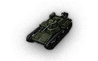
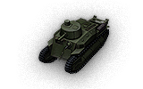
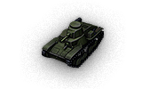
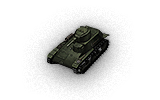

# Japan · Tier II

[All nations and tiers](../buffs_nerfs.md) · EU v20410 → RU v14600ru · 3 November 2026

<label><strong>Find a tank</strong><input type="search" placeholder="Try is7, obj140 or xm57" aria-label="Find a tank" style="display:block;width:100%;padding:.7rem;border:1px solid #888;border-radius:4px;margin:.5rem 0;color:inherit;background:transparent"></label>

Chi-Ni · Tier II

chini

<a href="https://tanks.gg/v20410/tank/chi-ni">EU stats</a> · <a href="https://tanks.gg/v14600ru/tank/chi-ni">RU stats</a>
<figure style="display:inline-block"><figcaption>Chi-Ni</figcaption></figure>
<em>Gun handling</em> 
<strong>Aim time (s)</strong> <small>EU</small> 2.10  <small>RU</small> <strong>1.60</strong> 
<strong>Dispersion (m/100 m)</strong> <small>EU</small> 0.50  <small>RU</small> <strong>0.40</strong> 
<strong>Dispersion · damaged</strong> <small>EU</small> 1  <small>RU</small> <strong>0.80</strong> 
<strong>Dispersion · moving</strong> <small>EU</small> 0.32  <small>RU</small> <strong>0.22</strong> 
<strong>Dispersion · tank traverse</strong> <small>EU</small> 0.32  <small>RU</small> <strong>0.22</strong> 

<em>Armor &amp; health</em> 
<strong>Health</strong> <small>EU</small> 380  <small>RU</small> <strong>460</strong> 
<strong>Track repair time (s)</strong> <small>EU</small> 12.03  <small>RU</small> <strong>3</strong> 

Type 89 I-Go/Chi-Ro · Tier II

type89igochiro

<a href="https://tanks.gg/v20410/tank/i-gochi-ro">EU stats</a> · <a href="https://tanks.gg/v14600ru/tank/i-gochi-ro">RU stats</a>
<figure style="display:inline-block"><figcaption>Type 89 I-Go/Chi-Ro</figcaption></figure>
<em>Gun handling</em> 
<strong>Dispersion · moving</strong> <small>EU</small> 0.28  <small>RU</small> <strong>0.24</strong> 
<strong>Dispersion · tank traverse</strong> <small>EU</small> 0.28  <small>RU</small> <strong>0.24</strong> 

<em>Armor &amp; health</em> 
<strong>Track repair time (s)</strong> <small>EU</small> 12.03  <small>RU</small> <strong>3</strong> 

Type 95 Ha-Go · Tier II

type95hago

<a href="https://tanks.gg/v20410/tank/ha-go">EU stats</a> · <a href="https://tanks.gg/v14600ru/tank/ha-go">RU stats</a>
<figure style="display:inline-block"><figcaption>Type 95 Ha-Go</figcaption></figure>
<strong>Penetration (mm)</strong> <b>EU</b>  AP <strong>60</strong> /  HEAT <strong>95</strong> /  HE <strong>28</strong> → <b>RU</b>  AP <strong>30</strong> /  HEAT <strong>55</strong> /  HE <strong>28</strong>

<em>Firepower</em> 
<strong>DPM (HP/min)</strong> <small>EU</small> 1 000  <small>RU</small> <strong>1 323.53</strong> 
<strong>Rate of fire (rounds/min)</strong> <small>EU</small> 13.33  <small>RU</small> <strong>17.65</strong> 
<strong>Reload time (s)</strong> <small>EU</small> 4.50  <small>RU</small> <strong>3.40</strong> 
<strong>Shell velocity (m/s)</strong> <small>EU</small> 710  <small>RU</small> <strong>355</strong> 

<em>Gun handling</em> 
<strong>Aim time (s)</strong> <small>EU</small> 2.10  <small>RU</small> <strong>1.80</strong> 
<strong>Dispersion (m/100 m)</strong> <small>EU</small> 0.46  <small>RU</small> <strong>0.44</strong> 
<strong>Dispersion · damaged</strong> <small>EU</small> 0.92  <small>RU</small> <strong>0.88</strong> 
<strong>Dispersion · firing</strong> <small>EU</small> 4  <small>RU</small> <strong>1</strong> 

<em>Mobility</em> 
<strong>Forward speed on soft terrain (km/h)</strong> <small>EU</small> 37.29  <small>RU</small> <strong>35.48</strong> 
<strong>Engine power (hp)</strong> <small>EU</small> 150  <small>RU</small> <strong>142.73</strong> 
<strong>Power/weight (hp/t)</strong> <small>EU</small> 18.62  <small>RU</small> <strong>17.71</strong> 
<strong>Tank traverse (°/s)</strong> <small>EU</small> 54.24  <small>RU</small> <strong>45.89</strong> 
<strong>Tank traverse on hard terrain (°/s)</strong> <small>EU</small> 55.34  <small>RU</small> <strong>42.14</strong> 
<strong>Tank traverse on medium terrain (°/s)</strong> <small>EU</small> 44.27  <small>RU</small> <strong>33.72</strong> 
<strong>Tank traverse on soft terrain (°/s)</strong> <small>EU</small> 23.30  <small>RU</small> <strong>17.75</strong> 

<em>Armor &amp; health</em> 
<strong>Health</strong> <small>EU</small> 350  <small>RU</small> <strong>360</strong> 
<strong>Track repair time (s)</strong> <small>EU</small> 12.03  <small>RU</small> <strong>3</strong> 

Type 97 Te-Ke · Tier II

type97teke

<a href="https://tanks.gg/v20410/tank/te-ke">EU stats</a> · <a href="https://tanks.gg/v14600ru/tank/te-ke">RU stats</a>
<figure style="display:inline-block"><figcaption>Type 97 Te-Ke</figcaption></figure>
<em>Gun handling</em> 
<strong>Aim time (s)</strong> <small>EU</small> 2.20  <small>RU</small> <strong>1.60</strong> 
<strong>Dispersion (m/100 m)</strong> <small>EU</small> 0.40  <small>RU</small> <strong>0.38</strong> 
<strong>Dispersion · damaged</strong> <small>EU</small> 0.80  <small>RU</small> <strong>0.76</strong> 
<strong>Dispersion · moving</strong> <small>EU</small> 0.24  <small>RU</small> <strong>0.18</strong> 
<strong>Dispersion · tank traverse</strong> <small>EU</small> 0.24  <small>RU</small> <strong>0.18</strong> 

<em>Armor &amp; health</em> 
<strong>Health</strong> <small>EU</small> 320  <small>RU</small> <strong>360</strong> 
<strong>Track repair time (s)</strong> <small>EU</small> 12.03  <small>RU</small> <strong>3</strong> 

